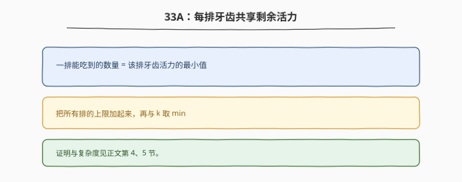
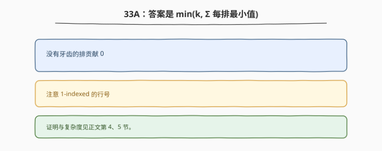

# Codeforces 33A 晚餐能吃什么 题解

## 1. 题目概述

- **题目链接**：https://codeforces.com/problemset/problem/33/A
- **比赛来源**：Codeforces Beta Round 33 (Codeforces format) · Problem A（UTC 2010-10-07）
- **难度**：1200
- **标签**：贪心、实现
- **评测类型**：普通
- **限制**：时间 2 s / 内存 256 MB

**题意**：鲨鱼有 $n$ 颗牙齿分布在 $m$ 排上，第 $i$ 颗的初始活力是 $c_i$。每吃一个食物，会消耗**某一排**中每颗牙齿各 1 点活力，且任何牙齿活力不能为负。求最多能吃多少食物。

**约束**：$n,m\le1000$，$k$ 可达 $10^9$。行号是 1-indexed。

## 2. 示例与观察

官方样例（输入 / 输出原样，共 2 组）：

```text
输入：
4 3 18
2 3
1 2
3 6
2 3
输出：
11
```

```text
输入：
2 2 13
1 13
2 12
输出：
13
```

**样例解释**：样例 1 三排的最小活力分别是 2（排 1）、3（排 2）、6（排 3），合计 11，不超过 $k=18$，答案 11；样例 2 两排合计 $13+12=25$，但 $k=13$，答案 13。

**观察 1（每排独立）**：一排能吃到的食物数只受该排**最小**活力限制——排 $r$ 的上限是 $\min_{i\in r} c_i$。

**观察 2（总量）**：所有排的上限加起来就是总上限，再与 $k$ 取 min。



## 3. 解题思路

### 3.1 朴素做法与瓶颈

如果每轮暴力找一排可吃的，最多 $\min(k,\sum\min)$ 轮，且每轮要扫所有排，复杂度与答案同阶（$k$ 可达 $10^9$），不可行。改成先算每排最小值即可。

### 3.2 算法流程



1. 读入，维护每排的最小活力 `best[r]`；
2. 对没有牙齿的排跳过；
3. 上限 $C=\sum_r best[r]$；
4. 输出 $\min(k,C)$。

### 3.3 样例走查

样例 1：排 2 有 3、3 → 3；排 1 有 2 → 2；排 3 有 6 → 6；$C=11$，$\min(18,11)=11$ ✓。

## 4. 正确性证明

**引理 1**：排 $r$ 最多能被吃 $\min_{i\in r}c_i$ 次。

**证明**：每吃一次该排所有牙齿各减 1，活力最小的那颗先到 0，故次数不超过它的活力；而每次各减 1 也不会让任何牙齿变负，故这个次数可达。∎

**引理 2**：总次数不超过 $\sum_r \min_{i\in r}c_i$，且该上界可达。

**证明**：各排独立消耗；按引理 1 每排恰好吃到上限即得。∎

**定理**：答案为 $\min(k,\sum_r\min c)$。

**证明**：由引理 2 得总量上界；又食物总数不超过 $k$，故答案 $\le\min(k,C)$；取 $\min(k,C)$ 时可先按排依次吃满，恰好达到。∎

## 5. 复杂度分析

- **时间**：$O(n+m)$。
- **空间**：$O(m)$。
- **与时限的关系**：远低于 2 s。

## 6. 参考代码

### C++17

```cpp
#include <bits/stdc++.h>
using namespace std;
int main(){ long long n,m,k; if(!(cin>>n>>m>>k)) return 0;
  vector<long long> best(m+1, LLONG_MAX);
  for(long long i=0;i<n;i++){ long long x,c; cin>>x>>c; best[x]=min(best[x],c); }
  long long cap=0;
  for(int r=1;r<=m;r++) if(best[r]!=LLONG_MAX) cap+=best[r];
  cout<<min(k,cap)<<"\n"; }
```

### Python3

```python
import sys
def main():
    d=list(map(int,sys.stdin.buffer.read().split()))
    n,m,k=d[0],d[1],d[2]
    INF=10**18; best=[INF]*(m+1)
    for i in range(n):
        x,c=d[3+2*i],d[4+2*i]
        if c<best[x]: best[x]=c
    cap=sum(v for v in best[1:] if v<INF)
    print(min(k,cap))
main()
```

## 7. 边界情况与易错点

1. **$k$ 很大**：答案被 $\sum\min$ 截断，别写成 $k$。
2. **没有牙齿的排**：不能贡献上限（初值要设成无穷大并跳过）。
3. **活力为 0**：该排上限为 0，不能吃。
4. **行号 1-indexed**：数组开 $m+1$。
5. **答案超过 int 吗**：$k\le10^9$ 用 `long long` 更稳。

## 8. 验证记录

- **编译环境**：`Apple clang 21.0.0`（`-O2`），Python 3.9.6。
- **官方样例**：2 / 2 通过（11、13）。
- **对拍**：独立"逐轮挑一排吃、直到吃不下"的模拟（小数据）随机 **200 组**（$n\le6$，$m\le4$，$k\le10$），C++ / Python / 暴力一致，**0 处不符**。
- **图片/公式**：两张 SVG 通过检查；KaTeX 无报错。
- **复核状态**：verified。

## 相关题目与扩展

- [Codeforces 33B String Problem](https://codeforces.com/problemset/problem/33/B)：同场 B 题。
- [LeetCode 875. 爱吃香蕉的珂珂](https://leetcode.cn/problems/koko-eating-bananas/)：另一个"消耗速率与上限"的题。

**延伸思考**：

1. **食物有不同"消耗排"**：变成资源分配问题，需要贪心或流。
2. **每吃一次随机消耗**：需要期望计算。
3. **牙齿按排共享但排有容量**：求最大流。
