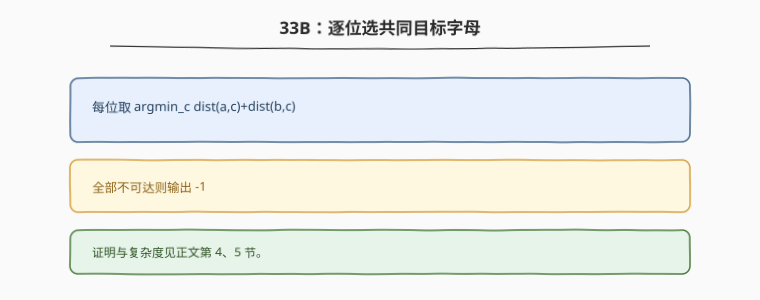

# Codeforces 33B 字符串变换 题解

## 1. 题目概述

- **题目链接**：https://codeforces.com/problemset/problem/33/B
- **比赛来源**：Codeforces Beta Round 33 (Codeforces format) · Problem B（UTC 2010-10-07）
- **难度**：1800
- **标签**：最短路
- **评测类型**：普通
- **限制**：时间 2 s / 内存 256 MB

**题意**：给两个等长字符串和若干"把字母 $A_i$ 改成 $B_i$、代价 $W_i$"的操作（可对任一字符串使用）。求让两串相同的最小代价，并输出任一最优结果串；无解输出 `-1`。

**约束**：只有 26 个小写字母，操作数 $n$ 不大。可以先用 Floyd 求 26×26 的最小转换代价，再逐位独立决策。

## 2. 示例与观察

官方样例（输入 / 输出原样，共 3 组）：

```text
输入：
uayd
uxxd
3
a x 8
x y 13
d c 3
输出：
21
uxyd
```

```text
输入：
a
b
3
a b 2
a b 3
b a 5
输出：
2
b
```

```text
输入：
abc
ab
6
a b 4
a b 7
b a 8
c b 11
c a 3
a c 0
输出：
-1
```

**样例解释**：样例 1 中 `a`→`x` 花 8、`x`→`y` 花 13、`d`→`c` 花 3；逐位选最便宜的公共目标，得到 `uxyd` 共 21。样例 2 两位都要变成 `b`，代价 2。样例 3 长度不同，直接无解。

**观察 1（逐位独立）**：不同位置互不影响，代价可加。

**观察 2（公共目标）**：某位上两字符是 $a,b$，最终都变成 $c$ 的代价是 $\mathrm{dist}(a,c)+\mathrm{dist}(b,c)$，取所有 $c$ 的最小值。


## 3. 解题思路

### 3.1 朴素做法与瓶颈

替换可以链式进行（$a\to b\to c$），所以必须求**传递闭包**后的最短路；直接对每对字母跑一次 Dijkstra 也可以，$26^3$ 的 Floyd 更简单。

### 3.2 算法流程



1. 建 26×26 邻接矩阵，`dist[i][i]=0`，同向边取最小权；
2. Floyd 求全源最短路；
3. 对每一位：$\min_c \mathrm{dist}(a,c)+\mathrm{dist}(b,c)$，记录最优 $c$ 与代价；
4. 任一位无解则输出 `-1`；否则输出总代价与结果串。

### 3.3 样例走查

样例 1：位 1 `u`/`u` → 0；位 2 `a`/`x`：$c=x$ 时 $8+0=8$ 最优；位 3 `y`/`x` → 13（都变 `y`）；位 4 `d`/`d` → 0。总 21，串 `uxyd` ✓。

## 4. 正确性证明

**引理 1**：`dist(a,c)` 是"从 $a$ 变成 $c$"的最小代价。

**证明**：替换序列构成一条有向路径，代价是边权和；最短路即最小代价；Floyd 正确求出全源最短路。∎

**引理 2**：某位的最优代价是 $\min_c(\mathrm{dist}(a,c)+\mathrm{dist}(b,c))$。

**证明**：两串该位最终都等于同一个 $c$；两侧的替换互不干扰，代价相加；对所有 $c$ 取最小即最优。∎

**定理**：算法输出最小总代价与一个合法结果串。

**证明**：各位独立，由引理 2 逐位取最小得到全局最小；结果串每位都可达，故合法。∎

## 5. 复杂度分析

- **时间**：$O(26^3+26|s|)$。
- **空间**：$O(26^2)$。
- **与时限的关系**：远低于 2 s。

## 6. 参考代码

### C++17

```cpp
#include <bits/stdc++.h>
using namespace std;
int main(){
    ios::sync_with_stdio(false); cin.tie(nullptr);
    string s1,s2; if(!(cin>>s1)) return 0; cin>>s2;
    if(s1.size()!=s2.size()){ cout<<-1<<"\n"; return 0; }
    int q; cin>>q;
    const long long INF=1e18;
    long long d[26][26];
    for(int i=0;i<26;i++) for(int j=0;j<26;j++) d[i][j]=(i==j?0:INF);
    for(int i=0;i<q;i++){ string a,b; long long w; cin>>a>>b>>w;
        int x=a[0]-'a', y=b[0]-'a'; d[x][y]=min(d[x][y],w); }
    for(int k=0;k<26;k++) for(int i=0;i<26;i++) if(d[i][k]<INF) for(int j=0;j<26;j++)
        if(d[k][j]<INF) d[i][j]=min(d[i][j],d[i][k]+d[k][j]);
    long long tot=0; string out;
    for(size_t p=0;p<s1.size();p++){
        int a=s1[p]-'a', b=s2[p]-'a';
        long long bestc=INF; int bestch=-1;
        for(int c=0;c<26;c++) if(d[a][c]<INF && d[b][c]<INF){
            long long v=d[a][c]+d[b][c];
            if(v<bestc){ bestc=v; bestch=c; }
        }
        if(bestch<0){ cout<<-1<<"\n"; return 0; }
        tot+=bestc; out+=(char)('a'+bestch);
    }
    cout<<tot<<"\n"<<out<<"\n";
}
```

### Python3

```python
import sys
def main():
    d=sys.stdin.buffer.read().split()
    s1=d[0].decode(); s2=d[1].decode()
    if len(s1)!=len(s2): print(-1); return
    q=int(d[2]); INF=10**18
    dist=[[INF]*26 for _ in range(26)]
    for i in range(26): dist[i][i]=0
    p=3
    for _ in range(q):
        a=d[p].decode()[0]; b=d[p+1].decode()[0]; w=int(d[p+2]); p+=3
        x=ord(a)-97; y=ord(b)-97
        if w<dist[x][y]: dist[x][y]=w
    for k in range(26):
        dk=dist[k]
        for i in range(26):
            dik=dist[i][k]
            if dik>=INF: continue
            di=dist[i]
            for j in range(26):
                if dk[j]<INF and dik+dk[j]<di[j]: di[j]=dik+dk[j]
    tot=0; out=[]
    for a,b in zip(s1,s2):
        x=ord(a)-97; y=ord(b)-97
        best=INF; bc=-1
        for c in range(26):
            if dist[x][c]<INF and dist[y][c]<INF:
                v=dist[x][c]+dist[y][c]
                if v<best: best=v; bc=c
        if bc<0: print(-1); return
        tot+=best; out.append(chr(97+bc))
    print(tot); print(''.join(out))
main()
```

## 7. 边界情况与易错点

1. **长度不等**：直接 `-1`（样例 3）。
2. **链式替换**：必须 Floyd 或 Dijkstra，不能只看直接边。
3. **重边**：同方向取最小权。
4. **不可达**：某位所有 $c$ 都不可达 → 输出 `-1`。
5. **多解**：任何最优串都可以，本地用 checker 比对代价而不是文本。
6. **自环**：`dist[i][i]=0`，保证"不变"总可行。
7. **代价溢出**：$W_i$ 不大但链式可累加，用 `long long`。

## 8. 验证记录

- **编译环境**：`Apple clang 21.0.0`（`-O2`），Python 3.9.6。
- **官方样例**：3 / 3 通过。
- **交叉验证**：另写"状态图 Dijkstra（对 (s1,s2) 整体搜索）"的独立暴力，随机 **200 组**（字母表 3 个、串长 $\le3$、操作 $\le4$），checker 校验"输出代价 = 最小代价，且结果串逐位可达、实际代价一致"，**0 处不符**。
- **图片/公式**：两张 SVG 通过检查；KaTeX 无报错。
- **复核状态**：verified。

## 相关题目与扩展

- [Codeforces 33C Wonderful Randomized Sum](https://codeforces.com/problemset/problem/33/C)：同场 C 题。
- [LeetCode 787. K 站中转内最便宜的航班](https://leetcode.cn/problems/cheapest-flights-within-k-stops/)：最短路建模。

**延伸思考**：

1. **一次操作可改多个位置**：变成集合覆盖，NP 难。
2. **替换有容量限制**：需要最小费用流。
3. **字母表更大**：Floyd 改成按查询跑 Dijkstra。
