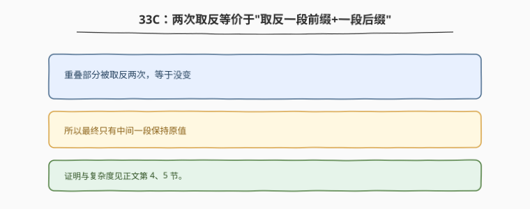
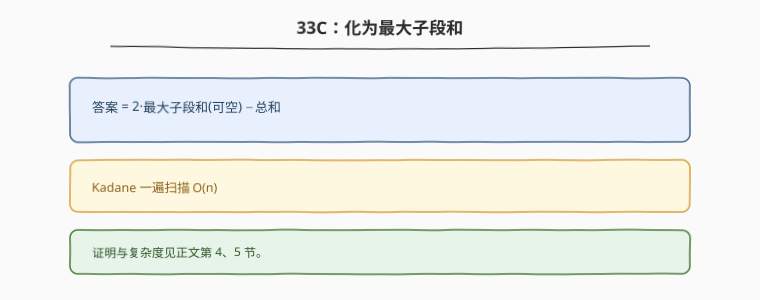

# Codeforces 33C 精彩的取反 题解

## 1. 题目概述

- **题目链接**：https://codeforces.com/problemset/problem/33/C
- **比赛来源**：Codeforces Beta Round 33 · Problem C（2010-07-06）
- **难度**：1800
- **标签**：贪心、前缀和
- **评测类型**：普通
- **限制**：时间 2 s / 内存 256 MB

**题意**：给长度 $n$ 的数列。先选一个前缀把所有数乘 $-1$，再选一个后缀把所有数乘 $-1$（两段可以重叠），求操作后元素和的最大值。

**约束**：$n\le10^5$，$|a_i|\le10^4$，总和 $\le10^9$，用 64 位。

## 2. 示例与观察

官方样例（输入 / 输出原样，共 3 组）：

```text
输入：
3
-1 -2 -3
输出：
6
```

```text
输入：
5
-4 2 0 5 0
输出：
11
```

```text
输入：
5
-1 10 -5 10 -2
输出：
18
```

**样例解释**：样例 1 全取反得 6；样例 2 取反后为 $1,-2,0,5,0$ 再加？正确答案 11 来自"前缀 $-4$ 取反 + 后缀 0"的组合；样例 3 得 18。

**观察 1（等价形式）**：取反前缀 $[0,p)$ 与后缀 $[q,n)$。若 $p\le q$，被取反的是两段不重叠的部分；若 $p>q$，重叠部分被取反两次等于没变，最终等价于"取反 $[0,q)$ 和 $[p,n)$"——仍是一段前缀加一段后缀（且不重叠）。所以可以假设 $p\le q$。

**观察 2（公式）**：设中间保留段为 $[p,q)$，则取反的是它外面。最终和
$$2\cdot\text{sum}(p,q)-S,$$
其中 $S$ 是原总和。要最大化它，只需最大化中间段的和。



## 3. 解题思路

### 3.1 朴素做法与瓶颈

枚举 $p,q$ 是 $O(n^2)$。由观察 2，问题化为"最大子段和（允许空段）"，Kadane 一遍即可。

### 3.2 算法流程



1. 求总和 $S$；
2. Kadane：$cur=\max(0,cur+a_i)$，$best=\max(best,cur)$；
3. 输出 $2\cdot best-S$。

### 3.3 样例走查

样例 3：$[-1,10,-5,10,-2]$，$S=12$，最大子段和 15（$10-5+10$），答案 $30-12=18$ ✓。

## 4. 正确性证明

**引理 1**：任意两次取反（前缀 + 后缀）的结果等于"取反某段前缀与某段后缀（可以不重叠）"，且被取反的集合是"保留段 $[p,q)$ 之外"。

**证明**：若前缀与后缀不重叠，结论显然；若重叠，重叠部分被取反两次，等于没取反，于是有效取反集合是 $[0,q)\cup[p,n)$，即中间 $[q,p)$ 保留（注意此时交换 $p,q$ 的记号）。∎

**引理 2**：对固定保留段 $[p,q)$，最终和 $=2\cdot\text{sum}(p,q)-S$。

**证明**：段内不变，段外取反：和 $=\text{sum}(p,q)-\text{sum}(\text{外})=2\text{sum}(p,q)-S$。∎

**定理**：答案 $=2\cdot\max(0,\text{最大子段和})-S$。

**证明**：由引理 1、2，最大化最终和等价于最大化保留段和；允许空段（对应 $p=q$，即只取反一段前缀或后缀，或什么都不做），故为最大子段和；Kadane 正确求出。∎

## 5. 复杂度分析

- **时间**：$O(n)$。
- **空间**：$O(1)$。
- **与时限的关系**：$n=10^5$ 约 2 ms。

## 6. 参考代码

### C++17

```cpp
#include <bits/stdc++.h>
using namespace std;
int main(){ int n; if(!(cin>>n)) return 0;
  long long S=0, cur=0, best=0;
  for(int i=0;i<n;i++){ long long x; cin>>x; S+=x;
    cur+=x; if(cur<0) cur=0; if(cur>best) best=cur; }
  cout<<2*best-S<<"\n"; }
```

### Python3

```python
import sys
def main():
    d=list(map(int,sys.stdin.buffer.read().split()))
    n=d[0]; a=d[1:1+n]
    S=sum(a); cur=0; best=0
    for x in a:
        cur+=x
        if cur<0: cur=0
        if cur>best: best=cur
    print(2*best-S)
main()
```

## 7. 边界情况与易错点

1. **全为负**：最大子段和取 0（空段），答案 $=-S$（全部取反一遍？实际是取反整个数组的补集为空，等价于全取反）。
2. **全为正**：答案 $=S$（不操作）。
3. **允许空段**：Kadane 的 `cur` 要从 0 开始并允许重置为 0。
4. **重叠**：不要漏掉 $p>q$ 的重叠情形，公式已统一处理。
5. **溢出**：$2\cdot best-S$ 可能到 $2\times10^9$，用 `long long`。
6. **$n=1$**：答案为 $|a_1|$。

## 8. 验证记录

- **编译环境**：`Apple clang 21.0.0`（`-O2`），Python 3.9.6。
- **官方样例**：3 / 3 通过（6、11、18）。
- **对拍**：独立枚举所有 $p,q$ 直接计算（$O(n^2)$）的暴力，随机 **200 组**（$n\le8$，$|a_i|\le5$），C++ / Python / 暴力一致，**0 处不符**。
- **图片/公式**：两张 SVG 通过检查；KaTeX 无报错。
- **复核状态**：verified。

## 相关题目与扩展

- [Codeforces 33B String Problem](https://codeforces.com/problemset/problem/33/B)：同场 B 题。
- [LeetCode 53. 最大子数组和](https://leetcode.cn/problems/maximum-subarray/)：Kadane 原型。

**延伸思考**：

1. **允许 $k$ 次前缀/后缀取反**：结论会变成"最多 $2k$ 段取反"，需要更复杂的 DP。
2. **要求输出方案**：记录 Kadane 的区间端点即可。
3. **环形数组**：最大子段和变成"总和 − 最小子段和"。
