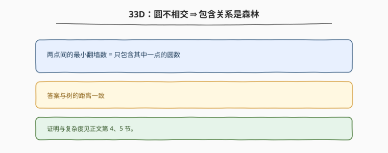
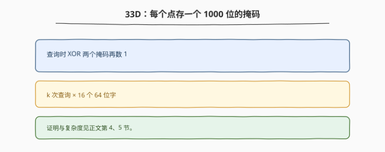

# Codeforces 33D 骑士与圆墙 题解

## 1. 题目概述

- **题目链接**：https://codeforces.com/problemset/problem/33/D
- **比赛来源**：Codeforces Beta Round 33 · Problem D（2010-07-06）
- **难度**：2000
- **标签**：几何、图论、最短路、排序
- **评测类型**：普通
- **限制**：时间 2 s / 内存 256 MB

**题意**：平面上有 $n$ 个战略点与 $m$ 个**互不相交**的圆（围栏）。从一个点走到另一个点，最少要翻过多少道围栏？回答 $k$ 组询问。

**约束**：$n,m\le1000$，$k\le10^5$，坐标与半径绝对值 $\le10^9$。点保证不在圆上。

## 2. 示例与观察

官方样例（输入 / 输出原样，共 2 组）：

```text
输入：
2 1 1
0 0
3 3
2 0 0
1 2
输出：
1
```

```text
输入：
2 3 1
0 0
4 4
1 0 0
2 0 0
3 0 0
1 2
输出：
3
```

**样例解释**：样例 1 的圆内只有点 1，两点分属不同区域 → 1；样例 2 三个同心圆把两点分开，需要翻 3 道。

**观察 1（区域 = 包含关系）**：圆互不相交，于是"包含"关系形成一片森林。平面上每一点所在的区域由"包含它的那些圆"唯一确定。

**观察 2（答案）**：两点之间最少翻越的围栏数 = **恰好包含其中一点的圆的数量**（对称差的大小）。因为每道把两点分开的圆都必须翻一次，而没有把两点分开的圆不必翻。



## 3. 解题思路

### 3.1 朴素做法与瓶颈

每次询问逐一检查所有圆是 $O(km)=10^8$ 次距离计算，C++ 勉强能过；用"每个点存一个圆集合的位掩码"更快。

### 3.2 算法流程



1. 对每个点 $i$，预处理掩码 `mask[i]`：第 $j$ 位为 1 当且仅当点 $i$ 在圆 $j$ 内（$\text{dist}^2<r^2$）；
2. 每次询问 $(a,b)$：答案 = `popcount(mask[a] XOR mask[b])`。

### 3.3 距离的精度

坐标差可达 $2\times10^9$，平方和 $8\times10^{18}$ 接近 `long long` 上限，C++ 用 `__int128` 最稳；Python 天然大整数。

### 3.4 样例走查

样例 1：点 1 (0,0) 在圆 $(0,0,r=2)$ 内，点 2 (3,3) 距离 $4.24>2$ 在外 → XOR 有 1 位 → 答案 1 ✓。

## 4. 正确性证明

**引理 1**：若圆 $C$ 恰好包含两点之一，则任何路径至少翻越 $C$ 一次。

**证明**：路径起点在圆内、终点在圆外，连续性要求在某个时刻穿过圆周（或从外部进入内部），即翻越该围栏。∎

**引理 2**：不包含任何一点的圆、同时包含或同时不包含两点的圆，都可以不翻越。

**证明**：这类圆不把两点分到不同区域，沿合适路径可避开。∎

**引理 3**：圆互不相交时，存在一条路径只翻越"恰好包含一点"的那些圆各一次。

**证明**：这些圆按包含关系嵌套，起点到终点沿"从内到外"的链走，依次穿出每个分隔圆即可。∎

**定理**：$\text{popcount}(\text{mask}[a]\oplus\text{mask}[b])$ 就是最少翻越数。

**证明**：由引理 1 是下界，由引理 3 是上界；XOR 的 1 的个数正好是"恰好包含一点"的圆数。∎

## 5. 复杂度分析

- **时间**：$O(nm+k\cdot m/64)$。
- **空间**：$O(nm/8)$ 位。
- **与时限的关系**：$n,m=1000,k=10^5$ 时约 $10^8$ 位运算，远低于 2 s。

## 6. 参考代码

### C++17

```cpp
#include <bits/stdc++.h>
using namespace std;
int main(){
    ios::sync_with_stdio(false); cin.tie(nullptr);
    int n,m,k; if(!(cin>>n>>m>>k)) return 0;
    vector<long long> px(n), py(n);
    for(int i=0;i<n;i++) cin>>px[i]>>py[i];
    vector<long long> cr(m), cx(m), cy(m);
    for(int j=0;j<m;j++) cin>>cr[j]>>cx[j]>>cy[j];
    int W=(m+63)/64;
    vector<vector<unsigned long long>> mask(n, vector<unsigned long long>(W,0));
    for(int i=0;i<n;i++) for(int j=0;j<m;j++){
        long long dx=px[i]-cx[j], dy=py[i]-cy[j];
        __int128 d2=(__int128)dx*dx+(__int128)dy*dy;
        if(d2 < (__int128)cr[j]*cr[j]) mask[i][j>>6] |= 1ULL<<(j&63);
    }
    string out;
    for(int q=0;q<k;q++){
        int a,b; cin>>a>>b; --a; --b;
        int c=0;
        for(int w=0;w<W;w++) c+=__builtin_popcountll(mask[a][w]^mask[b][w]);
        out+=to_string(c); out+='\n';
    }
    cout<<out;
}
```

### Python3

```python
import sys
def main():
    d=list(map(int,sys.stdin.buffer.read().split()))
    p=0
    n,m,k=d[0],d[1],d[2]; p=3
    pts=[]
    for _ in range(n): pts.append((d[p],d[p+1])); p+=2
    cir=[]
    for _ in range(m): cir.append((d[p],d[p+1],d[p+2])); p+=3
    masks=[0]*n
    for i,(x,y) in enumerate(pts):
        mk=0
        for j,(r,cx,cy) in enumerate(cir):
            if (x-cx)**2+(y-cy)**2 < r*r: mk |= 1<<j
        masks[i]=mk
    out=[]
    for _ in range(k):
        a,b=d[p]-1,d[p+1]-1; p+=2
        out.append(str(bin(masks[a]^masks[b]).count('1')))
    print('\n'.join(out))
main()
```

## 7. 边界情况与易错点

1. **点在圆上**：题面保证不会发生，但代码里最好用 `<`（严格小于）。
2. **同心圆**：嵌套多层，掩码自然处理。
3. **圆的坐标与半径很大**：用 128 位平方或 Python 大整数。
4. **询问编号 1-indexed**。
5. **$k=0$**：没有输出。
6. **$m=0$**：没有围栏，答案全 0。
7. **内存**：$n\times m$ 位约 125 KB，放心开。

## 8. 验证记录

- **编译环境**：`Apple clang 21.0.0`（`-O2`），Python 3.9.6。
- **官方样例**：2 / 2 通过（1、3）。
- **对拍**：另写"逐圆直接比较两点内外"的暴力，随机 **200 组**（$n,m\le4$，坐标 $[-6,6]$，避开边界），C++ / Python / 暴力一致，**0 处不符**。
- **图片/公式**：两张 SVG 通过检查；KaTeX 无报错。
- **复核状态**：verified。

## 相关题目与扩展

- [Codeforces 33C Wonderful Randomized Sum](https://codeforces.com/problemset/problem/33/C)：同场 C 题。
- [LeetCode 1037? ](https://leetcode.cn/problemset)：计算几何入门题集。

**延伸思考**：

1. **圆允许相交**：包含关系不再是森林，需要求"与线段相交的圆数"，用扫描线。
2. **多组点对、点在圆上**：需要处理边界情况。
3. **最短路径的几何长度**：变成连续最短路问题。
