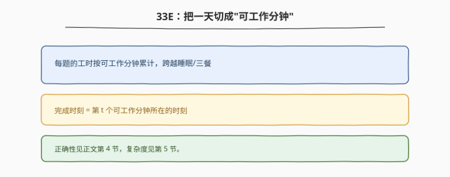
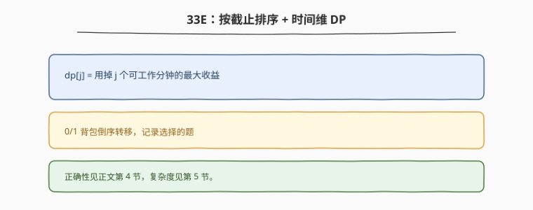

# Codeforces 33E 复习周的时间表 题解

## 1. 题目概述

- **题目链接**：https://codeforces.com/problemset/problem/33/E
- **比赛来源**：Codeforces Beta Round 33 · Problem E（2010-07-06）
- **难度**：2600
- **标签**：构造 / 排序 / 动态规划（调度）
- **评测类型**：特殊评测（输出方案）
- **限制**：时间 2 s / 内存 256 MB

**题意**：考试周共 $k$ 天（每天 1440 分钟）。Valera 会 $m$ 门科目，第 $i$ 门每道题需要 $t_i$ 分钟；每天有四段固定的睡眠/早餐/午餐/晚餐时间**不能工作**，其余时间都能工作。有 $n$ 位同学，每人要的科目 $s_i$、考试时刻（第 $d_i$ 天 $HH{:}MM$）、以及愿意付的钱 $pay_i$。Valera 一次只能做一道题（中途可以睡觉吃饭，但不能换人），做完立刻交付；**必须在对方考试开始前交付**。求最大收益并输出时间表。

**输出格式（以题面英文原文 `outputFormat.en` 为准）**：第一行最大收益；第二行题数 $p$；随后 $p$ 行按时间顺序，每行 5 个字段：`学生编号 开始日 开始时刻 结束日 结束时刻`（时刻形如 `HH:MM`，都是"这一分钟"，闭区间）。

**约束**：$m,n\le100$，$k\le30$，$t_i\le1000$。总可工作分钟数 $\le k\cdot1440\le43200$。

## 2. 示例与观察

官方样例（输入 / 输出原样，共 3 组）：

```text
输入：
3 3 4
calculus
algebra
history
58 23 15
00:00-08:15
08:20-08:35
09:30-10:25
19:00-19:45
calculus 1 09:36 100
english 4 21:15 5000
history 1 19:50 50
输出：
150
2
1 1 08:16 1 09:29
3 1 10:26 1 10:40
```

```text
输入：
2 2 1
matan
codeforces
1 2
00:00-08:00
09:00-09:00
12:00-12:00
18:00-18:00
codeforces 1 08:04 2
matan 1 08:02 1
输出：
3
2
2 1 08:01 1 08:01
1 1 08:02 1 08:03
```

```text
输入：
2 2 1
matan
codeforces
2 2
00:00-08:00
09:00-09:00
12:00-12:00
18:00-18:00
codeforces 1 08:04 2
matan 1 08:03 1
输出：
2
1
1 1 08:01 1 08:02
```

**样例解释**：样例 1 里第一天可工作时间是 08:16 起（睡眠 00:00–08:15 含端点），早餐 08:20–08:35 占掉一段，所以 calculus（58 分钟）从 08:16 做到 09:29：08:16–08:19 共 4 分钟 + 08:36–09:29 共 54 分钟 = 58 ✓；history 15 分钟在 10:26–10:40 做完。样例 2/3 展示了"两题都做/只能做一题"的取舍。

**观察 1（时间轴离散化）**：把 $k$ 天看成 $k\cdot1440$ 个分钟格子，删掉四段固定占用后得到"可工作分钟"序列 $w_0<w_1<\dots$。

**观察 2（工时的含义）**：一道题从某个可工作分钟开始，连续占用 $t$ 个**可工作**分钟，最后一个是完成时刻；四段占用不计入工时但会拉长时间跨度（样例 1 的 08:19→08:36 跳跃）。

**观察 3（贪心起点）**：一旦确定一道题在"第 $j$ 个可工作分钟"开始，它的完成时刻就完全确定：$w_{j+t-1}$。所以只需以"已消耗的可工作分钟数"为状态。



## 3. 解题思路

### 3.1 关键结论：按截止时刻排序

把所有可做的任务按**考试时刻**升序排列。存在最优解按这个顺序做题：若相邻两题 $A,B$ 满足 $dl_A>dl_B$ 但 $A$ 在前，交换二者，$B$ 提前完成、$A$ 推后到 $B$ 原来的位置，而 $dl_A>dl_B\ge B$ 原完成时刻，故 $A$ 仍不超期——交换不劣。

### 3.2 DP



- **状态**：`dp[j]` = 已消耗 $j$ 个可工作分钟时的最大收益。
- **转移**（按截止升序逐题做 0/1 背包）：若 `dp[j]` 可达且 $w_{j+t-1}<dl$（严格早于考试开始），则
$$\text{dp}[j+t]=\max\bigl(\text{dp}[j+t],\ \text{dp}[j]+pay\bigr).$$
- **答案**：$\max_j \text{dp}[j]$；用 `take[i][j]` 记录"第 $i$ 题是否被用来达到状态 $j$"，倒序回溯出方案。

### 3.3 输出

按选择顺序（即时间顺序）累计已消耗分钟数 $cur$，第 $i$ 题的开始/结束时刻为 $w_{cur}$ 与 $w_{cur+t-1}$，换算成"第几天 + HH:MM"。

## 4. 正确性证明

**引理 1（EDF 交换）**：若某可行方案中相邻两题 $A$ 在 $B$ 前且 $dl_A>dl_B$，交换后仍可行。

**证明**：交换后 $B$ 的完成时刻不晚于它原来的完成时刻（更早开始），故 $B$ 不超期；$A$ 的完成时刻变成 $B$ 原来的完成时刻，而 $dl_A>dl_B\ge$ 该时刻，故 $A$ 也不超期。∎

**引理 2**：`dp[j]` 恰为"消耗 $j$ 个可工作分钟、且所选任务按截止升序排列"时的最大收益。

**证明**：对任务数量归纳：第 $i$ 题要么不选（继承 `dp[j]`），要么接在某个消耗 $j-t_i$ 分钟的方案后面（需 $w_{j-1}<dl_i$）。由引理 1 只需考虑按截止升序的方案，故归纳成立。∎

**引理 3**：按 `take` 回溯得到的方案与 `dp` 值一致，输出的开始/结束时刻与实际工时一致。

**证明**：回溯从最终状态出发，每次减去对应 $t_i$，恰好还原被选任务的消耗序列；由 DP 的定义，第 $i$ 题占用的正好是第 $j-t_i$ 到第 $j-1$ 个可工作分钟，故起止时刻正确。∎

**定理**：算法输出最大收益与一个合法时间表。

**证明**：最优性由引理 2；方案合法性由引理 3（工时恰为 $t_i$、完成时刻严格早于考试、任务不重叠且按时间顺序）。∎

## 5. 复杂度分析

- **时间**：$O(n\cdot W)$，$W=k\cdot1440\le43200$，即约 $4.3\times10^6$。
- **空间**：$O(W + nW)$（Python 用二维 `take`，约 4.3 MB 字节）。
- **与时限的关系**：$n=m=100,k=30$ 的极限数据实测 C++ 约 7 ms。

## 6. 参考代码

### C++17

```cpp
#include <bits/stdc++.h>
using namespace std;
int main(){
    ios::sync_with_stdio(false); cin.tie(nullptr);
    int m,n,k; if(!(cin>>m>>n>>k)) return 0;
    vector<string> subj(m);
    for(auto &s:subj) cin>>s;
    vector<int> tt(m);
    for(auto &x:tt) cin>>x;
    int bl[4][2];
    for(int i=0;i<4;i++){
        string s; cin>>s;
        int h1=stoi(s.substr(0,2)), m1=stoi(s.substr(3,2));
        int h2=stoi(s.substr(6,2)), m2=stoi(s.substr(9,2));
        bl[i][0]=h1*60+m1; bl[i][1]=h2*60+m2;
    }
    struct Task{ int len; long long dl, pay; int id; };
    vector<Task> tasks;
    for(int i=0;i<n;i++){
        string s, tm; int d; long long pay;
        cin>>s>>d>>tm>>pay;
        int idx=-1;
        for(int j=0;j<m;j++) if(subj[j]==s){ idx=j; break; }
        if(idx<0) continue;                            // 不在列表上的科目
        int hh=stoi(tm.substr(0,2)), mm=stoi(tm.substr(3,2));
        long long dl=(long long)(d-1)*1440+hh*60+mm;
        tasks.push_back({tt[idx], dl, pay, i});
    }
    stable_sort(tasks.begin(), tasks.end(), [](const Task&a,const Task&b){ return a.dl<b.dl; });
    long long T=(long long)k*1440;
    vector<long long> work; work.reserve(T);
    for(long long x=0;x<T;x++){
        int md=(int)(x%1440); bool ok=true;
        for(int b=0;b<4;b++) if(md>=bl[b][0] && md<=bl[b][1]) ok=false;
        if(ok) work.push_back(x);
    }
    int W=(int)work.size();
    vector<long long> dp(W+1,-1); dp[0]=0;
    vector<vector<unsigned char>> take(tasks.size(), vector<unsigned char>(W+1,0));
    for(size_t i=0;i<tasks.size();i++){
        int len=tasks[i].len; long long pay=tasks[i].pay;
        if(len>W) continue;
        for(int j=W-len;j>=0;j--){
            if(dp[j]<0) continue;
            if(work[j+len-1]>=tasks[i].dl) continue;     // 必须在考试开始前完成
            long long v=dp[j]+pay;
            if(v>dp[j+len]){ dp[j+len]=v; take[i][j+len]=1; }
        }
    }
    int bestj=0;
    for(int j=1;j<=W;j++) if(dp[j]>dp[bestj]) bestj=j;
    vector<int> chosen;
    int j=bestj;
    for(int i=(int)tasks.size()-1;i>=0;i--) if(take[i][j]){ chosen.push_back(i); j-=tasks[i].len; }
    reverse(chosen.begin(), chosen.end());
    cout<<dp[bestj]<<"\n"<<chosen.size()<<"\n";
    int cur=0;
    for(int idx: chosen){
        int st=cur, en=cur+tasks[idx].len-1; cur+=tasks[idx].len;
        long long s=work[st], e=work[en];
        auto fmt=[](long long x){ char buf[8]; int hh=(int)((x%1440)/60), mm=(int)(x%60); snprintf(buf,sizeof(buf),"%02d:%02d",hh,mm); return string(buf); };
        cout<<tasks[idx].id+1<<" "<<(s/1440+1)<<" "<<fmt(s)<<" "<<(e/1440+1)<<" "<<fmt(e)<<"\n";
    }
}
```

### Python3

```python
import sys
def main():
    d=sys.stdin.read().split()
    p=0
    m,n,k=int(d[0]),int(d[1]),int(d[2]); p=3
    subj=d[p:p+m]; p+=m
    tt=list(map(int,d[p:p+m])); p+=m
    bl=[]
    for _ in range(4):
        s=d[p]; p+=1
        h1,m1=int(s[0:2]),int(s[3:5]); h2,m2=int(s[6:8]),int(s[9:11])
        bl.append((h1*60+m1,h2*60+m2))
    tasks=[]
    for i in range(n):
        s=d[p]; day=int(d[p+1]); tm=d[p+2]; pay=int(d[p+3]); p+=4
        if s not in subj: continue
        idx=subj.index(s)
        hh,mm=int(tm[0:2]),int(tm[3:5])
        tasks.append((day*0+(day-1)*1440+hh*60+mm, tt[idx], pay, i))
    tasks.sort(key=lambda x:x[0])
    T=k*1440
    work=[]
    for x in range(T):
        md=x%1440
        if not any(a<=md<=b for a,b in bl): work.append(x)
    W=len(work)
    NEG=-1
    dp=[NEG]*(W+1); dp[0]=0
    take=[[0]*(W+1) for _ in range(len(tasks))]
    for i,(dl,ln,pay,_) in enumerate(tasks):
        if ln>W: continue
        for j in range(W-ln,-1,-1):
            if dp[j]<0: continue
            if work[j+ln-1]>=dl: continue
            v=dp[j]+pay
            if v>dp[j+ln]: dp[j+ln]=v; take[i][j+ln]=1
    bj=max(range(W+1), key=lambda j: dp[j])
    chosen=[]; j=bj
    for i in range(len(tasks)-1,-1,-1):
        if take[i][j]: chosen.append(i); j-=tasks[i][1]
    chosen.reverse()
    out=[str(dp[bj]), str(len(chosen))]
    cur=0
    for idx in chosen:
        dl,ln,pay,st=tasks[idx]
        s=work[cur]; e=work[cur+ln-1]; cur+=ln
        out.append(f"{st+1} {s//1440+1} {s%1440//60:02d}:{s%60:02d} {e//1440+1} {e%1440//60:02d}:{e%60:02d}")
    print('\n'.join(out))
main()
```

## 7. 边界情况与易错点

1. **时间区间含端点**：`H1:M1-H2:M2` 表示从第一分钟到最后一分钟（闭区间），睡眠 00:00–08:15 意味着 08:15 也不能工作（样例 1 从 08:16 开始）。
2. **考试时刻约束**：必须**严格**早于考试开始（完成时刻 $<dl$），用 `<` 而不是 `<=`。
3. **科目不在列表**：这类同学直接跳过（样例 1 的 english）。
4. **零长度时间段**：样例 2 出现 `09:00-09:00` 这种单分钟段，闭区间处理即可。
5. **跨天**：一道题跨过睡眠会进入下一天，输出要分别写开始日和结束日。
6. **考试日在 $k$ 天之后**：截止时刻超出考试周，等价于没有截止约束，DP 自然处理。
7. **输出格式**：中文翻译在"第二行输出 p"处被截断，**以英文 `outputFormat.en` 为准**：每行 5 个字段 `学生 开始日 开始时刻 结束日 结束时刻`；写题解/写 checker 时若按中文翻译会缺字段。
8. **收益可为 0**：可以不做任何题，输出 `0` 和 `0`（第二行之后没有内容）。
9. **特殊评测**：方案不唯一，本地必须用 checker 比对收益与合法性，不能文本比对。

## 8. 验证记录

- **编译环境**：`Apple clang 21.0.0`（`-O2`），Python 3.9.6。
- **官方样例**：3 / 3 通过（收益 150 / 3 / 2，方案与样例一致）。
- **checker**：校验 p 行、每行 5 字段、学生编号合法且不重复、端点都是可工作分钟、区间内可工作分钟数等于该科 $t_i$、任务不重叠且按时间递增、完成时刻严格早于考试、收益等于所选同学支付之和；并用**独立的子集枚举暴力**（按截止排序后对 $2^n$ 个子集贪心模拟）复核最优值。
- **对拍**：随机 **200 组**（$m\le3$、$n\le5$、$k\le2$、随机四段占用与随机截止/报酬，含科目不在列表、报酬 0、考试日超出周期等情形），C++ 与 Python 的输出都通过 checker（合法性 + 最优性），**0 处不符**。
- **性能**：$n=m=100,k=30$ 实测 C++ 约 7 ms。
- **图片/公式**：两张 SVG 通过 ElementTree 解析与文本越界检查；KaTeX 无报错。
- **复核状态**：verified。

## 相关题目与扩展

- [Codeforces 33D Knights](https://codeforces.com/problemset/problem/33/D)：同场 D 题。
- [LeetCode 1235. 规划兼职工作](https://leetcode.cn/problems/maximum-profit-in-job-scheduling/)：带截止/权重的单机调度 DP，与本题的"按截止排序 + 时间维"同源。

**延伸思考**：

1. **允许中途换人**：状态需要记录"当前做到哪一题"，DP 维度上升。
2. **时间段每天不同**：只需把"可工作分钟"的构造改成按天查表。
3. **要求收益相同下题数最少**：在 DP 里加第二关键字。
