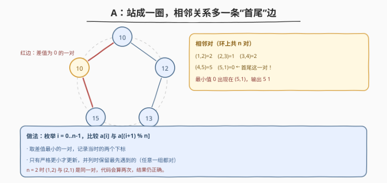
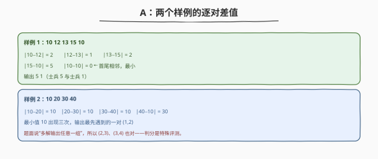

# Codeforces 34A 环形相邻身高差最小 题解

## 1. 题目概述

- **题目链接**：https://codeforces.com/problemset/problem/34/A
- **比赛来源**：Codeforces Beta Round 34 (Div. 2) · Problem A（2010-10-11）
- **难度**：800
- **标签**：实现
- **评测类型**：特殊评测（输出任意一组最优解即可）
- **限制**：时间 2 s / 内存 256 MB

**题意**：$n$ 名士兵站成一个**圆圈**，第 $i$ 名士兵的身高是 $a_i$。侦察小队由**相邻**的两名士兵组成。请找出一对相邻士兵，使他们的身高差 $|a_i-a_j|$ 最小，输出这两个人的编号。

**约束**：

- $2 \le n \le 100$，$1 \le a_i \le 1000$；
- 身高按顺时针或逆时针给出，但这对答案没有影响（相邻关系是对称的）；
- 相邻包括**首尾**：士兵 $n$ 与士兵 $1$ 也相邻；
- 若有多组最优解，输出任意一组（special judge）。

## 2. 示例与观察

官方样例 1（输入 / 输出原样）：

```text
输入：
5
10 12 13 15 10

输出：
5 1
```

官方样例 2（输入 / 输出原样）：

```text
输入：
4
10 20 30 40

输出：
1 2
```

**样例 1 演算**：环上的相邻对一共 5 对：

| 相邻对 | 身高 | 差值 |
|------|------|------|
| $(1,2)$ | $10,12$ | $2$ |
| $(2,3)$ | $12,13$ | $1$ |
| $(3,4)$ | $13,15$ | $2$ |
| $(4,5)$ | $15,10$ | $5$ |
| $(5,1)$ | $10,10$ | $0$ |

最小差值 $0$ 出现在首尾这一对 $(5,1)$，所以输出 `5 1`。**这一对正是最容易被漏掉的**：如果只枚举 $(i,i+1)$ 而忘了 $(n,1)$，本题就会答错。

**样例 2 演算**：四个差值分别是 $10,10,10,30$，最小值 $10$ 出现三次，输出最先遇到的一对 `1 2`；由于 special judge，`2 3`、`3 4` 同样正确。

**观察**：

1. 环上恰好有 $n$ 对相邻士兵：$(1,2),(2,3),\dots,(n-1,n),(n,1)$；
2. 由于 $n$ 只有 100，全部枚举即可，$O(n)$ 就能解决；
3. "输出任意一组"意味着不能靠样例输出"硬编码"，但也不必担心并列——只要差值等于全局最小值即可。

## 3. 解题思路

### 3.1 朴素做法与瓶颈

把 $n$ 对相邻士兵全部枚举一遍：第 $i$ 对是 $(i,\ (i+1)\bmod n)$，取 $|a_i-a_j|$ 最小的一对。$n\le100$，一次线性扫描就够了，没有任何瓶颈。

真正的"坑"只有三个：

- 忘记首尾相邻（用 `(i+1) % n` 就能自然处理）；
- 下标从 0 开始还是从 1 开始（输出要 $1..n$）；
- 并列时输出哪一个（都行，但要保证差值确实是最小值）。

### 3.2 核心观察：把"环"拆成"下标取模"



环上相邻这件事，用取模一句话就能表达：

$$j = (i+1)\bmod n, \qquad i = 0,1,\dots,n-1 .$$

当 $i=n-1$ 时 $j=0$，自动得到首尾这一对。于是"在环上找最小的相邻差"就变成了"在数组上扫一遍找最小差"，代码非常短。

### 3.3 算法流程

1. 读入 $n$ 与 $a_1..a_n$；
2. 初始化最优值为 $|a_1-a_2|$、最优对为 $(1,2)$；
3. 对每个 $i$，取 $j=(i+1)\bmod n$，若 $|a_i-a_j|$ 严格小于当前最优值，则更新；
4. 输出最优对的两个编号（1 起）。

只有"严格小于"才更新，因此并列时会保留最先遇到的那一对——这既保证正确，也与样例 2 的输出一致。

### 3.4 样例走查



- 样例 1：扫描到 $(5,1)$ 时差值 $0$ 刷新最优，输出 `5 1`；
- 样例 2：前三个差值都是 $10$，第一个 $(1,2)$ 被保留，输出 `1 2`。

## 4. 正确性证明

**引理 1（枚举的完备性）**：环上所有相邻对恰好是 $(i,(i+1)\bmod n)$，$i=0,\dots,n-1$。

**证明**：士兵站成一个圆，按给出的顺序（顺时针或逆时针）走一圈，每个人恰好与"前一个人"和"后一个人"相邻。规定"后一个人"是下标加一（对 $n$ 取模），于是 $i$ 的后邻是 $(i+1)\bmod n$，这就枚举了环上全部 $n$ 条相邻边，且每条边恰好被枚举一次（无向边 $\{i,i+1\}$ 在 $i$ 与 $i+1$ 处各出现一次，但作为"有序对"每个 $i$ 只贡献一次）。∎

**引理 2（输出合法）**：算法输出的两个下标互不相同、确实相邻，且身高差等于全部相邻对中的最小值。

**证明**：输出的两个下标是 $i$ 与 $(i+1)\bmod n$。当 $n\ge2$ 时 $i\ne(i+1)\bmod n$（若相等则 $n\mid1$，矛盾），故互不相同；由引理 1 它们相邻。算法只在新差值严格小于当前最优时才更新，因此结束时记录的值是遍历过程中的最小值，即全局最小值。∎

**定理**：算法输出的是合法答案；且当且仅当存在相邻对时（必然存在，因为 $n\ge2$）总能输出。

**证明**：由引理 2 输出合法。由于 $n\ge2$，环上至少有一对相邻士兵，枚举非空，最优值必然被赋值，所以不会出现"没有输出"的情况。∎

## 5. 复杂度分析

- **时间**：$O(n)$，一次线性扫描，$n\le100$ 时约 100 次减法。
- **空间**：$O(n)$（也可以边读边处理，做到 $O(1)$ 额外空间）。
- **与时限的关系**：2 s 的时限下实测端到端约 2 ms（几乎全是进程启动），余量在数百倍以上。

## 6. 参考代码

### C++17

```cpp
#include <bits/stdc++.h>
using namespace std;

int main() {
    int n;
    if (scanf("%d", &n) != 1) return 0;
    vector<int> a(n);
    for (auto &x : a) scanf("%d", &x);

    // 环形：第 i 个人与第 (i+1)%n 个人相邻；找身高差最小的一对
    int bestI = 0, bestJ = 1 % n;
    int best = abs(a[0] - a[bestJ]);
    for (int i = 0; i < n; ++i) {
        int j = (i + 1) % n;
        int d = abs(a[i] - a[j]);
        if (d < best) {
            best = d;
            bestI = i;
            bestJ = j;
        }
    }
    printf("%d %d\n", bestI + 1, bestJ + 1);
    return 0;
}
```

### Python3

```python
import sys


def main() -> None:
    data = sys.stdin.read().split()
    n = int(data[0])
    a = [int(x) for x in data[1:1 + n]]

    best_i, best_j = 0, 1 % n
    best = abs(a[0] - a[best_j])
    for i in range(n):
        j = (i + 1) % n                     # 环形相邻
        d = abs(a[i] - a[j])
        if d < best:
            best, best_i, best_j = d, i, j
    sys.stdout.write(f"{best_i + 1} {best_j + 1}\n")


main()
```

两份代码都只用标准库，可原样提交（本题是 special judge，任意一组最优解都算通过）。

## 7. 边界情况与易错点

1. **首尾相邻**：$(n,1)$ 这一对必须检查，否则样例 1 会输出 `2 3`（差值 1）而错过真正的 0。用 `(i+1)%n` 一行解决。
2. **$n=2$**：环上只有两个人，$(1,2)$ 和 $(2,1)$ 是同一对；取模后 $i=1$ 时 $j=0$，会输出 `2 1`，同样合法。
3. **并列最小**：例如 `1 2 3 4` 的差值 $1,1,1,3$，输出任意一个都行；但**不要**输出差值更大的对。
4. **身高完全一样**：`5 5 5` 的差值全是 0，输出 `1 2` 即可。
5. **输出格式**：两个整数、空格分隔、1 起下标；不要输出差值本身。
6. **身高顺序（正/逆时针）**：题面说身高可能按顺时针或逆时针给出，但这不影响答案——相邻关系与方向无关。
7. **只用一个循环变量**：注意 `best` 初值要用第一对，否则当所有差值都很大时会保留一个未初始化的值。

## 8. 验证记录

- **编译环境与命令**：本机只有 `Apple clang 21.0.0`（`/usr/bin/g++` 是 clang 软链），没有 GNU `g++`，因此用 `clang++ -std=c++17 -O2 -Wall -I codeforces/tools/include` 搭配本地 `bits/stdc++.h` 兼容头编译（代码只用标准库，可原样提交 GNU C++17）。Python 为 `Python 3.9.6`。
- **官方样例**：2 / 2 通过（`5 1`、`1 2`），并与 JSON 的 `out` 一致。
- **checker**（`/tmp/cf_verify_34_A/checker.py`，配合 `verify_solution.py --checker`）：校验输出是两个在 $[1,n]$ 内的下标、在环上相邻、且差值等于暴力求出的全局最小值。对错误答案（如样例 1 输出 `1 2`）会拒绝。
- **随机对拍**：随机生成 **300 组**输入（$n\in[2,100]$，身高值域分别取 $1..3$、$1..10$、$1..1000$，刻意制造大量并列最小值），C++ 与 Python 的输出**都交给 checker 校验**，`300/300` 通过。
- **最大约束性能**：$n=100$，C++ 端到端约 2 ms，Python 约 16 ms，内存 < 2 MB。
- **图片校验**：两张 SVG（`cf34a_circle.svg`、`cf34a_walkthrough.svg`）均通过 `xml.etree.ElementTree.parse`；用脚本估算每个 `text` 的包围盒，确认不越出 viewBox、文字互不重叠；并用 headless Chrome 渲染 PNG 后检查画布四边无墨迹（无裁切）。
- **公式校验**：公式均为 `$...$` 形式，星号直接写 `*`，`\text{}` 内无裸 `#`，KaTeX（`throwOnError`）渲染无报错。
- **复核状态**：verified（样例 + checker、随机对拍、性能、图片、公式均实跑通过；唯一环境差异是本机无 GNU g++，已用 clang++ 等价验证）。

## 相关题目与扩展

- [Codeforces 34B Sale](https://codeforces.com/problemset/problem/34/B)、[34C Page Numbers](https://codeforces.com/problemset/problem/34/C)、[34D Road Map](https://codeforces.com/problemset/problem/34/D)、[34E Collisions](https://codeforces.com/problemset/problem/34/E)：同场其余四题。
- [Codeforces 31A Worms Evolution](https://codeforces.com/problemset/problem/31/A)：同为"枚举 + 输出任意解"的入门题。
- [Codeforces 34A 常见变形：Codeforces 66B Petya and Countryside](https://codeforces.com/problemset/problem/66/B)：环形/双向扫描找极值的思路。
- [LeetCode 1051. 高度检查器](https://leetcode.cn/problems/height-checker/)：同样是身高数组的简单统计题。
- [LeetCode 846. 一手顺子](https://leetcode.cn/problems/hand-of-straights/)：排序后找相邻关系的题型。

**延伸思考**：

1. **如果要求输出"所有"最优对**：把"严格小于才更新"改成"小于等于就追加"，注意去重。
2. **如果站成的是链而不是环**：去掉首尾那一对即可，代码只需把循环范围改成 $i<n-1$。
3. **如果 $n$ 放大到 $10^7$**：仍是 $O(n)$ 扫描，但要注意读入速度（用快速读入）。
4. **如果身高是浮点数**：比较逻辑不变，注意用 `fabs` 且避免用 `==` 判断并列；本题整数身高没有这个问题。

