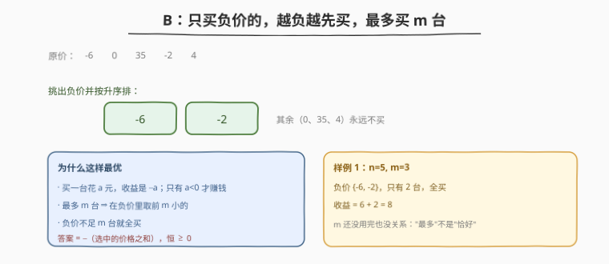
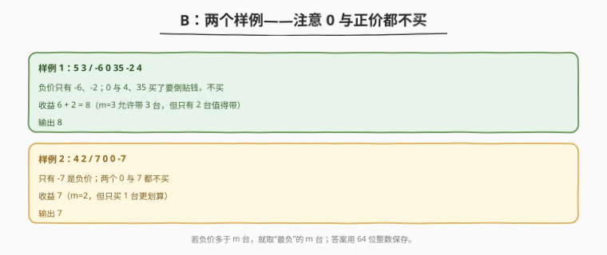

# Codeforces 34B 拍卖会最优购机收益 题解

## 1. 题目概述

- **题目链接**：https://codeforces.com/problemset/problem/34/B
- **比赛来源**：Codeforces Beta Round 34 (Div. 2) · Problem B（UTC 2010-10-11）
- **难度**：900
- **标签**：贪心、排序
- **评测类型**：普通（单组输入，唯一答案）
- **限制**：时间 2 s / 内存 256 MB

**题意**：拍卖会上有 $n$ 台旧电视，第 $i$ 台标价 $a_i$（可能是负数——负价表示"卖家倒贴钱请你搬走"）。Bob 最多能带走 $m$ 台，要求他最多能赚多少钱。

**约束**：

- $1\le m\le n\le100$，$-1000\le a_i\le1000$；
- 规模极小，排序即可；答案最大 $100\times1000=10^5$，用 32 位整数也够（用 `long long` 更稳）；
- 关键理解：买一台花 $a_i$ 元，所以花负价等于**赚钱**；花 $0$ 与正价都是净支出，不买；
- "最多 $m$ 台"不是"恰好 $m$ 台"，可以少买。

## 2. 示例与观察

官方样例 1（输入 / 输出原样）：

```text
输入：
5 3
-6 0 35 -2 4

输出：
8
```

官方样例 2（输入 / 输出原样）：

```text
输入：
4 2
7 0 0 -7

输出：
7
```

**样例 1 演算**：价格是 $-6,\ 0,\ 35,\ -2,\ 4$。其中负价只有 $-6$ 和 $-2$，把它们都"买"下来：

- 买 $-6$：卖家倒贴 6 元，收益 $+6$；
- 买 $-2$：收益 $+2$；

其余（$0$、$35$、$4$）买了都要花钱，不买。总收益 $6+2=8$。虽然 $m=3$，但只有 2 台值得买，所以收益就是 8。

**样例 2 演算**：价格 $7,\ 0,\ 0,\ -7$。唯一的负价是 $-7$，买它赚 7；两个 $0$ 买了既不赚也不亏（会浪费"运力"，但不影响金额），正价 7 买了亏 7。最大收益是 7。

**观察**：

1. 买一台的"收益"是 $-a_i$，所以**只有 $a_i<0$** 的电视带来正收益；
2. 若决定买若干台，显然应该挑最负的（收益最大的）；
3. 于是答案 = 选不超过 $m$ 个负价，使 $\sum(-a_i)$ 最大，即取最负的那些。

## 3. 解题思路

### 3.1 朴素做法与瓶颈

$n\le100$，可以枚举所有"买哪几台"的子集（$2^{100}$ 不可行），但本问题有显然的贪心结构：每台电视的收益互相独立、且都要花掉一个"运力"，所以这是一个"选至多 $m$ 个最大元素"的问题。

**贪心**：把所有负价单独拿出来，按**升序**（越负越前）排序，取前 $\min(m,\ \text{负价个数})$ 个，答案就是这些价格的相反数之和。

### 3.2 核心观察：0 与正价一定不买



设选中的集合为 $S$，$|S|\le m$，收益 $=-\sum_{i\in S}a_i$。

- 若 $S$ 里有 $a_i\ge 0$ 的元素，把它删掉：$|S|$ 变小（仍 $\le m$），收益不减（因为去掉的是非负贡献 $-a_i\le0$）。所以最优解可以不含 $0$ 和正价。
- 于是只需在负价里挑。若有负价没被选中，而选中的某个负价比它更接近 $0$（即 $a_j<a_i<0$ 却选了 $i$ 没选 $j$），把 $i$ 换成 $j$：收益增加 $a_i-a_j>0$，仍满足数量约束。所以最优解取的是**最负的若干个**。

### 3.3 算法流程

1. 读入 $n,m$ 与数组 $a$；
2. 过滤出所有负数，存入 `neg`；
3. 把 `neg` 升序排序（`-6, -2` 这样的顺序）；
4. 取前 $\min(m,\ |neg|)$ 个，把它们的相反数累加；
5. 输出累加值。

### 3.4 样例走查



- 样例 1：`neg = [-6, -2]`，$m=3$，全取，收益 $6+2=8$；
- 样例 2：`neg = [-7]`，$m=2$，只取 1 个，收益 $7$。

## 4. 正确性证明

**引理 1（正价与 0 不入最优解）**：存在一个最优解不含任何 $a_i\ge0$ 的电视。

**证明**：设最优解 $S$ 含 $a_i\ge0$。令 $S'=S\setminus\{i\}$，则 $|S'|<|S|\le m$，且收益 $-\sum_{S'}a = -\sum_S a + a_i \ge -\sum_S a$（因为 $a_i\ge0$）。故 $S'$ 也是最优解，且元素更少；反复操作即可得到只含负价的最优解。∎

**引理 2（取最负的若干台最优）**：在所有只含负价的方案中，设负价升序为 $b_1\le b_2\le\cdots\le b_k<0$。则取前 $t=\min(m,k)$ 个（即 $b_1,\dots,b_t$）是最优的。

**证明**：任取一个方案 $S\subseteq\{b_1,\dots,b_k\}$，$|S|\le m$。其收益为 $-\sum_{b\in S}b=\sum_{b\in S}|b|$。由于 $|b_1|\ge|b_2|\ge\cdots\ge|b_k|$，在大小不超过 $m$ 的子集中，"取绝对值最大的 $t$ 个"使和最大（这是"取前 $t$ 大"的标准交换论证：若 $S$ 含有 $b_j$ 而漏掉更靠前的 $b_i$（$i<j$），把 $b_j$ 换成 $b_i$ 不减少和、不增加个数）。∎

**定理**：算法输出的是 Bob 能获得的最大收益。

**证明**：由引理 1，最优解只含负价；由引理 2，其中最优的是"最负的 $t$ 个"，$t=\min(m,k)$。算法正是计算这 $t$ 个的绝对值之和。∎

## 5. 复杂度分析

- **时间**：$O(n\log n)$（排序），$n\le100$ 时不到 700 次比较。
- **空间**：$O(n)$。
- **与时限的关系**：2 s 的时限下实测端到端约 2 ms，余量数百倍。

## 6. 参考代码

### C++17

```cpp
#include <bits/stdc++.h>
using namespace std;

int main() {
    int n, m;
    if (scanf("%d %d", &n, &m) != 2) return 0;

    vector<int> neg;
    for (int i = 0; i < n; ++i) {
        int a;
        scanf("%d", &a);
        if (a < 0) neg.push_back(a);   // 只有负价才可能"赚钱"，0 和正价都不买
    }

    sort(neg.begin(), neg.end());       // 越负越赚
    long long earn = 0;
    int take = min((int)neg.size(), m); // 最多带 m 台
    for (int i = 0; i < take; ++i) earn += -(long long)neg[i];
    printf("%lld\n", earn);
    return 0;
}
```

### Python3

```python
import sys


def main() -> None:
    data = sys.stdin.read().split()
    n, m = int(data[0]), int(data[1])
    a = [int(x) for x in data[2:2 + n]]

    neg = sorted(x for x in a if x < 0)     # 只买负价的，越负越赚
    earn = -sum(neg[:m])                    # 最多买 m 台
    sys.stdout.write(str(earn) + "\n")


main()
```

两份代码都只用标准库，可原样提交。

## 7. 边界情况与易错点

1. **没有负价**：例如 `3 2 / 1 2 3`，负价集合为空，收益为 0（不是买最便宜的 1 台）。输出 `0`。
2. **负价多于 $m$ 台**：只买最负的 $m$ 台，例如 `4 2 / -1 -5 -3 -9` → 买 $-9,-5$，收益 14。
3. **$m=n$**：可以全部买下，但依然只买负价。
4. **价格为 0**：买 0 元电视既不赚钱也不亏钱，但**会占用运力**，因此最优解不会买它（不影响金额，但少买永远不亏）。
5. **全是负数且 $m=1$**：只取最负的那一个。
6. **答案类型**：$100\times1000=10^5$ 用 `int` 也够，但用 `long long` 免去隐患。
7. **"最多"不是"恰好"**：不要强行凑满 $m$ 台去买正价电视；那样收益会变小。

## 8. 验证记录

- **编译环境与命令**：本机只有 `Apple clang 21.0.0`，没有 GNU `g++`，因此用 `clang++ -std=c++17 -O2 -Wall -I codeforces/tools/include` 搭配本地 `bits/stdc++.h` 兼容头编译（代码只用标准库，可原样提交 GNU C++17）。Python 为 `Python 3.9.6`。
- **官方样例**：2 / 2 通过（`8`、`7`），C++ 与 Python 一致，且与 JSON 的 `out` 逐字符相同。
- **独立暴力对拍**：暴力（`/tmp/cf_verify_34_B/brute.py`）用 `itertools.combinations` 枚举**所有"至多 $m$ 台"的子集**并取最大收益——与"排序取最负的 $k$ 个"完全不同的思路。随机生成 **300 组**输入（$n\le12$，$m\le n$，价格 $-20\sim20$，含大量 0 与正价），C++ / Python / 暴力三方 **300/300 一致**。
- **最大约束性能**：$n=100$，C++ 端到端约 2 ms，Python 约 17 ms，内存 < 2 MB。
- **图片校验**：两张 SVG（`cf34b_greedy.svg`、`cf34b_walkthrough.svg`）均通过 `xml.etree.ElementTree.parse`；用脚本估算每个 `text` 的包围盒，确认不越出 viewBox、文字互不重叠；并用 headless Chrome 渲染 PNG 后检查画布四边无墨迹（无裁切）。
- **公式校验**：公式均为 `$...$`，星号直接写 `*`，`\text{}` 内无裸 `#`，KaTeX（`throwOnError`）渲染无报错。
- **复核状态**：verified（样例、随机对拍、性能、图片、公式均实跑通过；唯一环境差异是本机无 GNU g++，已用 clang++ 等价验证）。

## 相关题目与扩展

- [Codeforces 34A Reconnaissance 2](https://codeforces.com/problemset/problem/34/A)、[34C Page Numbers](https://codeforces.com/problemset/problem/34/C)、[34D Road Map](https://codeforces.com/problemset/problem/34/D)、[34E Collisions](https://codeforces.com/problemset/problem/34/E)：同场其余四题。
- [Codeforces 160A Twins](https://codeforces.com/problemset/problem/160/A)：排序后贪心取数，思路几乎相同。
- [LeetCode 1833. 雪糕的最大数量](https://leetcode.cn/problems/maximum-ice-cream-bars/)：排序后从便宜的开始买，与本题的"选最负的"是同一类贪心。
- [LeetCode 1005. K 次取反后最大化的数组和](https://leetcode.cn/problems/maximize-sum-of-array-after-k-negations/)：同样围绕"负数的绝对值"做贪心。
- [Codeforces 133A HQ9+](https://codeforces.com/problemset/problem/133/A)：同样的"读题 + 简单判定"入门题，适合热身。

**延伸思考**：

1. **如果每台电视还占不同的"运力"（背包）**：就变成了 0/1 背包，贪心不再最优，需要 DP。
2. **如果要求恰好带 $m$ 台**：当负价不足 $m$ 时被迫买正价，此时要选"最不亏"的正价补足，贪心规则变成"负价全买 + 正价里取最小的"。
3. **如果价格可以买卖两次（先买后卖）**：那就变成了股票买卖问题，与本题无关。
4. **如果 $n$ 到 $10^6$**：仍是排序 $O(n\log n)$；也可以用 `nth_element` 只取前 $m$ 小，做到期望 $O(n)$。

