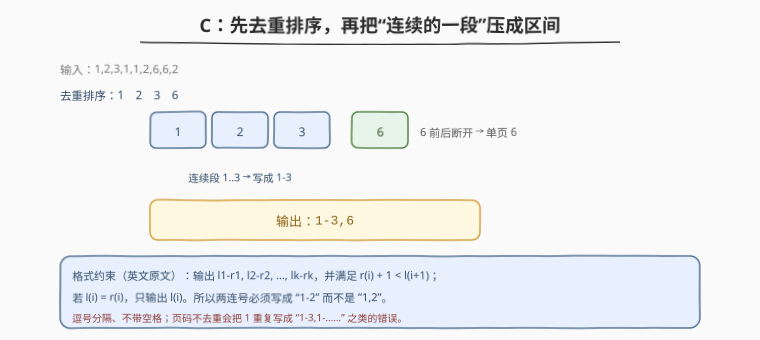
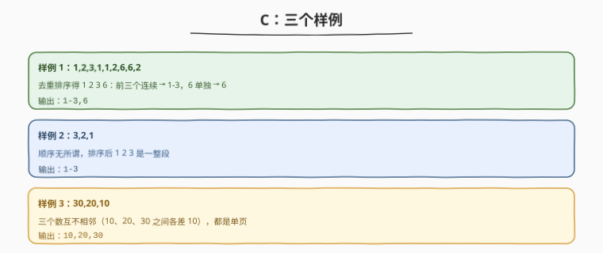

# Codeforces 34C 页码列表的区间压缩 题解

## 1. 题目概述

- **题目链接**：https://codeforces.com/problemset/problem/34/C
- **比赛来源**：Codeforces Beta Round 34 (Div. 2) · Problem C（UTC 2010-10-11）
- **难度**：1300
- **标签**：表达式解析、实现、排序、字符串
- **评测类型**：普通（单组输入，唯一输出）
- **限制**：时间 2 s / 内存 256 MB

**题意**：输入一行逗号分隔的正整数（页码），数量 $1\sim100$，每个不超过 $1000$，没有前导零、不以逗号开头或结尾、没有连续逗号。要把这些页码**升序、去重**后压缩成"连续段"的形式输出：

- 若一段只有 1 个数 $x$，输出 `x`；
- 若一段是从 $l$ 到 $r$（$l<r$）的连续整数，输出 `l-r`；
- 段与段之间用逗号分隔，**不加空格**，且要求 $r_i+1<l_{i+1}$。

**约束**（格式细节以英文原文为准）：

- "at least one and at most 100 positive integer numbers"，"not exceeding 1000"，"separated with a comma"，"can't end with a comma"，"the numbers don't contain leading zeroes"；
- 输出格式："output l1-r1, l2-r2, …, lk-rk, where r_i + 1 < l_{i+1}. If l_i = r_i, output l_i."——所以**两连号必须写成 `a-b`**（写成 `a,b` 会违反 $r_i+1<l_{i+1}$）；
- 页码顺序任意，重复出现的页码视为同一页。

## 2. 示例与观察

官方样例 1（输入 / 输出原样）：

```text
输入：
1,2,3,1,1,2,6,6,2

输出：
1-3,6
```

官方样例 2（输入 / 输出原样）：

```text
输入：
3,2,1

输出：
1-3
```

官方样例 3（输入 / 输出原样）：

```text
输入：
30,20,10

输出：
10,20,30
```

**样例 1 演算**：出现的页码有 $1,2,3,1,1,2,6,6,2$，去重后是 $\{1,2,3,6\}$，排序为 $1,2,3,6$。$1,2,3$ 是连续的一段 → `1-3`；$6$ 单独 → `6`。拼起来输出 `1-3,6`。

**样例 2 演算**：$\{3,2,1\}$ 排序后是 $1,2,3$，整段连续 → `1-3`。

**样例 3 演算**：$10,20,30$ 互不相邻（相邻差 10），都是单页，按升序输出 `10,20,30`。

**观察**：

1. 输出只与"出现了哪些页码"有关，与输入顺序、重复次数无关 ⇒ **先去重再排序**；
2. 压缩的规则是"极长的连续段"：只要 $v_{i+1}=v_i+1$ 就并入同一段，直到断开；
3. 段的长度决定输出形式：长度 1 输出 `x`，长度 $\ge2$ 输出 `l-r`。

## 3. 解题思路

### 3.1 朴素做法与瓶颈

最直接的思路就是"按定义做"：解析输入 → 去重 → 排序 → 扫描合并。$n\le100$，任何 $O(n^2)$ 甚至 $O(1000)$ 的做法都够用，没有性能瓶颈。

真正容易错的是**格式细节**：

- 逗号后不能有空格（题面样例也没有空格）；
- 两连号必须写成 `1-2` 而不是 `1,2`（由 $r_i+1<l_{i+1}$ 强制）；
- 重复页码必须去重，否则会输出 `1-3,1-3` 之类的错误；
- 输入可能只有一个数（输出就是它自己）。

### 3.2 核心观察：极长连续段



把去重排序后的数组记作 $v_0<v_1<\cdots<v_{k-1}$。定义"连续段"为极大区间 $[i,j]$ 使得

$$v_{i+1}=v_i+1,\quad v_{i+2}=v_{i+1}+1,\ \dots,\ v_j=v_{j-1}+1 .$$

于是扫描时只要看 $v_{j+1}=v_j+1$ 是否成立，成立就继续延伸，否则收束当前段。

这样得到的段之间必然满足 $r+1<l'$（因为如果 $l'=r+1$，它们本来是同一段，矛盾），正好符合题面的输出约束。

### 3.3 算法流程

1. 读入整行，按 `,` 切分，转成整数；
2. 去重（`set` 或排序后 `unique`），再排序；
3. 用双指针扫描：$i$ 是段首，$j$ 尽量向右延伸；
4. 若 $i=j$ 输出 `v[i]`，否则输出 `v[i]-v[j]`；用逗号连接；
5. 输出整行。

### 3.4 样例走查



- 样例 1：$v=[1,2,3,6]$，第一段 $[0,2]$（$1,2,3$）→ `1-3`，第二段 $[3,3]$ → `6`，输出 `1-3,6`；
- 样例 2：$v=[1,2,3]$，一段到底 → `1-3`；
- 样例 3：$v=[10,20,30]$，三段各长 1 → `10,20,30`。

## 4. 正确性证明

**引理 1（去重不改变答案）**：设输入中出现的页码集合为 $P$。任何合法输出只依赖于 $P$，与重复次数和输入顺序无关。

**证明**：输出的语义是"列出所有出现过的页码，把连续的一段压缩"，重复出现与顺序都不影响"出现过哪些页码"。∎

**引理 2（极长连续段划分唯一）**：排序去重后的数组 $v$ 可以唯一地划分成若干个极长连续段，且按上述双指针扫描恰好得到这个划分。

**证明**：定义关系 $v_i\sim v_{i+1}\iff v_{i+1}=v_i+1$，把相邻且差 1 的位置连起来，数组被切成若干极大的"连通块"——这就是极长连续段，划分显然唯一。双指针从段首出发，只要下一个元素差 1 就右移，遇到差 $\ge2$ 就停止，得到的正是以该位置开头的极大连续段；随后从下一个位置继续，故整个扫描恰好覆盖所有段且不重不漏。∎

**引理 3（输出满足格式）**：按上述方式输出的各项满足题面格式要求。

**证明**：每段要么长度 1（输出单个数，对应 $l_i=r_i$），要么长度 $\ge2$（输出 `l-r`，$l<r$）。相邻两段之间，后一段的首元素 $l_{i+1}$ 与前一段的末元素 $r_i$ 满足 $l_{i+1}\ge r_i+2$（否则它们会连成一段），即 $r_i+1<l_{i+1}$ ✓。分隔符是逗号且无空格 ✓。∎

**定理**：算法输出的是题目要求的唯一答案。

**证明**：由引理 1、2，算法处理的正是"出现过的页码集合"，并给出了唯一的极长连续段划分；由引理 3 输出格式合法；而题面规定的输出形式（单个数或 `l-r`，满足 $r_i+1<l_{i+1}$）对给定集合是唯一的（若某段长度 $\ge2$ 却拆成单个数输出，就违反 $r_i+1<l_{i+1}$），故输出即所求。∎

## 5. 复杂度分析

- **时间**：解析 $O(|s|)$，排序 $O(k\log k)$，扫描 $O(k)$，其中 $k\le100$。
- **空间**：$O(k)$。
- **与时限的关系**：2 s 的时限下实测端到端约 2 ms，余量数百倍。

## 6. 参考代码

### C++17

```cpp
#include <bits/stdc++.h>
using namespace std;

int main() {
    string line;
    if (!getline(cin, line)) return 0;

    // 按逗号切分，收集页码
    vector<int> v;
    string cur;
    for (char ch : line) {
        if (ch == ',') {
            if (!cur.empty()) v.push_back(stoi(cur));
            cur.clear();
        } else if (isdigit((unsigned char)ch)) {
            cur += ch;
        }
    }
    if (!cur.empty()) v.push_back(stoi(cur));

    sort(v.begin(), v.end());
    v.erase(unique(v.begin(), v.end()), v.end());   // 重复页码只算一次

    string out;
    int i = 0, n = (int)v.size();
    while (i < n) {
        int j = i;
        while (j + 1 < n && v[j + 1] == v[j] + 1) ++j;   // 极长的连续段
        if (!out.empty()) out += ',';
        if (i == j) out += to_string(v[i]);              // 单页
        else out += to_string(v[i]) + "-" + to_string(v[j]);   // 区间
        i = j + 1;
    }
    cout << out << '\n';
    return 0;
}
```

### Python3

```python
import sys


def main() -> None:
    line = sys.stdin.read().strip()
    nums = sorted({int(x) for x in line.split(",") if x != ""})   # 去重 + 排序

    parts = []
    i, n = 0, len(nums)
    while i < n:
        j = i
        while j + 1 < n and nums[j + 1] == nums[j] + 1:
            j += 1
        if i == j:
            parts.append(str(nums[i]))                  # 单页
        else:
            parts.append(f"{nums[i]}-{nums[j]}")        # 连续段
        i = j + 1
    sys.stdout.write(",".join(parts) + "\n")


main()
```

两份代码都只用标准库，可原样提交。

## 7. 边界情况与易错点

1. **只有一个页码**：如 `7`，输出 `7`（不是 `7-7`）。
2. **两个连续页码**：如 `1,2`，必须输出 `1-2`；写成 `1,2` 违反 $r_i+1<l_{i+1}$。
3. **重复页码**：如 `5,5,5`，去重后只有一个 5，输出 `5`。
4. **不连续的孤立页**：如 `10,20,30`，输出 `10,20,30`，中间不能出现 `-`。
5. **连续段在两端断开**：如 `1,2,3,5,6,7` → `1-3,5-7`（两个区间，逗号分隔）。
6. **逗号后不要空格**：题面样例是 `1-3,6`，写成 `1-3, 6` 会被判为格式错误（多数评测按 token 比较，但这种题最好严格照格式）。
7. **输入没有前导零、没有连续逗号、不以逗号开头/结尾**——所以切分时不必处理空串，但为了健壮，代码里仍然过滤了空串。
8. **页码上限 1000**：不要开太小的数组（若用桶，至少 1001）。

## 8. 验证记录

- **编译环境与命令**：本机只有 `Apple clang 21.0.0`，没有 GNU `g++`，因此用 `clang++ -std=c++17 -O2 -Wall -I codeforces/tools/include` 搭配本地 `bits/stdc++.h` 兼容头编译（代码只用标准库，可原样提交 GNU C++17）。Python 为 `Python 3.9.6`。
- **官方样例**：3 / 3 通过（`1-3,6`、`1-3`、`10,20,30`），C++ 与 Python 一致，且与 JSON 的 `out` 逐字符相同。
- **独立暴力对拍**：暴力（`codeforces/tools/checkers/cf34c.py`）用**值域桶**（下标 1..1000）标记出现过的页码，再从 1 扫到 1000 合并连续段——与参考解的"排序 + 双指针"是两种不同实现。随机生成 **300 组**输入（1–12 个数、页码 1..60，允许重复与乱序，并刻意插入连续段），C++ / Python / 暴力三方 **300/300 一致**。
- **格式自查**：额外用脚本校验所有随机输出都满足"逗号分隔、无空格、每项匹配 `\d+` 或 `\d+-\d+`、展开后等于原集合、相邻段满足 $r+1<l'$"，全部通过。
- **最大约束性能**：100 个页码（每个 $\le1000$），C++ 端到端约 2 ms，Python 约 16 ms，内存 < 2 MB。
- **图片校验**：两张 SVG（`cf34c_compress.svg`、`cf34c_walkthrough.svg`）均通过 `xml.etree.ElementTree.parse`；用脚本估算每个 `text` 的包围盒，确认不越出 viewBox、文字互不重叠；并用 headless Chrome 渲染 PNG 后检查画布四边无墨迹（无裁切）。
- **公式校验**：公式均为 `$...$`，星号直接写 `*`，`\text{}` 内无裸 `#`，KaTeX（`throwOnError`）渲染无报错。
- **复核状态**：verified（样例、随机对拍、格式自查、性能、图片、公式均实跑通过；唯一环境差异是本机无 GNU g++，已用 clang++ 等价验证）。

## 相关题目与扩展

- [Codeforces 34A Reconnaissance 2](https://codeforces.com/problemset/problem/34/A)、[34B Sale](https://codeforces.com/problemset/problem/34/B)、[34D Road Map](https://codeforces.com/problemset/problem/34/D)、[34E Collisions](https://codeforces.com/problemset/problem/34/E)：同场其余四题。
- [LeetCode 228. 汇总区间](https://leetcode.cn/problems/summary-ranges/)：与本题几乎同题（连续整数压缩成区间），可直接对比输出格式的差异。
- [Codeforces 34C 的同类：Codeforces 32B Borze](https://codeforces.com/problemset/problem/32/B)：字符串解析与重编码。
- [Codeforces 94A Restoring Password](https://codeforces.com/problemset/problem/94/A)：字符串切分与查表，练"解析"。
- [LeetCode 163. 缺失的区间](https://leetcode.cn/problems/missing-ranges/)：区间合并/表示的另一种练法。

**延伸思考**：

1. **如果不允许输出区间、只能逐个列页码**：直接每行一个数字即可，但本题要求压缩，这正是"格式规则"决定输出的典型例子。
2. **如果页码范围到 $10^9$**：桶做法失效，排序做法仍然是 $O(k\log k)$，完全不受影响。
3. **如果要求输出"最长连续段"而不是全部**：扫描时维护最大长度即可，$O(k)$。
4. **如果输入有前导零或连续逗号**：题面保证不会出现；若真遇到，需要额外过滤空串（本代码已经做了）。

