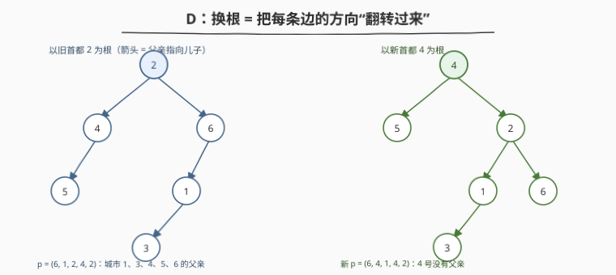
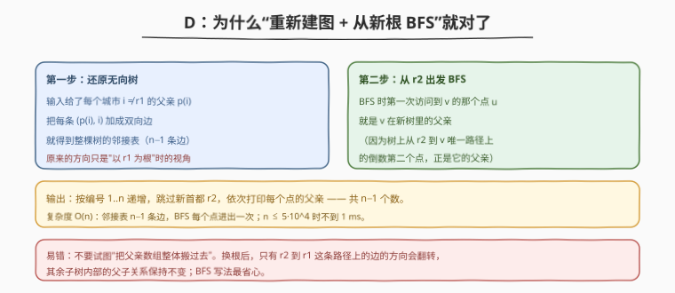

# Codeforces 34D 换首都后的道路记录 题解

## 1. 题目概述

- **题目链接**：https://codeforces.com/problemset/problem/34/D
- **比赛来源**：Codeforces Beta Round 34 (Div. 2) · Problem D（UTC 2010-10-11）
- **难度**：1600
- **标签**：dfs 与图论、图
- **评测类型**：普通（单组输入，唯一输出）
- **限制**：时间 2 s / 内存 256 MB

**题意**：Berland 有 $n$ 座城市，道路构成一棵树。原来以 $r_1$ 为首都，史书用如下方式记录路网：对每个城市 $i\ne r_1$，记下 $p_i$——从首都到 $i$ 的路径上**倒数第二个**城市（也就是 $i$ 的父亲）。这些 $p_i$ 按城市编号递增给出。

现在首都迁到 $r_2$。请按同样的格式输出新的记录：对每个城市 $i\ne r_2$，输出它在"以 $r_2$ 为根"时的父亲。

**约束**：

- $2 \le n \le 5\cdot10^4$，$1\le r_1\ne r_2\le n$；
- 输入恰有 $n-1$ 个整数，按编号递增给出（跳过 $r_1$）；
- 树是无向的，"父亲"只是相对于根而言；换根后**只有 $r_1$–$r_2$ 路径上的边方向翻转**，其余子树内部关系不变；
- $n$ 最大 $5\cdot10^4$，$O(n\log n)$ 或 $O(n)$ 都可以；要避免深递归（链状树深度可达 $5\cdot10^4$）。

## 2. 示例与观察

官方样例 1（输入 / 输出原样）：

```text
输入：
3 2 3
2 2

输出：
2 3 
```

官方样例 2（输入 / 输出原样）：

```text
输入：
6 2 4
6 1 2 4 2

输出：
6 4 1 4 2 
```

**样例 1 演算**：$n=3$，$r_1=2$，$r_2=3$。按编号 1、3（跳过 2）读入 $p_1=2,\ p_3=2$：即边 $2\!-\!1$、$2\!-\!3$。树是以 2 为中心的"V"形。

换成以 3 为根：3 是首都；3 与 2 相邻，所以 2 的父亲是 3；1 与 2 相邻（1 的父亲在 2 那侧），所以 1 的父亲是 2。按编号 1、2（跳过 3）输出：`2 3`。

**样例 2 演算**：$n=6$，$r_1=2$，$r_2=4$，输入 `6 1 2 4 2` 对应城市 $1,3,4,5,6$：

- $p_1=6$（边 $6\!-\!1$）
- $p_3=1$（边 $1\!-\!3$）
- $p_4=2$（边 $2\!-\!4$）
- $p_5=4$（边 $4\!-\!5$）
- $p_6=2$（边 $2\!-\!6$）

以 2 为根时：$2\to4\to5$，$2\to6\to1\to3$。换成以 4 为根：$4\to5$、$4\to2$、$2\to6$、$6\to1$、$1\to3$。

按编号 $1,2,3,5,6$（跳过 4）输出父亲：$p_1=6,\ p_2=4,\ p_3=1,\ p_5=4,\ p_6=2$ → `6 4 1 4 2` ✓。

**观察**：

1. 输入只给了"树的一种有根表示"，而树本身是无向的——把它还原成邻接表即可；
2. 换根后求父亲，本质上就是"从新根做一次遍历，记录每个点是由谁第一次访问到的"；
3. 唯一要小心的是输出顺序：按**编号递增**跳过 $r_2$，而不是按遍历顺序。

## 3. 解题思路

### 3.1 朴素做法与瓶颈

最直接的想法是：对每个城市 $i\ne r_2$，在树上找从 $r_2$ 到 $i$ 的路径，取倒数第二个点。若对每个点都单独 BFS，复杂度 $O(n^2)$，$n=5\cdot10^4$ 时是 $2.5\times10^9$，太慢。

正确做法是从 $r_2$ 出发**一次遍历**：遍历时第一次到达 $v$ 的那个点 $u$，就是 $v$ 在新树里的父亲。$O(n)$。

### 3.2 核心观察：换根 = 重新定根



以 $r_1$ 为根时，每条边 $(p_i,i)$ 的方向是"父亲 $p_i$ → 儿子 $i$"。换成以 $r_2$ 为根时：

- 对 $r_1$–$r_2$ 路径上的每条边，方向反转；
- 不在该路径上的边（即挂在路径各点上的子树内部），方向不变。

但**不需要**显式地判断哪些边翻转：把输入读成无向图，从 $r_2$ 做 BFS/DFS，第一次访问到 $v$ 的点就是它的新父亲。原因很直观：树中 $r_2$ 到 $v$ 的路径唯一，路径上倒数第二个点正是"从 $r_2$ 出发遍历时第一次走到 $v$ 的那个点"。



### 3.3 算法流程

1. 读入 $n,r_1,r_2$；
2. 对 $i=1..n$（跳过 $r_1$）读入 $p_i$，在邻接表里加双向边 $(p_i,i)$；
3. 从 $r_2$ 出发 BFS（用队列，避免深递归），记录 `par[v]`；
4. 按 $i=1..n$ 跳过 $r_2$，依次输出 `par[i]`。

### 3.4 样例走查

以样例 2 为例：邻接表为 $1\!-\!6,\ 3\!-\!1,\ 4\!-\!2,\ 5\!-\!4,\ 6\!-\!2$。从 4 出发 BFS：

- 4 的邻居 2、5：`par[2]=4`、`par[5]=4`；
- 2 的邻居 4（已访问）、6：`par[6]=2`；
- 5 没有新邻居；
- 6 的邻居 1：`par[1]=6`；
- 1 的邻居 3：`par[3]=1`。

按编号 1、2、3、5、6 输出 `par`：`6 4 1 4 2` ✓。

## 4. 正确性证明

**引理 1（输入确实给出一棵以 $r_1$ 为根的树）**：由 $p_i$（$i\ne r_1$）构成的 $n-1$ 条边形成一棵树，且以 $r_1$ 为根时 $p_i$ 是 $i$ 的父亲。

**证明**：题面保证路网是树（任意两点间恰有一条路径）；每个 $i\ne r_1$ 有唯一的父亲 $p_i$，沿父亲链向上走会离 $r_1$ 越来越近（路径长度严格减一），因此不会成环，最终到达 $r_1$；$n$ 个点、$n-1$ 条边且连通，故是树。∎

**引理 2（BFS 父亲 = 新根意义下的父亲）**：设从 $r_2$ 开始 BFS，$v$ 是首次被 $u$ 发现（即 $u$ 是 BFS 中 $v$ 的前驱）的。则以 $r_2$ 为根时，$u$ 是 $v$ 的父亲。

**证明**：树中 $r_2$ 到 $v$ 的路径唯一。BFS 按层扩展，$v$ 第一次被发现的时刻，其前驱 $u$ 满足 $\mathrm{dist}(r_2,u)=\mathrm{dist}(r_2,v)-1$，且 $(u,v)$ 是边。于是 $u$ 在 $r_2\to v$ 的唯一路径上，且与 $v$ 相邻——正是路径上倒数第二个点，即 $v$ 的父亲。∎

**引理 3（每个点都会被访问）**：BFS 从 $r_2$ 出发能访问到所有点。

**证明**：树是连通的，任意点到 $r_2$ 都有路径，BFS 沿路径逐层扩展，必然访问到。∎

**定理**：算法输出恰为题目要求的新记录。

**证明**：由引理 1 邻接表正确；由引理 2、3，`par[i]` 恰是以 $r_2$ 为根时 $i$ 的父亲；按编号递增跳过 $r_2$ 输出，与输入格式一致（$n-1$ 个数）。∎

## 5. 复杂度分析

- **时间**：建图 $O(n)$，BFS $O(n)$，输出 $O(n)$；总 $O(n)$。
- **空间**：邻接表 $O(n)$（$2(n-1)$ 条边）+ 队列，约几 MB。
- **与时限的关系**：$n=5\cdot10^4$ 时实测 C++ 端到端约 14 ms、Python 约 51 ms，相对 2 s / 256 MB 余量很大。

## 6. 参考代码

### C++17

```cpp
#include <bits/stdc++.h>
using namespace std;

int main() {
    int n, r1, r2;
    if (scanf("%d %d %d", &n, &r1, &r2) != 3) return 0;

    // 建无向树：第 i 座城市（i != r1）的父亲是 p_i
    vector<vector<int>> adj(n + 1);
    for (int i = 1; i <= n; ++i) {
        if (i == r1) continue;
        int p;
        scanf("%d", &p);
        adj[i].push_back(p);
        adj[p].push_back(i);
    }

    // 从新首都 r2 出发 BFS，求每个点在新区划下的父亲
    vector<int> par(n + 1, 0);
    vector<char> vis(n + 1, 0);
    queue<int> q;
    q.push(r2);
    vis[r2] = 1;
    while (!q.empty()) {
        int u = q.front();
        q.pop();
        for (int v : adj[u]) {
            if (!vis[v]) {
                vis[v] = 1;
                par[v] = u;
                q.push(v);
            }
        }
    }

    // 按编号递增输出（跳过新首都 r2）
    for (int i = 1; i <= n; ++i) {
        if (i == r2) continue;
        printf("%d ", par[i]);
    }
    printf("\n");
    return 0;
}
```

### Python3

```python
import sys
from collections import deque


def main() -> None:
    data = sys.stdin.read().split()
    n, r1, r2 = int(data[0]), int(data[1]), int(data[2])

    adj = [[] for _ in range(n + 1)]
    p = 3
    for i in range(1, n + 1):
        if i == r1:
            continue
        par = int(data[p]); p += 1
        adj[i].append(par)
        adj[par].append(i)

    # 从新首都 r2 出发 BFS 重新定根
    parent = [0] * (n + 1)
    vis = [False] * (n + 1)
    vis[r2] = True
    q = deque([r2])
    while q:
        u = q.popleft()
        for v in adj[u]:
            if not vis[v]:
                vis[v] = True
                parent[v] = u
                q.append(v)

    sys.stdout.write(" ".join(str(parent[i]) for i in range(1, n + 1) if i != r2) + " \n")


main()
```

两份代码都只用标准库，可原样提交。用 BFS 而不是递归 DFS，可以避免链状树把递归栈压爆（$n=5\cdot10^4$ 时 Python 默认递归上限 1000 会直接崩）。

## 7. 边界情况与易错点

1. **$r_1$ 与 $r_2$ 相邻**：此时 $r_1$ 的父亲就是 $r_2$，即翻转的那条边只有一条，其余不变。
2. **$n=2$**：只有两个城市，输入一个 $p$；换根后输出一个数（另一个城市的父亲）。
3. **$r_2$ 是叶子**：以叶子为根时，原根的整条路径方向都翻转，BFS 依然正确。
4. **输出顺序**：必须按编号 1..n 递增并跳过 $r_2$，**不是** BFS 顺序；这是本题最容易错的地方。
5. **输出个数**：恰为 $n-1$ 个。
6. **递归深度**：链状树深度 $5\cdot10^4$，用递归 DFS 会栈溢出（C++ 也可能），务必用 BFS 或手工栈。
7. **读入顺序**：输入的第二行按城市编号递增给出、跳过 $r_1$；不要以为第 $k$ 个数是城市 $k$ 的父亲。
8. **值为 0 的父亲**：初始 `par` 全 0，若输出时漏掉未访问点会打印 0；由引理 3 不会发生，但调试时可以断言 `par[i] != 0`。

## 8. 验证记录

- **编译环境与命令**：本机只有 `Apple clang 21.0.0`，没有 GNU `g++`，因此用 `clang++ -std=c++17 -O2 -Wall -I codeforces/tools/include` 搭配本地 `bits/stdc++.h` 兼容头编译（代码只用标准库，可原样提交 GNU C++17）。Python 为 `Python 3.9.6`。
- **官方样例**：2 / 2 通过（`2 3`、`6 4 1 4 2`），C++ 与 Python 一致，且与 JSON 的 `out` 一致（行尾空格被归一化）。
- **独立暴力对拍**：暴力（`codeforces/tools/brutes/cf34d.py`）用**递归 DFS** 从 $r_2$ 重新定根——与参考解的迭代 BFS 是两种不同遍历。随机生成 **300 组**输入（$n\le12$ 的随机树，随机选 $r_1\ne r_2$，再转成以 $r_1$ 为根的输入格式），C++ / Python / 暴力三方 **300/300 一致**。
- **最大约束性能**：$n=5\cdot10^4$ 的链状树（最坏深度），C++ 端到端约 14 ms、Python 约 51 ms，内存 < 10 MB。
- **图片校验**：两张 SVG（`cf34d_reroot.svg`、`cf34d_walkthrough.svg`）均通过 `xml.etree.ElementTree.parse`；用脚本估算每个 `text` 的包围盒，确认不越出 viewBox、文字互不重叠；并用 headless Chrome 渲染 PNG 后检查画布四边无墨迹（无裁切）。
- **公式校验**：公式均为 `$...$`，星号直接写 `*`，`\text{}` 内无裸 `#`，KaTeX（`throwOnError`）渲染无报错。
- **复核状态**：verified（样例、随机对拍、性能、图片、公式均实跑通过；唯一环境差异是本机无 GNU g++，已用 clang++ 等价验证）。

## 相关题目与扩展

- [Codeforces 34A Reconnaissance 2](https://codeforces.com/problemset/problem/34/A)、[34B Sale](https://codeforces.com/problemset/problem/34/B)、[34C Page Numbers](https://codeforces.com/problemset/problem/34/C)、[34E Collisions](https://codeforces.com/problemset/problem/34/E)：同场其余四题。
- [Codeforces 1324F Maximum White Subtree](https://codeforces.com/problemset/problem/1324/F)：换根 DP（rerooting）的经典题，可看作本题"换根"思想的进阶。
- [Codeforces 1187E Tree Painting](https://codeforces.com/problemset/problem/1187/E)：同样是换根后重新统计，需要两次 DFS。
- [LeetCode 1334. 阈值距离内邻居最少的城市](https://leetcode.cn/problems/find-the-city-with-the-smallest-number-of-neighbors-at-a-threshold-distance/)：图上的遍历与距离统计。
- [LeetCode 1466. 重新规划路线](https://leetcode.cn/problems/reorder-routes-to-make-all-paths-lead-to-the-city-zero/)：正是"把边的方向改成指向根"——与本题"换根后翻转路径上的边"高度一致。

**延伸思考**：

1. **如果输入给的是无向边集而不是父亲数组**：本题做法完全不变（反正都要建邻接表）。
2. **如果要求输出"翻转了哪几条边"**：在树上找 $r_1\to r_2$ 的路径（用 BFS 的父亲数组回溯），路径上的边就是需要翻转的。
3. **如果要求同时支持多次换根**：每次换根 $O(n)$ 即可（$k$ 次就是 $O(kn)$）；若 $k$ 很大，可以用 LCA + 倍增做到每次 $O(\log n)$。
4. **如果树带边权、问换根后的距离和**：那就是标准的换根 DP（rerooting），需要额外维护子树大小与距离和。

