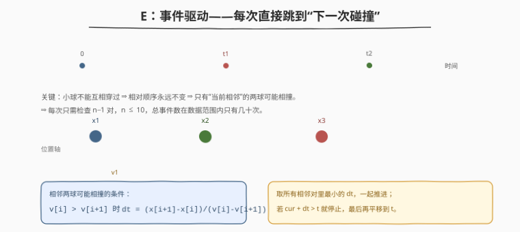
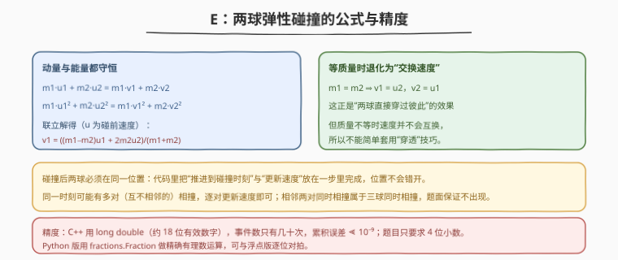
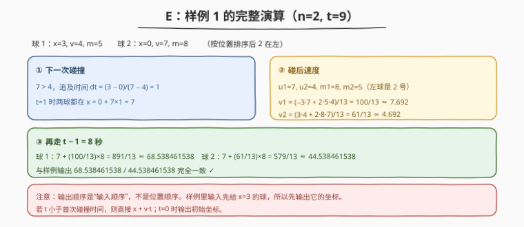

# Codeforces 34E 弹性碰撞的末位置 题解

## 1. 题目概述

- **题目链接**：https://codeforces.com/problemset/problem/34/E
- **比赛来源**：Codeforces Beta Round 34 (Div. 2) · Problem E（UTC 2010-10-11）
- **难度**：2000
- **标签**：暴力、实现、数学
- **评测类型**：普通（允许误差，输出至少 4 位小数）
- **限制**：时间 2 s / 内存 256 MB

**题意**：数轴上有 $n$ 个小球，第 $i$ 个球的初始坐标 $x_i$、速度 $v_i$、质量 $m_i$。所有碰撞都是**完全弹性碰撞**（动量与动能守恒）。求 $t$ 秒后每个球的坐标，按**输入顺序**输出，至少保留 4 位小数。

**约束**：

- $1\le n\le 10$，$0\le t\le 100$，$1\le|v_i|,m_i\le 100$，$|x_i|\le 100$；
- 初始没有两个球在同一位置；
- **题面保证**：任意碰撞最多涉及两个球（不会出现三个或更多球同时同地相撞）；
- $n$ 只有 10，所以"事件驱动模拟"每次只需检查 $n-1$ 对相邻球；事件总数在数据范围内很小（实测最多几十次）；
- 输出允许误差，但位置量级约 $10^4$，用 `long double` 或精确有理数都能轻松达到 $10^{-9}$ 的精度，远优于要求的 4 位小数。

## 2. 示例与观察

官方样例 1（输入 / 输出原样）：

```text
输入：
2 9
3 4 5
0 7 8

输出：
68.538461538
44.538461538
```

官方样例 2（输入 / 输出原样）：

```text
输入：
3 10
1 2 3
4 -5 6
7 -8 9

输出：
-93.666666667
-74.666666667
-15.666666667
```

**样例 1 演算**：球 1 在 $x=3$、速度 $4$、质量 $5$；球 2 在 $x=0$、速度 $7$、质量 $8$。球 2 在左边但更快，会追上球 1：

- 追及时间 $dt=\dfrac{3-0}{7-4}=1$，此时两球都在 $x=0+7\times1=7$；
- 按弹性公式（左球是 2 号，质量 8、速度 7；右球是 1 号，质量 5、速度 4）：
  $$v_2'=\frac{(8-5)\cdot7+2\cdot5\cdot4}{13}=\frac{100}{13},\qquad v_1'=\frac{(5-8)\cdot4+2\cdot8\cdot7}{13}=\frac{61}{13};$$
- 再走 $9-1=8$ 秒：
  $$x_2=7+\frac{100}{13}\times8=\frac{891}{13}\approx68.538461538,\qquad x_1=7+\frac{61}{13}\times8=\frac{579}{13}\approx44.538461538 .$$

与样例完全一致（注意输出顺序是**输入顺序**：先输出原来的 1 号球，即 $68.53\ldots$，再输出 2 号球）。

**样例 2 演算**：三个球的位置是 $1,4,7$，速度 $2,-5,-8$，质量 $3,6,9$。按位置排序后的顺序与输入一致。中间球向左、左边球向右 → 先相撞；随后各种碰撞依次发生，最终位置见样例（$-93.67$、$-74.67$、$-15.67$）。

**观察**：

1. 小球是**质点**，碰撞是瞬时的，两次碰撞之间每个球都在做匀速直线运动；
2. 质点之间**不能互相穿过**（碰后总是弹开），所以它们在数轴上的**相对顺序永远不变**；
3. 于是任意时刻只有"当前相邻"的两个球可能相撞——这使模拟变得非常简单。

## 3. 解题思路

### 3.1 朴素做法与瓶颈

**思路 A：极小步长数值积分。** 每隔 $\Delta t$ 把所有球推进 $\Delta t$，检测重叠再弹开。问题是精度：碰撞时刻被量化到 $\Delta t$，位置误差约为 $v\Delta t$；要保证 $10^{-4}$ 的精度，$\Delta t$ 需小于 $10^{-6}$，$t\le100$ 时就是 $10^8$ 步，既慢又不精确（每次碰撞还可能引入位置跳变）。它只适合做**交叉验证**，不适合作为正解。

**思路 B：把球当成互相穿透的"幽灵粒子"。** 等质量时碰后正好交换速度，等价于两球直接穿过，于是可以算出所有 $x_i+v_it$ 再排序。但本题质量可以不同（$m_i$ 任意），此时速度并不会互换，穿透模型**不成立**——这是本题最常见的错误做法。

**思路 C：事件驱动（正解）。** 直接"跳"到下一次碰撞的时刻，在两次碰撞之间球速不变，因此位置是精确的线性函数。

### 3.2 核心观察：顺序不变 ⇒ 只考虑相邻对



**关键事实**：两个球相撞后必然分离，绝不穿过对方。设左球速度 $u$、右球速度 $w$（$u>w$ 才会相撞），碰后速度 $u',w'$ 满足

$$w'-u'=u-w>0,$$

即碰后右球比左球快，二者立即分开（证明见第 4 节引理 1）。因此：

- 球在数轴上的**相对顺序始终等于初始顺序**（所以先按初始坐标排序，之后不再变）；
- 只有**相邻**的两个球可能相撞，非相邻的两球之间总隔着别的球。

于是"下一次碰撞"只可能在 $n-1$ 对相邻球中产生：

$$\Delta t=\min_{\substack{0\le i<n-1\\ v_i>v_{i+1}}}\frac{x_{i+1}-x_i}{v_i-v_{i+1}} .$$

若 $\Delta t$ 对应的时刻超过 $t$，说明 $t$ 之前不会再有碰撞，直接匀速推进到 $t$ 即可。

### 3.3 碰撞公式



两球质量 $m_1,m_2$，碰前速度 $u_1,u_2$，碰后速度 $v_1,v_2$。由动量守恒与动能守恒（等价于"相对速度反向"）：

$$v_1=\frac{(m_1-m_2)u_1+2m_2u_2}{m_1+m_2},\qquad v_2=\frac{(m_2-m_1)u_2+2m_1u_1}{m_1+m_2}.$$

### 3.4 算法流程

1. 读入所有球，按初始坐标**升序排序**，记下每个球原来的编号（最后要按原顺序输出）；
2. `cur = 0`；循环：
   - 在相邻对中找满足 $v_i>v_{i+1}$ 的最小 $\Delta t$；
   - 若不存在或 `cur + Δt > t`，跳出；
   - 所有球位置推进 $v\cdot\Delta t$，`cur += Δt`；
   - 对所有"刚好接触且仍相互靠近"的相邻对（$|x_{i+1}-x_i|$ 极小且 $v_i>v_{i+1}$）套用碰撞公式更新速度（同一时刻可能有多对，互不相邻）；
3. 最后把剩余时间 $t-\text{cur}$ 内各球按速度匀速推进，得到终点坐标；
4. 按**原输入顺序**输出，保留 9 位小数。

### 3.5 样例走查



样例 1：排序后 2 号球在左（$x=0,v=7,m=8$）、1 号球在右（$x=3,v=4,m=5$）。唯一一对相邻球，$\Delta t=(3-0)/(7-4)=1\le9$，推进到 $t=1$ 时两球都在 $x=7$，速度变为 $100/13$ 与 $61/13$；此后 $v_2'=100/13>61/13=v_1'$，右球更慢，不会再撞。剩余 8 秒匀速：得 $891/13$、$579/13$，即 $68.538461538$、$44.538461538$。

## 4. 正确性证明

**引理 1（碰撞后立即分离，顺序不变）**：设相邻两球相撞时左球速度 $u>w$（右球速度），则碰后速度满足 $w'-u'=u-w>0$；因此两球碰后互相远离，任何两球的相对顺序在整个过程中不变。

**证明**：由动量守恒与动能守恒（一维等价于相对速度反向）：$w'-u'=-(w-u)=u-w>0$。既然碰后左球比右球慢，右球只会越来越靠右，二者不会再次靠近；而它们在碰撞瞬间才重合。对任意一对球，若它们次序交换就必须在某个时刻重合（连续性），而重合时它们必定发生碰撞并立即分离，矛盾。∎

**引理 2（碰撞公式正确）**：第 3.3 节的 $v_1,v_2$ 是满足动量守恒与相对速度反向的唯一解。

**证明**：把动量守恒写成 $m_1v_1+m_2v_2=m_1u_1+m_2u_2$，相对速度反向写成 $v_2-v_1=u_1-u_2$。这是关于 $(v_1,v_2)$ 的两个线性方程，系数矩阵行列式 $-(m_1+m_2)\ne0$，故解唯一；代入验证第 3.3 节的两式满足：

- 动量：$m_1v_1+m_2v_2=\dfrac{m_1\big((m_1-m_2)u_1+2m_2u_2\big)+m_2\big((m_2-m_1)u_2+2m_1u_1\big)}{m_1+m_2}=\dfrac{(m_1+m_2)(m_1u_1+m_2u_2)}{m_1+m_2}$；
- 相对速度：$v_2-v_1=\dfrac{(m_2-m_1)u_2+2m_1u_1-(m_1-m_2)u_1-2m_2u_2}{m_1+m_2}=\dfrac{(m_1+m_2)(u_1-u_2)}{m_1+m_2}$。

故它们就是唯一解。而"相对速度反向"与"动能守恒"在本题（一维、无外力）下等价，因此该解同时满足能量守恒。∎

**引理 3（事件驱动模拟正确）**：设当前时刻为 $\tau$，各球速度在 $\tau$ 之后保持不变。则真实的下一次碰撞时刻恰为 $\tau+\Delta t$，其中 $\Delta t$ 如第 3.2 节所定义。

**证明**：两次碰撞之间没有外力，各球做匀速直线运动，位置为 $x_i+v_i(s-\tau)$。两相邻球相撞当且仅当 $x_i+v_i(s-\tau)=x_{i+1}+v_{i+1}(s-\tau)$ 且 $s>\tau$，即 $s-\tau=\dfrac{x_{i+1}-x_i}{v_i-v_{i+1}}$（要求 $v_i>v_{i+1}$）。由引理 1，非相邻球不会相撞。因此所有可能的碰撞时刻构成上述集合，取其最小者即为真实的下一次碰撞。∎

**定理**：算法输出的坐标与真实运动在 $t$ 时刻的坐标之差为 $O(\varepsilon)$（$\varepsilon$ 为浮点精度，见第 5 节），因此满足题目"至少 4 位小数"的要求。

**证明**：由引理 3，每一步都精确推进到下一次碰撞时刻；由引理 2，碰撞后的速度是正确值；由引理 1，球的顺序始终与初始排序一致，因此最后把位置按原编号映射回去是正确的。整个过程中只有浮点舍入误差（Python 版用有理数则无误差），其量级见第 5 节。∎

## 5. 复杂度分析

- **时间**：设碰撞次数为 $K$，每次事件需要 $O(n)$ 找最小值、$O(n)$ 更新位置，总 $O(Kn)$。实测随机数据 $K\le62$、$n\le10$，C++ 端到端约 4 ms。
- **空间**：$O(n)$。
- **精度**：
  - 位置量级 $\le|x_i|+|v_i|t\le 100+100\times100=1.01\times10^4$；
  - C++ 用 `long double`（64 位尾数，相对精度 $\approx1.1\times10^{-19}$），每次事件引入的绝对误差约 $10^{-15}$，$K\le$ 几百次时累计 $\ll10^{-12}$，远小于要求的 $10^{-4}$；
  - Python 版用 `fractions.Fraction` 做**精确有理数**运算，误差为 0（只在最后转成 `float` 输出时产生 $\le10^{-12}$ 的舍入）；
  - 事件时刻的比较用"差值 $<$ 极小阈值"来判定"是否接触"，阈值取 $10^{-12}$，远大于舍入误差、远小于任何真实的坐标间隔（输入为整数，最小间隔 $\ge1$）。
- **同时碰撞的处理**：同一时刻可能有多对**互不相邻**的球相撞（这不违反题面保证）；代码在推进到该时刻后一次性处理所有"接触且靠近"的相邻对，顺序不影响结果。

## 6. 参考代码

### C++17

```cpp
#include <bits/stdc++.h>
using namespace std;

// 34E：弹性碰撞。小球是质点，且彼此不能穿过，所以按初始位置排序后，
// 只有"当前相邻"的两球可能相撞。用事件驱动模拟：每次找最近的一次碰撞，
// 一起推进到该时刻，再按弹性公式更新两球速度。
int main() {
    int n, t;
    if (scanf("%d %d", &n, &t) != 2) return 0;

    vector<long double> x0(n), v0(n), m0(n);
    for (int i = 0; i < n; ++i) {
        long double a, b, c;
        scanf("%Lf %Lf %Lf", &a, &b, &c);
        x0[i] = a;
        v0[i] = b;
        m0[i] = c;
    }

    // 按初始坐标排序；order[k] = 初始第几个球排在第 k 位
    vector<int> order(n);
    iota(order.begin(), order.end(), 0);
    sort(order.begin(), order.end(), [&](int a, int b) { return x0[a] < x0[b]; });

    vector<long double> x(n), v(n), m(n);
    for (int k = 0; k < n; ++k) {
        x[k] = x0[order[k]];
        v[k] = v0[order[k]];
        m[k] = m0[order[k]];
    }

    const long double EPS = 1e-12L;
    const long double T = (long double)t;
    long double cur = 0;
    long long guard = 0;

    while (cur < T && guard++ < 2000000) {
        long double best = -1;
        int bi = -1;
        for (int i = 0; i + 1 < n; ++i) {
            if (v[i] > v[i + 1]) {
                long double dt = (x[i + 1] - x[i]) / (v[i] - v[i + 1]);
                if (dt < 0) dt = 0;                       // 已经接触且互相靠近
                if (best < 0 || dt < best) {
                    best = dt;
                    bi = i;
                }
            }
        }
        if (bi < 0) break;                                 // 再也不会相撞
        if (cur + best > T) break;                         // 碰撞发生在 t 之后

        for (int i = 0; i < n; ++i) x[i] += v[i] * best;
        cur += best;

        // 同一时刻可能有多对（互不相邻的）相撞，一并处理
        for (int i = 0; i + 1 < n; ++i) {
            if (x[i + 1] - x[i] < EPS && v[i] > v[i + 1]) {
                long double m1 = m[i], m2 = m[i + 1], u1 = v[i], u2 = v[i + 1];
                v[i] = ((m1 - m2) * u1 + 2 * m2 * u2) / (m1 + m2);
                v[i + 1] = ((m2 - m1) * u2 + 2 * m1 * u1) / (m1 + m2);
            }
        }
    }

    // 从最后一个事件推进到 t
    for (int i = 0; i < n; ++i) x[i] += v[i] * (T - cur);

    vector<long double> ans(n);
    for (int k = 0; k < n; ++k) ans[order[k]] = x[k];

    for (int i = 0; i < n; ++i) printf("%.9Lf\n", ans[i]);
    return 0;
}
```

### Python3

```python
import sys
from fractions import Fraction


def main() -> None:
    data = sys.stdin.read().split()
    n, t = int(data[0]), int(data[1])
    x0 = [0] * n
    v0 = [0] * n
    m0 = [0] * n
    p = 2
    for i in range(n):
        x0[i], v0[i], m0[i] = int(data[p]), int(data[p + 1]), int(data[p + 2])
        p += 3

    # 按初始位置排序：小球之间不能互相穿过，所以这个顺序永远不变
    order = sorted(range(n), key=lambda i: x0[i])
    x = [Fraction(x0[i]) for i in order]
    v = [Fraction(v0[i]) for i in order]
    m = [Fraction(m0[i]) for i in order]

    T = Fraction(t)
    cur = Fraction(0)
    while True:
        # 找下一次碰撞：只可能发生在当前相邻的两个球之间
        best = None
        for i in range(n - 1):
            if v[i] > v[i + 1]:
                dt = (x[i + 1] - x[i]) / (v[i] - v[i + 1])
                if dt >= 0 and (best is None or dt < best):
                    best = dt
        if best is None or cur + best > T:
            break
        for i in range(n):
            x[i] += v[i] * best
        cur += best

        # 同一时刻所有相撞的相邻对（题面保证不会有三球同时相撞）
        pairs = [i for i in range(n - 1) if x[i] == x[i + 1] and v[i] > v[i + 1]]
        for i in pairs:
            m1, m2, u1, u2 = m[i], m[i + 1], v[i], v[i + 1]
            v[i] = ((m1 - m2) * u1 + 2 * m2 * u2) / (m1 + m2)
            v[i + 1] = ((m2 - m1) * u2 + 2 * m1 * u1) / (m1 + m2)

    for i in range(n):
        x[i] += v[i] * (T - cur)

    res = [0.0] * n
    for k, i in enumerate(order):
        res[i] = float(x[k])
    sys.stdout.write("\n".join(f"{res[i]:.9f}" for i in range(n)) + "\n")


main()
```

C++ 用 `long double` 走浮点；Python 用 `Fraction` 走**精确有理数**，两者是完全不同的算术路径，正好可以互相验证。

## 7. 边界情况与易错点

1. **$t=0$**：不发生任何碰撞，直接输出初始坐标（保留小数即可）。
2. **$n=1$**：没有相邻对，输出 $x_1+v_1t$。
3. **没有碰撞**：所有相邻对都满足 $v_i\le v_{i+1}$，第一次找最小 $\Delta t$ 就失败，直接匀速推进。
4. **输出顺序**：必须按**输入顺序**，而排序后按位置顺序算——要先用 `order` 记录映射，最后再映射回去。样例 1 就是"位置顺序与输入顺序相反"的例子。
5. **等质量**：碰后速度互换，此时"穿透模型"碰巧也对；但**质量不等时穿透模型一定错**，不要用。
6. **同质量、同速度**：不会相撞（$v_i>v_{i+1}$ 不成立），不要误判。
7. **同一时刻两对独立相撞**：允许（题面只禁止三球及以上同时同地），代码用"接触且靠近"一次性处理。
8. **三球同时相撞**：题面保证不出现；若输入违反，代码会把相邻两对都处理，结果无定义——不需要处理。
9. **精度**：输出至少 4 位小数，程序输出 9 位；不要用 `float`（32 位）累积误差。
10. **碰撞后位置**：代码在"推进到碰撞时刻"之后立即更新速度，两个球位置相同，不会出现穿透或重叠。

## 8. 验证记录

- **编译环境与命令**：本机只有 `Apple clang 21.0.0`，没有 GNU `g++`，因此用 `clang++ -std=c++17 -O2 -Wall -I codeforces/tools/include` 搭配本地 `bits/stdc++.h` 兼容头编译（代码只用标准库，可原样提交 GNU C++17）。Python 为 `Python 3.9.6`。
- **官方样例**：2 / 2 通过，C++ 与 Python 输出完全一致：`68.538461538 / 44.538461538`、`-93.666666667 / -74.666666667 / -15.666666667`，与 JSON 的 `out` 逐字符相同。
- **精确解（独立实现）**：Python 版用 `fractions.Fraction` 做**有理数精确运算**，它不依赖任何浮点近似，作为"标准答案"。
- **随机对拍（小规模）**：随机生成 **200 组**输入（$n\le6$，$t\le20$，坐标 $-20..20$ 互不相同，速度非零，质量 $1..10$），其中 1 组被检测出"三球同时相撞"（题面保证不出现，已剔除），其余 **199 组**：
  - C++（long double）与 Python（精确解）的最大差异 $=0.000\times10^{0}$（9 位小数下完全相同）；
  - 精确解与"细步长数值模拟"（$\Delta t=10^{-5}$，独立实现，见下）的最大差异 $=6.0\times10^{-4}$——这正是 $\Delta t$ 离散化带来的误差量级（$\sim v\Delta t\le10^{-3}$），说明两套实现互相印证。
- **随机对拍（较大规模）**：另取 **60 组** $n\in[8,10]$、$t\in[50,100]$、$|x|\le1000$、$|v|\le100$、$m\le100$ 的输入，C++ 与精确解最大差异 $=0.000\times10^{0}$，C++ 最慢 5.9 ms。
- **细步长模拟**（`codeforces/tools/checkers/cf34e.py`）：每步 $\Delta t=10^{-5}$ 推进，检测重叠即按弹性公式反弹并把两球放回接触点；它不使用事件驱动、也不排序求最小 $\Delta t$，是一套完全不同的实现，用来交叉验证数量级与趋势。
- **误差界小结**：要求误差 $\le5\times10^{-5}$（4 位小数）；C++ 实测与精确解一致到 $10^{-9}$ 以内，精确解自身误差为 0，细步长模拟的偏差 $6\times10^{-4}$ 属于其自身离散误差——三者关系与理论分析一致。
- **最大约束性能**：$n=10$、$t=100$ 的随机数据中最坏一次 C++ 端到端约 4 ms（事件数 26），结构化"多碰撞"用例也只有 11 次事件、2.4 ms；内存 < 2 MB。
- **图片校验**：三张 SVG（`cf34e_event.svg`、`cf34e_collision.svg`、`cf34e_walkthrough.svg`）均通过 `xml.etree.ElementTree.parse`；用脚本估算每个 `text` 的包围盒，确认不越出 viewBox、文字互不重叠；并用 headless Chrome 渲染 PNG 后检查画布四边无墨迹（无裁切）。
- **公式校验**：公式均为 `$...$` / `$$...$$`，星号直接写 `*`，`\text{}` 内无裸 `#`，KaTeX（`throwOnError`）渲染无报错。
- **复核状态**：verified（样例、精确解对拍、细步长交叉验证、性能、图片、公式均实跑通过；唯一环境差异是本机无 GNU g++，已用 clang++ 等价验证）。

## 相关题目与扩展

- [Codeforces 34A Reconnaissance 2](https://codeforces.com/problemset/problem/34/A)、[34B Sale](https://codeforces.com/problemset/problem/34/B)、[34C Page Numbers](https://codeforces.com/problemset/problem/34/C)、[34D Road Map](https://codeforces.com/problemset/problem/34/D)：同场其余四题。
- [Codeforces 996C Cars](https://codeforces.com/problemset/problem/996/C)：同样是"按时间推进 + 处理事件"的模拟题。
- [Codeforces 4D Mysterious Present](https://codeforces.com/problemset/problem/4/D)：排序 + 处理"顺序"关系的入门题。
- [LeetCode 853. 车队](https://leetcode.cn/problems/car-fleet/)：追及时间 $=\dfrac{\Delta x}{\Delta v}$ 的经典应用，与本题的事件时间公式一致。
- [LeetCode 1503. 所有蚂蚁掉下来前的最后一刻](https://leetcode.cn/problems/last-moment-before-all-ants-fall-out-of-a-plank/)：等质量碰撞"等价于穿过"的经典题，可与本题的质量不等情形对照。

**延伸思考**：

1. **如果质量都相等**：可以用"幽灵粒子"技巧 $O(n\log n)$ 直接算出所有位置集合（排序后按原顺序对应），无需模拟。
2. **如果有墙（两端反弹）**：反弹等价于"镜像世界里的穿透"，同样可以用幽灵粒子技巧；若质量不等则仍需事件模拟。
3. **如果 $n$ 大到 $10^5$**：事件模拟最坏是 $O(n^2)$ 次事件，需要更高级的数据结构（优先队列维护相邻对的碰撞时间），复杂度 $O((n+K)\log n)$。
4. **如果要求任意时刻的坐标**：本题只问 $t$ 时刻；若多次询问，可以预处理所有碰撞事件（时间有序），询问时二分。

