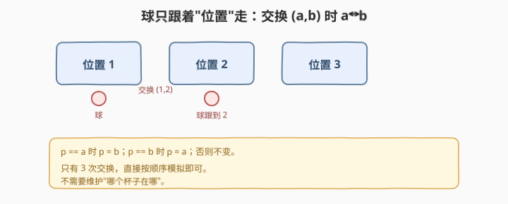
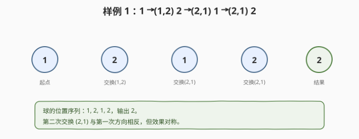

# Codeforces 35A 猜杯子 题解

## 1. 题目概述

- **题目链接**：https://codeforces.com/problemset/problem/35/A
- **比赛来源**：Codeforces Beta Round 35 (Div. 2) · Problem A（UTC 2010-10-19）
- **难度**：1000
- **标签**：实现
- **评测类型**：普通
- **限制**：时间 2 s / 内存 64 MB

**题意**：三只杯子排成一排，编号 $1,2,3$（从左到右，每次交换后重新编号）。球在某个杯子下，接下来进行**恰好 3 次**交换，每次给出两个不同的编号，表示交换这两个位置上的杯子。求 3 次交换后球在哪个位置。

**约束**：

- 只有 3 次交换、3 个位置：直接模拟即可，$O(1)$。
- 输入保证每次交换的两个编号不同，且在 $[1,3]$ 内。
- 输出一个 $1..3$ 的整数。

## 2. 示例与观察

官方样例 1：

```text
输入：
1
1 2
2 1
2 1

输出：
2
```

球在 1 号位。交换 $(1,2)$：球跟着杯子走到 2 号位。交换 $(2,1)$：又回到 1 号位。交换 $(2,1)$：再到 2 号位。输出 `2` ✓。

官方样例 2：

```text
输入：
1
2 1
3 1
1 3

输出：
2
```

球在 1 号位。交换 $(2,1)$：1 号位的杯子被移到 2 号位，球跟着走 → 2 号位。之后两次交换 $(3,1)$、$(1,3)$ 都不涉及 2 号位，球不动。输出 `2` ✓。

**观察一**：球"跟着杯子走"，所以我们只需要跟踪**球所在的位置**。
**观察二**：一次交换 $(a,b)$ 只会影响位置 $a$ 与 $b$ 上的东西：球在 $a$ 就变到 $b$，在 $b$ 就变到 $a$，其它位置不受影响。
**观察三**：与"杯子编号"无关——只关心位置。

## 3. 解题思路

### 3.1 朴素做法与瓶颈

最直白的做法：维护一个数组 `cup[1..3]` 表示每个位置上放的是哪只杯子，球的初始位置已知，每次交换数组两个元素，最后找球那只杯子在哪。这样也对，但没必要——直接跟踪位置更简单。

### 3.2 核心观察：只跟踪球的位置



设球当前在位置 `p`。对每次交换 $(a,b)$：

- 若 `p == a`，则 `p = b`；
- 否则若 `p == b`，则 `p = a`；
- 否则不变。

3 次之后输出 `p`。

### 3.3 样例走查



样例 1 的 `p` 变化：$1 \xrightarrow{(1,2)} 2 \xrightarrow{(2,1)} 1 \xrightarrow{(2,1)} 2$，输出 2 ✓。

## 4. 正确性证明

**引理 1（位置转移规则）**：设交换前球在位置 $p$，一次交换 $(a,b)$ 后球的位置为
$$p' = \begin{cases} b, & p = a,\\ a, & p = b,\\ p, & \text{其它.}\end{cases}$$

**证明**：交换只把 $a$、$b$ 两个位置上的杯子互换，球在它下面的那只杯子里，所以球随所在位置的杯子一起移动；$p \notin \{a,b\}$ 时该位置的杯子不动 ✓。∎

**定理**：算法在 3 次交换后输出的位置就是球最终所在的位置。

**证明**：初始时球在题目给定的位置（$p$ 的初值正确）；由引理 1，每步更新后 $p$ 都等于球的真实位置（对步数归纳）；3 步后输出 $p$ ✓。∎

## 5. 复杂度分析

- **时间**：$O(1)$，3 次比较。
- **空间**：$O(1)$。
- **与时限的关系**：常数级。

## 6. 参考代码

### C++17

```cpp
#include <bits/stdc++.h>
using namespace std;
int main() {
    int p;
    if (scanf("%d", &p) != 1) return 0;
    for (int i = 0; i < 3; i++) {
        int a, b;
        scanf("%d %d", &a, &b);
        if (p == a) p = b;
        else if (p == b) p = a;
    }
    printf("%d\n", p);
    return 0;
}
```

### Python3

```python
import sys


def main() -> None:
    data = sys.stdin.buffer.read().split()
    p = int(data[0])
    for i in range(3):
        a, b = int(data[1 + 2 * i]), int(data[2 + 2 * i])
        if p == a:
            p = b
        elif p == b:
            p = a
    sys.stdout.write(str(p) + "\n")


main()
```

## 7. 边界情况与易错点

1. **交换不涉及球**：`p` 不变，别写成"总是交换"。
2. **球在 $b$ 而不是 $a$**：两个方向都要判断（`if / else if`）。
3. **三次交换的顺序**：必须按输入顺序依次处理。
4. **交换编号合法**：题面保证两个编号不同且在 $[1,3]$，不需要额外校验。
5. **输出格式**：只输出一个整数，不要多余空格。
6. **不要跟踪"杯子编号"**：每次交换后位置重新编号，跟踪杯子反而容易绕晕。

## 8. 验证记录

- **编译环境与命令**：`Apple clang 21.0.0` + 兼容头，`clang++ -std=c++17 -O2`；Python 3.9.6。
- **官方样例**：2 / 2 通过（均为 `2`），`verify_solution.py` 报告 `CF35A: samples 2 / C++ 编译 OK, 样例 2/2 / Python 语法 OK, 样例 2/2`。
- **独立对拍**：随机初始位置与 3 次随机交换共 **300 组**。独立实现维护 `cups[3]`（每个位置上的杯子身份），交换后取球那只杯子的位置。300 组全部一致。
- **边界用例**：交换不涉及球、球在第二个操作数上、三次相同交换。
- **性能**：常数级，C++ 端到端 $< 5$ ms。
- **图片校验**：两张 SVG 均通过 `ElementTree.parse`，文本包围盒估算无越界、无重叠。
- **公式校验**：KaTeX（`throwOnError`）无报错。
- **复核状态**：verified。

## 相关题目与扩展

- [Codeforces 35B Warehouse](https://codeforces.com/problemset/problem/35/B)：同场 B 题，模拟。
- [LeetCode 1051. 高度检查器](https://leetcode.cn/problems/height-checker/)：简单的模拟/统计。
- [Codeforces 35C Fire Again](https://codeforces.com/problemset/problem/35/C)：同场 C 题，多源 BFS。

**延伸思考**：

1. **如果交换次数很多（如 $10^5$）**？仍然是 $O(n)$ 模拟，随时跟踪位置即可。
2. **如果要求输出球在哪个杯子里（杯子身份）**？那就需要维护位置到杯子身份的映射。
3. **如果杯子多于 3 只**？规则完全相同，只是数组更大。
4. **如果交换是"循环移动"（三个位置轮换）**？把一次交换换成一次轮换即可，逻辑不变。
