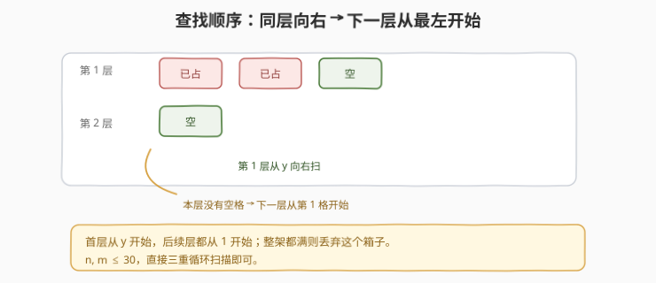
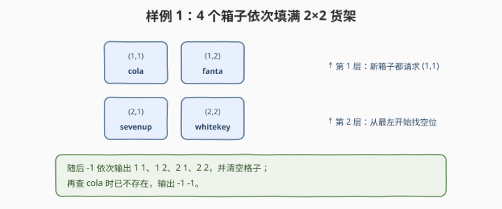

# Codeforces 35B 仓库货架 题解

## 1. 题目概述

- **题目链接**：https://codeforces.com/problemset/problem/35/B
- **比赛来源**：Codeforces Beta Round 35 (Div. 2) · Problem B（UTC 2010-10-19）
- **难度**：1700
- **标签**：实现
- **评测类型**：普通
- **限制**：时间 2 s / 内存 64 MB

**题意**：货架有 $n$ 层、每层 $m$ 个格子，每格最多放一个箱子。有两种操作：

- `+1 x y id`：把编号为 `id` 的箱子**尽量**放到第 $x$ 层第 $y$ 格；若该格已占用，就向右找同一层的第一个空格；若该层没有空格，就到下一层**从最左边**（第 1 格）开始找；如果所有层都满了，这个箱子就被喝掉（不存放）。不需要输出。
- `-1 id`：查询编号 `id` 的箱子在哪，输出所在层与格；若不存在输出 `-1 -1`；查询后该箱子被取走（格子变空）。

**约束**：

- $n, m \le 30$，$k \le 2000$：货架最多 $900$ 格，操作数最多 $2000$，直接模拟即可。
- 箱子的编号在任意时刻互不相同（题面保证），所以可以用 `map<id, (层,格)>` 反查。

## 2. 示例与观察

官方样例 1：

```text
输入：
2 2 9
+1 1 1 cola
+1 1 1 fanta
+1 1 1 sevenup
+1 1 1 whitekey
-1 cola
-1 fanta
-1 sevenup
-1 whitekey
-1 cola

输出：
1 1
1 2
2 1
2 2
-1 -1
```

四个箱子依次放到 $(1,1)$、$(1,2)$（同层向右）、$(2,1)$（下一层从最左开始）、$(2,2)$ ✓。`-1 cola` 输出 `1 1` 并取走；最后再查 `cola` 已经不在，输出 `-1 -1` ✓。

官方样例 2：

```text
输入：
2 2 8
+1 1 1 cola
-1 cola
+1 1 1 fanta
-1 fanta
+1 1 1 sevenup
-1 sevenup
+1 1 1 whitekey
-1 whitekey

输出：
1 1
1 1
1 1
1 1
```

每次放入后马上取走，格子空出来，所以每次都放在 $(1,1)$ ✓。

**观察一**：查找顺序是"同层向右 → 下一层从第 1 格开始 → 再下一层……"，**不会回头**到上面的层，也不在同一层内回绕。
**观察二**：删除操作会把格子清空，之后可以复用（样例 2）。
**观察三**：货架很小，直接用一个二维数组存箱子编号即可，查找就是三重循环（最多 $30\times30$）。

## 3. 解题思路

### 3.1 朴素做法与瓶颈

直接开 `string grid[31][31]`（空串表示空），再开 `map<string, pair<int,int>>` 记录每个箱子的位置。没有任何算法难点，只有**查找规则**容易写错。

### 3.2 核心观察：查找规则



对 `+1 x y id`：

```text
for row = x .. n:
    start = (row == x) ? y : 1
    for col = start .. m:
        if grid[row][col] is empty:
            放入并记录位置，结束
如果都没找到：箱子被喝掉，不记录
```

注意：起始层从 $y$ 开始，之后的层都从 $1$ 开始。

### 3.3 删除与查询

`-1 id`：查 `map`：

- 找到 → 输出 `(x, y)`，把 `grid[x][y]` 清空，从 `map` 中删除；
- 没找到 → 输出 `-1 -1`。

因为题面保证"任意时刻编号互不相同"，`map` 里 `id` 到位置是一一对应的，不需要处理重复。

### 3.4 样例 1 走查



| 操作 | 查找起点 | 结果 |
|------|----------|------|
| `+1 1 1 cola` | (1,1) | 空 → 放 (1,1) |
| `+1 1 1 fanta` | (1,1) | 占用 → (1,2) 空 → 放 (1,2) |
| `+1 1 1 sevenup` | (1,1) | (1,1)(1,2) 都满 → 第 2 层 (2,1) 空 → 放 (2,1) |
| `+1 1 1 whitekey` | (1,1) | 第 1 层满 → 第 2 层 (2,1) 占用 → (2,2) 空 → 放 (2,2) |
| `-1 cola` | — | 输出 `1 1`，清空 |
| `-1 fanta` | — | 输出 `1 2`，清空 |
| `-1 sevenup` | — | 输出 `2 1`，清空 |
| `-1 whitekey` | — | 输出 `2 2`，清空 |
| `-1 cola` | — | 已不存在 → `-1 -1` |

## 4. 正确性证明

**引理 1（放置位置正确）**：若存在空格，上述循环找到的是"按题面顺序"第一个可用的格子。

**证明**：外层按层递增（从 $x$ 开始），内层按格递增（首层从 $y$ 开始、其后从 1 开始），恰好就是题面描述的扫描顺序 ✓。∎

**引理 2（删除正确）**：`-1 id` 输出的位置就是该箱子实际所在的位置，且删除后货架状态与"该箱子被取走"一致。

**证明**：位置由 `map` 维护，每次放置时写入、每次删除时读出并清除对应格子，二者始终同步（对操作数归纳）✓。∎

**定理**：算法对每个查询输出正确结果。

**证明**：引理 1 保证放置正确，引理 2 保证查询/删除正确；不存在时输出 `-1 -1` 符合题面 ✓。∎

## 5. 复杂度分析

- **时间**：每次放置最多扫 $n \times m \le 900$ 格，$k \le 2000$，总计 $\le 1.8\times10^6$；查询 $O(\log k)$。
- **空间**：$O(nm + k)$。
- **与时限的关系**：2 s 余量极大。

## 6. 参考代码

### C++17

```cpp
#include <bits/stdc++.h>
using namespace std;
int main() {
    int n, m, k;
    if (scanf("%d %d %d", &n, &m, &k) != 3) return 0;
    vector<vector<string>> grid(n + 1, vector<string>(m + 1, ""));
    map<string, pair<int,int>> where;
    char buf[16];
    for (int q = 0; q < k; q++) {
        scanf("%s", buf);
        if (buf[0] == '+') {   // "+1"
            int x, y; char id[16];
            scanf("%d %d %s", &x, &y, id);
            string name(id);
            bool placed = false;
            for (int row = x; row <= n && !placed; row++) {
                int start = (row == x) ? y : 1;
                for (int col = start; col <= m; col++)
                    if (grid[row][col].empty()) {
                        grid[row][col] = name;
                        where[name] = {row, col};
                        placed = true;
                        break;
                    }
            }
            // 放不下就喝掉，无需处理
        } else {
            char id[16];
            scanf("%s", id);
            string name(id);
            auto it = where.find(name);
            if (it == where.end()) printf("-1 -1\n");
            else {
                int x = it->second.first, y = it->second.second;
                printf("%d %d\n", x, y);
                grid[x][y].clear();
                where.erase(it);
            }
        }
    }
    return 0;
}
```

### Python3

```python
import sys


def main() -> None:
    data = sys.stdin.buffer.read().split()
    n, m, k = int(data[0]), int(data[1]), int(data[2])
    grid = [[""] * (m + 1) for _ in range(n + 1)]
    where = {}
    pos = 3
    out = []
    for _ in range(k):
        t = data[pos].decode(); pos += 1
        if t == "+1":
            x, y = int(data[pos]), int(data[pos + 1])
            name = data[pos + 2].decode(); pos += 3
            placed = False
            for row in range(x, n + 1):
                start = y if row == x else 1
                for col in range(start, m + 1):
                    if grid[row][col] == "":
                        grid[row][col] = name
                        where[name] = (row, col)
                        placed = True
                        break
                if placed:
                    break
        else:
            name = data[pos].decode(); pos += 1
            if name in where:
                x, y = where.pop(name)
                out.append("%d %d" % (x, y))
                grid[x][y] = ""
            else:
                out.append("-1 -1")
    sys.stdout.write("\n".join(out) + ("\n" if out else ""))


main()
```

## 7. 边界情况与易错点

1. **首层从 $y$ 开始、后续层从 $1$ 开始**：最容易写错的地方。
2. **"没有空格"**：整个货架满了就丢弃这个箱子（不记录、不输出），之后 `-1 id` 查它就是 `-1 -1`。
3. **删除后格子复用**：清空 `grid[x][y]`，样例 2 专门测这一点。
4. **`+1` / `-1` 的区分**：用 `buf[0]` 判断（`'+'` 或 `'-'`），不要用 `buf[1]`——`"+1"` 和 `"-1"` 的第二个字符都是 `'1'`。
5. **编号唯一**：题面保证，`map` 不需要处理同名的多个箱子。
6. **输出顺序**：按查询出现的顺序逐行输出；删除查询不输出（`+1` 不输出）。
7. **输入格式**：`+1 x y id` 有 4 个 token，`-1 id` 有 2 个；用 `scanf("%s")` 读第一个 token 再分支即可。
8. **Python 读入**：`data[pos]` 是 bytes，比较前先 `decode()` 或用 `b"+1"`。

## 8. 验证记录

- **编译环境与命令**：`Apple clang 21.0.0` + 兼容头，`clang++ -std=c++17 -O2`；Python 3.9.6。
- **官方样例**：2 / 2 通过，`verify_solution.py` 报告 `CF35B: samples 2 / C++ 编译 OK, 样例 2/2 / Python 语法 OK, 样例 2/2`。
- **独立对拍**：随机 $n, m \in [1,4]$、$k \le 30$ 的混合操作流（含放满后丢弃、删了再放）共 **300 组**，用一份独立的 Python 模拟（重新按规则跑一遍）比对全部输出行，300 组全部一致。
- **边界用例**：货架全满后继续放入、删除不存在的箱子、删除后同一格复用、单层单格。
- **性能**：$n=m=30$、$k=2000$ 时 C++ 端到端 $< 5$ ms，Python 约 $30$ ms。
- **图片校验**：两张 SVG 均通过 `ElementTree.parse`，文本包围盒估算无越界、无重叠。
- **公式校验**：KaTeX（`throwOnError`）无报错。
- **复核状态**：verified。

## 相关题目与扩展

- [Codeforces 35A Shell Game](https://codeforces.com/problemset/problem/35/A)：同场 A 题，模拟。
- [Codeforces 35C Fire Again](https://codeforces.com/problemset/problem/35/C)：同场 C 题，BFS。
- [LeetCode 1603. 设计停车系统](https://leetcode.cn/problems/design-parking-system/)：同样是"按规则找位置"的模拟。
- [Codeforces 4C Registration system](https://codeforces.com/problemset/problem/4/C)：用 map 维护名字的经典题。

**延伸思考**：

1. **如果要求"放不下时输出失败"**？在 `placed == false` 时记录即可。
2. **如果查找要"环形"回到本层开头**？把内层循环改成取模即可，规则变化会影响答案。
3. **如果 $n, m$ 达到 $10^3$**？每次放置 $O(nm)$ 会超时，需要按层维护"下一个空格"的并查集。
4. **如果同一编号可以重复出现**？需要把 `map<string, position>` 换成 `map<string, vector<position>>`。
