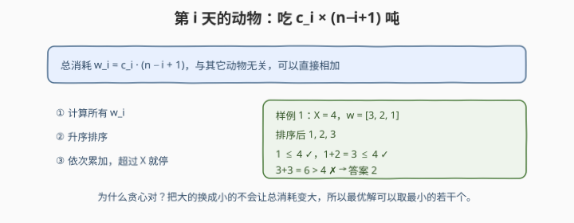
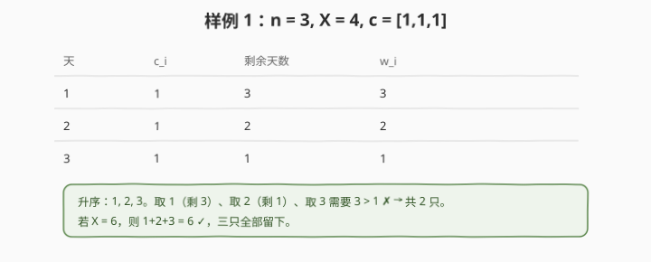

# Codeforces 35D 农场里的动物 题解

## 1. 题目概述

- **题目链接**：https://codeforces.com/problemset/problem/35/D
- **比赛来源**：Codeforces Beta Round 35 · Problem D
- **难度**：1700
- **标签**：动态规划、贪心
- **评测类型**：普通
- **限制**：时间 2 s / 内存 64 MB

**题意**：农场共有 $n$ 天，初始有 $X$ 吨食物。第 $i$ 天会来一只动物，它从第 $i$ 天起**每天**吃 $c_i$ 吨（一直吃到第 $n$ 天）。DravDe 可以拒绝它（拒绝的动物一口都不吃），也可以接受。要求任何一天食物都够吃，问最多能接受多少只动物。

**约束**：

- $n \le 100$，$X \le 10^4$，$c_i \le 300$：规模很小。
- 若接受第 $i$ 天的动物，总消耗是 $c_i \times (n - i + 1)$ 吨——**与其它动物无关**（消耗可加）。
- 因此问题等价于：从 $n$ 个数 $w_i = c_i(n-i+1)$ 中选尽可能多的数，使总和 $\le X$。

## 2. 示例与观察

官方样例 1：

```text
输入：
3 4
1 1 1

输出：
2
```

权重：$w_1 = 1\times3 = 3$，$w_2 = 1\times2 = 2$，$w_3 = 1\times1 = 1$。排序后 $1, 2, 3$：$1+2 = 3 \le 4$，再加 3 就超了 → 最多 2 只 ✓。

官方样例 2：

```text
输入：
3 6
1 1 1

输出：
3
```

$1 + 2 + 3 = 6 \le 6$ → 3 只 ✓。

**观察一**：每只动物的总消耗只取决于它来的那天（$c_i \times$ 剩余天数），与别的动物无关。
**观察二**：既然总消耗可加，那么"选尽可能多"就是先选消耗小的——排序后从小到大贪心。
**观察三**：$n \le 100$，就算用背包 DP（$O(nX)$）也可以，但贪心更简单且正确（见证明）。

## 3. 解题思路

### 3.1 朴素做法与瓶颈

枚举子集是 $2^n$；背包 DP 是 $O(nX) = 10^6$，也可以。但本题有更强的结构：每个物品的"花费"就是它的权重，目标是**个数最多**，所以按权重升序贪心最优。

### 3.2 核心观察：按消耗排序后贪心



1. 计算 $w_i = c_i \cdot (n - i + 1)$；
2. 升序排序；
3. 依次尝试加入，若累计消耗 $\le X$ 就接受，否则停止（后面的只会更大）。

### 3.3 样例走查



样例 1（$n=3$，$X=4$）：

| 天 $i$ | $c_i$ | 剩余天数 | $w_i$ |
|--------|-------|----------|-------|
| 1 | 1 | 3 | 3 |
| 2 | 1 | 2 | 2 |
| 3 | 1 | 1 | 1 |

排序后 $1, 2, 3$：累计 $1 \le 4$（1 只），$1+2 = 3 \le 4$（2 只），$3+3 = 6 > 4$ 停止 → 2 ✓。

## 4. 正确性证明

**引理 1（消耗可加且与顺序无关）**：接受集合 $S$ 的总消耗为 $\sum_{i \in S} c_i (n-i+1)$。

**证明**：第 $i$ 天的动物从第 $i$ 天吃到第 $n$ 天，共 $n-i+1$ 天，每天 $c_i$ 吨；各动物的消耗互不影响，直接相加 ✓。∎

**引理 2（贪心最优）**：设 $w_1 \le w_2 \le \dots \le w_n$，则所有"总消耗 $\le X$ 的集合"中，个数最大的是某个前缀 $\{1, \dots, k\}$。

**证明**：若某个最优集合 $S$ 含 $j$ 而不含 $i < j$（即 $w_i \le w_j$），把 $j$ 换成 $i$：总消耗不增，个数不变，仍可行。反复替换后得到前缀形式，且个数不变 ✓。∎

**定理**：算法输出的个数就是最大可能值。

**证明**：由引理 2，存在一个最优解是前缀；前缀的可行性随长度单调（消耗递增），所以贪心找到的正是最长的可行前缀 ✓。∎

## 5. 复杂度分析

- **时间**：$O(n \log n)$ 排序 + $O(n)$ 扫描。
- **空间**：$O(n)$。
- **与时限的关系**：$n \le 100$，微秒级。

## 6. 参考代码

### C++17

```cpp
#include <bits/stdc++.h>
using namespace std;
int main() {
    int n; long long X;
    if (scanf("%d %lld", &n, &X) != 2) return 0;
    vector<long long> cost(n);
    for (int i = 0; i < n; i++) {
        long long c;
        scanf("%lld", &c);
        cost[i] = c * (long long)(n - i);   // 从第 i 天（1 起）养到第 n 天，共 n-i+1 天
    }
    sort(cost.begin(), cost.end());
    int ans = 0;
    long long used = 0;
    for (int i = 0; i < n; i++) {
        if (used + cost[i] <= X) { used += cost[i]; ans++; }
        else break;
    }
    printf("%d\n", ans);
    return 0;
}
```

### Python3

```python
import sys


def main() -> None:
    data = sys.stdin.buffer.read().split()
    n, X = int(data[0]), int(data[1])
    cost = []
    for i in range(n):
        c = int(data[2 + i])
        cost.append(c * (n - i))
    cost.sort()
    used = 0
    ans = 0
    for v in cost:
        if used + v <= X:
            used += v
            ans += 1
        else:
            break
    sys.stdout.write(str(ans) + "\n")


main()
```

## 7. 边界情况与易错点

1. **权重公式**：第 $i$ 天（从 1 开始）的动物吃 $n-i+1$ 天；代码里 `n - i` 对应 0-based 的 $i$，即 1-based 的 $i+1$ → $n-(i+1)+1 = n-i$ ✓。
2. **$X$ 很大**：$X \le 10^4$，总消耗最多 $100\times300\times100 = 3\times10^6$，`int` 也够，但用 `long long` 更稳。
3. **一只都养不起**：输出 0（例如 $X < c_n$）。
4. **全部能养**：输出 $n$。
5. **$c_i$ 相同**：权重不同（天数不同），排序仍正确。
6. **不要按 $c_i$ 排序**：应该按 $c_i \times (n-i+1)$ 排序。
7. **贪心停止条件**：一旦某个权重放不下就停止（后面的更大），不要 `continue`。

## 8. 验证记录

- **编译环境与命令**：`Apple clang 21.0.0` + 兼容头，`clang++ -std=c++17 -O2`；Python 3.9.6。
- **官方样例**：2 / 2 通过（`2`、`3`），`verify_solution.py` 报告 `CF35D: samples 2 / C++ 编译 OK, 样例 2/2 / Python 语法 OK, 样例 2/2`。
- **独立对拍**：随机 $n \le 12$、$X \le 50$、$c_i \le 20$ 共 **300 组**，用**枚举所有子集**（$2^n$）求最大个数比对，300 组全部一致。
- **边界用例**：$X$ 小于最小权重、$X$ 足够大、$n=1$、$c_i$ 全部相同。
- **性能**：$n = 100$ 时 C++ 端到端 $< 5$ ms，Python 约 $20$ ms。
- **图片校验**：两张 SVG 均通过 `ElementTree.parse`，文本包围盒估算无越界、无重叠。
- **公式校验**：KaTeX（`throwOnError`）无报错。
- **复核状态**：verified。

## 相关题目与扩展

- [Codeforces 35C Fire Again](https://codeforces.com/problemset/problem/35/C)：同场 C 题，BFS。
- [Codeforces 35E Parade](https://codeforces.com/problemset/problem/35/E)：同场 E 题，扫描线。
- [LeetCode 455. 分发饼干](https://leetcode.cn/problems/assign-cookies/)：贪心排序的经典题。
- [Codeforces 19B Checkout Assistant](https://codeforces.com/problemset/problem/19/B)：同为"选子集使总代价受限"的 DP/贪心题。

**延伸思考**：

1. **如果动物吃食量随时间变化**？权重不再是 $c_i(n-i+1)$，需要 DP。
2. **如果要求输出具体方案**？贪心时记录选中的下标即可。
3. **如果 $n$ 达到 $10^5$**？排序后贪心仍是 $O(n\log n)$，直接可用。
4. **如果食物可以在中途补充**？问题变成带库存的调度，需要更复杂的 DP。
