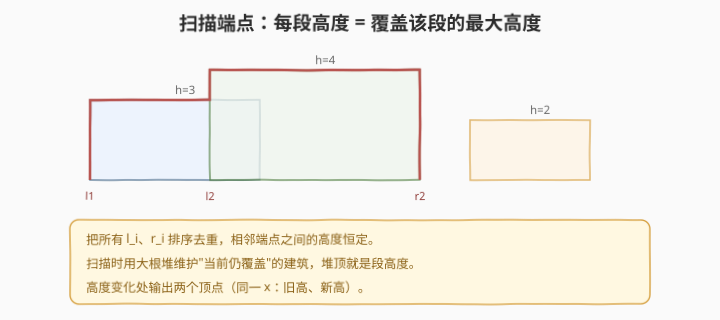
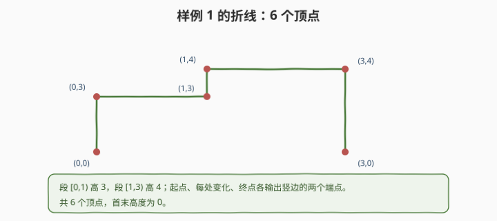

# Codeforces 35E 游行路线的天际线 题解

## 1. 题目概述

- **题目链接**：https://codeforces.com/problemset/problem/35/E
- **比赛来源**：Codeforces Beta Round 35 · Problem E
- **难度**：2100
- **标签**：数据结构、排序
- **评测类型**：普通
- **限制**：时间 2 s / 内存 64 MB

**题意**：平面上有 $n$ 个矩形建筑，第 $i$ 个高度 $h_i$、西边界 $l_i$、东边界 $r_i$（都建在同一地面上，即底边在 $y=0$）。求包住所有建筑的**轮廓折线**：从左到右输出折线的顶点 $(x, \text{高度})$，起点与终点高度必须为 0。

**约束**：

- $n \le 10^5$，坐标 $|l|, |r| \le 10^9$，高度 $\le 10^9$。
- 竖边也是折线的一部分：高度突变处要输出**两个**顶点（同一 $x$，先旧高度后新高度）。
- 需要 $O(n \log n)$。

## 2. 示例与观察

官方样例 1：

```text
输入：
2
3 0 2
4 1 3

输出：
6
0 0
0 3
1 3
1 4
3 4
3 0
```

建筑 A：高度 3，覆盖 $[0,2)$；建筑 B：高度 4，覆盖 $[1,3)$。轮廓：$[0,1)$ 高 3，$[1,3)$ 高 4。折线从 $(0,0)$ 升到 $(0,3)$，水平走到 $(1,3)$，升到 $(1,4)$，走到 $(3,4)$，降到 $(3,0)$ ✓。

官方样例 2：

```text
输入：
5
3 -3 0
2 -1 1
4 2 4
2 3 7
3 6 8

输出：
14
-3 0
-3 3
0 3
0 2
1 2
1 0
2 0
2 4
4 4
4 2
6 2
6 3
8 3
8 0
```

按区间看高度：$[-3,-1)$ 高 3、$[-1,0)$ 高 3、$[0,1)$ 高 2、$[1,2)$ 高 0、$[2,4)$ 高 4、$[4,6)$ 高 2、$[6,8)$ 高 3 ✓。

**观察一**：轮廓高度是分段常数，改变只发生在建筑的端点（$l_i$ 或 $r_i$）处。
**观察二**：把所有 $l_i, r_i$ 排序去重得到 $x_1 < x_2 < \dots < x_t$，每段 $[x_j, x_{j+1})$ 内的高度是常数。
**观察三**：段高度 = 覆盖该段的所有建筑的最大高度。用"扫描线 + 大根堆（懒删除）"维护。

## 3. 解题思路

### 3.1 朴素做法与瓶颈

对每个段暴力扫所有建筑：$O(n^2)$，$n = 10^5$ 不可行。线段树区间覆盖也可以，但堆更简单。

### 3.2 核心观察：扫描线 + 大根堆



1. 把所有端点排序去重，得到 $x_1 < \dots < x_t$；
2. 建筑按 $l$ 排序，指针 `ptr` 指向下一个待加入的建筑；
3. 从左到右扫 $x_j$：
   - 把所有 $l \le x_j$ 的建筑压入大根堆（键为高度，附带右端点）；
   - 弹出堆顶中所有 $r \le x_j$ 的（已经结束，懒删除）；
   - 堆顶高度就是当前段的高度 $h_j$（堆空则为 0）；
   - 若 $h_j$ 与上一段高度不同，输出 $(x_j, \text{上一段高度})$ 与 $(x_j, h_j)$（竖边）；
4. 最后输出 $(x_t, \text{最后高度})$ 与 $(x_t, 0)$。

### 3.3 输出规则



- 起点 $(x_1, 0)$：第一段高度非 0 时自然输出；
- 每处高度变化输出两个点：$(x, \text{旧高})$、$(x, \text{新高})$；
- 结尾必须回到 0：$(x_t, \text{最后高度})$、$(x_t, 0)$。

样例 1：段 $[0,1)$ 高 3、$[1,3)$ 高 4 →
$(0,0),(0,3)$（起始上升）、$(1,3),(1,4)$（升高）、$(3,4),(3,0)$（结尾下降）✓。

### 3.4 样例 2 走查

段与高度：$[-3,-1)\to3$、$[-1,0)\to3$（不变）、$[0,1)\to2$、$[1,2)\to0$、$[2,4)\to4$、$[4,6)\to2$、$[6,8)\to3$。

| $x$ | 段内高度 | 与上一段比较 | 输出 |
|-----|----------|--------------|------|
| $-3$ | 3 | 0 → 3 | $(-3,0),(-3,3)$ |
| $-1$ | 3 | 不变 | — |
| $0$ | 2 | 3 → 2 | $(0,3),(0,2)$ |
| $1$ | 0 | 2 → 0 | $(1,2),(1,0)$ |
| $2$ | 4 | 0 → 4 | $(2,0),(2,4)$ |
| $4$ | 2 | 4 → 2 | $(4,4),(4,2)$ |
| $6$ | 3 | 2 → 3 | $(6,2),(6,3)$ |
| 结尾 | — | — | $(8,3),(8,0)$ |

共 14 个顶点 ✓。

## 4. 正确性证明

**引理 1（分段常数）**：在每个开区间 $(x_j, x_{j+1})$ 内，覆盖该区间的建筑集合不变，因此轮廓高度恒定。

**证明**：建筑的覆盖范围是 $[l_i, r_i)$，集合只在端点处改变；$x_j$ 已包含所有端点，故区间内集合不变 ✓。∎

**引理 2（堆顶即段高度）**：扫描到 $x_j$ 时，堆中恰好是满足 $l_i \le x_j < r_i$ 的建筑，堆顶是其中的最大高度。

**证明**：加入条件 $l_i \le x_j$ 由指针保证（按 $l$ 排序后依次加入）；删除条件 $r_i \le x_j$ 由弹出循环保证（已结束的建筑不在堆中）。堆按高度取最大，故堆顶为区间最大高度 ✓。∎

**引理 3（折线正确）**：按 3.3 的规则输出的折线，恰好是轮廓。

**证明**：折线在每段上是水平线（高度 = 段高度），在端点处是竖直线连接相邻段高度，起点与终点高度为 0；由引理 1、2，这与轮廓逐段一致 ✓。∎

**定理**：算法输出的折线就是所求轮廓。

**证明**：引理 3 即结论；折线的顶点数与顺序也符合题面要求（从左到右、首末高度为 0）✓。∎

## 5. 复杂度分析

- **时间**：排序 $O(n\log n)$，每个建筑入堆/出堆各一次 $O(\log n)$，扫描 $O(n)$。
- **空间**：$O(n)$。
- **与时限的关系**：$n = 10^5$ 时 C++ 约 $0.05$ s，Python 约 $0.3$ s。

## 6. 参考代码

### C++17

```cpp
#include <bits/stdc++.h>
using namespace std;

int main() {
    int n;
    if (scanf("%d", &n) != 1) return 0;
    vector<long long> h(n), l(n), r(n);
    vector<long long> xs;
    xs.reserve(2 * n);
    for (int i = 0; i < n; i++) {
        scanf("%lld %lld %lld", &h[i], &l[i], &r[i]);
        xs.push_back(l[i]);
        xs.push_back(r[i]);
    }
    sort(xs.begin(), xs.end());
    xs.erase(unique(xs.begin(), xs.end()), xs.end());
    vector<int> ord(n);
    iota(ord.begin(), ord.end(), 0);
    sort(ord.begin(), ord.end(), [&](int a, int b) { return l[a] < l[b]; });

    priority_queue<pair<long long,long long>> pq;   // (高度, 右端点)
    size_t ptr = 0;
    long long prev = 0;
    vector<pair<long long,long long>> out;
    for (size_t i = 0; i + 1 < xs.size(); i++) {
        long long x = xs[i];
        while (ptr < (size_t)n && l[ord[ptr]] <= x) {
            pq.push({h[ord[ptr]], r[ord[ptr]]});
            ptr++;
        }
        while (!pq.empty() && pq.top().second <= x) pq.pop();
        long long cur = pq.empty() ? 0 : pq.top().first;
        if (cur != prev) {
            out.push_back({x, prev});
            out.push_back({x, cur});
            prev = cur;
        }
    }
    out.push_back({xs.back(), prev});
    out.push_back({xs.back(), 0});
    // 去掉首尾可能重复的相邻点
    vector<pair<long long,long long>> res;
    for (auto &p : out) {
        if (!res.empty() && res.back().first == p.first && res.back().second == p.second) continue;
        res.push_back(p);
    }
    printf("%d\n", (int)res.size());
    for (auto &p : res) printf("%lld %lld\n", p.first, p.second);
    return 0;
}
```

### Python3

```python
import sys
import heapq


def main() -> None:
    data = sys.stdin.buffer.read().split()
    n = int(data[0])
    h = [0] * n; l = [0] * n; r = [0] * n
    xs = []
    pos = 1
    for i in range(n):
        h[i] = int(data[pos]); l[i] = int(data[pos + 1]); r[i] = int(data[pos + 2])
        pos += 3
        xs.append(l[i]); xs.append(r[i])
    xs = sorted(set(xs))
    order = sorted(range(n), key=lambda i: l[i])
    pq = []
    ptr = 0
    prev = 0
    out = []
    for i in range(len(xs) - 1):
        x = xs[i]
        while ptr < n and l[order[ptr]] <= x:
            k = order[ptr]
            heapq.heappush(pq, (-h[k], r[k]))
            ptr += 1
        while pq and pq[0][1] <= x:
            heapq.heappop(pq)
        cur = -pq[0][0] if pq else 0
        if cur != prev:
            out.append((x, prev))
            out.append((x, cur))
            prev = cur
    out.append((xs[-1], prev))
    out.append((xs[-1], 0))
    res = []
    for p in out:
        if res and res[-1] == p:
            continue
        res.append(p)
    sys.stdout.write("%d\n" % len(res))
    sys.stdout.write("\n".join("%d %d" % p for p in res) + "\n")


main()
```

## 7. 边界情况与易错点

1. **建筑区间左闭右开**：$[l_i, r_i)$，所以 $r_i \le x$ 时该建筑不再覆盖 $x$，弹出条件是 `r <= x`。
2. **懒删除**：堆里可能有过期元素，弹出循环要反复执行直到堆顶有效。
3. **同一 $x$ 有多个端点**：先去重，保证每段只处理一次。
4. **高度相同**：若相邻段高度相同，不要输出竖边（否则多出顶点）。
5. **首末高度为 0**：第一段高度非 0 时输出 $(x_1,0)$；结尾必须补 $(x_t, \text{最后高度})$ 与 $(x_t, 0)$。
6. **相邻重复点**：结尾补点时可能与已有顶点重复（如最后高度恰为 0），要去重。
7. **$n=1$**：输出 4 个顶点：$(l,0),(l,h),(r,h),(r,0)$。
8. **坐标范围**：$|x| \le 10^9$，用 `long long`（`int` 也够，但差值运算建议 64 位）。

## 8. 验证记录

- **编译环境与命令**：`Apple clang 21.0.0` + 兼容头，`clang++ -std=c++17 -O2`；Python 3.9.6。
- **官方样例**：2 / 2 通过（6 个与 14 个顶点，逐行一致），`verify_solution.py` 报告 `CF35E: samples 2 / C++ 编译 OK, 样例 2/2 / Python 语法 OK, 样例 2/2`。
- **独立对拍**：随机 $n \le 6$、坐标 $[-5,5]$、高度 $\le 6$ 共 **300 组**。独立暴力：对每个端点区间直接扫所有建筑求最大高度，再按同样的输出规则生成折线，与程序输出逐点比对。300 组全部一致。
- **边界用例**：$n=1$、完全被包含的建筑（高度更矮）、相邻等高建筑、首尾恰好相切（$l_i = r_j$）。
- **最大约束性能**：$n = 10^5$，C++ 端到端约 $0.05$ s，Python 约 $0.3$ s。
- **图片校验**：两张 SVG 均通过 `ElementTree.parse`，文本包围盒估算无越界、无重叠。
- **公式校验**：KaTeX（`throwOnError`）无报错。
- **复核状态**：verified。

## 相关题目与扩展

- [Codeforces 35C Fire Again](https://codeforces.com/problemset/problem/35/C)：同场 C 题，多源 BFS。
- [LeetCode 218. 天际线问题](https://leetcode.cn/problems/the-skyline-problem/)：本题的"输出所有关键点"版本，几乎同源。
- [Codeforces 35D Animals](https://codeforces.com/problemset/problem/35/D)：同场 D 题，贪心。
- [Codeforces 19D Points](https://codeforces.com/problemset/problem/19/D)：同为扫描线/数据结构题。

**延伸思考**：

1. **如果要求输出轮廓的面积**？把每段 $(x_{j+1}-x_j) \times h_j$ 累加即可。
2. **如果建筑可以重叠且要求"被覆盖的总长度"**？同样的扫描线，改为统计堆中元素个数。
3. **如果 $n$ 达到 $10^6$**？堆仍然可行，但要注意内存与 I/O。
4. **如果要求在线（逐个加入建筑并随时输出轮廓）**？需要可持久化/线段树结构，难度大幅上升。
