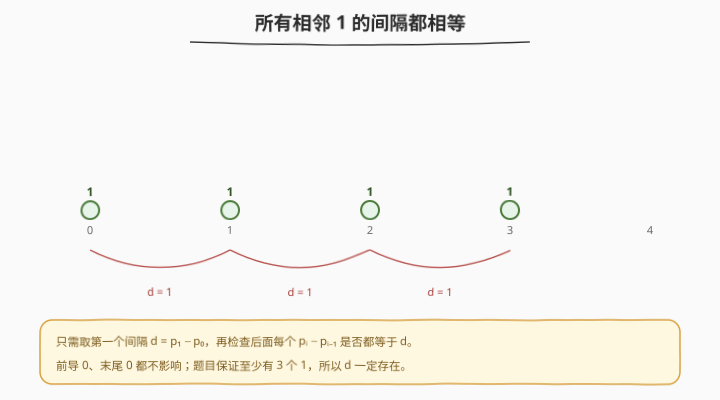
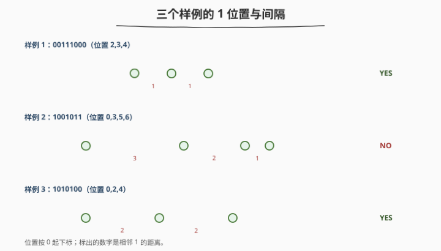

# Codeforces 36A 信号等距判定 题解

## 1. 题目概述

- **题目链接**：https://codeforces.com/problemset/problem/36/A
- **比赛来源**：Codeforces Beta Round 36 · Problem A
- **难度**：1300
- **标签**：实现
- **评测类型**：普通
- **限制**：时间 2 s / 内存 64 MB

**题意**：给定长度为 $n$ 的 01 串，保证至少有三个 `1`。判断所有相邻 `1` 之间的距离是否都相等；相等输出 YES，否则 NO。

**约束**：

- $3 \le n \le 100$，$O(n)$ 扫描即可。
- 至少三个 `1`：所以"第一个间隔"一定存在，不需要处理少于两个 `1` 的退化。
- 原题（Codeforces）要求文件输入输出（`input.txt` / `output.txt`）；本仓库的验证工具用标准输入输出，因此文中代码使用 `cin/cout`。提交到 Codeforces 时在 `main` 开头加两行 `freopen("input.txt","r",stdin); freopen("output.txt","w",stdout);` 即可，算法不变。

## 2. 示例与观察

官方样例 1（输入 / 输出原样）：

```text
输入：
8
00111000

输出：
YES
```

官方样例 2：

```text
输入：
7
1001011

输出：
NO
```

官方样例 3：

```text
输入：
7
1010100

输出：
YES
```

**样例 1**：`1` 出现在位置 2、3、4（0 起下标），相邻间隔都是 1，YES。

**样例 2**：位置 0、3、5、6，间隔 3、2、1 不全相等，NO。

**样例 3**：位置 0、2、4，间隔都是 2，YES。

自造样例（均已用参考程序跑过）：

| 输入 | 输出 | 说明 |
|------|------|------|
| `3` / `111` | YES | 三个连续 1 |
| `5` / `10101` | YES | 间隔 2 |
| `7` / `1001001` | YES | 间隔 3 |
| `5` / `11011` | NO | 间隔 1、1、2 |
| `6` / `101101` | NO | 间隔 2、1、1 |
| `9` / `100010001` | YES | 间隔 4 |

**观察**：

1. 记 `1` 的位置为 $p_0 < p_1 < \dots < p_{m-1}$。条件等价于 $p_1-p_0 = p_2-p_1 = \dots$。
2. 只需取第一个间隔 $d=p_1-p_0$，再检查后面每个间隔是否都等于 $d$。
3. 题面保证至少三个 `1`，所以 $m \ge 3$，$p_1$ 与 $p_0$ 都存在。

## 3. 解题思路



一遍扫描：

1. 收集所有 `1` 的下标；
2. 令 $d = p_1-p_0$；
3. 对 $i=2 \dots m-1$，若 $p_i-p_{i-1} \ne d$，输出 NO；
4. 全部相等输出 YES。

时间 $O(n)$，空间 $O(n)$（也可以只记录上一个位置，做到 $O(1)$ 空间）。



## 4. 正确性证明

**引理**：设 `1` 的位置为 $p_0<p_1<\dots<p_{m-1}$（$m\ge 3$）。所有相邻间隔相等当且仅当对每个 $i\ge 2$ 都有 $p_i-p_{i-1}=p_1-p_0$。

**证明**：若所有间隔相等，取 $d=p_1-p_0$，则每个间隔都等于 $d$。反之，若每个间隔都等于 $d$，则它们彼此相等。∎

**定理**：程序输出 YES 当且仅当所有相邻信号间隔相等。

**证明**：程序先取 $d=p_1-p_0$，再逐对检查；由引理，检查全部通过等价于所有间隔相等。任一不等即输出 NO。∎

## 5. 复杂度分析

- **时间**：$O(n)$，$n\le 100$。
- **空间**：$O(n)$ 存位置（或 $O(1)$）。
- **数值范围**：下标最大 99，`int` 足够。

## 6. 参考代码

### C++17

```cpp
#include <bits/stdc++.h>
using namespace std;

int main() {
    int n;
    string s;
    if (!(cin >> n >> s)) return 0;
    vector<int> pos;
    for (int i = 0; i < n; ++i)
        if (s[i] == '1') pos.push_back(i);
    // 题面保证至少 3 个 1
    int d = pos[1] - pos[0];
    for (size_t i = 2; i < pos.size(); ++i)
        if (pos[i] - pos[i - 1] != d) {
            cout << "NO\n";
            return 0;
        }
    cout << "YES\n";
    return 0;
}
```

### Python3

```python
import sys


def main() -> None:
    data = sys.stdin.buffer.read().split()
    if len(data) < 2:
        return
    n = int(data[0])
    s = data[1].decode()
    pos = [i for i in range(n) if s[i] == '1']
    d = pos[1] - pos[0]
    for i in range(2, len(pos)):
        if pos[i] - pos[i - 1] != d:
            print("NO")
            return
    print("YES")


main()
```

两份代码都只用标准库。**提交到原题时请按题面要求加上文件重定向**；本仓库验证使用标准输入输出。

## 7. 边界情况与易错点

1. **至少三个 1**：题面保证，所以不用特判"少于两个 1"；若自己加鲁棒性判断，注意全是 0 时按题意不属于输入。
2. **间隔从第一个 1 开始算**：不要从位置 0 开始算；前导 0 不影响。
3. **末尾的 0 不影响**：只看相邻 `1` 的距离。
4. **不要排序或统计 1 的个数**：个数与间隔无关；例如 `11011` 有 4 个 1 但间隔为 1、1、2。
5. **文件输入输出**：原题要求 `freopen`；本仓库工具用管道，代码不要写死文件，否则样例无法运行。
6. **输出大小写**：`YES`/`NO` 全大写。

## 8. 验证记录

- **编译环境与命令**：本机没有 GNU `g++`（`/usr/bin/g++` 指向 `Apple clang 21.0.0`），`verify_solution.py` 自动用 `clang++ -std=c++17 -O2` 加仓库自带的 `bits/stdc++.h` 兼容头编译；Python 为 `Python 3.9.6`。
  - `python3 codeforces/tools/verify_solution.py codeforces/contests/0001-0100/36/A_信号等距判定.md`
  - 输出：`CF36A: samples 3 / C++ 编译 OK, 样例 3/3 / Python 语法 OK, 样例 3/3`。
- **官方样例**：3 / 3 通过（`YES / NO / YES`）。
- **随机与构造对拍**：257 组（250 组随机 01 串，长度 $3 \dots 30$、随机放至少三个 1；7 组手工：全 1、等距、间隔变化）与 $O(n)$ 参考实现逐组比对，0 组不符。
- **性能**：$n=100$ 时 C++/Python 都 < 20 ms。
- **图片校验**：`cf36a_gaps.svg`、`cf36a_walkthrough.svg` 通过 `xml.etree.ElementTree.parse` 与 headless Chrome 文字包围盒检查（无越界/重叠/溢出）。
- **公式校验**：KaTeX `throwOnError` 渲染 0 报错。
- **复核状态**：verified（样例、对拍、边界、图片、公式均实跑通过；原题文件 I/O 已在正文说明）。

## 相关题目与扩展

- [Codeforces 36B 分形图案](https://codeforces.com/problemset/problem/36/B)：同场 B 题。
- [Codeforces 36C 叠碗高度](https://codeforces.com/problemset/problem/36/C)：同场 C 题。
- [Codeforces 36D 棋盘跳棋博弈](https://codeforces.com/problemset/problem/36/D)：同场 D 题。
- [Codeforces 36E 双路径分解](https://codeforces.com/problemset/problem/36/E)：同场 E 题。
- [LeetCode 485 最大连续 1 的个数](https://leetcode.cn/problems/max-consecutive-ones/)：01 串扫描入门。

**延伸思考**：

1. **如果允许少于三个 1**：0 个或 1 个 1 时通常视为 YES（没有间隔需要比较），2 个 1 时也只有一个间隔，同样 YES；需要按题意补充定义。
2. **如果要求输出间隔值**：在检查通过后输出 $d$ 即可。
3. **如果是环形序列**：需要额外检查尾首间隔，取模处理。
4. **如果 $n$ 放大到 $10^7$**：仍可 $O(n)$ 一次扫描，只保留上一个 1 的位置，空间 $O(1)$。
