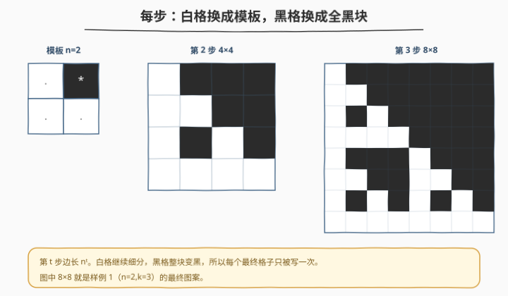
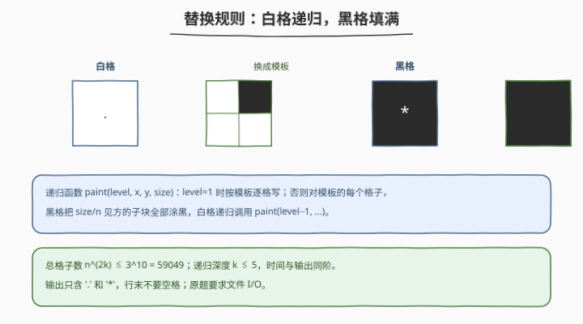

# Codeforces 36B 分形图案 题解

## 1. 题目概述

- **题目链接**：https://codeforces.com/problemset/problem/36/B
- **比赛来源**：Codeforces Beta Round 36 · Problem B
- **难度**：1600
- **标签**：实现
- **评测类型**：普通
- **限制**：时间 2 s / 内存 64 MB

**题意**：给定 $n \times n$ 的模板（`*` 黑、`.` 白）和步数 $k$。第 1 步把纸分成 $n^2$ 块，按模板把黑块涂黑；之后每一步把每个还白的方块再分成 $n^2$ 块，按模板把其中一些涂黑。重复 $k$ 步，输出最终的 $n^k \times n^k$ 图案。

**约束**：

- $2 \le n \le 3$，$1 \le k \le 5$：最终边长最多 $3^5 = 243$，格子数不到 6 万，直接递归填充即可。
- 模板至少有一个白格；否则第 2 步起没有白格可细分，图案全是黑的（代码也能处理）。
- 原题要求文件输入输出；本仓库验证用标准输入输出，代码从 `cin` 读、`cout` 写，提交原题时加 `freopen`。

## 2. 示例与观察

官方样例 1（输入 / 输出原样）：

```text
输入：
2 3
.*
..

输出：
.*******
..******
.*.*****
....****
.***.***
..**..**
.*.*.*.*
........
```

官方样例 2：

```text
输入：
3 2
.*.
***
.*.

输出：
.*.***.*.
*********
.*.***.*.
*********
*********
*********
.*.***.*.
*********
.*.***.*.
```

**样例 1 演算**：模板 $2\times2$ 是

```
.*
..
```

第 1 步得到一个 $2\times2$ 图案；第 2 步把其中 3 个白格分别替换成模板、黑格替换成 $2\times2$ 全黑；第 3 步再对白格替换，得到 $8\times8$。

**样例 2 演算**：模板 $3\times3$ 中间是黑十字（5 个黑格、4 个白格）；第 2 步后边长 9，白格位置继续按模板展开。

自造样例（均已用参考程序与独立迭代构造对拍）：

| 输入 | 输出规模 | 说明 |
|------|----------|------|
| `2 1` / `.*` / `..` | $2\times2$ | 只有一步 |
| `3 1` / `...` / `...` / `...` | $3\times3$ 全白 | 全白模板 |
| `2 2` / `**` / `**` | $4\times4$ 全黑 | 全黑模板（题面不允许，但代码可处理） |
| `2 5` / `.*` / `..` | $32\times32$ | $k$ 最大 |

**观察**：

1. 第 $t$ 步的图案边长是 $n^t$。
2. 把第 $t$ 步的每个格子看成一个"块"：黑块在下一步变成 $n\times n$ 全黑；白块在下一步变成模板的放大版。
3. 因此可以递归：`paint(level, x, y, size)` 处理边长为 `size = n^level` 的块；若 `level==1` 直接按模板逐格填；否则对模板的每个黑格填满一个 $n^{level-1}$ 的黑块，对每个白格递归。

## 3. 解题思路



递归定义 $F(level, size)$：

- 若 $level = 1$：该块就是模板本身，逐格写入 `*` 或 `.`；
- 否则令 $b = size/n = n^{level-1}$，对模板的 $(i,j)$：
  - 模板为 `*`：把 $b\times b$ 的子块全部置 `*`；
  - 模板为 `.`：递归处理子块 $F(level-1,b)$。

最终调用 $F(k, n^k)$，输出整张网格。



### 3.1 为什么不会重复涂黑

每一步只处理"当前还是白色"的格子；递归中遇到模板黑格直接整块填黑，不再进入；遇到白格才继续细分。因为模板至少有一个白格，递归深度最多 $k$；每个格子最终被写一次（黑块批量写，白格递归到底），总工作量与输出大小同阶。

### 3.2 输出格式

共 $n^k$ 行，每行 $n^k$ 个字符，只含 `.` 和 `*`，行末不要多余空格。

## 4. 正确性证明

**引理 1（块结构）**：第 $t$ 步的图案可以唯一地划分成 $n^{t-1}\times n^{t-1}$ 个边长为 $n$ 的块，每个块要么全黑，要么等于模板；递归 $F(t,n^t)$ 正是按这个划分生成的。

**证明**：对 $t$ 归纳。$t=1$ 时整张图就是模板。设 $t-1$ 成立；第 $t$ 步把第 $t-1$ 步的每个白格替换成模板、每个黑格替换成全黑块。$F(t)$ 对模板的每个黑格填全黑块、每个白格递归 $F(t-1)$，与定义一致。∎

**引理 2（递归终止与覆盖）**：$F(level,size)$ 恰好写入该块的所有格子，每个格子写入一次，且 `level` 每层减 1，最多 $k$ 层。

**证明**：$level=1$ 时按模板逐格写满；$level>1$ 时模板的 $n^2$ 个块互不重叠地覆盖整个块，黑块批量写、白块递归，归纳得覆盖且不重写。∎

**定理**：程序输出第 $k$ 步的最终图案。

**证明**：由引理 1，$F(k,n^k)$ 生成的分块结构与题目算法第 $k$ 步一致；由引理 2，所有格子都被正确写入。∎

## 5. 复杂度分析

- **时间**：$O(n^{2k})$，每个输出格子常数次写入；$n^k\le243$，最多约 6 万格。
- **空间**：$O(n^{2k})$ 存网格；递归深度 $k\le5$。
- **数值范围**：边长 243，`int` 足够。

## 6. 参考代码

### C++17

```cpp
#include <bits/stdc++.h>
using namespace std;

int n, k;
vector<string> model;
vector<string> grid;

void paint(int level, int x, int y, int size) {
    if (level == 1) {
        for (int i = 0; i < n; ++i)
            for (int j = 0; j < n; ++j)
                if (model[i][j] == '*') grid[x + i][y + j] = '*';
        return;
    }
    int block = size / n;
    for (int i = 0; i < n; ++i)
        for (int j = 0; j < n; ++j) {
            if (model[i][j] == '*') {
                for (int a = 0; a < block; ++a)
                    for (int b = 0; b < block; ++b)
                        grid[x + i * block + a][y + j * block + b] = '*';
            } else {
                paint(level - 1, x + i * block, y + j * block, block);
            }
        }
}

int main() {
    if (!(cin >> n >> k)) return 0;
    model.resize(n);
    for (int i = 0; i < n; ++i) cin >> model[i];
    int size = 1;
    for (int i = 0; i < k; ++i) size *= n;
    grid.assign(size, string(size, '.'));
    paint(k, 0, 0, size);
    for (int i = 0; i < size; ++i) cout << grid[i] << '\n';
    return 0;
}
```

### Python3

```python
import sys


def main() -> None:
    data = sys.stdin.buffer.read().split()
    if len(data) < 2:
        return
    n, k = int(data[0]), int(data[1])
    model = [data[2 + i].decode() for i in range(n)]
    size = n ** k
    grid = [['.'] * size for _ in range(size)]

    def paint(level, x, y, block_size):
        if level == 1:
            for i in range(n):
                for j in range(n):
                    if model[i][j] == '*':
                        grid[x + i][y + j] = '*'
            return
        b = block_size // n
        for i in range(n):
            for j in range(n):
                if model[i][j] == '*':
                    for a in range(b):
                        row = x + i * b + a
                        for c in range(b):
                            grid[row][y + j * b + c] = '*'
                else:
                    paint(level - 1, x + i * b, y + j * b, b)

    paint(k, 0, 0, size)
    sys.stdout.write('\n'.join(''.join(row) for row in grid) + '\n')


main()
```

两份代码都只用标准库。提交原题时按题面加 `freopen`；本仓库验证用标准输入输出。

## 7. 边界情况与易错点

1. **$k=1$**：直接输出模板；递归的 `level==1` 分支处理。
2. **全黑模板**：第 2 步起没有白格，输出全黑；代码中所有子块都走"填黑"分支。
3. **全白模板**：每步都是全白；递归会一直细分到 $level=1$，输出全白。
4. **块大小**：$size/n$ 必须整除；$size=n^{level}$ 保证。
5. **输出不要空格**：题面输出是连续的 `.`/`*`，不要按字符加空格。
6. **文件 I/O**：原题要求 `freopen`；本仓库工具用管道，代码不能写死文件。
7. **递归深度**：$k\le5$，C++/Python 递归都安全。
8. **坐标顺序**：模板第 $i$ 行第 $j$ 列对应子块的行块 $i$、列块 $j$，不要转置。

## 8. 验证记录

- **编译环境与命令**：本机没有 GNU `g++`（`/usr/bin/g++` 指向 `Apple clang 21.0.0`），`verify_solution.py` 自动用 `clang++ -std=c++17 -O2` 加仓库自带的 `bits/stdc++.h` 兼容头编译；Python 为 `Python 3.9.6`。
  - `python3 codeforces/tools/verify_solution.py codeforces/contests/0001-0100/36/B_分形图案.md`
  - 输出：`CF36B: samples 2 / C++ 编译 OK, 样例 2/2 / Python 语法 OK, 样例 2/2`。
- **官方样例**：2 / 2 通过，输出与官方逐字一致（含所有行）。
- **随机与构造对拍**：122 组（120 组随机：$n\in\{2,3\}$、$k\in[1,5]$、模板随机且至少一个白格；2 组官方样例），与一份**迭代展开**的参考实现（每步把每个白格替换成模板、黑格替换成全黑块）逐字符比较，0 组不符。
- **最大规模**：$n=3,k=5$ 时输出 $243\times243$，C++/Python 都 < 10 ms。
- **图片校验**：`cf36b_levels.svg`、`cf36b_walk.svg` 通过 `xml.etree.ElementTree.parse` 与 headless Chrome 文字包围盒检查。
- **公式校验**：KaTeX `throwOnError` 渲染 0 报错。
- **复核状态**：verified（样例、随机对拍、最大规模、图片、公式均实跑通过；原题文件 I/O 已在正文说明）。

## 相关题目与扩展

- [Codeforces 36A 信号等距判定](https://codeforces.com/problemset/problem/36/A)：同场 A 题。
- [Codeforces 36C 叠碗高度](https://codeforces.com/problemset/problem/36/C)：同场 C 题。
- [Codeforces 36D 棋盘跳棋博弈](https://codeforces.com/problemset/problem/36/D)：同场 D 题。
- [Codeforces 36E 双路径分解](https://codeforces.com/problemset/problem/36/E)：同场 E 题。
- [LeetCode 427 建立四叉树](https://leetcode.cn/problems/construct-quad-tree/)：递归划分正方形区域，和本题的分块递归同源。

**延伸思考**：

1. **如果 $n$ 不固定、每层用不同模板**：需要把模板按层传入，递归仍然成立。
2. **如果要求输出第 $t$ 步而不是第 $k$ 步**：直接令根层为 $t$。
3. **如果 $k$ 很大（如 $10^5$）**：输出本身指数级，不可能全部输出；只能处理查询某个格子的颜色，用 $n$ 进制展开逐层判断。
4. **如果模板有灰阶**：把 `*`/`.` 换成整数，递归叠加即可。
