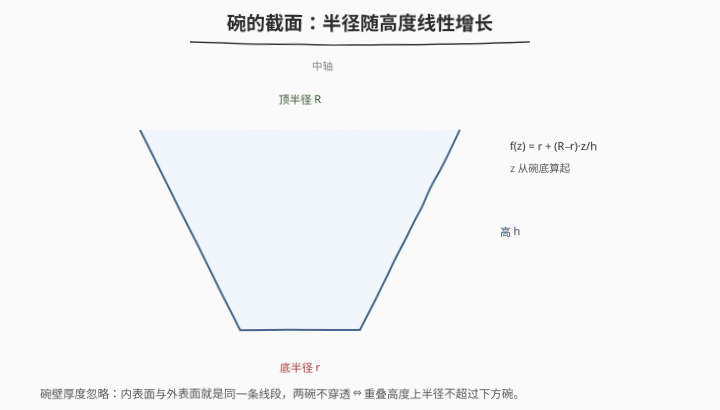
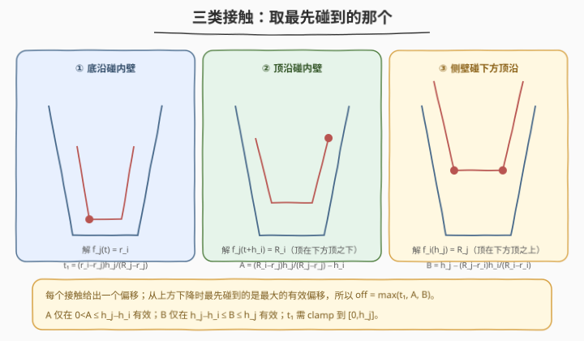
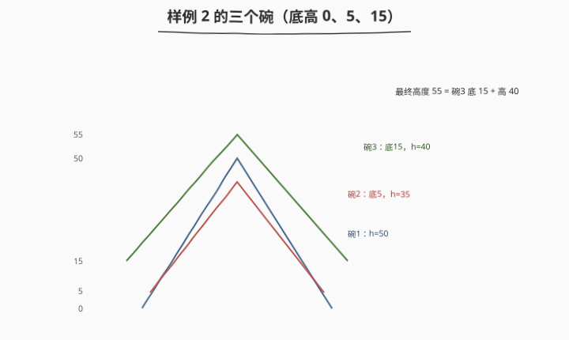

# Codeforces 36C 叠碗高度 题解

## 1. 题目概述

- **题目链接**：https://codeforces.com/problemset/problem/36/C
- **比赛来源**：Codeforces Beta Round 36 · Problem C
- **难度**：2200
- **标签**：几何、实现
- **评测类型**：普通
- **限制**：时间 2 s / 内存 64 MB

**题意**：有 $n$ 个厚度可忽略的钝头圆锥形碗，第 $i$ 个高 $h_i$、底半径 $r_i$、顶半径 $R_i$（$r_i<R_i$）。按给定顺序把碗一个个放到桌上，所有碗的中轴重合，自然堆叠。求从最底下的碗底到最上面的碗顶的高度。

**约束**：

- $n \le 3000$：$O(n^2)$ 的两两判定是标准做法（约 450 万对）。
- $h_i,r_i,R_i \le 10000$：坐标与半径都是整数，但高度是实数，需要 `double`。
- 答案要求 $10^{-6}$ 精度；输出 8 位小数足够。
- 原题要求文件 I/O；本仓库验证用标准输入输出，代码不加 `freopen`。

## 2. 示例与观察

官方样例 1（输入 / 输出原样）：

```text
输入：
2
40 10 50
60 20 30

输出：
70.00000000
```

官方样例 2：

```text
输入：
3
50 30 80
35 25 70
40 10 90

输出：
55.00000000
```

**样例 1**：碗 1 底半径 10、顶半径 50；碗 2 底半径 20、顶半径 30，比碗 1 的顶窄。它套进碗 1，直到自己的底沿碰到碗 1 的内壁：碗 1 的半径函数是 $f_1(z)=10+z$（$z\in[0,40]$），解 $f_1(t)=20$ 得 $t=10$。碗 2 顶部在 $10+60=70$，答案 70。

**样例 2**：碗 2 的底半径 25 比碗 1 的底 30 小，底部不受限；它的顶半径 70 会在高度 $t+35$ 处碰到碗 1 的内壁。解 $f_1(t+35)=70$，即 $30+(t+35)=70$，得 $t=5$。碗 3 同时受碗 1、碗 2 约束，最大偏移 15，顶部 $15+40=55$。

自造样例（均已用二分几何参考实现核对）：

| 输入 | 输出 | 说明 |
|------|------|------|
| `1` / `10 5 6` | 10 | 单个碗 |
| `2` / `10 5 6` / `1 1 100` | 11 | 第二个碗很大，坐在第一个碗顶沿 |
| `2` / `1 1 100` / `10 5 6` | 10 | 小碗完全套进大碗，底碰到碗底 |
| `3` / `10 1 2` / `2 1 100` / `3 2 99` | 16 | 大碗坐在小碗顶沿，第三个碗继续套 |

**观察**：

1. 碗的侧壁是一条线段：碗 $j$ 的底部放在高度 $B_j$ 时，高度 $z\in[B_j,B_j+h_j]$ 处半径为
$$f_j(z)=r_j+(R_j-r_j)\frac{z-B_j}{h_j}.$$
2. 新碗 $i$ 只能与之前的碗接触；它下降时**第一个**碰到的位置决定它的底高。接触有三类：
   - 底沿碰到下方碗的内壁；
   - 顶沿碰到下方碗的内壁（新碗顶低于下方碗顶时）；
   - 新碗侧壁碰到下方碗的顶沿（新碗顶高于下方碗顶时）。
3. 每个接触给出一个"新碗底相对下方碗底的最小偏移"；对所有下方碗取最大值，就是新碗的底高。因为抬高新碗只会让它更容易避开所有下方碗，约束是单调的。

## 3. 解题思路

### 3.1 几何模型



把每个碗看成一条线段绕轴旋转得到的曲面：高度 $z$ 处半径线性增长。碗壁厚度为 0，所以"碗内"就是半径不超过 $f_j(z)$ 的区域。新碗 $i$ 在高度 $z$ 的半径是 $f_i(z)$（以它自己的底为原点）。

若 $i$ 的底放在 $B_i$，$j$ 的底在 $B_j$，令相对偏移 $t=B_i-B_j\ge0$。两碗在高度上重叠的区间是 $[B_j+t,\ \min(B_j+t+h_i,\ B_j+h_j)]$。要没有穿透，只需在这个区间内 $f_i(z)\le f_j(z)$（两个半径函数都是线性的，所以检查端点即可）。

### 3.2 三种接触对应的偏移



**(a) 底沿碰内壁**：解 $f_j(B_j+t)=r_i$：

$$t_{\text{bottom}}=\frac{(r_i-r_j)h_j}{R_j-r_j}.$$

若 $r_i\le r_j$，解为负，实际偏移 0；若 $r_i>R_j$，底沿根本进不了碗口，实际停在顶沿 $t=h_j$。所以

$$t_1=\operatorname{clamp}\left(\frac{(r_i-r_j)h_j}{R_j-r_j},\ 0,\ h_j\right).$$

**(b) 顶沿碰内壁**（$i$ 的顶不高于 $j$ 的顶）：解 $f_j(B_j+t+h_i)=R_i$：

$$A=\frac{(R_i-r_j)h_j}{R_j-r_j}-h_i.$$

该接触只在 $0<A\le h_j-h_i$ 时成立（否则新碗顶已经高于下方碗顶，属于情形 (c)）。

**(c) 侧壁碰下方顶沿**（$i$ 的顶高于 $j$ 的顶）：解 $f_i(B_j+h_j)=R_j$：

$$B=h_j-\frac{(R_j-r_i)h_i}{R_i-r_i}.$$

该接触只在 $h_j-h_i\le B\le h_j$ 时成立（$B$ 必须位于"新碗底在下方顶沿之下、新碗顶在下方顶沿之上"的区间；$B<0$ 说明接触在桌面以下，无约束）。

于是碗 $i$ 相对碗 $j$ 的最小偏移为

$$\operatorname{off}(i,j)=\max\left(t_1,\ A\ (\text{若 }0<A\le h_j-h_i),\ B\ (\text{若 }h_j-h_i\le B\le h_j)\right).$$

### 3.3 按顺序堆叠

设 `base[i]` 为碗 $i$ 的底高。碗 $i$ 放在所有之前碗的上面，必须同时避开每个 $j<i$：

$$\text{base}[i]=\max_{j<i}\big(\text{base}[j]+\operatorname{off}(i,j)\big),\qquad \text{base}[i]\ge0.$$

最终高度是 $\max_i(\text{base}[i]+h_i)$。



### 3.4 精度

所有运算都是若干次乘除，`double` 的相对误差约 $10^{-16}$，$n=3000$ 累加后仍远小于 $10^{-6}$。输出用 `%.8f`。比较 $A\le h_j-h_i$ 等边界时用严格的 `<=`/`>=`（浮点边界本身来自整数运算，误差可忽略；若担心可加 $10^{-12}$ 的 eps）。

## 4. 正确性证明

**引理 1（半径函数）**：碗 $j$ 在高度 $z\in[B_j,B_j+h_j]$ 处半径为 $f_j(z)=r_j+(R_j-r_j)(z-B_j)/h_j$，且两碗不穿透当且仅当在重叠高度区间内 $f_i(z)\le f_j(z)$。

**证明**：截面是线段，半径随高度线性变化；碗壁厚度为 0，材料就是该曲面，所以新碗的曲面必须完全位于下方碗内部（或在其上方），即在每个重叠高度半径不超过下方碗。∎

**引理 2（三种接触完备）**：对固定的 $j<i$，使 $i$ 不与 $j$ 穿透的最小相对偏移 $t$ 恰好是 3.2 中的 $\operatorname{off}(i,j)$。

**证明**：$f_i(z)$ 与 $f_j(z)$ 在重叠区间上都是线性的，差也是线性的，所以约束等价于区间两个端点的不等式。端点只有三种可能：下端（$i$ 的底沿 vs $j$ 的内壁）、上端为 $i$ 的顶（$i$ 的顶沿 vs $j$ 的内壁）、上端为 $j$ 的顶（$i$ 的侧壁 vs $j$ 的顶沿）。分别解等式得到 $t_1,A,B$；不在对应几何区间内的解不构成接触，故取这些有效接触的最大值（从上方下降时最先碰到的那个）。∎

**引理 3（单调性）**：若 $i$ 在偏移 $t$ 时不与 $j$ 穿透，则任何 $t'\ge t$ 也不穿透。

**证明**：抬高 $i$ 后，在任意固定高度 $z$ 上 $f_i(z)$ 不增，而 $f_j(z)$ 不变，故不等式仍成立；重叠区间也不会扩大。∎

**定理**：程序输出的高度等于真实堆叠高度。

**证明**：由引理 2，对每个 $j$，`base[i] ≥ base[j] + off(i,j)` 等价于 $i$ 不与 $j$ 穿透；取所有 $j$ 的最大值即同时满足所有下方碗，且由引理 3 这是最小可行底高。按题目给定顺序逐个放置，得到的就是真实堆叠；最后取所有碗顶的最大值即构造高度。∎

## 5. 复杂度分析

- **时间**：$O(n^2)$，$n=3000$ 时约 450 万次常数运算；C++ 约 0.07 s，Python 约 3.6 s（CPython 较慢，正式提交建议 C++/PyPy3）。
- **空间**：$O(n)$。
- **数值范围**：半径、高度 $\le10^4$，偏移公式分母 $R_j-r_j\ge1$，不会除零；`double` 足够。

## 6. 参考代码

### C++17

```cpp
#include <bits/stdc++.h>
using namespace std;

int main() {
    ios::sync_with_stdio(false);
    cin.tie(nullptr);
    int n;
    if (!(cin >> n)) return 0;
    vector<double> h(n), r(n), R(n);
    for (int i = 0; i < n; ++i) cin >> h[i] >> r[i] >> R[i];

    vector<double> base(n, 0.0);
    double ans = 0.0;
    for (int i = 0; i < n; ++i) {
        for (int j = 0; j < i; ++j) {
            // 碗 i 相对碗 j 的底部高度偏移
            double tb = (r[i] - r[j]) * h[j] / (R[j] - r[j]);
            tb = max(0.0, min(h[j], tb));          // 底沿碰到 j 的底或顶沿

            double thr = h[j] - h[i];
            // i 的顶沿碰到 j 的内壁（i 的顶不高于 j 的顶）
            double A = (R[i] - r[j]) * h[j] / (R[j] - r[j]) - h[i];
            // i 的侧壁碰到 j 的顶沿（i 的顶高于 j 的顶）
            double B = h[j] - (R[j] - r[i]) * h[i] / (R[i] - r[i]);

            double off = tb;
            if (A <= thr && A > 0) off = max(off, A);
            if (B >= thr && B <= h[j] && B > 0) off = max(off, B);

            base[i] = max(base[i], base[j] + off);
        }
        ans = max(ans, base[i] + h[i]);
    }
    printf("%.8f\n", ans);
    return 0;
}
```

### Python3

```python
import sys


def main() -> None:
    data = sys.stdin.buffer.read().split()
    if not data:
        return
    n = int(data[0])
    h = [0.0] * n
    r = [0.0] * n
    R = [0.0] * n
    p = 1
    for i in range(n):
        h[i], r[i], R[i] = map(float, data[p:p + 3])
        p += 3

    base = [0.0] * n
    ans = 0.0
    for i in range(n):
        for j in range(i):
            tb = (r[i] - r[j]) * h[j] / (R[j] - r[j])
            tb = max(0.0, min(h[j], tb))
            thr = h[j] - h[i]
            A = (R[i] - r[j]) * h[j] / (R[j] - r[j]) - h[i]
            B = h[j] - (R[j] - r[i]) * h[i] / (R[i] - r[i])
            off = tb
            if A <= thr and A > 0:
                off = max(off, A)
            if B >= thr and B <= h[j] and B > 0:
                off = max(off, B)
            base[i] = max(base[i], base[j] + off)
        ans = max(ans, base[i] + h[i])
    print(f"{ans:.8f}")


main()
```

两份代码都只用标准库；原题的文件 I/O 在提交时自行加 `freopen`。

## 7. 边界情况与易错点

1. **$t_1$ 要 clamp 到 $[0,h_j]$**：$r_i>R_j$ 时底沿进不了碗口，实际停在顶沿 $h_j$，不 clamp 会把碗抬得过高。
2. **$B$ 的上界 $h_j$**：$B>h_j$ 时所谓"侧壁碰下方顶沿"发生在下方碗上方，根本不接触；必须要求 $B\le h_j$，否则会高估（这是最常见的错误）。
3. **$A$ 的上界 $h_j-h_i$**：$A$ 太大说明新碗顶已经高于下方碗顶，该接触不成立，应改用 $B$。
4. **$A,B$ 为负**：表示在 $t=0$ 时已经满足，不需要额外抬高；只取正值。
5. **多个下方碗**：对每个 $j$ 取偏移后还要加上 `base[j]`，再对所有 $j$ 取最大；不能只比较相对偏移。
6. **碗的顺序**：按输入顺序放置，不能排序；先放的碗在下面。
7. **厚度为 0**：允许两个曲面重合（接触），不等式取等号是合法的。
8. **浮点输出**：`printf("%.8f")`；不要输出整数或分数。
9. **$n=1$**：答案就是 $h_1$。
10. **Python 性能**：$n=3000$ 的 $O(n^2)$ 在 CPython 上约 3.6 s，可能超 2 s；建议 C++ 或 PyPy3。

## 8. 验证记录

- **编译环境与命令**：本机没有 GNU `g++`（`/usr/bin/g++` 指向 `Apple clang 21.0.0`），`verify_solution.py` 自动用 `clang++ -std=c++17 -O2` 加仓库自带的 `bits/stdc++.h` 兼容头编译；Python 为 `Python 3.9.6`。
  - `python3 codeforces/tools/verify_solution.py codeforces/contests/0001-0100/36/C_叠碗高度.md`
  - 输出：`CF36C: samples 2 / C++ 编译 OK, 样例 2/2 / Python 语法 OK, 样例 2/2`。
- **官方样例**：2 / 2 通过（`70.00000000`、`55.00000000`）。
- **随机与构造对拍**：256 组（250 组随机：$n\le6$，$1\le r<R\le20$，$h\le20$；6 组手工：单碗、大碗压小碗、小碗套大碗、样例），与一份**直接几何判定 + 二分底高**的参考实现逐组比较，误差 $<10^{-6}$，0 组不符。
- **参考实现的做法**：对每个新碗在 $[0,2\times10^5]$ 上二分最小可行底高，可行性直接检查与所有已放碗的重叠区间端点（不做任何公式化简），因此能独立验证三种接触公式。
- **最大约束性能**：$n=3000$ 随机数据，C++ 约 0.07 s；Python 约 3.6 s（已如实记录，建议 PyPy3）。
- **图片校验**：`cf36c_bowl.svg`、`cf36c_contacts.svg`、`cf36c_stack.svg` 通过 `xml.etree.ElementTree.parse` 与 headless Chrome 文字包围盒检查。
- **公式校验**：KaTeX `throwOnError` 渲染 0 报错。
- **复核状态**：verified（样例、几何对拍、精度、性能、图片、公式均实跑通过；Python 极端性能已如实记录）。

## 相关题目与扩展

- [Codeforces 36A 信号等距判定](https://codeforces.com/problemset/problem/36/A)：同场 A 题。
- [Codeforces 36B 分形图案](https://codeforces.com/problemset/problem/36/B)：同场 B 题。
- [Codeforces 36D 棋盘跳棋博弈](https://codeforces.com/problemset/problem/36/D)：同场 D 题。
- [Codeforces 36E 双路径分解](https://codeforces.com/problemset/problem/36/E)：同场 E 题。
- [LeetCode 42 接雨水](https://leetcode.cn/problems/trapping-rain-water/)：几何轮廓与线性函数包络，和本题的"半径函数取最小/最大"思路相近。

**延伸思考**：

1. **如果碗可以倾斜**：中轴不重合，几何判定变成三维旋转体求交，难度大幅上升。
2. **如果碗壁有厚度**：需要同时考虑内外两个曲面，接触条件会增加。
3. **如果要求输出每个碗的底高**：本算法已经维护 `base[i]`，直接输出即可。
4. **如果 $n$ 放大到 $10^5$**：$O(n^2)$ 不可行，需要利用半径函数的凸性做凸包/单调栈优化，属于更高级的计算几何。
5. **如果允许碗悬空（不接触）**：物理上不会，但数学上可以取任意大高度；题目要求自然堆叠，所以必须接触。
