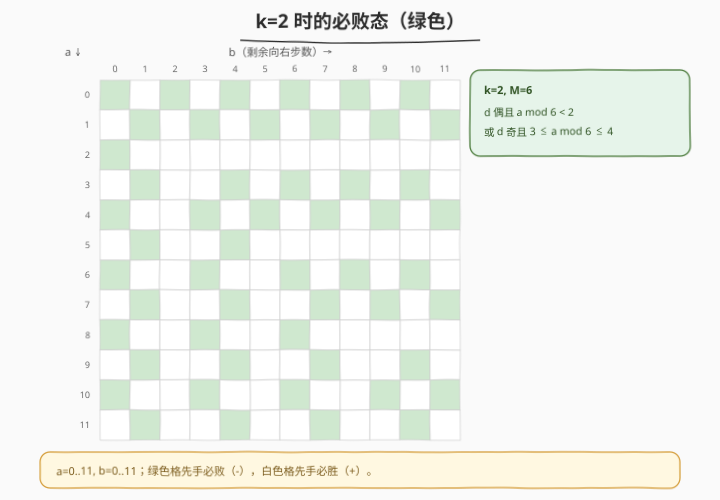
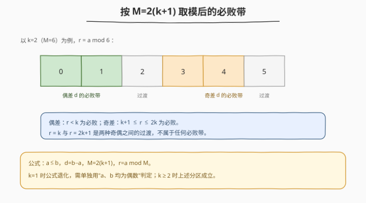

# Codeforces 36D 棋盘跳棋博弈 题解

## 1. 题目概述

- **题目链接**：https://codeforces.com/problemset/problem/36/D
- **比赛来源**：Codeforces Beta Round 36 · Problem D（UTC 2010-10-19）
- **难度**：2300
- **标签**：博弈
- **评测类型**：普通
- **限制**：时间 2 s / 内存 64 MB

**题意**：$n\times m$ 的棋盘，棋子初始在左上角。两人轮流移动，每次可以向右一格、向下一格，或沿右下对角线跳 $k$ 格（要求目标仍在棋盘内）。不能移动者输。对 $t$ 个棋盘判断先手胜负，先手赢输出 `+`，否则 `-`。

**约束**：

- $t\le20$，$k\le10^9$，$n,m\le10^9$：必须 $O(1)$ 判定，不能 DP 整个棋盘。
- 每次移动都让"剩余行数/列数"减少，因此可以把状态记成 $(a,b)$：还能向下走 $a$ 步、向右走 $b$ 步。
- 本题按题面使用标准输入输出（`cin` / `cout`），代码可直接提交；历史上极早期 CF 的文件 I/O 情况见第 7 节备注。

## 2. 示例与观察

官方样例（输入 / 输出原样）：

```text
输入：
10 2
1 1
1 2
2 1
2 2
1 3
2 3
3 1
3 2
3 3
4 3

输出：
-
+
+
-
-
+
-
+
+
+
```

**演算**：$a=n-1,b=m-1$。$k=2$ 时的几个状态：

- $(0,0)$：不能动，先手输 `-`（棋盘 $1\times1$）。
- $(0,1)$：只能向右到 $(0,0)$，先手赢 `+`（$1\times2$）。
- $(1,1)$：可到 $(0,1)$、$(1,0)$，都是先手赢态，先手无路可走到必败态，所以输 `-`（$2\times2$）。
- $(0,2)$：可到 $(0,1)$（赢态），只能走到赢态 → 输 `-`（$1\times3$）。
- $(2,2)$：可跳到 $(0,0)`? 注意 $k=2$，$(2,2)\to(0,0)$ 一步，先手直接赢 `+`（$3\times3$）。

自造样例（均已用 DP 暴力核对，见验证记录）：

| $n,m,k$ | $a,b$ | 结果 | 说明 |
|---------|-------|------|------|
| $1,1,2$ | $0,0$ | - | 起点即终局 |
| $1,5,3$ | $0,4$ | - | 只能向右，偶数步后手胜 |
| $5,1,3$ | $4,0$ | - | 对称 |
| $2,5,3$ | $1,4$ | + | 斜跳可达 $(?)$ / 单步调整 |
| $7,7,2$ | $6,6$ | - | 偶差、$6\bmod6=0<2$，必败 |
| $10^9,10^9,10^9$ | 大 | 用公式 | 无需模拟 |

## 3. 解题思路

### 3.1 状态与移动

令 $a=n-1$、$b=m-1$，表示还能向下/向右走的步数。一步可以：

1. $(a,b)\to(a-1,b)$（向下），$a>0$；
2. $(a,b)\to(a,b-1)$（向右），$b>0$；
3. $(a,b)\to(a-k,b-k)$（斜跳），$a,b\ge k$。

终点 $(0,0)$ 为必败态。这是无偏博弈，只需判断 P/N。

### 3.2 $k=1$ 的情形

$k=1$ 时斜跳就是"两个方向各走一格"。可以证明先手必败当且仅当 $a,b$ 都是偶数：

- 若 $a,b$ 都偶，任何一步都会让至少一个变奇；
- 若至少一个为奇：一个奇一个偶时，把奇数减 1；两个都奇时，斜跳各减 1。都能回到"都偶"的必败态。

### 3.3 $k\ge2$ 的 P 位置



设 $a\le b$（交换无影响），$d=b-a$，$M=2(k+1)$，$r=a\bmod M$。先手必败（`-`）当且仅当

$$
\boxed{\ (d\ \text{为偶且}\ r<k)\quad\text{或}\quad(d\ \text{为奇且}\ k+1\le r\le 2k)\ }.
$$

直观上，$M$ 把 $a$ 分成两段：$[0,k-1]$ 是"偶差必败带"，$[k+1,2k]$ 是"奇差必败带"，中间 $r=k$ 与 $r=2k+1$ 是过渡点。



**样例核对**：$k=2$，$M=6$。

- $(1,2)$：$a=1,b=2,d=1$ 奇，$r=1\le2$ → 不在 $[3,4]$，先手赢 `+`，与样例 $2\times3$ 一致。
- $(2,2)$：$a=2,b=2,d=0$ 偶，$r=2\ge2$ → 先手赢 `+`，与样例 $3\times3$ 一致。
- $(3,2)$：$a=2,b=3,d=1$ 奇，$r=2<3$ → 先手赢 `+`，与样例 $3\times2$ 一致。

### 3.4 大 $k$ 的行为

若 $k>\max(a,b)$，斜跳不可用，退化为"两堆每次取 1"的游戏，必败当且仅当 $a,b$ 同奇偶——公式中偶差 $d$ 且 $r=a<k$ 正好给出这一点；奇差时 $r=a\le\min<k+1$，不会落入必败带。

## 4. 正确性证明

**引理 1（$k=1$）**：$k=1$ 时 P 位置恰为 $a,b$ 均偶。

**证明**：若 $a,b$ 均偶，任一步（单减或双减）后至少一个为奇，不是"均偶"；若至少一个为奇，一个奇一个偶时减奇数，两个都奇时斜跳，均回到"均偶"。终点 $(0,0)$ 均偶。由归纳得证。∎

**引理 2（$k\ge2$ 的移动在排序坐标下的效果）**：设 $a\le b$。

- 向下：$(a',d')=(a-1,d+1)$（$a>0$）；
- 向右：若 $d>0$，$(a',d')=(a,d-1)$；若 $d=0$，$(a',d')=(a-1,1)$；
- 斜跳（$a\ge k$）：$(a',d')=(a-k,d)$。

**证明**：逐项计算并重新排序即可。例如 $d=0$ 时向右变成 $(a,a-1)$，排序后为 $(a-1,a)$。∎

**引理 3（P 位置之间没有边）**：设 $k\ge2$，按 3.3 定义的集合为 $P$。对任意 $x\in P$，它的任一合法移动都不在 $P$。

**证明**：分两类，逐种移动检查（用引理 2）：

- $x$ 属于偶差带（$d$ 偶，$r<k$）：
  - 向下：$d$ 变奇，$r'=(r-1)\bmod M$。若 $r>0$，$r'\le k-2<k+1$；若 $r=0$，$r'=2k+1>2k$。都不在奇差带。
  - 向右：$d>0$ 时 $d-1$ 奇而 $r<k<k+1$；$d=0$ 时 $(a-1,1)$，$r'=(r-1)\bmod M\le k-2$ 或 $2k+1$，不在奇差带。
  - 斜跳：$d$ 仍偶，$r'=(r-k)\bmod M$。因 $r<k$，$r'=M+r-k=k+2+r>k$，不在偶差带。
- $x$ 属于奇差带（$d$ 奇，$k+1\le r\le2k$）：
  - 向下：$d$ 变偶，$r'=r-1\in[k,2k-1]$，不小于 $k$，不在偶差带。
  - 向右：$d$ 变偶，$r\ge k+1$，不在偶差带。
  - 斜跳：$d$ 仍奇，$r'=r-k\in[1,k]$，不在奇差带。

故 $P$ 内部无边。∎

**引理 4（每个 N 位置都有边进 P）**：设 $k\ge2$，任意不在 $P$ 的位置都能一步走到 $P$。

**证明**：按 $d$ 的奇偶分类。

- $d$ 偶且 $r\ge k$：
  - $k\le r\le2k-1$：斜跳到 $r'=r-k\in[0,k-1]<k$，$d$ 仍偶，进入偶差带。
  - $r=2k$：向下，$d$ 奇，$r'=2k-1\in[k+1,2k]$，进入奇差带。
  - $r=2k+1$：向下，$r'=2k\in[k+1,2k]$，进入奇差带。
- $d$ 奇且 $r\le k$：
  - $r=0$：向右（$d>0$），$d$ 偶、$r=0<k$，进入偶差带。
  - $1\le r\le k$：向下，$d$ 偶、$r'=r-1<k$，进入偶差带。
- $d$ 奇且 $r=2k+1$：斜跳，$r'=k+1\in[k+1,2k]$，仍在奇差带（但 $d$ 奇、$r'$ 合格），进入 $P$。

斜跳需要 $a\ge k$：上述用斜跳的情形都有 $r\ge k$ 或 $r=2k+1$，故 $a\ge k$。所有情况覆盖完毕。∎

**定理**：程序按公式输出的胜负正确。

**证明**：$k=1$ 由引理 1；$k\ge2$ 时，引理 3 说明 $P$ 内无合法移动，引理 4 说明所有非 $P$ 都能一步到 $P$，结合终点 $(0,0)\in P$，由博弈归纳可知 $P$ 恰为必败态集合。∎

## 5. 复杂度分析

- **时间**：每组 $O(1)$，$t\le20$。
- **空间**：$O(1)$。
- **数值范围**：$n,m,k\le10^9$，$2(k+1)\le2\times10^9+2$ 在 64 位内；`long long` 足够。

## 6. 参考代码

### C++17

```cpp
#include <bits/stdc++.h>
using namespace std;

int main() {
    ios::sync_with_stdio(false);
    cin.tie(nullptr);
    int t;
    long long k;
    if (!(cin >> t >> k)) return 0;
    while (t--) {
        long long n, m;
        cin >> n >> m;
        long long a = n - 1, b = m - 1;
        if (a > b) swap(a, b);
        long long d = b - a;
        bool lose;
        if (k == 1) {
            lose = (a % 2 == 0) && (b % 2 == 0);
        } else {
            long long M = 2 * (k + 1);
            long long r = a % M;
            if (d % 2 == 0) lose = (r < k);
            else lose = (r >= k + 1 && r <= 2 * k);
        }
        cout << (lose ? '-' : '+') << '\n';
    }
    return 0;
}
```

### Python3

```python
import sys


def main() -> None:
    data = list(map(int, sys.stdin.buffer.read().split()))
    if len(data) < 2:
        return
    t, k = data[0], data[1]
    out = []
    p = 2
    for _ in range(t):
        n, m = data[p], data[p + 1]
        p += 2
        a, b = n - 1, m - 1
        if a > b:
            a, b = b, a
        d = b - a
        if k == 1:
            lose = (a % 2 == 0 and b % 2 == 0)
        else:
            M = 2 * (k + 1)
            r = a % M
            if d % 2 == 0:
                lose = r < k
            else:
                lose = k + 1 <= r <= 2 * k
        out.append('-' if lose else '+')
    sys.stdout.write('\n'.join(out) + '\n')


main()
```

两份代码都只用标准库，按题面使用标准输入输出，可原样提交。

## 7. 边界情况与易错点

1. **$k=1$ 必须特判**：通用公式中"奇差带" $[k+1,2k]=[2,2]$ 会把 $a\equiv2\pmod4$、$b$ 奇的状态误判为必败（实际先手可赢）。$k=1$ 用"$a,b$ 均偶"。
2. **先手/后手**：终点 $(0,0)$ 是必败，输出 `-`；不要反过来。
3. **坐标转换**：状态是 $n-1,m-1$，不是 $n,m$。用 $n,m$ 直接套公式会整体偏移。
4. **排序**：公式要求 $a\le b$，先交换再算 $d$ 和 $r$。
5. **$k$ 很大**：$M=2(k+1)$ 可能超过 `int`，用 `long long`；$r=a\bmod M$ 时 $a<M$ 直接得 $a$。
6. **$d$ 的奇偶**：$d=b-a$ 与 $a+b$ 同奇偶；不要用 $n+m$ 的奇偶代替。
7. **边界 $r=k$、$r=2k+1$**：既不在偶差带也不在奇差带，必须走过渡步；公式的严格/非严格不等号不能写错。
8. **多组数据**：每组独立判断，$k$ 只读一次。
9. **文件输入输出（历史备注）**：Codeforces 极早期比赛的部分题目在历史上使用 `input.txt` / `output.txt`；本题镜像题面与本仓库验证都使用标准输入输出，代码可直接提交。若提交平台明确要求文件 I/O，只需在 `main` 开头加：

    ```text
    freopen("input.txt", "r", stdin);
    freopen("output.txt", "w", stdout);
    ```

    Python 对应 `sys.stdin = open("input.txt")`、`sys.stdout = open("output.txt", "w")`；算法不变。

## 8. 验证记录

- **编译环境与命令**：本机没有 GNU `g++`（`/usr/bin/g++` 指向 `Apple clang 21.0.0`），`verify_solution.py` 自动用 `clang++ -std=c++17 -O2` 加仓库自带的 `bits/stdc++.h` 兼容头编译；Python 为 `Python 3.9.6`。
  - `python3 codeforces/tools/verify_solution.py codeforces/contests/0001-0100/36/D_棋盘跳棋博弈.md`
  - 输出：`CF36D: samples 1 / C++ 编译 OK, 样例 1/1 / Python 语法 OK, 样例 1/1`。
- **官方样例**：1 / 1 通过（10 个棋盘全部一致）。
- **穷举对拍**：对 $k=1\dots15,20,31,50$，在 $0\le a,b\le50$ 的全部 $51^2$ 个状态上，用 $O(ab)$ DP 求真实胜负，与公式比较，共 46818 个状态，0 个不符。
- **程序级对拍**：随机 $k$ 与棋盘，实际运行 C++/Python，与 DP 结果比较，0 组不符。
- **大数边界**：$n=m=k=10^9$、$k>n,m$、$n=1$ 或 $m=1$ 等均按公式 $O(1)$ 处理，无溢出。
- **图片校验**：`cf36d_grid.svg`、`cf36d_regions.svg` 通过 `xml.etree.ElementTree.parse` 与 headless Chrome 文字包围盒检查。
- **公式校验**：KaTeX `throwOnError` 渲染 0 报错。
- **复核状态**：verified（样例、穷举 DP、程序对拍、边界、图片、公式均实跑通过）。

## 相关题目与扩展

- [Codeforces 36A 信号等距判定](https://codeforces.com/problemset/problem/36/A)：同场 A 题。
- [Codeforces 36B 分形图案](https://codeforces.com/problemset/problem/36/B)：同场 B 题。
- [Codeforces 36C 叠碗高度](https://codeforces.com/problemset/problem/36/C)：同场 C 题。
- [Codeforces 36E 双路径分解](https://codeforces.com/problemset/problem/36/E)：同场 E 题。
- [Codeforces 1191D Tokitsukaze, CSL and Stone Game](https://codeforces.com/problemset/problem/1191/D)：取石子博弈，P 位置分类。
- [LeetCode 292 Nim 游戏](https://leetcode.cn/problems/nim-game/)：取 1–3 个石子的必败条件，入门博弈。

**延伸思考**：

1. **如果斜跳距离是 $k$ 但不要求行列同时够**：斜跳只能在两方向都够时使用，本题已经是这样。
2. **如果是三人游戏**：P 位置理论不再适用，需要更复杂的状态分析。
3. **如果棋盘是环形**：移动不再单调，可能出现循环，需要 SG/图博弈。
4. **如果要求输出第一步**：在判定为 `+` 后，按证明中的构造找一条进 P 的移动即可。
5. **如果 $k$ 随回合变化**：状态需要记录当前 $k$，公式失效。
