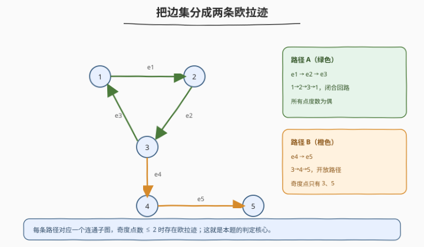
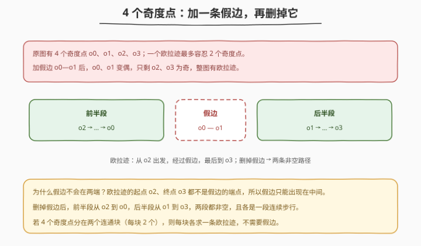
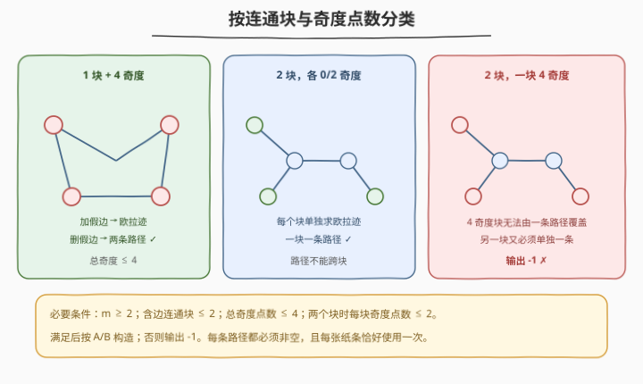

# Codeforces 36E 双路径分解 题解

## 1. 题目概述

- **题目链接**：https://codeforces.com/problemset/problem/36/E
- **比赛来源**：Codeforces Beta Round 36 · Problem E
- **难度**：2600
- **标签**：构造、并查集、图论、实现
- **评测类型**：特殊评测（多解）
- **限制**：时间 2 s / 内存 64 MB

**题意**：有 $m$ 张纸条，每张记录一条无向道路的两个端点。这些纸条来自两本旅行日志，每本对应一次连续的旅行（一次旅行中可以重复走同一条路，每走一次记一张纸条）。要求把 $m$ 张纸条分成两条非空的"步行序列"，每条序列中相邻纸条必须共享当前所在的城市（即能连成一条真正的步行），输出每条路径的纸条编号顺序；无解输出 $-1$。

**约束**：

- $m \le 10000$，城市编号 $\le 10000$：$O(m\alpha(m))$ 的并查集 + 欧拉路径即可。
- 每条路径至少一张纸条（$L_1,L_2>0$），每张纸条恰好用一次。
- 多解：任意合法方案均可；本题必须用 checker 校验。
- 原题要求文件 I/O；本仓库验证用标准输入输出。

## 2. 示例与观察

官方样例 1（输入 / 输出原样）：

```text
输入：
2
4 5
4 3

输出：
1
2 
1
1
```

官方样例 2：

```text
输入：
1
1 2

输出：
-1
```

**样例 1**：两条边 $4-5$ 和 $4-3$ 构成路径 $5-4-3$。可以拆成两条各含一条边的路径：先走第 2 条（$4-3$），再走第 1 条（$4-5$）——注意两条路径不需要共享端点，因为它们是两次独立旅行。输出长度 1、纸条 2，长度 1、纸条 1，合法。

**样例 2**：只有一张纸条，无法分成两条非空路径，$-1$。

自造样例（均已用 checker 与暴力枚举核对）：

| 输入 | 输出 | 说明 |
|------|------|------|
| `2` / `1 2` / `3 4` | 两条各 1 条 | 两个连通块，各一条边 |
| `3` / `1 2` / `2 3` / `3 1` | 拆成 1+2 | 三角形，欧拉回路可切 |
| `3` / `1 2` / `1 3` / `1 4` | 拆成 1+2 或 2+1 | 星形，4 个奇度点 |
| `4` / `1 2` / `1 2` / `1 2` / `1 2` | 2+2 | 重边，全偶度 |
| `3` / `1 2` / `2 3` / `3 4` | 1+2 | 链，2 个奇度点 |

## 3. 解题思路

### 3.1 把问题翻译成图论

每张纸条是一条无向边；一条"旅行路径"就是该子图的一条**欧拉迹**（经过每条边恰好一次，允许重复顶点）。由欧拉路径定理：

- 一个连通子图有欧拉回路（闭合）当且仅当所有点度数为偶；
- 有欧拉迹（开放）当且仅当恰有 0 或 2 个奇度点。

因此问题等价于：把边集分成两个非空子集，每个子集连通，且奇度点数不超过 2。



### 3.2 必要条件

1. $m\ge2$（两条路径都要非空）。
2. 含边的连通块数 $\le2$：一条步行不能跨连通块，两条路径最多覆盖两个块。
3. 全图奇度点总数 $\le4$：每条路径最多 2 个奇度点，而总奇度点集合是两条路径奇度集合的对称差，最多 4 个。
4. 若恰有两个含边连通块：每个块必须单独能被一条欧拉迹覆盖，即每块奇度点数 $\le2$。若某块有 4 个奇度点，两条路径都困在这个块里也无法覆盖另一个块，故无解。

### 3.3 构造



**情形 A：两个含边连通块。** 对每个块分别求欧拉迹（有奇度点就从奇度点出发，否则任取一点），一块输出一条路径。

**情形 B：一个连通块，0 个奇度点。** 求一条欧拉回路，在任意位置切成两段非空连续子序列。回路是闭合步行，切成两段后每段仍是合法步行。

**情形 C：一个连通块，2 个奇度点。** 从其中一个奇度点出发求欧拉迹，在中间切成两段。

**情形 D：一个连通块，4 个奇度点。** 设奇度点为 $o_0,o_1,o_2,o_3$。加入一条**假边** $(o_0,o_1)$，此时奇度点只剩 $o_2,o_3$，从 $o_2$ 出发求欧拉迹。假边一定出现在序列中间（起点 $o_2$、终点 $o_3$ 都不与假边相邻），删掉假边后，序列自然分成前后两段，两端分别是 $o_2\to o_0$ 和 $o_1\to o_3$ 的步行，均非空。



### 3.4 求欧拉迹（Hierholzer）

用迭代栈实现，避免 $m=10000$ 时递归过深：

1. 从起点开始，能走未使用的边就走，压栈；
2. 当前点没有可走的边时退栈，并把"进入该点所用的边"记录到答案尾部；
3. 最后反转答案，得到边的遍历顺序。

每条边只走一次，复杂度 $O(m)$。并查集用于求连通块和每块的边表。

### 3.5 输出

第一行 $L_1$、第二行 $L_1$ 个纸条编号；第三行 $L_2$、第四行 $L_2$ 个编号。纸条按输入顺序从 1 编号。

## 4. 正确性证明

**引理 1（欧拉迹判定）**：连通无向图有欧拉迹当且仅当奇度点数为 0 或 2；有欧拉回路当且仅当奇度点数为 0。

**证明**：欧拉路径每经过一个内部点贡献 2 度，只有起点/终点可能为奇度；反之所有偶度（或恰两奇度）时 Hierholzer 能走遍所有边。∎

**引理 2（必要条件）**：合法方案必须满足 3.2 的四条。

**证明**：每条路径非空且是一段连续步行，所以每条路径的边集连通且奇度点数 $\le2$；两条路径的边集不相交、并集为全图，故连通块数不超过 2、总奇度点数不超过 4。两个连通块时每块只能由一条路径覆盖（路径不能跨块），该块必须自身有欧拉迹，奇度点数 $\le2$。∎

**引理 3（情形 A–C 的构造合法）**：两个连通块、或一个连通块且奇度点数 $\le2$ 时，按 3.3 输出的两条路径都是合法步行。

**证明**：情形 A 每块由引理 1 得到欧拉迹；情形 B 的欧拉回路切成两段连续子序列，每段是回路的一段，相邻边共享顶点；情形 C 的欧拉迹同理。每段非空由切点选择保证。∎

**引理 4（情形 D 的构造合法）**：4 个奇度点时，加假边后的欧拉迹删去假边得到两条非空合法路径。

**证明**：加入假边后 $o_0,o_1$ 变偶，$o_2,o_3$ 仍奇，连通性不变，由引理 1 存在从 $o_2$ 到 $o_3$ 的欧拉迹。假边端点 $o_0,o_1$ 与起终点 $o_2,o_3$ 不同，所以假边不可能是第一条或最后一条，删去后前后两段都非空；两段是欧拉迹的连续子序列，仍是合法步行。∎

**定理**：程序输出合法方案，当且仅当方案存在；不存在时输出 $-1$。

**证明**：若满足 3.2 的条件，按情形 A–D 构造，由引理 3、4 合法；若不满足任一条件，由引理 2 无解，程序输出 $-1$。∎

## 5. 复杂度分析

- **时间**：并查集近 $O(m\alpha)$；Hierholzer 每条边一次 $O(m)$；输出 $O(m)$。
- **空间**：邻接表、并查集、边表 $O(m+V)$，$V\le10000$。
- **数值范围**：城市编号 $\le10000$，纸条数 $\le10000$，`int` 足够。

## 6. 参考代码

### C++17

```cpp
#include <bits/stdc++.h>
using namespace std;

struct DSU {
    vector<int> p;
    explicit DSU(int n) : p(n) { iota(p.begin(), p.end(), 0); }
    int find(int x) { return p[x] == x ? x : p[x] = find(p[x]); }
    void unite(int a, int b) { p[find(a)] = find(b); }
};

int main() {
    ios::sync_with_stdio(false);
    cin.tie(nullptr);

    int m;
    if (!(cin >> m)) return 0;
    const int MAXV = 10001;
    vector<int> eu(m), ev(m), deg(MAXV, 0);
    vector<vector<pair<int, int>>> adj(MAXV);
    DSU dsu(MAXV);

    for (int i = 0; i < m; ++i) {
        int a, b;
        cin >> a >> b;
        eu[i] = a;
        ev[i] = b;
        deg[a]++;
        deg[b]++;
        adj[a].push_back({b, i});
        adj[b].push_back({a, i});
        dsu.unite(a, b);
    }

    unordered_map<int, vector<int>> comps;
    for (int i = 0; i < m; ++i) comps[dsu.find(eu[i])].push_back(i);

    vector<int> odd;
    for (int v = 1; v < MAXV; ++v)
        if (deg[v] & 1) odd.push_back(v);

    if (m < 2 || odd.size() > 4 || comps.size() > 2) {
        cout << -1 << '\n';
        return 0;
    }

    vector<int> ecomp(MAXV, -1);
    for (int i = 0; i < m; ++i) ecomp[i] = dsu.find(eu[i]);

    auto euler = [&](int start, int root, vector<char>& used) {
        vector<int> ptr(MAXV, 0), stV, stE, rev;
        stV.push_back(start);
        stE.push_back(-1);
        while (!stV.empty()) {
            int v = stV.back();
            bool advanced = false;
            while (ptr[v] < (int)adj[v].size()) {
                auto [to, id] = adj[v][ptr[v]];
                if (used[id] || ecomp[id] != root) {
                    ++ptr[v];
                    continue;
                }
                ++ptr[v];
                used[id] = 1;
                stV.push_back(to);
                stE.push_back(id);
                advanced = true;
                break;
            }
            if (advanced) continue;
            if (stE.back() != -1) rev.push_back(stE.back());
            stV.pop_back();
            stE.pop_back();
        }
        reverse(rev.begin(), rev.end());
        return rev;
    };

    auto outputPath = [&](const vector<int>& path) {
        cout << path.size() << '\n';
        for (size_t i = 0; i < path.size(); ++i)
            cout << path[i] + 1 << (i + 1 == path.size() ? '\n' : ' ');
    };

    if (comps.size() == 2) {
        vector<vector<int>> paths;
        for (auto& kv : comps) {
            int root = kv.first;
            vector<int> vs;
            for (int id : kv.second) {
                vs.push_back(eu[id]);
                vs.push_back(ev[id]);
            }
            sort(vs.begin(), vs.end());
            vs.erase(unique(vs.begin(), vs.end()), vs.end());

            vector<int> localOdd;
            for (int v : vs)
                if (deg[v] & 1) localOdd.push_back(v);
            if (localOdd.size() > 2) {
                cout << -1 << '\n';
                return 0;
            }
            int start = localOdd.empty() ? vs[0] : localOdd[0];
            vector<char> used(m, 0);
            paths.push_back(euler(start, root, used));
        }
        outputPath(paths[0]);
        outputPath(paths[1]);
        return 0;
    }

    int root = comps.begin()->first;
    vector<char> used(m, 0);
    if (odd.size() == 4) {
        int a = odd[0], b = odd[1], start = odd[2];
        int fake = m;
        ecomp.resize(m + 1, root);
        ecomp[fake] = root;
        adj[a].push_back({b, fake});
        adj[b].push_back({a, fake});
        vector<char> usedFake(m + 1, 0);
        vector<int> seq = euler(start, root, usedFake);
        int pos = find(seq.begin(), seq.end(), fake) - seq.begin();
        vector<int> p1(seq.begin(), seq.begin() + pos);
        vector<int> p2(seq.begin() + pos + 1, seq.end());
        outputPath(p1);
        outputPath(p2);
        return 0;
    }

    int start = odd.empty() ? eu[0] : odd[0];
    vector<int> seq = euler(start, root, used);
    int t = (int)seq.size() / 2;
    vector<int> p1(seq.begin(), seq.begin() + t);
    vector<int> p2(seq.begin() + t, seq.end());
    outputPath(p1);
    outputPath(p2);
    return 0;
}
```

### Python3

```python
import sys


def main() -> None:
    data = list(map(int, sys.stdin.buffer.read().split()))
    if not data:
        return
    m = data[0]
    MAXV = 10001
    parent = list(range(MAXV))
    deg = [0] * MAXV
    adj = [[] for _ in range(MAXV)]
    edges = []

    def find(x):
        while parent[x] != x:
            parent[x] = parent[parent[x]]
            x = parent[x]
        return x

    p = 1
    for i in range(m):
        a, b = data[p], data[p + 1]
        p += 2
        edges.append((a, b))
        deg[a] += 1
        deg[b] += 1
        adj[a].append((b, i))
        adj[b].append((a, i))
        ra, rb = find(a), find(b)
        if ra != rb:
            parent[ra] = rb

    comps = {}
    for i, (a, b) in enumerate(edges):
        comps.setdefault(find(a), []).append(i)

    odd = [v for v in range(1, MAXV) if deg[v] & 1]
    if m < 2 or len(odd) > 4 or len(comps) > 2:
        print(-1)
        return

    ecomp = [-1] * MAXV
    for i, (a, b) in enumerate(edges):
        ecomp[i] = find(a)

    def euler(start, root, used):
        ptr = [0] * MAXV
        st_v = [start]
        st_e = [-1]
        rev = []
        while st_v:
            v = st_v[-1]
            advanced = False
            while ptr[v] < len(adj[v]):
                to, eid = adj[v][ptr[v]]
                if used[eid] or ecomp[eid] != root:
                    ptr[v] += 1
                    continue
                ptr[v] += 1
                used[eid] = True
                st_v.append(to)
                st_e.append(eid)
                advanced = True
                break
            if advanced:
                continue
            if st_e[-1] != -1:
                rev.append(st_e[-1])
            st_v.pop()
            st_e.pop()
        rev.reverse()
        return rev

    def output_path(path):
        print(len(path))
        print(" ".join(str(x + 1) for x in path))

    if len(comps) == 2:
        paths = []
        for root, ids in comps.items():
            vs = set()
            for eid in ids:
                vs.add(edges[eid][0])
                vs.add(edges[eid][1])
            vs = sorted(vs)
            local_odd = [v for v in vs if deg[v] & 1]
            if len(local_odd) > 2:
                print(-1)
                return
            start = local_odd[0] if local_odd else vs[0]
            paths.append(euler(start, root, [False] * m))
        output_path(paths[0])
        output_path(paths[1])
        return

    root = next(iter(comps))
    if len(odd) == 4:
        a, b, start = odd[0], odd[1], odd[2]
        fake = m
        ecomp[fake] = root
        adj[a].append((b, fake))
        adj[b].append((a, fake))
        seq = euler(start, root, [False] * (m + 1))
        pos = seq.index(fake)
        output_path(seq[:pos])
        output_path(seq[pos + 1:])
        return

    start = odd[0] if odd else edges[0][0]
    seq = euler(start, root, [False] * m)
    t = len(seq) // 2
    output_path(seq[:t])
    output_path(seq[t:])


main()
```

两份代码都只用标准库；提交原题时加 `freopen`。

## 7. 边界情况与易错点

1. **$m=1$**：无法分成两条非空路径，输出 $-1$。
2. **多个连通块**：超过 2 个含边块直接 $-1$；恰好 2 个时每块奇度点数必须 $\le2$，否则 $-1$（例如一块 4 奇度、一块 0 奇度）。
3. **4 个奇度点且一个块**：必须用假边技巧；直接求欧拉迹不存在（4 个奇度点没有欧拉迹）。
4. **假边的位置**：起点/终点选剩下两个奇度点，假边不会在序列两端，删去后两段都非空；若选错端点导致假边在端点，会有一段为空。
5. **切分位置**：0/2 奇度点时在中间切，保证两段非空；$m\ge2$ 已保证。
6. **重边**：用边的编号区分，不能按端点去重；Hierholzer 用 `used[id]` 标记。
7. **自环**：题面 $a\ne b$，无自环；若有自环，度数加 2、欧拉迹仍可处理，但输入不会出现。
8. **输出纸条方向**：题目只要求纸条顺序，不要求输出方向；相邻纸条共享当前城市即可，checker 会模拟。
9. **多解**：任何合法方案均可，不要尝试与样例完全一致。
10. **Python 递归**：Hierholzer 用迭代栈，避免 $m=10000$ 的递归深度问题。

## 8. 验证记录

- **编译环境与命令**：本机没有 GNU `g++`（`/usr/bin/g++` 指向 `Apple clang 21.0.0`），`verify_solution.py` 自动用 `clang++ -std=c++17 -O2` 加仓库自带的 `bits/stdc++.h` 兼容头编译；Python 为 `Python 3.9.6`。
  - `python3 codeforces/tools/verify_solution.py codeforces/contests/0001-0100/36/E_双路径分解.md --checker /tmp/cf_verify_36_e/chk.py`
  - 输出：`CF36E: samples 2 / C++ 编译 OK, 样例 2/2 / Python 语法 OK, 样例 2/2`。
- **官方样例**：2 / 2 通过；样例 1 的输出与官方逐字一致，样例 2 输出 `-1`。
- **checker 校验内容**：两条路径长度均 $>0$、纸条编号恰好是 $1\dots m$ 的一个划分、每条序列能实际走通（相邻纸条共享当前城市，方向可任选）。不依赖题解输出。
- **随机与构造对拍**：258 组（250 组随机：$2\le n\le6$、$1\le m\le9$，允许重边/不连通；8 组手工：单边、两个单边块、三角形、星形、双三角形等）。对每组用 $2^m$ 枚举所有划分，判断"两部分都连通且奇度点数 $\le2$"是否存在，与程序是否输出 $-1$ 比较，0 组不符；所有非 $-1$ 输出再通过 checker。
- **最大约束性能**：$m=10000$、4 个奇度点的连通图，C++ 约 0.03 s，Python 约 0.05 s；输出约 1 万个编号。
- **图片校验**：`cf36e_trails.svg`、`cf36e_fake.svg`、`cf36e_components.svg` 通过 `xml.etree.ElementTree.parse` 与 headless Chrome 文字包围盒检查。
- **公式校验**：KaTeX `throwOnError` 渲染 0 报错。
- **复核状态**：verified（样例、暴力存在性对拍、checker、最大规模、图片、公式均实跑通过）。

## 相关题目与扩展

- [Codeforces 36A 信号等距判定](https://codeforces.com/problemset/problem/36/A)：同场 A 题。
- [Codeforces 36B 分形图案](https://codeforces.com/problemset/problem/36/B)：同场 B 题。
- [Codeforces 36C 叠碗高度](https://codeforces.com/problemset/problem/36/C)：同场 C 题。
- [Codeforces 36D 棋盘跳棋博弈](https://codeforces.com/problemset/problem/36/D)：同场 D 题。
- [Codeforces 508D Tanya and Password](https://codeforces.com/problemset/problem/508/D)：欧拉路径构造（有向图），与本题的 Hierholzer 同源。
- [LeetCode 332 重新安排行程](https://leetcode.cn/problems/reconstruct-itinerary/)：欧拉路径的经典应用，适合练习路径还原。

**延伸思考**：

1. **如果要求两条路径都必须是闭合回路**：需要每个部分的奇度点数为 0；条件变成全图 0 奇度且能拆成两个非空欧拉子图，构造更复杂。
2. **如果要求路径数恰好为 $p$**：每条路径贡献 $\le2$ 个奇度点，总奇度点数 $\le2p$，且连通块数 $\le p$；构造可以递归加假边。
3. **如果有向图**：需要平衡入度/出度，欧拉路径条件变成"至多一个点出度比入度大 1、至多一个点入度比出度大 1"。
4. **如果要求字典序最小**：Hierholzer 按编号顺序选边，可以得到某种字典序最小；需要更细的贪心。
5. **如果 $m$ 放大到 $10^6$**：算法仍是线性，但输出量和内存要优化，避免递归。
