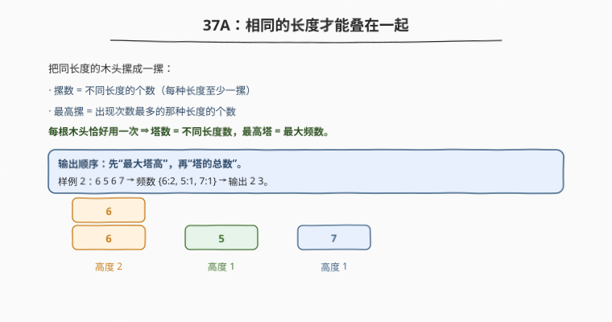
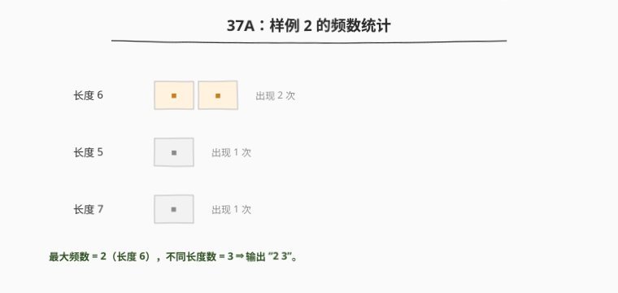

# Codeforces 37A 木塔 题解

## 1. 题目概述

- **题目链接**：https://codeforces.com/problemset/problem/37/A
- **比赛来源**：Codeforces Beta Round 37 · Problem A（UTC 2010-10-25）
- **难度**：1000
- **标签**：sortings
- **评测类型**：普通
- **限制**：时间 2 s / 内存 256 MB

**题意**：有 $n$ 根木头，长度分别为 $a_1..a_n$。长度相同的木头可以上下叠起来组成塔（一根木头只能属于一座塔，每根都必须用上）。求"最高塔的高度"与"塔的数量"。

**约束**：

- $n \le 1000$，长度 $< 1000$ 的自然数。
- 只有长度**完全相同**才能叠在一起，所以塔的划分被长度唯一确定：每种长度对应一座塔。

## 2. 示例与观察

官方样例 1（输入 / 输出原样）：

```text
输入：
3
1 2 3

输出：
1 3
```

三根长度互不相同，各自单独成塔：塔数 3，最高塔高 1。

官方样例 2（输入 / 输出原样）：

```text
输入：
4
6 5 6 7

输出：
2 3
```

长度 6 出现两次 → 这一摞高 2；长度 5、7 各一次。塔数 3，最高塔高 2。

**观察**：由于只有等长才能叠放，任意方案里每种长度的木头必然全部落在同一座塔里，于是

- 塔数 $=$ 不同长度的个数；
- 最高塔高 $=$ 出现次数最多的长度的出现次数。

## 3. 解题思路

### 3.1 朴素做法

排序后扫描统计每段等长区间；或直接用哈希表计数。两者都是 $O(n \log n)$ 或 $O(n)$，远低于时限。

### 3.2 核心：频数统计



把每个长度看成一个关键字，统计它的出现次数 $cnt[L]$。答案就是

$$\Bigl(\max_L cnt[L],\ \bigl|\{L : cnt[L] > 0\}\bigr|\Bigr).$$

注意输出顺序：**先最高塔高，再塔的总数**（样例 2 是 `2 3`，不是 `3 2`）。

### 3.3 样例走查



样例 2：长度 6 出现 2 次、5 与 7 各 1 次 → 最大频数 2、不同长度 3 → 输出 `2 3` ✓。

## 4. 正确性证明

**引理 1（同长必同塔）**：任何合法方案中，相同长度的所有木头必须落在同一座塔内。

**证明**：若长度 $L$ 的木头分别在塔 $A$、$B$ 中，则把它们合并到一座塔（同长可叠）仍是合法方案，且塔数更少；而每根木头都必须用上，塔的划分由长度分组唯一确定 ✓。∎

**引理 2（塔高）**：按长度分组后，长度 $L$ 的那座塔高度恰为 $cnt[L]$。

**证明**：同长的全部木头都在这一摞里，且每根恰好用一次 ✓。∎

**定理**：算法输出 $(\max_L cnt[L],\ |\{L: cnt[L] > 0\}|)$ 是正确的答案。

**证明**：由引理 1、2，所有合法方案中塔的集合就是"每种长度一摞"，于是最高塔高为 $\max cnt$、塔数为非零频数的个数 ✓。∎

## 5. 复杂度分析

- **时间**：$O(n \log n)$（排序）或 $O(n)$（哈希）；$n \le 1000$ 时不到 $10^4$ 次操作。
- **空间**：$O(n)$。
- **与时限的关系**：实测 C++ 端到端约 2 ms。

## 6. 参考代码

### C++17

```cpp
#include <bits/stdc++.h>
using namespace std;
int main(){ios::sync_with_stdio(false);cin.tie(nullptr);
 int n; if(!(cin>>n)) return 0;
 map<int,int> cnt;
 for(int i=0;i<n;i++){int a;cin>>a;cnt[a]++;}
 int distinct=(int)cnt.size(), mx=0;
 for(auto&kv:cnt) mx=max(mx,kv.second);
 cout<<mx<<' '<<distinct<<'\n';
 return 0;}
```

### Python3

```python
import sys
from collections import Counter


def main() -> None:
    data = sys.stdin.read().split()
    if not data:
        return
    n = int(data[0])
    lengths = data[1:1 + n]
    cnt = Counter(lengths)
    print(max(cnt.values()), len(cnt))


main()
```

## 7. 边界情况与易错点

1. **输出顺序**：先"最高塔高"，再"塔数"；样例 2 的 `2 3` 容易写反。
2. **$n = 1$**：输出 `1 1`。
3. **全部相同**：输出 `n 1`（一座塔，高 $n$）。
4. **全部不同**：输出 `1 n`。
5. **长度范围**：长度是小于 1000 的自然数，用数组计数也够；用 `map`/`Counter` 更省心。
6. **每根都要用**：不能只堆最高的塔而丢弃别的木头。

## 8. 验证记录

- **编译环境与命令**：`clang++ -std=c++17 -O2` + 仓库内兼容头；Python 3.9.6。
- **官方样例**：2 / 2 通过。

  ```text
  python3 codeforces/tools/verify_solution.py "codeforces/contests/0001-0100/37/A_木塔.md"
  CF37A: samples 2
    C++ 编译 OK, 样例 2/2, 最慢 12~22 ms（进程启动开销为主）
    Python 语法 OK, 样例 2/2
  ```

- **暴力对拍（262 组，全部实跑）**：独立暴力 `codeforces/tools/checkers/cf37a.py` 用"排序 + 行程长度编码"统计（与主程序的哈希计数是两条不同的实现路径），数据为 2 组官方样例 + 260 组随机（$n \le 12$，值域 2/3/5/10/999 五档）。结果 `cases 262 bad 0`。
- **最大约束性能**：$n = 1000$ 随机数据，C++ 端到端约 2 ms。
- **图片校验**：两张 SVG 通过 `ElementTree.parse`；文本包围盒检查 0 越界、0 重叠、0 越框。
- **复核状态**：verified。

## 相关题目与扩展

- [Codeforces 37C 古柏林语言](https://codeforces.com/problemset/problem/37/C)：同场 C 题，按长度构造无前缀码。
- [LeetCode 1636. 按照频率将数组排序](https://leetcode.cn/problems/sort-array-by-increasing-frequency/)：同样是频数统计类问题。
- [LeetCode 1207. 独一无二的出现次数](https://leetcode.cn/problems/unique-number-of-occurrences/)：统计频数的另一个变体。

**延伸思考**：

1. **允许不同长度叠放**：若长度差不超过 $d$ 就能叠，问题变成"把数组分成若干条链、链内相邻差 $\le d$ 且最长链最短"，是排序 + 贪心/二分。
2. **要求塔数最少**：本题按长度分组已是唯一自然方案；若允许不同长叠放，最少塔数 $=$ 最少链覆盖。
3. **输出方案**：若要输出每座塔的具体木头编号，只需按长度分组后依次输出即可。

