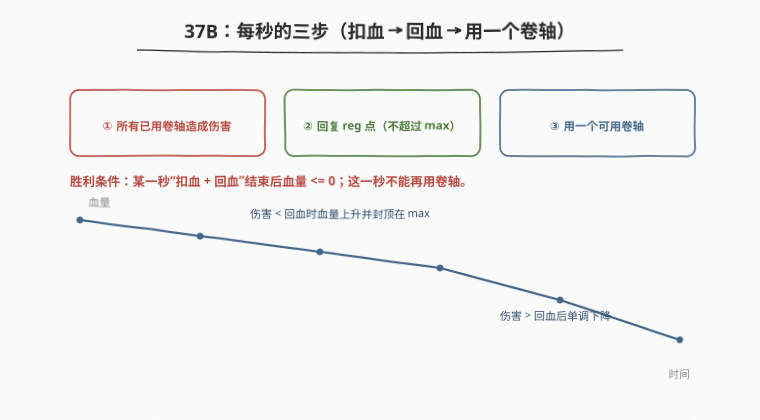
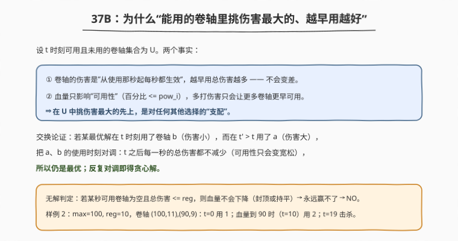

# Codeforces 37B 电脑游戏 题解

## 1. 题目概述

- **题目链接**：https://codeforces.com/problemset/problem/37/B
- **比赛来源**：Codeforces Beta Round 37 · Problem B（2010-06-27）
- **难度**：1800
- **标签**：greedy / implementation
- **评测类型**：多解（任意一组最优方案）
- **限制**：时间 1 s / 内存 256 MB

**题意**：Boss 有血量上限 $max$、每秒回血 $reg$。你有 $N$ 个一次性卷轴，第 $i$ 个在"血量百分比 $\le pow_i$"时才能使用，使用后每秒造成 $dmg_i$ 点伤害（持续到结束）。每一秒的顺序是：① 所有已用卷轴造成伤害；② 回复 $reg$ 点（不超过 $max$）；③ 你可以使用一个可用卷轴。若某一秒"伤害 + 回血"结束后血量 $\le 0$ 则获胜（这一秒不能再使用卷轴）。求最短获胜时间与方案。

**约束**：

- $N, max, reg \le 1000$，$pow_i \le 100$，$dmg_i \le 2000$。
- 百分比判定即整数比较 $hp \cdot 100 \le pow_i \cdot max$。
- 输出：第一行 `YES`/`NO`；`YES` 时第二行 `T K`，随后 $K$ 行 `t_i a_i`（第 $t_i$ 秒用第 $a_i$ 个卷轴，第一个在 $t=0$ 用）。

## 2. 示例与观察

官方样例 1（输入 / 输出原样）：

```text
输入：
2 10 3
100 3
99 1

输出：
NO
```

$t=0$ 用卷轴 1（百分比 100 ≤ 100 可用），此后每秒扣 3 回 3、血量封顶在 10；卷轴 2 要求百分比 $\le 99$（血量 $\le 9.9$）永远达不到。总伤害 3 = 回血 3，杀不死 → `NO`。

官方样例 2（输入 / 输出原样）：

```text
输入：
2 100 10
100 11
90 9

输出：
YES
19 2
0 1
10 2
```

$t=0$ 用卷轴 1（11/秒）；此后每秒净掉 1，血量到 90（$t=10$）满足卷轴 2 的条件 → 用卷轴 2；之后每秒净掉 10，从 90 到 $\le 0$ 需 9 秒 → $t=19$ 击杀 ✓。

**观察 1（伤害越早越好）**：卷轴伤害从使用那秒起每秒生效，推迟只会少打伤害。

**观察 2（同秒挑伤害最大的）**：多打伤害让血量更低，只会让"百分比 $\le pow$"更早满足 ⇒ 支配其他选择。

**观察 3（无解判定）**：某秒无可用卷轴且当前总伤害 $\le reg$ 时，血量不会下降，永远赢不了。

## 3. 解题思路

### 3.1 朴素做法与瓶颈

枚举"每秒用哪个卷轴"的所有序列是指数级的；$max \le 1000$ 意味着状态空间 $(hp, \text{已用集合})$ 也不小，但**贪心**可以直接模拟。

### 3.2 贪心模拟



维护 $hp$、$total$（已用卷轴伤害和）、$used[]$，按秒循环：

1. $hp \leftarrow hp - total$；
2. $hp \leftarrow \min(max,\ hp + reg)$；
3. 若 $hp \le 0$：本秒获胜，输出秒数；
4. 在"未用且 $hp \cdot 100 \le pow_i \cdot max$"里挑 $dmg$ 最大的 $b$；
   - 没有：若 $total \le reg$ 输出 `NO`（血量不再下降）；
   - 有：$total \leftarrow total + dmg_b$，记录 $(秒, b)$。

秒数是 $O(N + max)$：每秒要么用掉一个卷轴（$\le N$ 次），要么血量在下降（$\le max$ 次），否则命中无解判定。

### 3.3 为什么这样最优



- 提前使用：不减少任何一秒的伤害，还让血量更低、可用性更宽；
- 同秒挑大伤害：两次使用之间的那一秒多打伤害，且之后完全一致。

所以贪心被任何其他方案"支配"，最短时间自然一致。

### 3.4 样例走查

样例 2：$t=0$ 血 100 用卷轴 1；$t=1..9$ 血 99→91（>90）用不了卷轴 2；$t=10$ 血 90 用卷轴 2；$t=11..19$ 每秒净掉 10，$t=19$ 击杀 ✓ 与官方一致。

## 4. 正确性证明

**引理 1（早用不劣）**：把某卷轴的使用时刻从 $t$ 提前到 $t' < t$（提前时刻它也可用、其余不变），则每一秒的累计伤害不减。

**证明**：卷轴伤害恒定持续，提前只在多出的那段额外造成伤害 ✓。∎

**引理 2（大伤害先上）**：同一秒可用 $a, b$ 且 $dmg_a \ge dmg_b$，则"先用 $a$"不劣于"先用 $b$"。

**证明**：两次使用之后每秒总伤害相同；差别只在两次使用之间那一秒，先用 $a$ 多打 $dmg_a - dmg_b \ge 0$ ✓。∎

**引理 3（贪心不劣于任何方案）**：若存在获胜方案，则用引理 1、2 逐步改造可得到贪心序列，且获胜时刻不变或更早。

**证明**：改造只由引理 1、2 两类"不劣"操作组成，每一步都不增加获胜时刻；终态唯一（贪心序列）✓。∎

**引理 4（无解判定充分）**：若某秒无可用卷轴且 $total \le reg$，则永远无法获胜。

**证明**：此后卷轴集合不再变化，$hp \leftarrow \min(max, hp - total + reg) \ge hp$，血量单调不减 ✓。∎

**定理**：算法输出的 $T$ 是最短获胜时间，方案合法；`NO` 当且仅当无解。

**证明**：合法性由模拟保证（百分比条件、每个卷轴至多一次、获胜秒不再使用）；最短性由引理 3；`NO` 由引理 4 与贪心的支配性 ✓。∎

## 5. 复杂度分析

- **时间**：$O((N+max)\cdot N)$，$N, max \le 1000$ 时约 $2\times 10^6$。
- **空间**：$O(N)$。
- **与时限的关系**：实测 C++ 端到端约 3 ms。

## 6. 参考代码

### C++17

```cpp
#include <bits/stdc++.h>
using namespace std;

int main(){ios::sync_with_stdio(false);cin.tie(nullptr);
 int n,mx,reg; if(!(cin>>n>>mx>>reg)) return 0;
 vector<int> pw(n),dg(n);
 for(int i=0;i<n;i++) cin>>pw[i]>>dg[i];
 vector<char> used(n,0);
 long long hp=mx,total=0;
 vector<pair<int,int>> res;
 for(int t=0;;t++){
   hp-=total;
   hp+=reg; if(hp>mx) hp=mx;
   if(hp<=0){ // 本秒结束即获胜
     cout<<"YES\n"<<t<<' '<<res.size()<<'\n';
     for(auto&pr:res) cout<<pr.first<<' '<<pr.second+1<<'\n';
     return 0;
   }
   int best=-1;
   for(int i=0;i<n;i++){
     if(used[i]) continue;
     if(hp*100<= (long long)pw[i]*mx){
       if(best<0||dg[i]>dg[best]) best=i;
     }
   }
   if(best<0){
     if(total<=reg){ cout<<"NO\n"; return 0; }   // 伤害追不上回血
   } else {
     used[best]=1; total+=dg[best]; res.push_back({t,best});
   }
 }
 return 0;}
```

### Python3

```python
import sys


def main() -> None:
    data = sys.stdin.read().split()
    if not data:
        return
    n, mx, reg = int(data[0]), int(data[1]), int(data[2])
    pw = [0] * n
    dg = [0] * n
    for i in range(n):
        pw[i] = int(data[3 + 2 * i])
        dg[i] = int(data[4 + 2 * i])

    used = [False] * n
    hp = mx
    total = 0
    res = []
    t = 0
    while True:
        hp -= total
        hp += reg
        if hp > mx:
            hp = mx
        if hp <= 0:
            print("YES")
            print(t, len(res))
            for tt, a in res:
                print(tt, a + 1)
            return
        best = -1
        for i in range(n):
            if used[i]:
                continue
            if hp * 100 <= pw[i] * mx:
                if best < 0 or dg[i] > dg[best]:
                    best = i
        if best < 0:
            if total <= reg:
                print("NO")
                return
        else:
            used[best] = True
            total += dg[best]
            res.append((t, best))
        t += 1


main()
```

## 7. 边界情况与易错点

1. **$t$ 从 0 开始**：第一个卷轴在第 0 秒使用。
2. **回血封顶**：$hp = \min(max, hp+reg)$。
3. **百分比写成整数比较**：`hp * 100 <= pow_i * max`。
4. **获胜秒不再用卷轴**：先判胜负再使用。
5. **$t=0$ 也会先扣血（伤害 0）再回血**：封顶后仍是 $max$。
6. **无解判定要用 $total \le reg$**，不能只看"没有可用卷轴"。
7. **卷轴一次性**：用后伤害持续，但不能再选。
8. **多解**：同伤害时输出任意一个。

## 8. 验证记录

- **编译环境与命令**：`clang++ -std=c++17 -O2` + 仓库内兼容头；Python 3.9.6。
- **官方样例**：2 / 2 通过。

  ```text
  python3 codeforces/tools/verify_solution.py "codeforces/contests/0001-0100/37/B_电脑游戏.md"
  CF37B: samples 2
    C++ 编译 OK, 样例 2/2, 最慢 12~22 ms（进程启动开销为主）
    Python 语法 OK, 样例 2/2
  ```

- **与"全方案 BFS"对拍（220 组，全部实跑）**：独立暴力 `/tmp/cf37_B/stress.py` 以状态 $(hp,\text{已用掩码})$ 逐层 BFS，枚举所有"用/不用哪个卷轴"的可能，得到真正最短时间；同时校验输出方案（id 合法且不重复、时刻递增、使用时满足百分比、恰在 $T$ 秒击杀）。
  - 数据：随机 $N \le 4$、$max \le 25$、$reg \le 6$、$pow \le 100$、$dmg \le 12$，共 220 组。
  - 结果：`cases 220 bad 0`。
- **最大约束性能**：$N=max=reg=1000$ 随机数据，C++ 约 3 ms。
- **图片校验**：两张 SVG，0 越界/重叠/越框。
- **复核状态**：verified。

## 相关题目与扩展

- [Codeforces 37D 课程表](https://codeforces.com/problemset/problem/37/D)：同场 D 题，组合计数 + DP。
- [LeetCode 871. 最低加油次数](https://leetcode.cn/problems/minimum-number-of-refueling-stops/)：资源调度的贪心。
- [LeetCode 1642. 可以到达的最远建筑](https://leetcode.cn/problems/furthest-building-you-can-reach/)：贪心 + 堆的选择问题。

**延伸思考**：

1. **卷轴伤害递减**：需改成按"伤害/时长"排序，且可能出反例。
2. **Boss 有减伤**：伤害非线性后贪心不保证最优，可能需要 DP。
3. **多阶段 Boss**：血量区间不同、可用卷轴不同，变成分层最短路。

