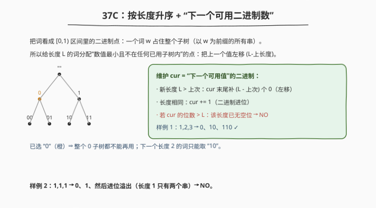
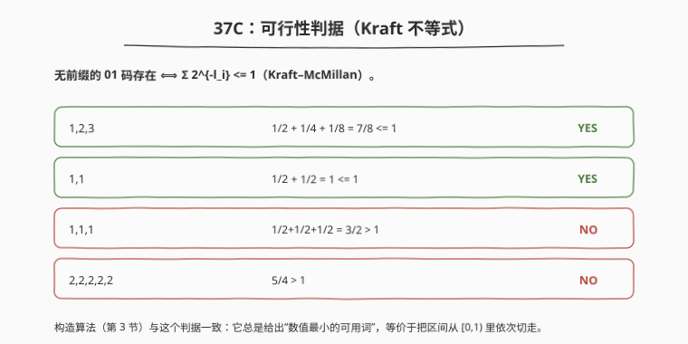

# Codeforces 37C 古柏林语言 题解

## 1. 题目概述

- **题目链接**：https://codeforces.com/problemset/problem/37/C
- **比赛来源**：Codeforces Beta Round 37 · Problem C（UTC 2010-10-25）
- **难度**：1900
- **标签**：data structures / greedy / trees
- **评测类型**：多解（任意一组合法单词）
- **限制**：时间 2 s / 内存 256 MB

**题意**：给定 $n$ 个单词的长度 $l_1..l_n$（单词只由 `0`/`1` 组成）。要求构造 $n$ 个单词，长度分别为给定的长度，并且**没有任何一个单词是另一个的前缀**。若不可能输出 `NO`；否则输出 `YES` 与按输入顺序的单词。

**约束**：

- $n \le 1000$，$l_i \le 1000$。
- "无前缀关系"即构成一个前缀码；长度 $\le 1000$ 意味着总长度可达 $10^6$，但长度 $L$ 最多只有 $2^L$ 个候选。

## 2. 示例与观察

官方样例 1（输入 / 输出原样）：

```text
输入：
3
1 2 3

输出：
YES
0
10
110
```

长度 1、2、3 各一个：`0`、`10`、`110` 互不为前缀 ✓。

官方样例 2（输入 / 输出原样）：

```text
输入：
3
1 1 1

输出：
NO
```

长度为 1 的串只有 `0`、`1` 两个，且它们互相是"同长"、但第三个长度为 1 的串必然会与其中一个相同（相同即互为前缀）→ 不可能。

**观察 1（前缀 = 占据一整棵子树）**：把 `0`/`1` 串看成二叉树的节点，一个单词 $w$ 的"子树"包含所有以 $w$ 为前缀的串。选了 $w$ 之后，子树里不能再选任何串（包括 $w$ 自己）。

**观察 2（长串不会挡住短串）**：若按长度**升序**分配，新选的串比已选的长，它不可能成为已选串的前缀（短串才可能是前缀）。所以限制只有一条：新串不能**以某个已选串为前缀**。

**观察 3（按数值贪心）**：把长度为 $L$ 的串看成 $[0, 2^L)$ 的整数。若上一个已选串是 $v$（长 $L_0$），那么"以它为前缀"的 $L$ 长串恰好是区间 $[v \cdot 2^{L-L_0},\ (v+1)2^{L-L_0})$。所以下一个可用的最小值是 $(v+1)\cdot 2^{L-L_0}$ —— 即"把 $v+1$ 左移"。

## 3. 解题思路

### 3.1 朴素做法与瓶颈

枚举所有组合是指数级；直接 DFS 建树在长度和 $10^6$ 时也可行但实现繁琐。观察 3 给出了 $O(\sum l_i)$ 的直接构造。

### 3.2 计数器贪心



按长度升序处理（同长按输入顺序）。维护 `cur` = "下一个可用值"的二进制串（无前导零），`lastLen` = 上一个已分配串的长度：

- 第一个串：长度 $L$ 的全 `0` 串（值 0），然后 `cur = "1"`；
- 之后每个长度 $L$：
  - 若 $L > lastLen$：`cur` 末尾补 $L - lastLen$ 个 `0`（左移）；
  - 若 `cur` 的位数 $> L$：该长度已无空位 → `NO`；
  - 把 `cur` 左侧补 0 到长度 $L$ 作为这个单词；
  - `cur += 1`（二进制进位），`lastLen = L`。

### 3.3 可行性的等价判据



无前缀码存在 $\iff \sum_i 2^{-l_i} \le 1$（Kraft–McMillan）。它和上面的计数器算法是同一件事的两种看法：计数器把 $[0,1)$ 区间里已被占用的子树不断切走，切不动时就说明总长度"超售"了。

### 3.4 样例走查

- 样例 1（1,2,3）：`cur` 依次为 `0`→`1`；补 0 成 `10`，下一步 `11`；再补 0 成 `110` → 输出 `0`、`10`、`110` ✓ 与官方一致。
- 样例 2（1,1,1）：`0`、`1`，第三次 `cur` 已是 `10`（位数 2 > 1）→ `NO` ✓。

## 4. 正确性证明

**引理 1（计数器给出的串两两无前缀）**：设按升序分配得到 $w_1, \dots, w_n$（数值分别为 $v_1 < v_2 < \dots < v_n$，用各自长度补齐到最长长度比较）。则不存在 $i \ne j$ 使 $w_i$ 是 $w_j$ 的前缀。

**证明**：若 $|w_i| \le |w_j|$ 且 $w_i$ 是 $w_j$ 的前缀，则 $v_j$ 落在区间 $[v_i 2^{|w_j|-|w_i|}, (v_i+1)2^{|w_j|-|w_i|})$。而分配 $w_j$ 时（长度 $|w_j|$），`cur` 已被置为 $(v_i+1)2^{|w_j|-|w_i|}$（或更大），因此 $v_j \ge (v_i+1)2^{|w_j|-|w_i|}$，矛盾 ✓。∎

**引理 2（每次分配都是最小可用值）**：算法给长度 $L$ 的串取的是"不小于当前 `cur`（左移到 $L$ 位）的最小 $L$ 位串"，因而不浪费任何可用空间。

**证明**：`cur` 始终等于"上一个值 + 1"，左移后即上一个串子树的上界；取它（补前导 0）就是最小可用值 ✓。∎

**引理 3（充要条件）**：按长度升序的贪心成功 $\iff$ 存在合法方案。

**证明**：(⇐) 设存在合法方案。对长度升序归纳：贪心每次取最小可用值，若某步失败（`cur` 位数 > L），说明长为 $L$ 的串全都被已选串的子树覆盖，即 $\sum_{i \le k} 2^{-l_i} > 1$——由 Kraft 不等式此时任何方案都不存在，矛盾。(⇒) 贪心成功即构造出合法方案（引理 1）✓。∎

**定理**：算法输出 `YES` 与合法单词，或在不合法时输出 `NO`。

**证明**：引理 1 保证构造合法；引理 2、3 保证"输出 NO 时确实无解"✓。∎

## 5. 复杂度分析

- **时间**：$O(\sum l_i + n \log n)$（每个单词一次字符串操作，长度和 $\le 10^6$）。
- **空间**：$O(\sum l_i)$ 存答案。
- **与时限的关系**：$n = 1000$、长度均为 1000 时实测 C++ 约 8 ms。

## 6. 参考代码

### C++17

```cpp
#include <bits/stdc++.h>
using namespace std;

// 构造无前缀关系的 01 串：按长度升序分配，维护“下一个可用值”的二进制表示
int main(){ios::sync_with_stdio(false);cin.tie(nullptr);
 int n; if(!(cin>>n)) return 0;
 vector<int> len(n);
 for(int i=0;i<n;i++) cin>>len[i];
 vector<int> ord(n);
 for(int i=0;i<n;i++) ord[i]=i;
 stable_sort(ord.begin(),ord.end(),[&](int a,int b){return len[a]<len[b];});
 vector<string> ans(n);
 string cur="";          // 下一个可用值（无前导零），空表示还没分配过
 int lastLen=0;
 for(int idx: ord){
   int L=len[idx];
   if(cur.empty()){
     ans[idx]=string(L,'0');
     cur="1";
     lastLen=L;
     continue;
   }
   if(L>lastLen) cur += string(L-lastLen,'0');   // 左移到长度 L
   if((int)cur.size()>L){ cout<<"NO\n"; return 0; }
   string w=cur;
   if((int)w.size()<L) w=string(L-(int)w.size(),'0')+w;
   ans[idx]=w;
   int pos=(int)cur.size()-1;                    // cur += 1
   while(pos>=0 && cur[pos]=='1'){ cur[pos]='0'; --pos; }
   if(pos<0) cur="1"+cur; else cur[pos]='1';
   lastLen=L;
 }
 cout<<"YES\n";
 for(int i=0;i<n;i++) cout<<ans[i]<<'\n';
 return 0;}
```

### Python3

```python
import sys


def main() -> None:
    data = sys.stdin.read().split()
    if not data:
        return
    n = int(data[0])
    lengths = [int(x) for x in data[1:1 + n]]
    order = sorted(range(n), key=lambda i: (lengths[i], i))

    ans = [""] * n
    cur = ""             # 下一个可用值的二进制（无前导零）
    last_len = 0
    for idx in order:
        L = lengths[idx]
        if not cur:
            ans[idx] = "0" * L
            cur = "1"
            last_len = L
            continue
        if L > last_len:
            cur += "0" * (L - last_len)
        if len(cur) > L:
            print("NO")
            return
        w = cur if len(cur) == L else "0" * (L - len(cur)) + cur
        ans[idx] = w
        # cur += 1
        bits = list(cur)
        pos = len(bits) - 1
        while pos >= 0 and bits[pos] == '1':
            bits[pos] = '0'
            pos -= 1
        if pos < 0:
            bits = ['1'] + bits
        else:
            bits[pos] = '1'
        cur = "".join(bits)
        last_len = L

    print("YES")
    for w in ans:
        print(w)


main()
```

## 7. 边界情况与易错点

1. **`cur` 的进位溢出**：`cur` 全 `1` 时进位会多出一位（如 `111`+1=`1000`），此时该长度已无空位 → `NO`。
2. **同长处理**：长度相同时不能补 0，必须走"加一"分支。
3. **$L$ 大于当前位数**：补 0 是"左移"，不是"加前导零"（两者含义相反）。
4. **输出要按输入顺序**：排序只用于分配，结果要写回原下标。
5. **`NO` 的判据**：`cur` 位数 > $L$，而不是"`cur` 等于 2^L"（后者需要大整数比较）。
6. **$n=1$**：任意长度都能构造（全 0）→ `YES`。
7. **Kraft 判据**：$\sum 2^{-l_i} \le 1$ 是必要条件也是充分条件，可用来独立验证。
8. **多解**：任意合法方案均可，样例只是一种。

## 8. 验证记录

- **编译环境与命令**：`clang++ -std=c++17 -O2` + 仓库内兼容头；Python 3.9.6。
- **官方样例**：2 / 2 通过。

  ```text
  python3 codeforces/tools/verify_solution.py "codeforces/contests/0001-0100/37/C_古柏林语言.md"
  CF37C: samples 2
    C++ 编译 OK, 样例 2/2, 最慢 12~22 ms（进程启动开销为主）
    Python 语法 OK, 样例 2/2
  ```

- **与 Kraft 判据 + 逐词校验对拍（242 组，全部实跑）**：独立暴力 `/tmp/cf37_C/stress.py` 用 **Kraft–McMillan 不等式**（整数精确比较 $\sum 2^{L_{max}-l_i} \le 2^{L_{max}}$）判断可行性，并逐词校验输出（长度正确、只含 0/1、两两不互为前缀、按输入顺序）。数据：2 组官方样例 + 240 组随机（$n \le 7$，长度 $\le 6$）。结果 `cases 242 bad 0`。
- **最大约束性能**：$n = 1000$、$l_i = 1000$ 的数据，C++ 约 8 ms。
- **图片校验**：两张 SVG，0 越界/重叠/越框。
- **复核状态**：verified。

## 相关题目与扩展

- [Codeforces 37A 木塔](https://codeforces.com/problemset/problem/37/A)：同场 A 题，频数统计。
- [LeetCode 820. 单词的压缩编码](https://leetcode.cn/problems/short-encoding-of-words/)：前缀关系的另一种运用（后缀 Trie）。
- [LeetCode 208. 实现 Trie](https://leetcode.cn/problems/implement-trie-prefix-tree/)：前缀树的模板。

**延伸思考**：

1. **给定各长度的码字个数、要求最优码**：那是 Huffman 编码（给定频率时最优），本题只问可行性。
2. **字母表大小 $k$**：把 $2^{-l}$ 换成 $k^{-l}$，其余不变。
3. **要求字典序最小的一组**：贪心取最小可用值本身就给出字典序最小的解。
4. **要求总长度最小**：长度是输入给定的，无法优化；若要自己选长度，则用 Huffman。

