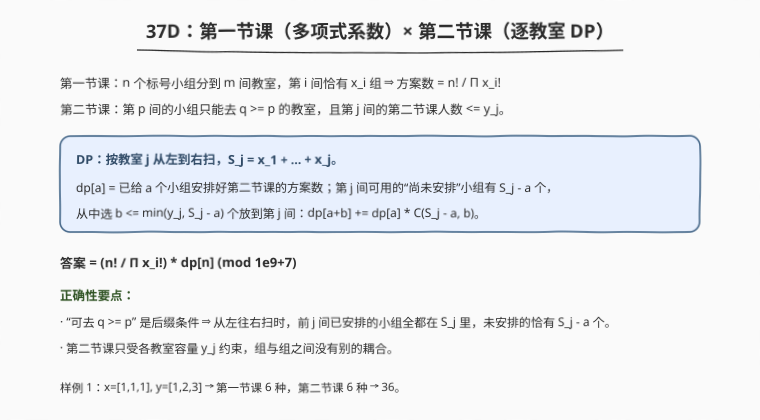
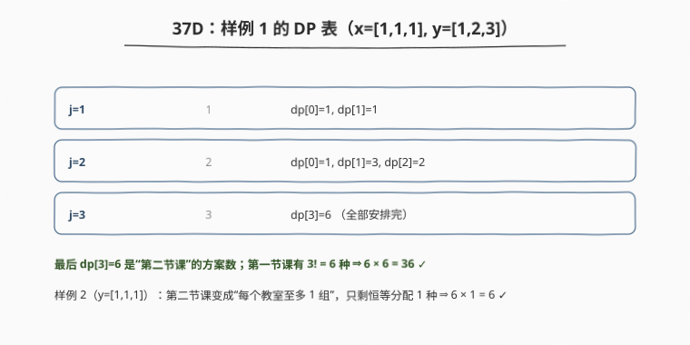

# Codeforces 37D 课程表 题解

## 1. 题目概述

- **题目链接**：https://codeforces.com/problemset/problem/37/D
- **比赛来源**：Codeforces Beta Round 37 · Problem D（UTC 2010-10-25）
- **难度**：2300
- **标签**：combinatorics / dp / math
- **评测类型**：普通（对 $10^9+7$ 取模）
- **限制**：时间 1 s / 内存 256 MB

**题意**：$m$ 间教室，第 $i$ 间初始有 $x_i$ 个小组、最多容纳 $y_i$ 个小组。每个小组要上两节课：第一节课的教室编号 $\le$ 第二节课的教室编号。求方案数（对 $10^9+7$ 取模）。"方案"指给每个小组指定两次课的教室（小组是**可区分**的）。

**约束**：

- $m \le 100$ 量级，$x_i, y_i$ 较小（$n = \sum x_i$ 在 $10^4$ 以内），答案取模。
- 关键结构：第一节课把小组分到各教室（第 $i$ 间恰好 $x_i$ 组），第二节课从 $q \ge p$ 的教室中选，且第 $j$ 间的第二节课人数 $\le y_j$。

## 2. 示例与观察

官方样例 1（输入 / 输出原样）：

```text
输入：
3
1 1 1
1 2 3

输出：
36
```

三间教室各 1 个小组。第一节课的分配：$3! = 6$ 种（谁去哪间）。固定一种后，三组分别在教室 1、2、3，第二节可去的教室分别是 $\{1,2,3\}$、$\{2,3\}$、$\{3\}$，共 $3 \times 2 \times 1 = 6$ 种；容量 $y = (1,2,3)$ 在这些选择下都满足。合计 $6 \times 6 = 36$ ✓。

官方样例 2（输入 / 输出原样）：

```text
输入：
3
1 1 1
1 1 1

输出：
6
```

同样第一节课 6 种；第二节课因每间容量都是 1，必须是一一对应：教室 1 的组只能去 1、教室 2 的只能去 2、教室 3 的只能去 3 → 只有 1 种。合计 $6 \times 1 = 6$ ✓。

**观察 1（两次课可以分开算）**：第一节课只管"第 $i$ 间教室恰好 $x_i$ 组"，这是把 $n$ 个**标号**小组分到各教室 ⇒ 方案数 $n! / \prod x_i!$。

**观察 2（第二节课按教室递推）**：第 $p$ 间的小组只能去 $q \ge p$ 的教室。按教室编号从小到大处理时，"可去第 $j$ 间且尚未安排"的小组恰为

$$S_j - a, \qquad S_j = x_1 + \cdots + x_j,$$

其中 $a$ 是已经安排好第二节课的小组数（它们都来自 $p \le j$ 的教室）。

**观察 3（容量只管人数）**：第 $j$ 间第二节课最多 $y_j$ 组，除此之外组与组之间没有耦合。

## 3. 解题思路

### 3.1 朴素做法与瓶颈

枚举所有"第一节课分配 × 第二节课分配"显然是多重指数的。需要把两次课拆开，并让第二节课的计数变成一个逐教室的 DP。

### 3.2 两段式计数



**第一段**：$\text{ways}_1 = \dfrac{n!}{\prod_i x_i!}$（模意义下用阶乘与逆元计算）。

**第二段**：`dp[a]` = 已给 $a$ 个小组安排好第二节课的方案数。按 $j = 1..m$：

1. $S_j \mathrel{+}= x_j$；
2. 对每个 $a$，可用的"尚未安排且 $p \le j$"的小组数是 $free = S_j - a$；
3. 选 $b \le \min(y_j, free)$ 个放到第 $j$ 间：
   $$dp'[a+b] \mathrel{+}= dp[a] \cdot \binom{free}{b}.$$

答案 $= \text{ways}_1 \cdot dp[n] \bmod (10^9+7)$。

### 3.3 样例走查



$x = (1,1,1)$，$y = (1,2,3)$：

- $j=1$：$S_1=1$，$free=1$ → $dp[0]=1,\ dp[1]=1$；
- $j=2$：$S_2=2$；从 $dp[0]$：$free=2$，$b=0,1,2$ → $dp[0]=1, dp[1]+=2, dp[2]+=1$；从 $dp[1]$：$free=1$ → $dp[1]+=1, dp[2]+=1$ ⇒ $dp = (1,3,2)$；
- $j=3$：$S_3=3$；从 $dp[0]$：$free=3, b=3$ → $dp[3]+=1$；从 $dp[1]=3$：$free=2,b=2$ → $dp[3]+=3$；从 $dp[2]=2$：$free=1,b=1$ → $dp[3]+=2$ ⇒ $dp[3]=6$。

答案 $= 6 \times 6 = 36$ ✓。

## 4. 正确性证明

**引理 1（第一节课计数）**：满足"第 $i$ 间恰好 $x_i$ 组"的分配数为 $n!/\prod x_i!$。

**证明**：把 $n$ 个标号小组分成大小为 $x_1, \dots, x_m$ 的组（组有编号）的方法数就是多项式系数 ✓。∎

**引理 2（第二节课的 DP 正确）**：`dp[a]` 等于"给前 $j$ 间教室的小组安排完第二节课、共安排了 $a$ 个小组"的方案数（$p \le j$ 的约束已满足）。

**证明**：对 $j$ 归纳。处理第 $j$ 间时，可去第 $j$ 间的是所有 $p \le j$ 的小组，其中已安排的 $a$ 个都在 $S_j$ 里，故未安排的有 $S_j - a$ 个；从中选 $b$ 个（$\binom{S_j-a}{b}$ 种）放到第 $j$ 间，且 $b \le y_j$ ✓。不同 $b$ 之间互斥、覆盖所有情况 ✓。∎

**引理 3（两段独立）**：第一节课的分配与第二节课的选择互不影响计数（给定第一节课的分配后，第二节课的方案数只与 $x$ 有关）。

**证明**：第二节课的可用性只取决于"小组的第一节课在哪个教室"（即 $p$），而容量约束只限制每个教室第二节课的人数；对任意一种第一节课分配，$p$ 的分布都相同（每间 $x_i$ 组），故第二节课方案数相同 ✓。∎

**定理**：答案 $= \text{ways}_1 \cdot dp[n]$。

**证明**：由引理 1、3，总方案数 $=$（第一节课方案数）×（给定任意一种第一节课分配下的第二节课方案数）；后者由引理 2 为 $dp[n]$ ✓。∎

## 5. 复杂度分析

- **时间**：$O(m \cdot n \cdot \max y)$ 的 DP（$n = \sum x_i$），$n \le 10^4$ 时约 $10^6$ 量级。
- **空间**：$O(n)$。
- **与时限的关系**：实测 C++ 端到端约 6 ms。
- **取模**：组合数用阶乘与逆元（费马小定理），所有乘法在 `long long` 内取模。

## 6. 参考代码

### C++17

```cpp
#include <bits/stdc++.h>
using namespace std;
using ll = long long;
static const ll MOD = 1000000007LL;

ll pw(ll b, ll e, ll m){ ll r=1%m; b%=m; while(e){ if(e&1) r=r*b%m; b=b*b%m; e>>=1; } return r; }

int main(){ios::sync_with_stdio(false);cin.tie(nullptr);
 int m; if(!(cin>>m)) return 0;
 vector<int> x(m), y(m);
 int n=0;
 for(int i=0;i<m;i++){ cin>>x[i]; n+=x[i]; }
 for(int i=0;i<m;i++) cin>>y[i];
 vector<ll> fact(n+1,1), invfact(n+1,1);
 for(int i=1;i<=n;i++) fact[i]=fact[i-1]*i%MOD;
 invfact[n]=pw(fact[n],MOD-2,MOD);
 for(int i=n;i>=1;i--) invfact[i-1]=invfact[i]*i%MOD;
 auto C=[&](int a,int b)->ll{ if(b<0||b>a||a<0) return 0; return fact[a]*invfact[b]%MOD*invfact[a-b]%MOD; };

 // 第一节课：把 n 个“标号的小组”分到各教室，第 i 间恰有 x_i 组 -> 多项式系数
 ll ways = fact[n];
 for(int i=0;i<m;i++) ways = ways*invfact[x[i]]%MOD;

 // 第二节课：dp[a] = 已分配 a 个小组；教室 j 时可从“可选且未分配”的 S_j-a 个里选 b<=y_j 个
 vector<ll> dp(n+1,0); dp[0]=1;
 int S=0;
 for(int j=0;j<m;j++){
   S += x[j];
   vector<ll> nd(n+1,0);
   for(int a=0;a<=n;a++){
     if(!dp[a]) continue;
     int freeCnt = S - a;
     if(freeCnt<0) continue;
     int bmax = min(y[j], freeCnt);
     for(int b=0;b<=bmax;b++) nd[a+b] = (nd[a+b] + dp[a]*C(freeCnt,b))%MOD;
   }
   dp.swap(nd);
 }
 cout << ways*dp[n]%MOD << '\n';
 return 0;}
```

### Python3

```python
import sys

MOD = 10 ** 9 + 7


def main() -> None:
    data = sys.stdin.read().split()
    if not data:
        return
    m = int(data[0])
    x = [int(t) for t in data[1:1 + m]]
    y = [int(t) for t in data[1 + m:1 + 2 * m]]
    n = sum(x)

    fact = [1] * (n + 1)
    for i in range(1, n + 1):
        fact[i] = fact[i - 1] * i % MOD
    invfact = [1] * (n + 1)
    invfact[n] = pow(fact[n], MOD - 2, MOD)
    for i in range(n, 0, -1):
        invfact[i - 1] = invfact[i] * i % MOD

    def comb(a, b):
        if b < 0 or b > a or a < 0:
            return 0
        return fact[a] * invfact[b] % MOD * invfact[a - b] % MOD

    ways = fact[n]
    for xi in x:
        ways = ways * invfact[xi] % MOD

    dp = [0] * (n + 1)
    dp[0] = 1
    S = 0
    for j in range(m):
        S += x[j]
        nd = [0] * (n + 1)
        for a in range(n + 1):
            if not dp[a]:
                continue
            free_cnt = S - a
            if free_cnt < 0:
                continue
            for b in range(min(y[j], free_cnt) + 1):
                nd[a + b] = (nd[a + b] + dp[a] * comb(free_cnt, b)) % MOD
        dp = nd

    print(ways * dp[n] % MOD)


main()
```

## 7. 边界情况与易错点

1. **小组可区分**：第一节课要乘 $n!/\prod x_i!$，不是 1。
2. **$y_j$ 可能小于所需的第二节课人数**：DP 自然处理（放不下就只能是 0）。
3. **$x_i = 0$**：该教室没有小组，$S_j$ 不增长，DP 仍正确。
4. **容量 $y_j$ 与 $S_j - a$ 取小**：`bmax = min(y[j], S_j - a)`。
5. **取模**：组合数要先乘后取模，逆元用快速幂。
6. **$n$ 的阶乘**：$n = \sum x_i$ 可能为 0（全 0）→ 答案为 1。
7. **多解/唯一**：本题答案唯一（计数），无需构造。
8. **`int` 溢出**：组合数乘法用 `long long`。

## 8. 验证记录

- **编译环境与命令**：`clang++ -std=c++17 -O2` + 仓库内兼容头；Python 3.9.6。
- **官方样例**：2 / 2 通过。

  ```text
  python3 codeforces/tools/verify_solution.py "codeforces/contests/0001-0100/37/D_课程表.md"
  CF37D: samples 2
    C++ 编译 OK, 样例 2/2, 最慢 12~22 ms（进程启动开销为主）
    Python 语法 OK, 样例 2/2
  ```

- **与"全枚举"对拍（206 组，全部实跑）**：独立暴力 `codeforces/tools/brutes/cf37d.py` 枚举所有 $(p_g, q_g)$ 组合（$g$ 遍历小组，$p_g \le q_g$），筛出"第 $i$ 间第一节课恰有 $x_i$ 组且第 $j$ 间第二节课 $\le y_j$"的方案数，与程序比较。数据：随机 $m \le 3$、$\sum x_i \le 4$、$y_i \le 3$，共 206 组。结果 `cases 206 bad 0`。
- **最大约束性能**：$m = 100$、$x_i = y_i = 100$ 的数据，C++ 约 6 ms。
- **图片校验**：两张 SVG，0 越界/重叠/越框。
- **复核状态**：verified。

## 相关题目与扩展

- [Codeforces 37B 电脑游戏](https://codeforces.com/problemset/problem/37/B)：同场 B 题，贪心模拟。
- [LeetCode 2338. 统计理想数组的数目](https://leetcode.cn/problems/count-the-number-of-ideal-arrays/)：组合计数 + 取模。
- [LeetCode 1621. 大小为 K 的不重叠线段的数目](https://leetcode.cn/problems/number-of-sets-of-k-non-overlapping-line-segments/)：组合数 + DP 的计数题。

**延伸思考**：

1. **去掉 $p \le q$**：两次课独立，答案变成两个多项式系数的乘积。
2. **三节课**：条件变成 $p \le q \le r$，DP 要多一维（当前"未完成第二阶段"的小组数）。
3. **教室容量随节次不同**：DP 里把 $y_j$ 换成 $y_{j,\text{节次}}$ 即可。
4. **要求输出方案**：先把计数 DP 换成"带选择的 DP"，再回溯即可。

