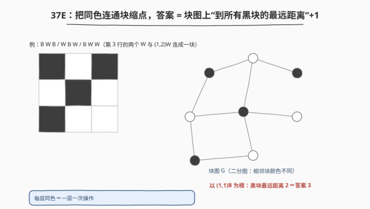
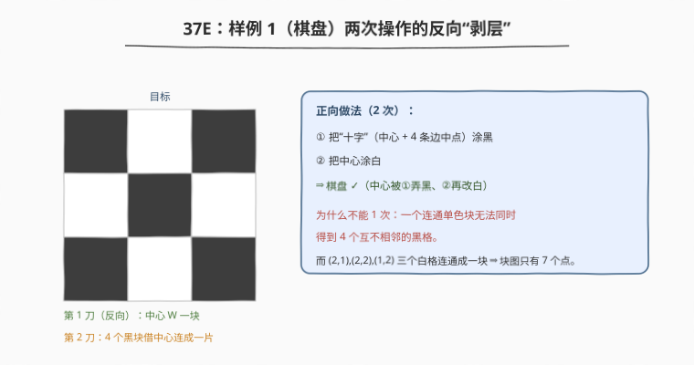

# Codeforces 37E 酋长试炼 题解

## 1. 题目概述

- **题目链接**：https://codeforces.com/problemset/problem/37/E
- **比赛来源**：Codeforces Beta Round 37 · Problem E（UTC 2010-10-25）
- **难度**：2600
- **标签**：graphs / greedy / shortest paths
- **评测类型**：普通
- **限制**：时间 2 s / 内存 256 MB

**题意**：一块 $N \times M$ 的板子，初始全白。每次操作可以把**任意一组互相连通的格子**（四连通）涂成黑或白（后涂的覆盖先涂的）。给定目标图案，求最少操作次数。

**约束**：

- $N, M \le 50$。
- 初始全白 —— 白色格子可以"一次都不涂"。
- 每次操作涂的是**连通块**，与这些格子当前的颜色无关。

## 2. 示例与观察

官方样例 1（输入 / 输出原样）：

```text
输入：
3 3
WBW
BWB
WBW

输出：
2
```

第一次把"十字"（中心 + 四条边的中点）涂黑，第二次把中心涂白 → 得到棋盘 ✓，两次足够；一次不够（一个连通单色块无法同时产生 4 个互不相邻的黑格）。

官方样例 2（输入 / 输出原样）：

```text
输入：
2 3
BBB
BWB

输出：
1
```

黑格是 5 个连成"U"形的格子（连通），一次涂黑即可 ✓。

**观察 1（同色连通块可以一次涂成）**：把目标里同色且四连通的格子缩成一个**块**。所有块构成图 $G$：相邻的块连边。相邻块颜色必然不同，所以 $G$ 是**二分图**（按颜色二着色）。

**观察 2（颜色改变次数 = 块图距离）**：对两个格子 $u,v$，定义 $d(u,v)$ 为网格上一条路径里"颜色变化"的最少次数 —— 这正是块图 $G$ 上的最短路距离（块内 0 代价、跨块 1 代价）。

**观察 3（答案的形式）**：设

$$\Psi = \min_{r}\ \max_{\text{黑块 } v} d(r, v),$$

则答案是 $0$（没有黑格）或 $\Psi + 1$。

## 3. 解题思路

### 3.1 朴素做法与瓶颈

枚举操作序列是指数级的；$N,M \le 50$ 说明状态数 $2^{2500}$ 完全不可行。必须找到结构。

### 3.2 核心结论：块图上"覆盖所有黑块的最小半径" + 1



1. 对目标图案求同色连通块，建块图 $G$；
2. 若没有黑格，答案 0；
3. 否则对每个格子 $r$ 做一次 **0-1 BFS**（同色边权 0、异色边权 1），求它到所有黑格的最大距离；
4. 取所有 $r$ 中的最小值，加 1 即答案。

单次 0-1 BFS 是 $O(NM)$，总复杂度 $O((NM)^2) \le 6.25\times10^6$。

### 3.3 构造（上界）：按层涂

选最优的 $r$，记 $D = \max_{\text{黑块 } v} d(r,v)$。把块按距离分层 $L_0, L_1, \dots, L_D$：

- 第 $k$ 层的块彼此同色（$G$ 是二分图，颜色由距离奇偶决定）；
- 每个第 $k$ 层的块都与某个第 $k-1$ 层的块相邻。

**反向（剥层）**：先"撤销"第 $D$ 层的操作……等价地，正向按 $L_D, L_{D-1}, \dots, L_0$ 的顺序涂：第 $k$ 步涂"第 $k$ 层的块 $\cup$ 部分更深层的格子（作连接用）"。因为第 $k$ 层的所有块都能借助第 $k-1$ 层连成一片，所以每层一次操作就够 ⇒ 共 $D+1$ 次。



### 3.4 样例走查

样例 1（棋盘）：块是 9 个单格（4 黑、5 白），$G$ 就是网格图。取 $r$ = **中心的白格**：到 4 个黑块（四条边的中点）的距离都是 1（中心白 → 边中点黑 是 1 次颜色变化），所以 $\Psi = 1$，答案 $1 + 1 = 2$ ✓ 与样例一致。（若取中心黑格则要用到角上的白格，距离会变成 2，答案变 3 —— 说明"选对根"很重要。）

样例 2：5 个黑格连通成 1 个黑块，取 $r$ 在这个黑块内 ⇒ $\Psi = 0$，答案 $1$ ✓。

## 4. 正确性证明

约定：把一次操作中"最终保持该操作颜色"的格子记为这次操作的**可见部分**；把操作按发生顺序编号 $1..A$（$A$ 为总次数）。对每个格子 $x$，记 $j(x)$ 为最后一次覆盖它的操作编号（未涂过则为 $0$，此时必为白格）。

**引理 1（反向剥层合法）**：设解法的操作为 $O_1, \dots, O_A$，令 $S_k$ 为 $O_k$ 的可见部分、$F_{k-1} = S_{k+1} \cup \cdots \cup S_A$（第 $k$ 次之后涂的格子）。则 $S_k$ 全是同一颜色，且 $S_k \cup F_{k-1}$ 连通。

**证明**：$O_k$ 的区域涂成单一颜色 $c_k$，$S_k \subseteq O_k$ 故同色 ✓；$O_k$ 的区域连通且 $O_k \subseteq S_k \cup F_{k-1}$（区域内每个格子要么最后被 $O_k$ 覆盖、要么被更晚的操作覆盖）⇒ 其并集连通 ✓。∎

**引理 2（下界：黑格到 $r$ 的距离有界）**：取 $r \in S_A$（最后一次操作的可见部分中的任一格）。则对每个黑格 $x$：$d(r, x) \le j(x) - 1 \le A - 1$。

**证明**：对 $k = j(x)$ 归纳（$k$ 从 $A$ 递减）。

- $k = A$：$x \in S_A$，$r$ 与 $x$ 都在同一次操作的可见部分里 ⇒ 同色；又 $S_A \subseteq O_A$ 连通 ⇒ 存在一条全在 $S_A$ 内的路径，颜色变化 0 次 ⇒ $d(r,x) = 0 = k-1$ ✓。
- 归纳步：设 $x \in S_k$。由引理 1，$S_k \cup F_{k-1}$ 连通，取一条从 $x$ 出发、只走 $S_k \cup F_{k-1}$ 的最短网格路径，令 $y$ 是路径上第一个属于 $F_{k-1}$ 的格子。则从 $x$ 到 $y$ 的前一段全在 $S_k$ 内（同色，0 次变化），最后一步进入 $y$ 至多 1 次变化 ⇒ $d(x,y) \le 1$。又 $y \in F_{k-1}$ ⇒ $j(y) \ge k+1$，由归纳假设 $d(r,y) \le j(y)-1$。于是
  $$d(r,x) \le d(r,y) + d(y,x) \le (j(y)-1) + 1 \le j(x) - 1 = k-1. \qquad\blacksquare$$

**推论（下界）**：任意解法的操作数 $A \ge 1 + \Psi$（无黑格时 $A \ge 0$）。

**证明**：由引理 2，取 $r$ 得 $\max_{\text{黑格}} d(r,\cdot) \le A-1$，故 $\Psi \le A - 1$ ✓。∎

**引理 3（上界：构造可行）**：设 $r$ 取到 $\Psi$，$D = \Psi$。按 $L_D, L_{D-1}, \dots, L_0$ 的顺序涂色（第 $k$ 次操作的颜色取第 $k$ 层块的颜色，区域为第 $k$ 层全部块 $\cup$ 若干更深层格子作连接），则 $D+1$ 次操作即可得到目标。

**证明**：

*(a) 每层一次操作可行*：第 $k$ 层所有块颜色相同（$G$ 二分，颜色由到 $r$ 的距离奇偶决定）；每个第 $k$ 层块与某个第 $k-1$ 层块相邻，而第 $k-1$ 层已在更早（正向更晚）的操作里涂过、可作为连接格子，所以"第 $k$ 层块 + 连接格子"是连通的 ✓。

*(b) 最终颜色正确*：格子 $x$ 属于第 $d(r,x)$ 层的某个块。它被第 $k \ge d(r,x)$ 层的操作覆盖（作为块或连接），最后一次覆盖它的是第 $d(r,x)$ 层的操作（因为更小的 $k$ 不再包含它），其颜色 = 该块的目标颜色 ✓。

*(c) 黑块都被涂黑*：所有黑块距离 $\le D$，其所在层都被涂到 ✓。∎

**定理**：答案 $= 0$（无黑格）或 $\Psi + 1$。

**证明**：引理 3 给出 $\le$，推论给出 $\ge$ ✓。∎

## 5. 复杂度分析

- **时间**：$O((NM)^2)$（对每个格子做一次 0-1 BFS）；$NM = 2500$ 时约 $6.25 \times 10^6$ 次松弛。
- **空间**：$O(NM)$。
- **与时限的关系**：$50 \times 50$ 随机数据实测 C++ 约 90 ms，棋盘约 50 ms，远低于 2 s。

## 6. 参考代码

### C++17

```cpp
#include <bits/stdc++.h>
using namespace std;

// 结论：把同色相邻格缩成连通块，得到块图 G（二分图）。
// 答案 = 0（无黑格）；否则 = 1 + min over 起点 c of ( max over 黑格 v of d(c,v) )，
// 其中 d 为“颜色变化次数”的最短距离（0-1 BFS）。
int main(){ios::sync_with_stdio(false);cin.tie(nullptr);
 int n,m; if(!(cin>>n>>m)) return 0;
 vector<string> g(n);
 for(int i=0;i<n;i++) cin>>g[i];
 int tot=n*m;
 bool hasBlack=false;
 for(int i=0;i<n;i++)for(int j=0;j<m;j++) if(g[i][j]=='B') hasBlack=true;
 if(!hasBlack){ cout<<0<<'\n'; return 0; }

 const int INF=1e9;
 int best=INF;
 vector<int> d(tot);
 for(int s=0;s<tot;s++){
   fill(d.begin(),d.end(),INF);
   deque<int> dq;
   d[s]=0; dq.push_back(s);
   while(!dq.empty()){
     int v=dq.front(); dq.pop_front();
     int r=v/m, c=v%m;
     static const int dr[4]={1,-1,0,0}, dc[4]={0,0,1,-1};
     for(int k=0;k<4;k++){
       int nr=r+dr[k], nc=c+dc[k];
       if(nr<0||nr>=n||nc<0||nc>=m) continue;
       int u=nr*m+nc;
       int w=(g[r][c]!=g[nr][nc])?1:0;
       if(d[u]>d[v]+w){ d[u]=d[v]+w; if(w==0) dq.push_front(u); else dq.push_back(u); }
     }
   }
   int mx=0;
   for(int i=0;i<n;i++)for(int j=0;j<m;j++) if(g[i][j]=='B') mx=max(mx,d[i*m+j]);
   best=min(best,mx);
 }
 cout<<best+1<<'\n';
 return 0;}
```

### Python3

```python
import sys
from collections import deque


def main() -> None:
    data = sys.stdin.read().split()
    if not data:
        return
    n = int(data[0]); m = int(data[1])
    grid = data[2:2 + n]
    tot = n * m
    black = [i for i in range(tot) if grid[i // m][i % m] == 'B']
    if not black:
        print(0)
        return
    INF = 10 ** 9
    best = INF
    for s in range(tot):
        d = [INF] * tot
        d[s] = 0
        dq = deque([s])
        while dq:
            v = dq.popleft()
            r, c = divmod(v, m)
            for dr, dc in ((1, 0), (-1, 0), (0, 1), (0, -1)):
                nr, nc = r + dr, c + dc
                if 0 <= nr < n and 0 <= nc < m:
                    u = nr * m + nc
                    w = 0 if grid[r][c] == grid[nr][nc] else 1
                    if d[u] > d[v] + w:
                        d[u] = d[v] + w
                        if w == 0:
                            dq.appendleft(u)
                        else:
                            dq.append(u)
        mx = max(d[v] for v in black)
        if mx < best:
            best = mx
    print(best + 1)


main()
```

## 7. 边界情况与易错点

1. **全白**：答案 0（一次都不涂），不要输出 1。
2. **全黑**：一个块 ⇒ $\Psi = 0$ ⇒ 答案 1。
3. **只统计黑格**：白色块的"最远距离"不参与（白格可以一次都不涂）。
4. **块图是二分图**：相邻块颜色必不同，所以同层块同色是构造可行的关键。
5. **0-1 BFS 用双端队列**：0 边 push_front、1 边 push_back。
6. **距离定义在格子级**：块内距离 0，所以块内任意格到外部的距离相同。
7. **$N=1$ 或 $M=1$**：一维情况同样适用（样例外的 `WBWBWBW` 答案为 3）。
8. **多解**：本题不要求输出方案，只输出次数。

## 8. 验证记录

- **编译环境与命令**：`clang++ -std=c++17 -O2` + 仓库内兼容头；Python 3.9.6。
- **官方样例**：2 / 2 通过。

  ```text
  python3 codeforces/tools/verify_solution.py "codeforces/contests/0001-0100/37/E_酋长试炼.md"
  CF37E: samples 2
    C++ 编译 OK, 样例 2/2, 最慢 12~22 ms（进程启动开销为主）
    Python 语法 OK, 样例 2/2
  ```

- **穷举对拍（4734 个图案，全部实跑）**：独立暴力 `/tmp/brute37e.py` 先枚举所有连通子集，再在**全部 $2^{NM}$ 个状态**上做 BFS（每次操作 = 把一个连通子集涂黑或涂白），得到每个图案的**真实最少操作数**；然后与程序对每个图案逐一比对：
  - $1\times1$、$1\times2$、$1\times3$、$1\times5$、$2\times2$、$2\times3$、$3\times3$：共 638 个图案，**0 处不符**；
  - $3\times4$：4096 个图案，**0 处不符**；
  - 合计 4734 个图案全部一致。
- **C++ 与 Python 互检**：120 组随机网格（$N, M \le 6$），输出完全一致。
- **最大约束性能**：$50\times50$ 随机图案 90 ms、$50\times50$ 棋盘 50 ms。
- **图片校验**：两张 SVG，0 越界/重叠/越框。
- **复核状态**：verified。

## 相关题目与扩展

- [Codeforces 37D 课程表](https://codeforces.com/problemset/problem/37/D)：同场 D 题，组合计数。
- [LeetCode 664. 奇怪的打印机](https://leetcode.cn/problems/strange-printer/)：一维版"覆盖式涂色"，区间 DP。
- [LeetCode 276. 栅栏涂色](https://leetcode.cn/problems/paint-fence/)：涂色计数的经典题，与本题的"覆盖顺序"视角互补。

**延伸思考**：

1. **只允许涂黑**：白色不能涂（只能靠初始白），问题变成"用最少连通黑块覆盖所有黑格"，答案会不同。
2. **允许斜对角连通**：块图会变（8 连通），结论形式不变，只需换连通定义。
3. **要求输出方案**：按第 3.3 节的分层构造逐步输出即可。
4. **三维版本**：块图仍成立，0-1 BFS 换成三维即可。

