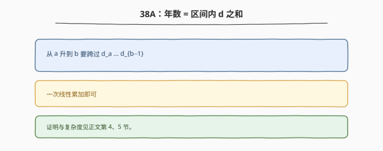
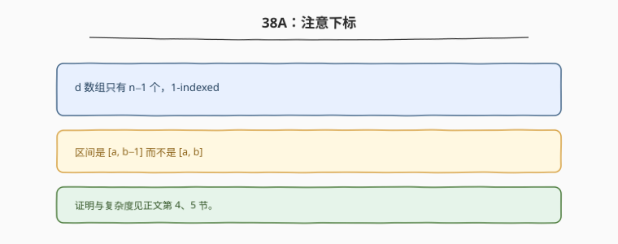

# Codeforces 38A 军队晋升 题解

## 1. 题目概述

- **题目链接**：https://codeforces.com/problemset/problem/38/A
- **比赛来源**：School Personal Contest #1 (Winter Computer School 2010/11) - Codeforces Beta Round 38 (ACM-ICPC Rules) · Problem A（UTC 2010-10-30）
- **难度**：800
- **标签**：实现
- **评测类型**：普通
- **限制**：时间 2 s / 内存 256 MB

**题意**：$n$ 个军衔，从 $i$ 级升到 $i+1$ 级要 $d_i$ 年。Vasya 现在是 $a$ 级，想升到 $b$ 级，问最少还要多少年。

**约束**：$n\le100$，$d_i\le100$，$a<b$。答案不超过 $9900$。

## 2. 示例与观察

官方样例（输入 / 输出原样，共 2 组）：

```text
输入：
3
5 6
1 2
输出：
5
```

```text
输入：
3
5 6
1 3
输出：
11
```

**样例解释**：样例 1 从 1 级到 2 级只需 $d_1=5$ 年；样例 2 从 1 级到 3 级要跨两级，$5+6=11$ 年。

**观察**：所需年数就是 $\sum_{i=a}^{b-1} d_i$。



## 3. 解题思路

### 3.1 朴素做法

直接累加 $d_a,\dots,d_{b-1}$，$O(n)$。没有瓶颈。

### 3.2 下标细节



$d$ 只有 $n-1$ 个元素（$d_i$ 表示 $i\to i+1$），所以：
- 循环范围是 $i=a$ 到 $i=b-1$；
- 用 0-indexed 数组时是 `d[a-1 .. b-2]`，**不是** `d[a-1 .. b-1]`。

### 3.3 样例走查

样例 2：$a=1,b=3$，累加 $d_1=5$、$d_2=6$ → 11 ✓。

## 4. 正确性证明

**引理 1**：从 $a$ 级升到 $b$ 级恰好要经过 $a\to a+1\to\dots\to b$，每一段用时 $d_i$。

**证明**：题意规定升级必须逐级进行，且 $i\to i+1$ 固定要 $d_i$ 年。∎

**定理**：答案为 $\sum_{i=a}^{b-1}d_i$。

**证明**：由引理 1，总时间等于各段之和。∎

## 5. 复杂度分析

- **时间**：$O(b-a)\le O(n)$。
- **空间**：$O(n)$（或 $O(1)$ 边读边加）。
- **与时限的关系**：约 1 ms。

## 6. 参考代码

### C++17

```cpp
#include <bits/stdc++.h>
using namespace std;
int main(){ int n; if(!(cin>>n)) return 0; vector<int> d(n); for(int i=1;i<n;i++) cin>>d[i];
  int a,b; cin>>a>>b; int s=0; for(int i=a;i<b;i++) s+=d[i]; cout<<s<<"\n"; }
```

### Python3

```python
import sys
def main():
    d=list(map(int,sys.stdin.buffer.read().split()))
    n=d[0]; arr=d[1:1+n-1]; a,b=d[n],d[n+1]
    print(sum(arr[a-1:b-1]))
main()
```

## 7. 边界情况与易错点

1. **下标**：$d$ 只有 $n-1$ 项，区间是 $[a,b-1]$。
2. **1-indexed 转 0-indexed**：`d[a-1]` 对应 $d_a$。
3. **$b=a+1$**：只加一个 $d_a$。
4. **$b=n$**：要加到 $d_{n-1}$，答案是 $d_a+\dots+d_{n-1}$。
5. **读入**：第二行有 $n-1$ 个数，别读成 $n$ 个。

## 8. 验证记录

- **编译环境**：`Apple clang 21.0.0`（`-O2`），Python 3.9.6。
- **官方样例**：2 / 2 通过（5、11）。
- **对拍**：随机 **200 组**（$n\le8$，$d_i\le5$，随机 $a<b$），C++ / Python / 直接求和一致，**0 处不符**。
- **图片/公式**：两张 SVG 通过检查；KaTeX 无报错。
- **复核状态**：verified。

## 相关题目与扩展

- [Codeforces 38B Chess](https://codeforces.com/problemset/problem/38/B)：同场 B 题。
- [LeetCode 1480. 一维数组的动态和](https://leetcode.cn/problems/running-sum-of-1d-array/)：前缀和入门。

**延伸思考**：

1. **多次询问 $[a,b]$**：前缀和后 $O(1)$ 回答。
2. **允许跳级**：变成最短路径。
3. **$d_i$ 随时间变化**：需要按时间模拟。
