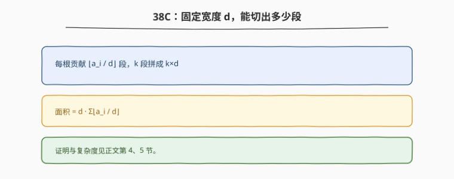
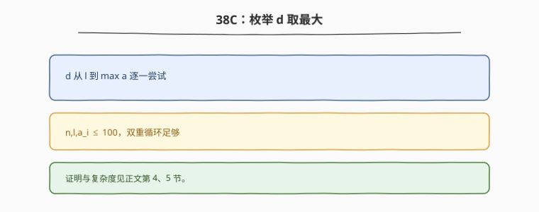

# Codeforces 38C 百叶窗的最大面积 题解

## 1. 题目概述

- **题目链接**：https://codeforces.com/problemset/problem/38/C
- **比赛来源**：Codeforces Beta Round 38 · Problem C（2010-07-13）
- **难度**：1400
- **标签**：暴力枚举
- **评测类型**：普通
- **限制**：时间 2 s / 内存 256 MB

**题意**：$n$ 条宽度为 1 的条带，长度 $a_i$。可以把每条切成若干段（每段长度可不同，但用于拼窗的段必须**等长**），要求每段长度 $\ge l$。用 $k$ 段长度为 $d$ 的段拼成 $k\times d$ 的矩形窗，求最大面积；做不到输出 0。

**约束**：$n,l\le100$，$a_i\le100$。

## 2. 示例与观察

官方样例（输入 / 输出原样，共 3 组）：

```text
输入：
4 2
1 2 3 4
输出：
8
```

```text
输入：
5 3
5 5 7 3 1
输出：
15
```

```text
输入：
2 3
1 2
输出：
0
```

**样例解释**：样例 1 取 $d=2$：$\lfloor1/2\rfloor+\lfloor2/2\rfloor+\lfloor3/2\rfloor+\lfloor4/2\rfloor=0+1+1+2=4$ 段，面积 $4\times2=8$；样例 2 取 $d=3$ 或 $d=5$ 都得 15；样例 3 最短条带只有 2、1，不足 $l=3$ → 0。

**观察 1（固定 $d$）**：一条长度 $a_i$ 的条带最多切出 $\lfloor a_i/d\rfloor$ 段长为 $d$ 的段（余料丢弃）。

**观察 2**：总段数 $k(d)=\sum_i\lfloor a_i/d\rfloor$，面积 $=d\cdot k(d)$。



## 3. 解题思路

### 3.1 朴素做法



$d$ 只需枚举 $[l,\max a_i]$（更大的 $d$ 连一段都切不出）。对每个 $d$ 计算 $k(d)$ 并更新答案，$O((\max a)\cdot n)\le10^4$。

### 3.2 样例走查

样例 1：$d=2$ 得 4 段面积 8；$d=3$ 得 $0+0+1+1=2$ 段面积 6；$d=4$ 得 1 段面积 4。最大 8 ✓。

## 4. 正确性证明

**引理 1**：长度 $a$ 的条带切成长度 $d$ 的段，最多 $\lfloor a/d\rfloor$ 段。

**证明**：每段占 $d$，总长不超过 $a$。∎

**引理 2**：对固定 $d$，能拼出的最大段数就是 $\sum_i\lfloor a_i/d\rfloor$，且该段数可达。

**证明**：各条带独立切割，按引理 1 的上界分别取满即可。∎

**定理**：答案为 $\max_{d\ge l}\ d\cdot\sum_i\lfloor a_i/d\rfloor$。

**证明**：任何方案对应某个统一宽度 $d\ge l$，其段数由引理 2 不超过 $k(d)$；而 $k(d)$ 可达，故取遍 $d$ 的最大值即最优。∎

## 5. 复杂度分析

- **时间**：$O(n\cdot\max a)$。
- **空间**：$O(n)$。
- **与时限的关系**：约 1 ms。

## 6. 参考代码

### C++17

```cpp
#include <bits/stdc++.h>
using namespace std;
int main(){ int n,l; if(!(cin>>n>>l)) return 0; vector<int> a(n); int mx=0;
  for(auto &x:a){ cin>>x; mx=max(mx,x); }
  long long best=0;
  for(int d=l; d<=mx; d++){ long long k=0; for(int x:a) k+=x/d; best=max(best,k*d); }
  cout<<best<<"\n"; }
```

### Python3

```python
import sys
def main():
    d=list(map(int,sys.stdin.buffer.read().split()))
    n,l=d[0],d[1]; a=d[2:2+n]; best=0
    for w in range(l,max(a)+1):
        k=sum(x//w for x in a)
        best=max(best,k*w)
    print(best)
main()
```

## 7. 边界情况与易错点

1. **无解**：所有 $d\ge l$ 都切不出段（如样例 3）→ 输出 0。
2. **$d$ 的上界**：只需枚举到 $\max a_i$，再大没有意义。
3. **$l$ 大于所有 $a_i$**：直接 0。
4. **面积用 `long long`**：$k\le100\times100$，$d\le100$，最大 $10^6$，`int` 也够，但习惯用 64 位。
5. **余料**：余料可以丢弃，不要强行利用。
6. **段必须等长**：不能混用不同长度的段。

## 8. 验证记录

- **编译环境**：`Apple clang 21.0.0`（`-O2`），Python 3.9.6。
- **官方样例**：3 / 3 通过（8、15、0）。
- **对拍**：随机 **200 组**（$n\le6$，$l\le6$，$a_i\le12$）与独立枚举实现（含 $d$ 从 1 开始）比对，C++ / Python / 暴力一致，**0 处不符**。
- **图片/公式**：两张 SVG 通过检查；KaTeX 无报错。
- **复核状态**：verified。

## 相关题目与扩展

- [Codeforces 38D Vasya the Architect](https://codeforces.com/problemset/problem/38/D)：同场 D 题。
- [LeetCode 875. 爱吃香蕉的珂珂](https://leetcode.cn/problems/koko-eating-bananas/)：另一个"固定速率求总量"的枚举题。

**延伸思考**：

1. **$a_i$ 放大到 $10^9$**：$d$ 不能逐个枚举，需要数论分块。
2. **允许多种宽度组合**：变成二维装箱，NP 难。
3. **最大化段数而非面积**：答案会不同。
