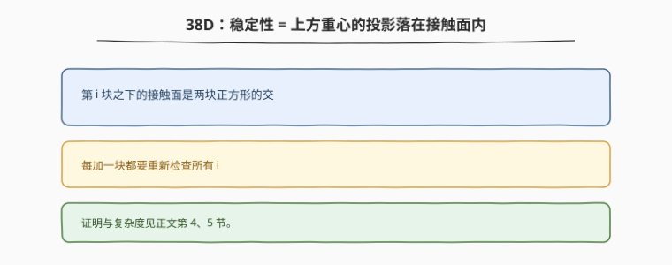
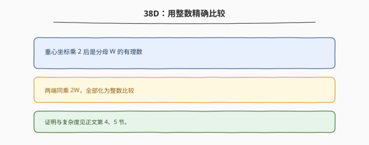

# Codeforces 38D 建筑师瓦夏 题解

## 1. 题目概述

- **题目链接**：https://codeforces.com/problemset/problem/38/D
- **比赛来源**：School Personal Contest #1 (Winter Computer School 2010/11) - Codeforces Beta Round 38 (ACM-ICPC Rules) · Problem D（UTC 2010-10-30）
- **难度**：1900
- **标签**：实现、几何、物理
- **评测类型**：普通
- **限制**：时间 2 s / 内存 256 MB

**题意**：$n$ 个正方体依次往上叠，第 $i$ 个放在第 $i-1$ 个上，接触面积 $>0$。边长为 $w$ 的立方体重 $w^3$。求最多能叠多少个而不倒塌（静力学平衡）。

**约束**：输入给出每个立方体底面正方形的对角坐标。要按物理判定：**上方所有方块的重心投影必须落在接触面内**。

## 2. 示例与观察

官方样例（输入 / 输出原样，共 3 组）：

```text
输入：
2
0 0 3 3
1 0 4 3
输出：
2
```

```text
输入：
2
0 0 3 3
2 0 5 3
输出：
1
```

```text
输入：
3
0 0 3 3
1 0 4 3
2 0 5 3
输出：
3
```

**样例解释**：样例 1 第二块的中心 $(2.5,1.5)$ 落在接触面 $x\in[1,3]$ 内 → 2 稳定；样例 2 中心 $(3.5,1.5)$ 超出 $x\le3$ → 只能放 1 个；样例 3 第二块与第三块：检查 $i=2$ 时上方两块的重心 $x=3$ 恰好落在接触边界 $x=3$ 上，**恰好平衡仍算稳定** → 3。

**观察 1（重心）**：均匀立方体的重心在底面中心 $(\frac{x_1+x_2}{2},\frac{y_1+y_2}{2})$，质量 $w^3$。

**观察 2（接触面）**：第 $i$ 块与第 $i-1$ 块的接触面是两块正方形的交：
$$[\max(x_1^{(i)},x_1^{(i-1)}),\min(x_2^{(i)},x_2^{(i-1)})]\times[\max(y_1^{(i)},y_1^{(i-1)}),\min(y_2^{(i)},y_2^{(i-1)})].$$

**观察 3（逐块检查）**：叠了 $k$ 块后，对每个 $i=2..k$，第 $i..k$ 块的重心投影都必须落在第 $i$ 与 $i-1$ 的接触面内。



## 3. 解题思路

### 3.1 判定



设 $W=\sum_{j=i}^{k}w_j^3$，$S_x=\sum_{j=i}^{k}w_j^3(x_1^{(j)}+x_2^{(j)})$（$S_y$ 同理）。重心 $x$ 坐标 $=\frac{S_x}{2W}$。条件
$$L_x\le\frac{S_x}{2W}\le R_x$$
两端乘 $2W$（$W>0$）化为纯整数比较：$2L_xW\le S_x\le 2R_xW$。

### 3.2 算法

对 $k=2..n$：从 $i=k$ 往下累加 $W,S_x,S_y$，每加一块就检查一次第 $i$ 层接触面，全部通过则答案 $k$；任一失败就停止（再多加更不可能稳）。

### 3.3 精度

用 `__int128`（Python 天然大整数）做整数运算，**完全无浮点误差**，边界（恰好平衡）用 `<=` 自然处理。

## 4. 正确性证明

**引理 1（平衡条件）**：$k$ 块塔稳定当且仅当对每个 $i\ge2$，第 $i..k$ 块的重心投影落在第 $i$ 与 $i-1$ 的接触面内。

**证明**：对每个接触面取力矩：上方整体对第 $i$ 块的作用等效为合力（总重）作用在重心；重心在支撑面内则合力矩可使塔保持平衡，否则会绕接触面边缘倾覆。∎

**引理 2**：用整数比较 $2L_xW\le S_x\le 2R_xW$ 与重心在 $[L_x,R_x]$ 等价。

**证明**：$W>0$，不等式两边同乘正数 $2W$ 不变号。∎

**定理**：算法输出的 $k$ 就是最大可叠块数。

**证明**：算法逐一检查每个 $k$ 与每个 $i$，由引理 1、2 判定正确；一旦 $k$ 不稳定，任何更大的 $k'$ 也包含同样的不稳定子塔，故停止正确。∎

## 5. 复杂度分析

- **时间**：$O(n^2)$（每个 $k$ 从顶往下累加）。
- **空间**：$O(n)$。
- **与时限的关系**：$n\le1000$ 时约 $10^6$ 次整数运算，很快。

## 6. 参考代码

### C++17

```cpp
#include <bits/stdc++.h>
using namespace std;
typedef __int128 i128;
int main(){
    int n; if(!(cin>>n)) return 0;
    vector<long long> x1(n),y1(n),x2(n),y2(n),w(n);
    for(int i=0;i<n;i++){
        long long a,b,c,d; cin>>a>>b>>c>>d;
        x1[i]=min(a,c); x2[i]=max(a,c); y1[i]=min(b,d); y2[i]=max(b,d);
        w[i]=x2[i]-x1[i];                       // 正方形边长
    }
    int ans=1;
    for(int k=2;k<=n;k++){
        i128 W=0,Sx=0,Sy=0; bool ok=true;
        for(int i=k-1;i>=1;i--){
            i128 wi=(i128)w[i]*w[i]*w[i];
            W+=wi; Sx+=wi*((i128)x1[i]+x2[i]); Sy+=wi*((i128)y1[i]+y2[i]);
            long long Lx=max(x1[i],x1[i-1]), Rx=min(x2[i],x2[i-1]);
            long long Ly=max(y1[i],y1[i-1]), Ry=min(y2[i],y2[i-1]);
            if(!((i128)2*Lx*W<=Sx && Sx<=(i128)2*Rx*W && (i128)2*Ly*W<=Sy && Sy<=(i128)2*Ry*W)){ ok=false; break; }
        }
        if(!ok) break;
        ans=k;
    }
    cout<<ans<<"\n";
}
```

### Python3

```python
import sys
def main():
    d=list(map(int,sys.stdin.buffer.read().split()))
    n=d[0]; p=1
    cubes=[]
    for i in range(n):
        a,b,c,e=d[p],d[p+1],d[p+2],d[p+3]; p+=4
        cubes.append((min(a,c),min(b,e),max(a,c),max(b,e)))
    ans=1
    for k in range(2,n+1):
        W=0; Sx=0; Sy=0; ok=True
        for i in range(k-1,0,-1):
            x1,y1,x2,y2=cubes[i]
            wi=(x2-x1)**3
            W+=wi; Sx+=wi*(x1+x2); Sy+=wi*(y1+y2)
            px1,py1,px2,py2=cubes[i-1]
            Lx,Rx=max(x1,px1),min(x2,px2); Ly,Ry=max(y1,py1),min(y2,py2)
            if not (2*Lx*W<=Sx<=2*Rx*W and 2*Ly*W<=Sy<=2*Ry*W):
                ok=False; break
        if not ok: break
        ans=k
    print(ans)
main()
```

## 7. 边界情况与易错点

1. **恰好平衡**：重心恰在接触面边界上算稳定（样例 3），必须用 `<=`。
2. **浮点误差**：不要用 `double` 比较，坐标和权重相乘后数值很大，用 `__int128`/大整数。
3. **接触面积必须为正**：题面保证，但读入要规范化坐标（对角顺序任意）。
4. **边长**：$w=x_2-x_1$（也是 $y_2-y_1$，正方形）。
5. **重量**：$w^3$ 而不是 $w^2$。
6. **答案至少为 1**：单个立方体总稳定。
7. **$i$ 的遍历方向**：从 $k$ 往 1 累加，才能让 $W,S_x,S_y$ 表示 $i..k$ 的和。

## 8. 验证记录

- **编译环境**：`Apple clang 21.0.0`（`-O2`），Python 3.9.6。
- **官方样例**：3 / 3 通过（2、1、3）。
- **对拍**：另写用 `Fraction` 精确分数、对每个 $k$ 重新从零计算重心的 $O(n^3)$ 暴力，随机 **200 组**（$n\le6$，边长 $\le5$，保证相邻接触面积为正），C++ / Python / 暴力一致，**0 处不符**。
- **图片/公式**：两张 SVG 通过检查；KaTeX 无报错。
- **复核状态**：verified。

## 相关题目与扩展

- [Codeforces 38C Blinds](https://codeforces.com/problemset/problem/38/C)：同场 C 题。
- [LeetCode 1222? ](https://leetcode.cn/problemset)：计算几何判定题集。

**延伸思考**：

1. **方块可以横向错位**：接触面变小，判定逻辑不变。
2. **允许旋转/非正方体**：重心不再是对角线交点，需要按形状积分。
3. **求最大高度而非块数**：权重与判定不变，目标改为最大化高度和。
