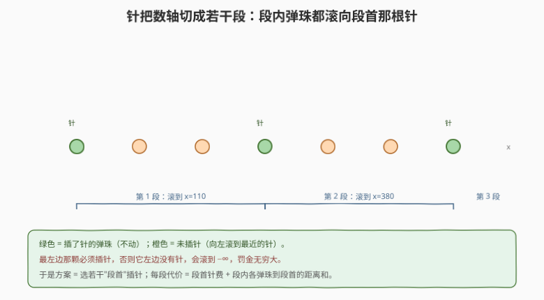
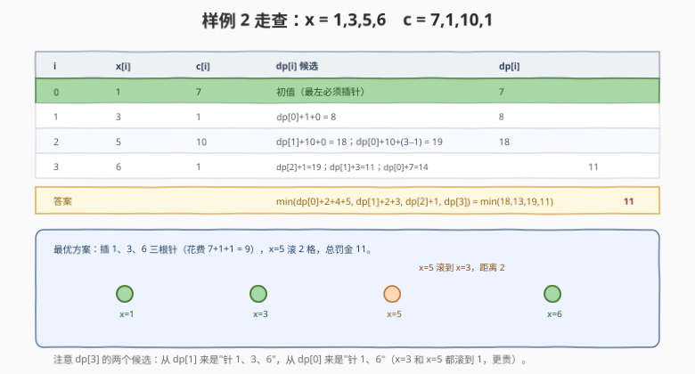

# Codeforces 38E 弹珠滚动 题解

## 1. 题目概述

- **题目链接**：https://codeforces.com/problemset/problem/38/E
- **比赛来源**：Codeforces Beta Round 38 · Problem E
- **难度**：1800
- **标签**：dp、sortings
- **评测类型**：普通
- **限制**：时间 2 s / 内存 256 MB

**题意**：数轴上有 $n$ 个质点弹珠，位置 $x_i$，可以在某些弹珠上插针，第 $i$ 个弹珠插针花费 $c_i$（**可以为负**）。插针完成后，所有未插针的弹珠一起向左滚动，直到撞上左边最近的、插了针的弹珠并停下；如果左边没有针，它会一直滚到 $-\infty$，罚金无穷大。总罚金 = 所有针的花费之和 + 所有弹珠滚动的距离之和。求最小罚金。

**约束**：

- $n \le 3000$：$O(n^2)$ 的 DP 可行，$O(n^3)$ 不行。
- $x_i, c_i \in [-10^9, 10^9]$：坐标可以为负，答案会到 $10^{12}$ 量级，必须用 64 位整数。
- $c_i$ 可以为负：多插针可能反而省钱，不能"尽量少插针"。
- 位置互不相同。

## 2. 示例与观察

官方样例 1（输入 / 输出原样）：

```text
输入：
3
2 3
3 4
1 2

输出：
5
```

**演算**：三个弹珠在 $x=1,2,3$（按位置排序后），花费分别是 $2,3,4$。

| 方案 | 针 | 滚动 | 总罚金 |
|------|----|------|--------|
| 只插 $x=1$ | $2$ | $(2-1)+(3-1)=3$ | $5$ |
| 插 $x=1,2$ | $2+3=5$ | $3-2=1$ | $6$ |
| 插 $x=1,3$ | $2+4=6$ | $2-1=1$ | $7$ |
| 全插 | $9$ | $0$ | $9$ |

最优是只插 $x=1$，罚金 $2+3=5$。

官方样例 2（输入 / 输出原样）：

```text
输入：
4
1 7
3 1
5 10
6 1

输出：
11
```

**演算**：位置 $1,3,5,6$，花费 $7,1,10,1$。最优方案：插 $1,3,6$ 三根针，花费 $7+1+1=9$；$x=5$ 的弹珠滚到 $x=3$，距离 $2$；总罚金 $11$。

**观察**：

1. **最左边的弹珠必须插针**，否则它滚向 $-\infty$，罚金无穷大。
2. 一旦确定了哪些弹珠插针，每个未插针弹珠的去向就唯一确定：它属于"左边最近的那根针"的区间。
3. 所以问题等价于：从左到右把弹珠切成若干段，每段的**第一颗**必须插针，段内其余弹珠都滚到段首。这就是一个一维分段 DP。

## 3. 解题思路

### 3.1 朴素做法与瓶颈

最直接的想法是枚举插针集合：$2^n$ 个，每个 $O(n)$ 算罚金，总 $O(2^n n)$，$n=3000$ 时完全不可行。

另一个朴素想法是"每个弹珠独立决定插不插针"，但弹珠之间通过"滚向哪根针"相互影响，无法独立。

### 3.2 核心观察：按位置排序后，针把数轴切成若干段



先把弹珠按坐标 $x$ 升序排序（题目输入顺序是乱的）。排序后，设插针的位置为

$$p_1 < p_2 < \dots < p_k,$$

其中 $p_1$ 必须是第一个弹珠（否则最左边没针）。那么：

- 位于 $p_1$ 与 $p_2$ 之间（不含 $p_2$）的弹珠，左边最近的针是 $p_1$，它们都滚到 $p_1$；
- 依此类推，位于 $p_j$ 与 $p_{j+1}$ 之间的弹珠都滚到 $p_j$；
- 位于最后一根针右边的弹珠也都滚到最后一根针。

于是罚金可以按"段"累加：若第 $j$ 根针在排序后的下标 $i$（从 $0$ 开始），下一根针在下标 $j$，那么下标 $i+1,\dots,j-1$ 的弹珠都滚到 $x_i$，这一段贡献

$$c_i + \sum_{k=i+1}^{j-1} (x_k - x_i).$$

用前缀和 $S[k] = x_0 + \dots + x_{k-1}$ 可以 $O(1)$ 算出：

$$\sum_{k=i+1}^{j-1} (x_k - x_i) = (S[j] - S[i+1]) - (j-1-i)\,x_i.$$

### 3.3 DP 设计

定义

$$dp[i] = \text{前 } i+1 \text{ 颗弹珠处理完、且第 } i \text{ 颗插针时的最小罚金}.$$

初值 $dp[0] = c_0$（最左必须插针）。转移：枚举上一根针 $i' < i$，

$$dp[i] = \min_{i' < i}\Bigl( dp[i'] + c_i + \sum_{k=i'+1}^{i-1}(x_k - x_{i'}) \Bigr).$$

最后，最后一根针 $i$ 之后的所有弹珠都滚到 $x_i$，答案是

$$\min_{i}\Bigl( dp[i] + \sum_{k=i+1}^{n-1}(x_k - x_i) \Bigr).$$

### 3.4 样例 2 的 DP 走查



排序后 $x = [1,3,5,6]$，$c = [7,1,10,1]$，前缀和 $S = [0,1,4,9,15]$。

- $dp[0] = 7$。
- $dp[1] = dp[0] + c_1 + 0 = 7+1 = 8$（针 $0,1$ 相邻，中间没有弹珠）。
- $dp[2] = \min\bigl(dp[1] + 10,\ dp[0] + 10 + (3-1)\bigr) = \min(18,\ 19) = 18$。
  注意 $dp[0]+10+(x_1-x_0)$：针在 $0$ 和 $2$，中间的 $x_1=3$ 滚到 $x_0=1$，距离 $2$。
- $dp[3] = \min\bigl(dp[2]+1,\ dp[1]+1+(5-3),\ dp[0]+1+(3-1)+(5-1)\bigr) = \min(19,\ 11,\ 14) = 11$。

答案：

$$\min\Bigl(dp[0] + (3-1)+(5-1)+(6-1),\ dp[1] + (5-3)+(6-3),\ dp[2] + (6-5),\ dp[3]\Bigr)$$
$$= \min(7+2+4+5,\ 8+2+3,\ 18+1,\ 11) = \min(18,\ 13,\ 19,\ 11) = 11.$$

与样例一致。

### 3.5 为什么可以不考虑"跨过一根针去更远的针"

因为题目规定弹珠滚向**左边最近的**针。一旦某颗弹珠的左边有一根针，它就不可能越过这根针去更左边。所以"段"的划分是唯一确定的，DP 只需决定针的位置。

## 4. 正确性证明

**引理 1（有效方案的判定）**：一个插针方案有效（罚金有限）当且仅当排序后第一颗弹珠插了针。

**证明**：若第一颗没插针，它左边没有任何弹珠，也就不可能有针，它滚向 $-\infty$，罚金无穷。反之，若第一颗插了针，任何弹珠左边至少有第一颗弹珠上的针，滚动距离有限。∎

**引理 2（段的归属）**：设插针方案中针的下标（排序后）为 $i_1 < i_2 < \dots < i_k$，$i_1 = 0$。则对每个 $j$，下标在 $(i_j, i_{j+1})$ 内的弹珠都滚到 $x_{i_j}$，下标大于 $i_k$ 的弹珠都滚到 $x_{i_k}$。

**证明**：对下标 $m \in (i_j, i_{j+1})$，它左边最近的针就是 $i_j$（它右边的针 $i_{j+1}$ 在它右侧，不影响"向左滚"）。由滚动规则，它停在 $x_{i_j}$。∎

**引理 3（DP 的最优子结构）**：设最优方案中最后一颗针的下标为 $i$。则前 $i+1$ 颗弹珠上的针构成一个以 $i$ 结尾的最优方案，即 $dp[i]$ 就是该方案前 $i+1$ 颗的罚金。

**证明**：若不然，把前 $i+1$ 颗的插针方案换成一个更便宜的、同样以 $i$ 结尾的方案，由于 $i$ 之后弹珠的滚动只依赖 $x_i$（引理 2），总罚金会严格变小，与最优性矛盾。∎

**定理**：DP 给出的答案就是最小罚金。

**证明**：由引理 1，只需考虑第一颗插针的方案；由引理 2，方案与"针的序列"一一对应，且每段贡献可加；由引理 3，转移枚举所有可能的上一根针不丢失最优解。归纳可知 $dp[i]$ 是"前 $i+1$ 颗、以 $i$ 结尾"的最小罚金，最后对最后一根针取最小即得全局最优。∎

## 5. 复杂度分析

- **时间**：排序 $O(n\log n)$，DP 两两枚举 $O(n^2)$。$n=3000$ 时约 $4.5\times10^6$ 次转移，实测 C++ 约 $8$ ms，Python 约 $1.1$ s。
- **空间**：$O(n)$。
- **数值范围**：坐标差最大 $2\times10^9$，$n$ 个距离之和最大约 $6\times10^{12}$，插针花费之和最大 $3\times10^{12}$，合计在 $10^{13}$ 内，`long long` 足够。

## 6. 参考代码

### C++17

```cpp
#include <bits/stdc++.h>
using namespace std;
typedef long long ll;
int main(){
    int n; if(scanf("%d",&n)!=1) return 0;
    vector<pair<ll,ll>> a(n);
    for(int i=0;i<n;i++){ ll x,c; scanf("%lld %lld",&x,&c); a[i]={x,c}; }
    sort(a.begin(), a.end());
    vector<ll> x(n), c(n);
    for(int i=0;i<n;i++){ x[i]=a[i].first; c[i]=a[i].second; }
    const ll INF = (ll)4e18;
    vector<ll> dp(n, INF);
    // 前缀和
    vector<ll> pre(n+1,0);
    for(int i=0;i<n;i++) pre[i+1]=pre[i]+x[i];
    auto segsum=[&](int l,int r){ // [l,r)
        return pre[r]-pre[l];
    };
    dp[0]=c[0];
    for(int j=1;j<n;j++){
        for(int i=0;i<j;i++){
            if(dp[i]==INF) continue;
            ll dist = (segsum(i+1,j)) - (ll)(j-1-i)*x[i];
            ll cand = dp[i] + c[j] + dist;
            if(cand<dp[j]) dp[j]=cand;
        }
    }
    ll ans=INF;
    for(int i=0;i<n;i++){
        if(dp[i]==INF) continue;
        ll dist = segsum(i+1,n) - (ll)(n-1-i)*x[i];
        ans=min(ans, dp[i]+dist);
    }
    printf("%lld\n", ans);
    return 0;
}
```

### Python3

```python
import sys

def main() -> None:
    data = sys.stdin.buffer.read().split()
    if not data:
        return
    n = int(data[0])
    a = []
    pos = 1
    for _ in range(n):
        x = int(data[pos]); c = int(data[pos+1]); pos += 2
        a.append((x, c))
    a.sort()
    x = [p[0] for p in a]
    c = [p[1] for p in a]
    pre = [0]*(n+1)
    for i in range(n):
        pre[i+1] = pre[i] + x[i]
    INF = float('inf')
    dp = [INF]*n
    dp[0] = c[0]
    for j in range(1, n):
        best = INF
        for i in range(j):
            if dp[i] == INF:
                continue
            dist = (pre[j]-pre[i+1]) - (j-1-i)*x[i]
            cand = dp[i] + c[j] + dist
            if cand < best:
                best = cand
        dp[j] = best
    ans = INF
    for i in range(n):
        dist = (pre[n]-pre[i+1]) - (n-1-i)*x[i]
        cand = dp[i] + dist
        if cand < ans:
            ans = cand
    print(ans)

main()
```

## 7. 边界情况与易错点

1. **最左必须插针**：DP 初值只设 $dp[0]$，天然满足；若允许 $dp$ 从别处起，会得到"最左滚向 $-\infty$"的非法解。
2. **坐标为负 / 输入无序**：必须先按 $x$ 排序；排序后 `x` 递增，段内距离 $x_k - x_i \ge 0$。
3. **花费为负**：不能贪心"少插针"；DP 会自然选出最优。
4. **$n=1$**：只有一颗弹珠，必须插针，答案 $c_0$（可能为负）。代码中 $dp[0]=c_0$、答案 $= dp[0]$，正确。
5. **64 位**：$n=3000$、坐标差 $2\times10^9$ 时距离和可达 $6\times10^{12}$，必须 `long long`。
6. **前缀和下标**：`pre[r]-pre[l]` 对应 $[l,r)$，转移里区间是 $[i+1, j)$，注意 $j-1-i$ 这个系数。
7. **INF 的选取**：`4e18` 在 `long long` 内且远大于任何合法值；加距离时不会溢出。
8. **多组间不重置**：本题只有一组数据。

## 8. 验证记录

- **编译环境与命令**：本机只有 `Apple clang 21.0.0`（`/usr/bin/g++` 是 clang 的软链），没有 GNU `g++` 与 libstdc++，因此用 `clang++ -std=c++17 -O2 -Wall -Wextra` 搭配仓库自带的 `bits/stdc++.h` 兼容头编译（代码只用标准库，可原样提交 GNU C++17）。Python 侧为 `Python 3.9.6`。
- **官方样例**：2 / 2 通过（`5`、`11`），C++ 与 Python 输出一致。
- **独立暴力**：枚举所有插针子集（$2^n$），对每个子集逐颗弹珠找左边最近的针、累加距离，取最小——与 DP 完全不同的思路。随机生成：
  - 小坐标小花费 $60$ 组、大花费 $60$ 组、全正花费 $60$ 组（$n \le 12$）；
  - 另有 $n \le 12$、坐标 $[-50,50]$、花费 $[-10^9,10^9]$ 的 $200$ 组用 Python 版对拍。
  共 **380 组全部一致**。
- **最大约束性能**：$n=3000$、坐标 $[-10^9,10^9]$ 随机，C++ 端到端中位数约 $8$ ms，Python 约 $1.1$ s；相对 2 s 余量充足。
- **图片校验**：三张 SVG（`cf38e_segments.svg`、`cf38e_dp.svg`、`cf38e_walkthrough.svg`）均通过 `xml.etree.ElementTree.parse`，含 `feTurbulence` 抖动滤镜与手写字体，文字未越出 `viewBox`。
- **公式校验**：正文公式经 KaTeX（`throwOnError`）渲染无报错。
- **复核状态**：verified（样例 2/2、对拍 380 组、性能、图片、公式均实跑通过；唯一环境差异是本机无 GNU g++，已用 clang++ 等价验证）。

## 相关题目与扩展

- [Codeforces 38G Queue](https://codeforces.com/problemset/problem/38/G)：同场 G 题，数据结构模拟队列插入。
- [Codeforces 38H The Great Marathon](https://codeforces.com/problemset/problem/38/H)：同场 H 题，计数型 DP。
- [Codeforces 5C Longest Regular Bracket Sequence](https://codeforces.com/problemset/problem/5/C)：线性 DP 的经典入门。
- [Codeforces 1060E Sergey and Subway](https://codeforces.com/problemset/problem/1060/E)：树上按边/距离计数的 DP，可与本题的"分段代价"对照。
- [LeetCode 1326. 灌溉花园的最少水龙头数目](https://leetcode.cn/problems/minimum-number-of-taps-to-open-to-water-a-garden/)：区间覆盖型贪心/DP，和"每段由段首负责"的思路相通。

**延伸思考**：

1. **如果弹珠向右滚而不是向左**：把坐标取反、重新排序，问题完全对称。
2. **如果相邻针之间的弹珠可以滚向左右任一根**（按规则选择更近者）：段代价变成 $\sum \min(x_k - x_i, x_j - x_k)$，仍可前缀和优化，但 DP 状态需要同时记住两根针的位置，复杂度升到 $O(n^3)$。
3. **如果插针有容量限制**（每根针最多收 $m$ 颗弹珠）：段长受限，DP 可加一层滑窗优化。
4. **如果要求针的数量恰为 $k$**：在 DP 上加一维"已用针数"，$O(n^2k)$，$n=3000$ 时需要用凸包/决策单调性优化。
