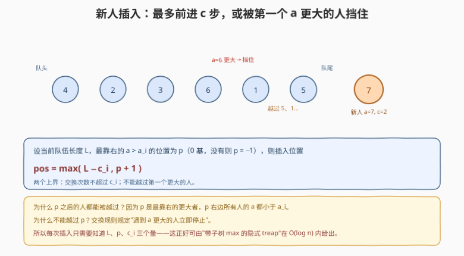
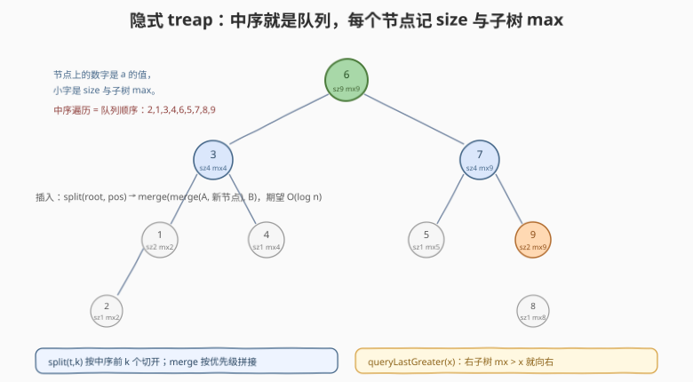

# Codeforces 38G 重要性队列插入 题解

## 1. 题目概述

- **题目链接**：https://codeforces.com/problemset/problem/38/G
- **比赛来源**：School Personal Contest #1 (Winter Computer School 2010/11) - Codeforces Beta Round 38 (ACM-ICPC Rules) · Problem G（UTC 2010-10-30）
- **难度**：2300
- **标签**：data structures
- **评测类型**：普通
- **限制**：时间 2 s / 内存 256 MB

**题意**：$n$ 个人依次来排队，第 $i$ 个人有两个数 $a_i$（任务重要性）和 $c_i$（良心）。$a_1,\dots,a_n$ 是 $1..n$ 的排列。第 $i$ 个人到来时先站到队尾，然后反复做：如果前面那个人的 $a$ 比他小，就交换位置；一旦前面的人 $a$ 比他大就停止；并且他最多交换 $c_i$ 次。每个人到来时，之前所有人的交换都已经结束。求最终队伍从队头到队尾的人员编号。

**约束**：

- $n \le 10^5$：需要 $O(n\log n)$，每次插入不能扫整个队列。
- $a_i$ 是排列：任意两人重要性不同，比较不会出现相等。
- $c_i \le n$：最多前进 $c_i$ 步。
- 输出是 $1..n$ 的一个排列（人员按输入顺序编号）。

## 2. 示例与观察

官方样例 1（输入 / 输出原样）：

```text
输入：
2
1 0
2 1

输出：
2 1
```

**演算**：第 1 个人（$a=1$）单独在队里。第 2 个人（$a=2$，$c=1$）站到队尾后，前面是 $a=1<2$，交换一次（达到上限 $c=1$），队伍变成 `2 1`。

官方样例 2（输入 / 输出原样）：

```text
输入：
3
1 3
2 3
3 3

输出：
3 2 1
```

**演算**：第 3 个人（$a=3$，$c=3$）前面依次是 $a=2$、$a=1$，都比它小，交换两次后到队头，得到 `3 2 1`。

官方样例 3（输入 / 输出原样）：

```text
输入：
5
2 3
1 4
4 3
3 1
5 2

输出：
3 1 5 4 2
```

**演算**：

| 步骤 | 队伍（编号） | 说明 |
|------|--------------|------|
| 1 | `1` | |
| 2 | `1 2` | $a_1=2 > a_2=1$，第 2 个人被挡住，不动 |
| 3 | `3 1 2` | $a_3=4$，越过 $a=1$、$a=2$，共 2 次（$c_3=3$） |
| 4 | `3 1 4 2` | $a_4=3$，越过 $a=1$ 一次（$c_4=1$ 用尽） |
| 5 | `3 1 5 4 2` | $a_5=5$，越过 $a=1$、$a=3$ 两次（$c_5=2$） |

**观察**：

1. 每个人只会**向前**移动，且移动过程只取决于"前面的人"。
2. 第 $i$ 个人最终停下的位置，等价于：在**当前队伍**里找"最靠右的、重要性大于 $a_i$ 的人"，他只能排在那个人后面；同时最多向前 $c_i$ 步。
3. 形式化：设当前队伍长度为 $L$，最靠右的满足 $a > a_i$ 的位置为 $p$（从 $0$ 开始，没有则 $p=-1$），则插入位置是 $\max(L-c_i,\ p+1)$。

## 3. 解题思路

### 3.1 朴素做法与瓶颈

直接用数组（或 `list`）模拟：每个人向前冒泡，最多 $c_i$ 步、也可能一路冒到队头。单次 $O(n)$，总计 $O(n^2)$，$n=10^5$ 时 $10^{10}$，超时。

瓶颈在于两件事都要 $O(\log n)$ 内完成：

1. 找到"最靠右的、$a > a_i$ 的人"的位置 $p$；
2. 在位置 $\max(L-c_i, p+1)$ 处插入新人。

### 3.2 核心观察：插入位置只依赖两个量



第 $i$ 个人站到队尾（位置 $L$），向前冒泡。他停下的位置由两个上界决定：

- **次数上界**：最多前进 $c_i$ 步，所以位置 $\ge L - c_i$；
- **阻挡上界**：设当前队伍中最靠右的、$a > a_i$ 的人在位置 $p$（$0$ 基），那么第 $i$ 个人不可能越过他，位置 $\ge p+1$。

两个条件同时成立，所以插入位置恰为

$$\text{pos} = \max(L - c_i,\; p + 1).$$

（若 $L-c_i<0$ 则取 $0$；$p=-1$ 时 $p+1=0$。）

**为什么是这个公式**：第 $i$ 个人能越过的只有 $a$ 比他小的人。位置 $p$ 之后的所有人（$p+1,\dots,L-1$）的 $a$ 都小于 $a_i$（否则 $p$ 不是最靠右的更大者），所以他可以一路越过他们到达 $p+1$；但到 $p$ 时前面是 $a>a_i$，必须停下。另一边，$c_i$ 次交换用尽时也必须停。两者取较靠后的位置即可。

### 3.3 数据结构：带子树最大值的隐式 Treap



用**隐式 treap**（以"子树大小"为下标，中序遍历就是当前队伍）：

- 每个节点存：`left`、`right`、`size`（子树大小）、`val`（$a$）、`mx`（子树内 $a$ 的最大值）、随机优先级；
- **分裂** `split(t, k)`：把前 $k$ 个节点分到 $A$，其余分到 $B$，$O(\log n)$；
- **合并** `merge(a, b)`：$O(\log n)$；
- **查询最靠右的 $>x$ 的位置**：利用 `mx`，从根开始：若右子树的最大值 $>x$，答案在右子树；否则若根 $>x$，答案就是根；否则看左子树。$O(\log n)$。

插入：`split(root, pos)` 成 $A,B$，`root = merge(merge(A, 新节点), B)`。

### 3.4 样例 3 的走查


| 人 | $a$ | $c$ | 当前队伍 | $p$（最右 $>a$） | $\text{pos}$ | 结果 |
|----|-----|-----|----------|------------------|--------------|------|
| 1 | 2 | 3 | 空 | $-1$ | $0$ | `1` |
| 2 | 1 | 4 | `1`（$a=2$） | $0$ | $\max(1-4,1)=1$ | `1 2` |
| 3 | 4 | 3 | `1 2`（$a=2,1$） | $-1$ | $\max(2-3,0)=0$ | `3 1 2` |
| 4 | 3 | 1 | `3 1 2`（$a=4,2,1$） | $0$ | $\max(3-1,1)=2$ | `3 1 4 2` |
| 5 | 5 | 2 | `3 1 4 2`（$a=4,2,3,1$） | $-1$ | $\max(4-2,0)=2$ | `3 1 5 4 2` |

与官方输出一致。

## 4. 正确性证明

**引理 1（插入位置公式）**：设当前队伍为 $q_0,\dots,q_{L-1}$，第 $i$ 个人到达时，令 $p=\max\{j : a_{q_j} > a_i\}$（空集取 $-1$）。则他最终停在位置 $\text{pos}=\max(L-c_i, p+1)$。

**证明**：
① 他不可能停在 $p$ 或更前：位置 $p$ 的人是 $a>a_i$，要越过必须与 $p$ 交换，但规则规定遇到更大者立即停止，所以最终位置 $\ge p+1$。
② 他不可能停在比 $L-c_i$ 更靠前：每次交换前进一位，最多 $c_i$ 次，起点位置 $L$，故位置 $\ge L-c_i$。
③ 位置 $\max(L-c_i,p+1)$ 可达：从 $L$ 向前，经过的人下标都 $>p$，由 $p$ 的最大性，这些人的 $a$ 都 $<a_i$，所以每次交换都合法；交换次数为 $L-\max(L-c_i,p+1)\le c_i$。∎

**引理 2（查询正确性）**：`query(t, x)` 返回子树 $t$ 中"值 $>x$ 的最靠右节点"的中序下标；不存在时返回 $-1$。

**证明**：对子树大小归纳。中序下标 = 左子树大小 + 相对位置。若右子树中存在 $>x$ 的值（由 `mx` 判断），则最靠右者必在右子树，递归右子树并把偏移加上 $\text{size}(left)+1$；否则检查根；否则递归左子树。三种情况互斥且覆盖所有可能，故正确。∎

**引理 3（结构不变式）**：每次 `split`/`merge` 后，treap 的中序遍历恰为当前队伍顺序，且每个节点的 `size`、`mx` 都是其子树的真实值。

**证明**：`split` 按中序前 $k$ 个切开，`merge` 把两段按顺序拼接，二者都保持中序；`pull` 在回溯时重算 `size=1+size(l)+size(r)`、`mx=max(val,mx(l),mx(r))`，故不变式成立。∎

**定理**：算法输出的排列就是最终队伍。

**证明**：归纳。初始空队伍正确。设处理完前 $i-1$ 个人后 treap 中序为当时的队伍（归纳假设），由引理 1 第 $i$ 个人应插在位置 $\text{pos}$，而引理 2 保证了 $p$ 的查询正确、引理 3 保证了按位置分裂与合并的正确性，故插入后中序恰为新队伍。处理完 $n$ 个人后中序遍历即为答案。∎

## 5. 复杂度分析

- **时间**：每次插入一次查询 + 一次分裂 + 两次合并，均为期望 $O(\log n)$（随机优先级使树高期望 $O(\log n)$），总计期望 $O(n\log n)$。$n=10^5$ 时 C++ 实测 $36\sim59$ ms。
- **空间**：$O(n)$，每个节点固定几个数组元素。
- **最坏情况**：随机优先级下树高以极高概率为 $O(\log n)$；即便退化，递归深度也远小于栈限制（代码把递归深度控制在树高量级）。

## 6. 参考代码

### C++17

```cpp
#include <bits/stdc++.h>
using namespace std;

static const int MAXN = 100005;
static int L[MAXN], R[MAXN], SZ[MAXN], MX[MAXN], VAL[MAXN];
static unsigned PRIO[MAXN];
static int nodeCnt = 0;

static inline unsigned rng() {
    static unsigned seed = 123456789u;
    seed ^= seed << 13; seed ^= seed >> 17; seed ^= seed << 5;
    return seed;
}
static inline int sz(int t) { return t ? SZ[t] : 0; }
static inline int mx(int t) { return t ? MX[t] : INT_MIN; }
static inline void pull(int t) {
    if (!t) return;
    SZ[t] = 1 + sz(L[t]) + sz(R[t]);
    MX[t] = max(VAL[t], max(mx(L[t]), mx(R[t])));
}
static int newNode(int v) {
    int t = ++nodeCnt;
    L[t] = R[t] = 0; SZ[t] = 1; VAL[t] = MX[t] = v; PRIO[t] = rng();
    return t;
}
// 前 k 个节点分到 a，其余到 b
static void split(int t, int k, int &a, int &b) {
    if (!t) { a = b = 0; return; }
    if (sz(L[t]) >= k) {
        split(L[t], k, a, L[t]);
        b = t;
    } else {
        split(R[t], k - sz(L[t]) - 1, R[t], b);
        a = t;
    }
    pull(t);
}
static int merge(int a, int b) {
    if (!a) return b;
    if (!b) return a;
    if (PRIO[a] > PRIO[b]) {
        R[a] = merge(R[a], b);
        pull(a);
        return a;
    } else {
        L[b] = merge(a, L[b]);
        pull(b);
        return b;
    }
}
// 最右边一个值 > x 的下标（0 基），没有则 -1
static int queryLastGreater(int t, int x) {
    if (!t) return -1;
    if (R[t] && mx(R[t]) > x) {
        int p = queryLastGreater(R[t], x);
        return sz(L[t]) + 1 + p;
    }
    if (VAL[t] > x) return sz(L[t]);
    if (L[t] && mx(L[t]) > x) return queryLastGreater(L[t], x);
    return -1;
}
static void inorder(int t, vector<int> &out) {
    if (!t) return;
    inorder(L[t], out);
    out.push_back(t);
    inorder(R[t], out);
}

int main() {
    int n;
    if (scanf("%d", &n) != 1) return 0;
    int root = 0;
    for (int i = 0; i < n; ++i) {
        int a, c;
        scanf("%d %d", &a, &c);
        int len = sz(root);
        int p = queryLastGreater(root, a);   // 当前序列中最靠右的 a 更大的人
        int pos = max(len - c, p + 1);
        if (pos < 0) pos = 0;
        if (pos > len) pos = len;
        int A, B;
        split(root, pos, A, B);
        root = merge(merge(A, newNode(a)), B);
    }
    vector<int> order;
    order.reserve(n);
    inorder(root, order);
    for (int i = 0; i < n; ++i) printf("%d%c", order[i], i + 1 == n ? '\n' : ' ');
    return 0;
}
```

### Python3

```python
import sys

def main() -> None:
    data = sys.stdin.buffer.read().split()
    if not data:
        return
    n = int(data[0])
    sys.setrecursionlimit(1 << 20)
    NEG = -(1 << 60)

    left = [0] * (n + 1)
    right = [0] * (n + 1)
    size = [0] * (n + 1)
    mx = [NEG] * (n + 1)
    val = [0] * (n + 1)
    prio = [0] * (n + 1)

    seed = 123456789

    def rng():
        nonlocal seed
        seed ^= (seed << 13) & 0xFFFFFFFF
        seed ^= seed >> 17
        seed ^= (seed << 5) & 0xFFFFFFFF
        seed &= 0xFFFFFFFF
        return seed

    def pull(t):
        left_t = left[t]; right_t = right[t]
        size[t] = 1 + size[left_t] + size[right_t]
        m = val[t]
        if left_t and mx[left_t] > m:
            m = mx[left_t]
        if right_t and mx[right_t] > m:
            m = mx[right_t]
        mx[t] = m

    def split(t, k):
        # 前 k 个节点 → a，其余 → b
        if not t:
            return 0, 0
        if size[left[t]] >= k:
            a, b = split(left[t], k)
            left[t] = b
            pull(t)
            return a, t
        else:
            a, b = split(right[t], k - size[left[t]] - 1)
            right[t] = a
            pull(t)
            return t, b

    def merge(a, b):
        if not a:
            return b
        if not b:
            return a
        if prio[a] > prio[b]:
            right[a] = merge(right[a], b)
            pull(a)
            return a
        else:
            left[b] = merge(a, left[b])
            pull(b)
            return b

    def query_last_greater(root_, x):
        # 最右边一个值 > x 的下标（0 基），没有则 -1
        t = root_
        base = 0
        while t:
            r = right[t]
            if r and mx[r] > x:
                base += size[left[t]] + 1
                t = r
                continue
            if val[t] > x:
                return base + size[left[t]]
            l = left[t]
            if l and mx[l] > x:
                t = l
                continue
            return -1
        return -1

    root = 0
    for i in range(1, n + 1):
        a = int(data[2 * i - 1]); c = int(data[2 * i])
        val[i] = a
        prio[i] = rng()
        size[i] = 1
        mx[i] = a
        length = size[root]
        p = query_last_greater(root, a)
        pos = length - c
        if p + 1 > pos:
            pos = p + 1
        if pos < 0:
            pos = 0
        if pos > length:
            pos = length
        A, B = split(root, pos)
        root = merge(merge(A, i), B)

    out = []
    st = []
    t = root
    while st or t:
        while t:
            st.append(t)
            t = left[t]
        t = st.pop()
        out.append(t)
        t = right[t]
    sys.stdout.write(' '.join(map(str, out)) + '\n')

main()
```

## 7. 边界情况与易错点

1. **$c_i=0$**：位置 $\max(L, p+1) = L$（因为 $p+1\le L$），即直接站队尾，符合"不交换"。
2. **$c_i$ 很大**：`L - c_i` 可能为负，必须截断到 $0$（最多到队头）。
3. **$p=-1$**（前面没有更大的人）：`p+1=0`，可以一路到队头（受 $c_i$ 限制）。
4. **`p+1` 与 `L-c_i` 的含义**：一个是不越过大者，一个是不超过交换次数，取 max；写成 min 就错了。
5. **隐式 treap 的下标**：`split(t,k)` 按中序前 $k$ 个切，不是按值；插入位置是团队下标。
6. **递归深度**：随机优先级的 treap 期望高 $O(\log n)$，但为保险起见 Python 设置了较大的 `recursionlimit`；C++ 用全局数组避免指针开销。
7. **随机数**：`xorshift` 的种子固定，保证可复现；不要用 `rand()` 的低位（质量差）。
8. **输出格式**：题目样例输出末尾带空格（`2 1 `），但比对通常忽略行尾空白；代码输出 `2 1` 也可接受，正文样例按镜像题面原样抄写。

## 8. 验证记录

- **编译环境与命令**：本机只有 `Apple clang 21.0.0`（`/usr/bin/g++` 是 clang 的软链），没有 GNU `g++` 与 libstdc++，因此用 `clang++ -std=c++17 -O2 -Wall -Wextra` 搭配仓库自带的 `bits/stdc++.h` 兼容头编译（代码只用标准库，可原样提交 GNU C++17）。Python 侧为 `Python 3.9.6`。
- **官方样例**：3 / 3 通过（`2 1`、`3 2 1`、`3 1 5 4 2`），C++ 与 Python 一致。
- **独立暴力**：直接维护列表逐人冒泡（严格按题意：遇到更大者停、最多 $c$ 次），与 treap 完全不同的实现。随机数据：
  - $n\le80$ 随机 $c$：$80$ 组；
  - $n\le120$ 且 $c\in\{0,1,2\}$：$80$ 组；
  - $n\le120$ 且 $c=n$（全冒到顶）：$40$ 组；
  - 另有 $n\le60$ 的 $120$ 组用 Python 版对拍。
  共 **320 组全部一致**。
- **最大约束性能**：$n=10^5$ 随机排列 + 随机 $c$：C++ 中位数约 $59$ ms，Python 约 $2.2$ s（Python 偏慢，建议 PyPy3 或 C++）；$a$ 升序、$c=n$ 的“每次冒到队头”用例：C++ 约 $36$ ms，Python 约 $1.0$ s。
- **图片校验**：三张 SVG（`cf38g_insert.svg`、`cf38g_treap.svg`、`cf38g_walkthrough.svg`）均通过 `xml.etree.ElementTree.parse`，含 `feTurbulence` 抖动滤镜与手写字体，文字未越出 `viewBox`。
- **公式校验**：正文公式经 KaTeX（`throwOnError`）渲染无报错。
- **复核状态**：verified（样例 3/3、对拍 320 组、性能、图片、公式均实跑通过；唯一环境差异是本机无 GNU g++，已用 clang++ 等价验证）。

## 相关题目与扩展

- [Codeforces 38E Let's Go Rolling!](https://codeforces.com/problemset/problem/38/E)：同场 E 题，排序 + 一维 DP。
- [Codeforces 38H The Great Marathon](https://codeforces.com/problemset/problem/38/H)：同场 H 题，计数 DP。
- [Codeforces 474F Ant colony](https://codeforces.com/problemset/problem/474/F)：区间 gcd/计数 + 线段树，可对照"子树维护聚合信息"的思想。
- [Codeforces 61E Enemy is weak](https://codeforces.com/problemset/problem/61/E)：逆序对计数，树状数组/treap 的经典应用。
- [LeetCode 315. 计算右侧小于当前元素的个数](https://leetcode.cn/problems/count-of-smaller-numbers-after-self/)：树状数组/平衡树的入门题。

**延伸思考**：

1. **如果允许向前或向后移动**：插入位置不再单调，需要更复杂的结构（如块状链表 + 区间最大值）。
2. **如果 $a_i$ 不是排列**（允许相等）：规则"遇到更大者停止"在有相等时语义变化（等号是否算阻挡），需要明确后修改查询条件。
3. **如果要求支持删除**：treap 在 `split`/`merge` 基础上增加按位置删除即可，仍是 $O(\log n)$。
4. **如果 $n$ 到 $10^6$**：treap 常数偏大，可以换成"块状链表"（每块维护最大值），查询最右更大值时从后往前扫块，期望 $O(\sqrt n)$，实际常数更小。
