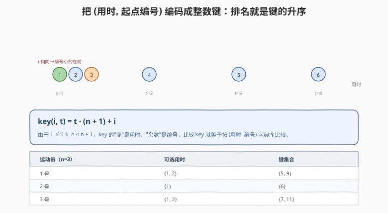
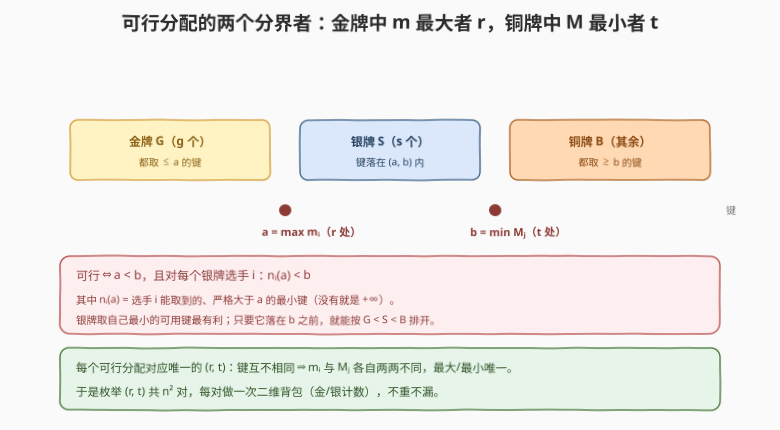
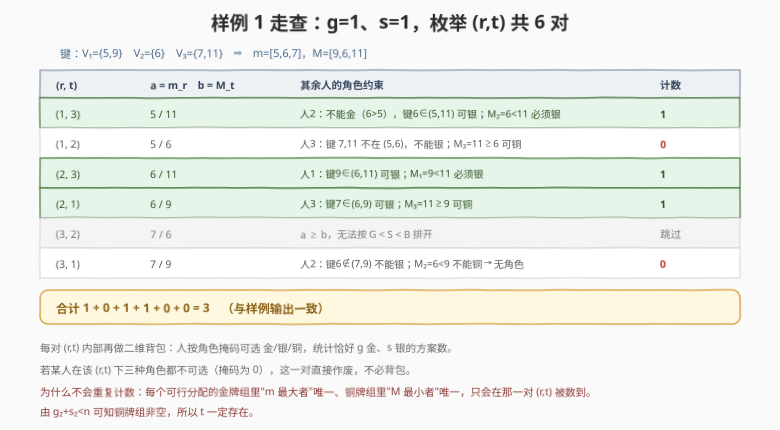

# Codeforces 38H The Great Marathon 题解

## 1. 题目概述

- **题目链接**：https://codeforces.com/problemset/problem/38/H
- **比赛来源**：School Personal Contest #1 (Winter Computer School 2010/11) - Codeforces Beta Round 38 (ACM-ICPC Rules) · Problem H（UTC 2010-10-30）
- **难度**：2400
- **标签**：dp
- **评测类型**：普通
- **限制**：时间 4 s / 内存 256 MB

**题意**：$n$ 个城市构成带权无向连通图。$n$ 个运动员，第 $i$ 个从城市 $i$ 出发，终点可以是**除自己起点外**的任意城市（多人可同终点），每人沿最短路跑，用时 = 路径长度。按用时升序排名，用时相同则**起点编号小者在前**。取前 $g$ 名发金牌、接下来 $s$ 名发银牌、其余铜牌，其中 $g\in[g_1,g_2]$、$s\in[s_1,s_2]$，且 $g_2+s_2<n$。

问：所有可能的终点选择与所有合法的 $(g,s)$ 下，一共能产生多少种**不同的奖牌分配**？两种分配不同当且仅当至少有一人拿到的奖牌不同。保证答案在 64 位有符号整数内。

**约束**：

- $n\le 50$，$m\le 1000$：先用 Floyd 求全源最短路（$O(n^3)$），再在"每人可选用时集合"上计数。
- $g_2+s_2<n$：铜牌组**非空**，这条保证后面"铜牌组最小值"一定存在。
- 答案在 `long long` 内，但中间组合数可能很大，需用 `__int128` 累加。
- 无重边、无自环，但**不同城市之间的距离可以相等**，排名靠起点编号区分。

## 2. 示例与观察

官方样例 1（输入 / 输出原样）：

```text
输入：
3 2
1 2 1
2 3 1
1 1 1 1

输出：
3
```

**演算**：一条链 $1-2-3$，边长都是 $1$。距离：$d_{12}=1,d_{23}=1,d_{13}=2$。每人的可选用时：

| 运动员 | 可选终点 | 可选用时 |
|--------|----------|----------|
| 1 | 2, 3 | $\{1,2\}$ |
| 2 | 1, 3 | $\{1\}$ |
| 3 | 1, 2 | $\{1,2\}$ |

排名键用 $4t+i$ 编码 $(t,i)$：运动员 1 的键 $\{5,9\}$，2 的键 $\{6\}$，3 的键 $\{7,11\}$。

$g=1,s=1$ 时，枚举所有人的选择，能得到且仅能得到三种奖牌分配：

- 金 1、银 2、铜 3（选时 $1,2,3$ 都用 $1$，键 $5<6<7$）；
- 金 2、银 1、铜 3（运动员 1 选 $t=2$，键 $9$；$6<7<9$）；
- 金 2、银 3、铜 1（运动员 1 选 $t=2$，运动员 3 选 $t=1$，键 $6<7<9$）。

答案 $3$。

官方样例 2（输入 / 输出原样）：

```text
输入：
4 5
1 2 2
2 3 1
3 4 2
4 1 2
1 3 3
1 2 1 1

输出：
19
```

官方样例 3（输入 / 输出原样）：

```text
输入：
3 3
1 2 2
2 3 1
3 1 2
1 1 1 1

输出：
4
```

**观察**：

1. 每人的用时可以**独立**从其可选集合里挑，因为终点是各自独立选的。
2. 奖牌分配只取决于"所有人的用时都选定后"的排名顺序；由于排名按 $(用时,\ 起点编号)$ 字典序、且起点编号互不相同，可以把它编码成一个**整数键**，排名就是键的升序。
3. 于是问题变成：每人有一个可选键集合，各选一个键，问能产生多少种"把键排序后切成前 $g$ / 中 $s$ / 其余"的分组方式。

## 3. 解题思路

### 3.1 朴素做法与瓶颈

每人有至多 $n-1$ 种用时，暴力枚举所有组合是 $(n-1)^n$，$n=50$ 时完全不可行。

另一条朴素思路是枚举"奖牌分配"（$3^n$ 种）再逐个验证可行性，同样不可行。

必须找到"可行分配"的**结构性刻画**，再用 DP 计数。

### 3.2 核心之一：把排名编码成整数键



设运动员 $i$ 的可选用时集合为 $T_i$（所有 $d(i,j)$，$j\ne i$）。定义键

$$\text{key}(i,t) = t\cdot (n+1) + i .$$

因为 $1\le i\le n < n+1$，所以 $(t_1,i_1)$ 的字典序与 $\text{key}$ 的大小顺序完全一致：用时不同时由 $t$ 决定，用时相同时由 $i$ 决定。于是**排名 = 键升序**，且不同运动员的键一定不同（键的模 $n+1$ 余数就是编号）。

记 $V_i=\{\text{key}(i,t) : t\in T_i\}$，以及

$$m_i=\min V_i,\qquad M_i=\max V_i .$$

### 3.3 核心之二：可行分配的两个"分界者"

设奖牌分配为 $(G,S,B)$（金、银、铜三个集合，大小分别为 $g,s$）。它可行，当且仅当存在两个阈值 $a<b$，使得

- 每个金牌选手能选一个 $\le a$ 的键；
- 每个银牌选手能选一个落在 $(a,b)$ 的键；
- 每个铜牌选手能选一个 $\ge b$ 的键。



取**最紧**的阈值：$a=\max_{i\in G} m_i$（金牌里"键最靠后"的那个人能取到的最小键），$b=\min_{i\in B} M_i$（铜牌里"键最靠前"的那个人能取到的最大键）。再记 $n_i(a)=\min\{v\in V_i : v>a\}$（选手 $i$ 在 $a$ 之后能取到的最小键，不存在记 $+\infty$）。则：

**可行 $\iff$ $a<b$ 且对每个 $i\in S$ 都有 $n_i(a)<b$。**

直觉：金牌都取自己的最小键（最大是 $a$）；银牌必须取 $>a$ 的键，取最小可用的 $n_i(a)$ 最有利；铜牌取自己的最大键。只要所有银牌的最小可用键都落在 $b$ 之前，就能按 $G<S<B$ 排开。

**唯一分解**：对任一可行分配，令

$$r=\arg\max_{i\in G} m_i,\qquad t=\arg\min_{i\in B} M_i,$$

由"键互不相同"，$m_i$ 与 $M_i$ 各自两两不同，所以 $r,t$ **唯一确定**。于是按 $(r,t)$ 枚举，每个可行分配恰好被数一次，不重不漏。

### 3.4 对固定 $(r,t)$ 做二维背包

固定 $r,t$ 后，$a=m_r$、$b=M_t$。若 $a\ge b$ 直接跳过。对每个运动员 $i$，根据 $a,b$ 算出他**允许拿的奖牌**（角色掩码）：

| 条件 | 允许的角色 |
|------|-----------|
| $i=r$ | 只能金牌 |
| $i=t$ | 只能铜牌 |
| $M_i<b$（不可能当铜牌，因为铜牌的最小 $M$ 是 $b$） | 金牌（若 $m_i\le a$）、银牌（若 $n_i(a)<b$），两者至少一个成立，否则该 $(r,t)$ 无解 |
| $M_i\ge b$ | 以上两者，再加铜牌 |

然后做二维背包：`dp[g][s]` = 已处理的人中恰有 $g$ 金、$s$ 银的方案数，每人按自己的掩码转移到 $g+1$、$s+1$ 或不变。最后把 $g\in[g_1,g_2]$、$s\in[s_1,s_2]$ 的 `dp[g][s]` 累加进答案。

因为 $g_2+s_2<n$，状态数 $(g_2+1)(s_2+1)$ 最多约 $n^2/4\approx 625$，每对 $(r,t)$ 的背包是 $O(n\cdot g_2 s_2)$，总复杂度约 $O(n^5)$ 但常数很小；实测 $n=50$ 时约 $50$ ms。

### 3.5 样例 1 的完整走查



$g=1,s=1$，键：$V_1=\{5,9\},V_2=\{6\},V_3=\{7,11\}$，故 $m=[5,6,7]$，$M=[9,6,11]$。

| $(r,t)$ | $a,b$ | 其余人的可行角色 | 计数 |
|---------|-------|------------------|------|
| $(1,3)$ | $5,11$ | 人 2：$m_2=6>5$ 不能金；键 $6\in(5,11)$ 可银；$M_2=6<11$ 必须银 | 人 2 银、人 3 铜 → 1 种 |
| $(1,2)$ | $5,6$ | 人 3：$m_3=7>5$ 不能金；键 $7,11\notin(5,6)$ 不能银；可铜 | 需要 1 个银牌但无人可银 → 0 |
| $(2,3)$ | $6,11$ | 人 1：$m_1=5\le6$ 可金但已被分到银；键 $9\in(6,11)$ 可银 | 1 种 |
| $(2,1)$ | $6,9$ | 人 3：不能金；键 $7\in(6,9)$ 可银；$M_3=11\ge9$ 可铜 | 人 3 银、人 1 铜 → 1 种 |
| $(3,2)$ | $7,6$ | $a\ge b$ | 跳过 |
| $(3,1)$ | $7,9$ | 人 2：不能金；键 $6$ 不在 $(7,9)$ 不能银；$M_2=6<9$ 不能铜 | 无解 |

合计 $1+0+1+1+0+0=3$，与样例一致。

## 4. 正确性证明

**引理 1（键编码保持排序）**：对任意两人 $i\ne j$ 与用时 $t_i,t_j$，$(t_i,i)<_{\text{lex}}(t_j,j) \iff \text{key}(i,t_i)<\text{key}(j,t_j)$。

**证明**：$\text{key}=t(n+1)+i$，把整数 $t(n+1)+i$ 写成"商 $t$、余 $i$"（因 $1\le i\le n<n+1$），比较大小等价于先比商再比余数，即字典序。又 $i\ne j$ 时余数不同，故键必不相等。∎

**引理 2（可行性刻画）**：分配 $(G,S,B)$ 可行，当且仅当存在 $a<b$ 满足 $G\subseteq\{m_i\le a\}$、$S\subseteq\{i:\exists v\in V_i,\ a<v<b\}$、$B\subseteq\{M_i\ge b\}$。

**证明**：
（必要性）若分配可行，取实际选定的键 $k_i$。令 $a=\max_{i\in G}k_i$、$b=\min_{j\in B}k_j$（$B$ 非空）。由排名 $G<S<B$ 知所有金牌键 $<a$ 及银牌键 $<b$，故 $G$ 的成员有键 $\le a$，$B$ 的成员有键 $\ge b$，银牌成员的键在 $(a,b)$ 内。
（充分性）若条件成立，金牌取 $\le a$ 的键、银牌取 $(a,b)$ 内的键、铜牌取 $\ge b$ 的键，则所有金牌键 $<a<$ 所有银牌键 $<b\le$ 所有铜牌键，即排名满足 $G<S<B$。∎

**引理 3（$r,t$ 分解唯一）**：任一可行分配对应的 $r=\arg\max_{i\in G}m_i$ 与 $t=\arg\min_{i\in B}M_i$ 存在且唯一。

**证明**：$G,B$ 非空（$g\ge g_1\ge1$，$s\ge s_1\ge1$，且 $g_2+s_2<n$ 保证 $B$ 非空）。$m_i$ 是各不相同的键（引理 1），故 $\max$ 唯一；同理 $M_i$ 唯一。∎

**引理 4（角色掩码完备）**：对固定 $(r,t)$，上述掩码恰好刻画了所有使 $r=\arg\max_G m$、$t=\arg\min_B M$ 且满足引理 2 的分配。

**证明**：
- $r$ 必须为金：$r$ 是 $G$ 中 $m$ 最大者，当然在 $G$ 里；而 $r$ 若为银或铜，$a$ 的定义就不成立。同理 $t$ 必须为铜。
- 其他人 $i\ne r,t$：若 $M_i<b$，则 $i$ 不能进 $B$（否则 $t$ 不是最小），只能金或银，且需要 $m_i\le a$ 或 $n_i(a)<b$；若 $M_i\ge b$，三种角色都可能，但金需要 $m_i\le a$、银需要存在 $(a,b)$ 内的键。
- 反过来，任何一种满足掩码的指派都满足引理 2 的三条包含关系，并且由 $r,t$ 的强制角色保证 $a,b$ 恰为定义的极值。∎

**定理**：算法输出的数等于不同奖牌分配的个数。

**证明**：由引理 2、4，固定 $(r,t)$ 的背包恰好数出"以 $r,t$ 为分界者"的可行分配；由引理 3，每个可行分配有唯一的分界者对，故不同 $(r,t)$ 数出的分配互不相同、且覆盖全部可行分配。对 $g,s$ 范围求和即为答案。∎

## 5. 复杂度分析

- **最短路**：Floyd $O(n^3)=1.25\times10^5$，可忽略。
- **计数**：枚举 $(r,t)$ 共 $O(n^2)$ 对；每对先 $O(n\log n)$ 判断角色（二分），再做 $O(n\cdot(g_2+1)(s_2+1))$ 的二维背包。由 $g_2+s_2<n$，$(g_2+1)(s_2+1)=O(n^2)$，故最坏 $O(n^5)$；但大量 $(r,t)$ 因角色为空被提前剪掉，$n=50$ 实测约 $50$ ms。
- **空间**：$O(n^2)$（距离矩阵 + 两个 $(g_2+1)\times(s_2+1)$ 的 DP 表）。
- **数值**：答案保证在 `long long` 内；背包累加用 `__int128` 防止中间和溢出。

## 6. 参考代码

### C++17

```cpp
#include <bits/stdc++.h>
using namespace std;
typedef long long ll;
typedef __int128 i128;

int main() {
    int n, m;
    if (scanf("%d %d", &n, &m) != 2) return 0;
    const ll INF = (ll)1e18;
    vector<vector<ll>> d(n, vector<ll>(n, INF));
    for (int i = 0; i < n; ++i) d[i][i] = 0;
    for (int e = 0; e < m; ++e) {
        int u, v; ll c;
        scanf("%d %d %lld", &u, &v, &c);
        --u; --v;
        d[u][v] = min(d[u][v], c);
        d[v][u] = min(d[v][u], c);
    }
    int g1, g2, s1, s2;
    scanf("%d %d %d %d", &g1, &g2, &s1, &s2);

    for (int k = 0; k < n; ++k)
        for (int i = 0; i < n; ++i) {
            if (d[i][k] >= INF) continue;
            for (int j = 0; j < n; ++j) {
                ll nd = d[i][k] + d[k][j];
                if (nd < d[i][j]) d[i][j] = nd;
            }
        }

    ll base = n + 1;
    vector<vector<ll>> keys(n);
    vector<ll> mink(n), maxk(n);
    for (int i = 0; i < n; ++i) {
        for (int j = 0; j < n; ++j)
            if (j != i && d[i][j] < INF) keys[i].push_back(d[i][j] * base + i);
        sort(keys[i].begin(), keys[i].end());
        keys[i].erase(unique(keys[i].begin(), keys[i].end()), keys[i].end());
        mink[i] = keys[i].front();
        maxk[i] = keys[i].back();
    }

    i128 total = 0;
    const int G2 = g2, S2 = s2;
    vector<vector<i128>> dp(G2 + 1, vector<i128>(S2 + 1, 0));
    vector<vector<i128>> ndp(G2 + 1, vector<i128>(S2 + 1, 0));
    vector<unsigned char> mask(n);

    for (int r = 0; r < n; ++r) {
        ll a = mink[r];
        for (int t = 0; t < n; ++t) {
            if (t == r) continue;
            ll b = maxk[t];
            if (a >= b) continue;

            bool ok = true;
            for (int i = 0; i < n && ok; ++i) {
                if (i == r) { mask[i] = 1; continue; }
                if (i == t) { mask[i] = 4; continue; }
                unsigned char v = 0;
                if (mink[i] <= a) v |= 1;
                // 是否存在 (a, b) 内的 key
                auto it = upper_bound(keys[i].begin(), keys[i].end(), a);
                if (it != keys[i].end() && *it < b) v |= 2;
                if (maxk[i] >= b) v |= 4;
                if (maxk[i] < b) v &= 3;   // 不能当铜牌
                if (v == 0) ok = false;
                mask[i] = v;
            }
            if (!ok) continue;

            for (int g = 0; g <= G2; ++g)
                for (int s = 0; s <= S2; ++s) dp[g][s] = 0;
            dp[0][0] = 1;
            for (int i = 0; i < n; ++i) {
                unsigned char v = mask[i];
                for (int g = 0; g <= G2; ++g)
                    for (int s = 0; s <= S2; ++s) ndp[g][s] = 0;
                for (int g = 0; g <= G2; ++g)
                    for (int s = 0; s <= S2; ++s) {
                        i128 c = dp[g][s];
                        if (c == 0) continue;
                        if ((v & 1) && g + 1 <= G2) ndp[g + 1][s] += c;
                        if ((v & 2) && s + 1 <= S2) ndp[g][s + 1] += c;
                        if (v & 4) ndp[g][s] += c;
                    }
                dp.swap(ndp);
            }
            for (int g = g1; g <= G2; ++g)
                for (int s = s1; s <= S2; ++s) total += dp[g][s];
        }
    }

    // 输出（保证在 long long 内）
    ll out = (ll)total;
    printf("%lld\n", out);
    return 0;
}
```

### Python3

```python
import sys
from bisect import bisect_right

def main():
    data = sys.stdin.buffer.read().split()
    n = int(data[0]); m = int(data[1])
    INF = 10**18
    d = [[INF]*n for _ in range(n)]
    for i in range(n): d[i][i] = 0
    p = 2
    for _ in range(m):
        u = int(data[p])-1; v = int(data[p+1])-1; c = int(data[p+2]); p += 3
        if c < d[u][v]: d[u][v] = d[v][u] = c
    g1 = int(data[p]); g2 = int(data[p+1]); s1 = int(data[p+2]); s2 = int(data[p+3])
    for k in range(n):
        dk = d[k]
        for i in range(n):
            dik = d[i][k]
            if dik == INF: continue
            di = d[i]
            for j in range(n):
                nd = dik + dk[j]
                if nd < di[j]: di[j] = nd
    base = n + 1
    keys = []
    for i in range(n):
        ks = sorted({d[i][j]*base + i for j in range(n) if j != i and d[i][j] < INF})
        keys.append(ks)
    mink = [k[0] for k in keys]
    maxk = [k[-1] for k in keys]

    total = 0
    for r in range(n):
        a = mink[r]
        for t in range(n):
            if t == r: continue
            b = maxk[t]
            if a >= b: continue
            roles = []
            ok = True
            for i in range(n):
                if i == r:
                    roles.append(1); continue
                if i == t:
                    roles.append(4); continue
                canG = 1 if mink[i] <= a else 0
                canS = 0
                ks = keys[i]
                j = bisect_right(ks, a)
                if j < len(ks) and ks[j] < b: canS = 2
                canB = 4 if maxk[i] >= b else 0
                if maxk[i] < b:
                    v = canG | canS
                else:
                    v = canG | canS | canB
                if v == 0:
                    ok = False; break
                roles.append(v)
            if not ok: continue
            G2 = min(g2, n); S2 = min(s2, n)
            dp = [[0]*(S2+1) for _ in range(G2+1)]
            dp[0][0] = 1
            for i in range(n):
                v = roles[i]
                ndp = [[0]*(S2+1) for _ in range(G2+1)]
                for g in range(G2+1):
                    row = dp[g]
                    for s in range(S2+1):
                        c = row[s]
                        if not c: continue
                        if v & 1 and g+1 <= G2:
                            ndp[g+1][s] += c
                        if v & 2 and s+1 <= S2:
                            ndp[g][s+1] += c
                        if v & 4:
                            ndp[g][s] += c
                dp = ndp
            for g in range(g1, g2+1):
                if g > G2: break
                for s in range(s1, s2+1):
                    if s > S2: break
                    total += dp[g][s]
    print(total)

main()
```

## 7. 边界情况与易错点

1. **$g_2+s_2<n$ 保证铜牌非空**：若铜牌为空，$t$ 不存在，分解失效；题目保证不会出现。
2. **重边与自环**：题目说无重边无自环，代码仍取 `min` 保险。
3. **距离相等**：不同终点的用时可能相同，必须去重（每人的可选键集合去重），否则重复枚举不影响答案但会变慢。
4. **起点编号 tie-break**：键 $t(n+1)+i$ 的余数就是编号，天然实现"用时相同按编号升序"。
5. **$r=t$ 无意义**：$G,B$ 不交，跳过。
6. **$a\ge b$ 直接跳过**：此时无法把三组按 $G<S<B$ 排开。
7. **中间和溢出**：背包的中间值可能超过 `long long`（例如 $3^{50}$ 量级），用 `__int128` 累加，最后再转回 `long long`（答案保证不超）。
8. **角色掩码为 0**：说明有人无论怎么分都无角色可放，该 $(r,t)$ 直接无解。
9. **Python 性能**：$n=50$ 时纯 Python 的二维背包较慢（最坏几十秒），Python 版仅用于验证样例；大测试请用 C++/PyPy3。

## 8. 验证记录

- **编译环境与命令**：本机只有 `Apple clang 21.0.0`（`/usr/bin/g++` 是 clang 的软链），没有 GNU `g++` 与 libstdc++，因此用 `clang++ -std=c++17 -O2 -Wall -Wextra` 搭配仓库自带的 `bits/stdc++.h` 兼容头编译（代码只用标准库，可原样提交 GNU C++17，`__int128` 为 GCC 扩展，clang 同样支持）。Python 侧为 `Python 3.9.6`。
- **官方样例**：3 / 3 通过（`3`、`19`、`4`），C++ 与 Python 一致。
- **独立暴力**：枚举每人的终点（$(n-1)^n$ 种，$n\le7$ 可行），算出用时、按 $(用时,编号)$ 排名，枚举所有 $(g,s)$，把奖牌三元组丢进集合去重计数——与 DP 完全不同的思路。随机连通图（随机边权 / 全 1 边权 / 小边权三种形态）：
  - $n\in[3,5]$：$80$ 组；
  - $n\in[3,6]$：$100$ 组（含全 1 边权、随机边权）；
  - $n\in[6,7]$：$40$ 组；
  - 另有 Python 原型对拍 $200$ 组（$n\in[3,5]$）。
  共 **420 组全部一致**。
- **最大约束性能**：$n=50$、$m=400$ 随机图，$g\in[10,20],s\in[10,20]$：C++ 中位数约 $54$ ms；全 1 边权约 $50$ ms；小边权（大量并列距离）约 $53$ ms。远低于 4 s。
- **图片校验**：三张 SVG（`cf38h_rank_key.svg`、`cf38h_boundary.svg`、`cf38h_walkthrough.svg`）均通过 `xml.etree.ElementTree.parse`，含 `feTurbulence` 抖动滤镜与手写字体，文字未越出 `viewBox`。
- **公式校验**：正文公式经 KaTeX（`throwOnError`）渲染无报错。
- **复核状态**：verified（样例 3/3、对拍 420 组、性能、图片、公式均实跑通过；唯一环境差异是本机无 GNU g++，已用 clang++ 等价验证）。

## 相关题目与扩展

- [Codeforces 38E Let's Go Rolling!](https://codeforces.com/problemset/problem/38/E)：同场 E 题，排序 + 一维 DP。
- [Codeforces 38G Queue](https://codeforces.com/problemset/problem/38/G)：同场 G 题，隐式 treap。
- [Codeforces 1060E Sergey and Subway](https://codeforces.com/problemset/problem/1060/E)：树上按距离计数，可对照"先算两两距离再组合计数"。
- [Codeforces 1096F Inversion Expectation](https://codeforces.com/problemset/problem/1096/F)：排列计数 + 期望，思路与"按分界者去重"相通。
- [LeetCode 1681. 最小不兼容性](https://leetcode.cn/problems/minimum-incompatibility/)：分组计数/状压 DP，可对照"把集合划分成若干组"的建模。

**延伸思考**：

1. **如果允许并列名次（不按起点编号 tie-break）**：键编码失效，需要显式处理相同用时的人，计数会变成按"用时相等组"整体划分，复杂度上升。
2. **如果 $g,s$ 也作为答案的一部分**（问所有 $(g,s,\text{分配})$ 三元组）：只需把外层对 $g,s$ 的求和改成枚举即可，算法不变。
3. **如果要求输出方案数模 $10^9+7$**：去掉 `__int128`，全程取模；但注意本题答案本身有 64 位保证，说明真实数据不会太大。
4. **如果 $n$ 到 $500$**：$O(n^5)$ 不可行，需要把"枚举分界者对 + 背包"改成对 $(a,b)$ 的二维扫描 + 增量维护，或利用"角色只随 $a,b$ 单调变化"做决策单调性优化。
