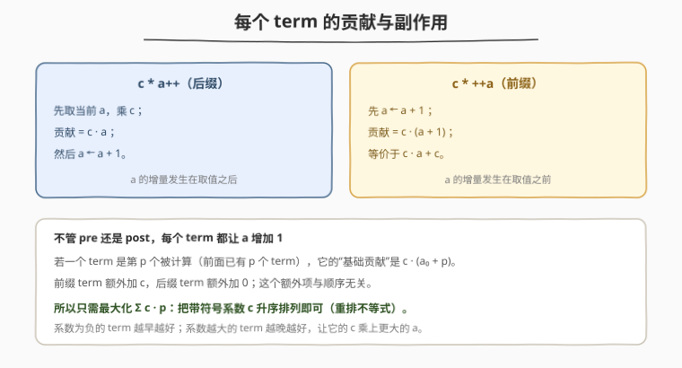
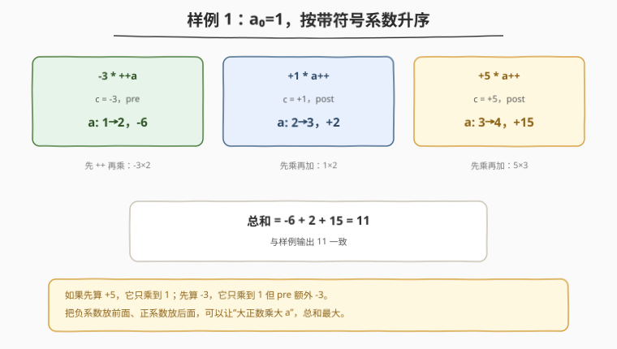

# Codeforces 39A 表达式项的最大值 题解

## 1. 题目概述

- **题目链接**：https://codeforces.com/problemset/problem/39/A
- **比赛来源**：Codeforces Beta Round 39 · Problem A
- **难度**：2000
- **标签**：表达式解析、贪心（expression parsing, greedy）
- **评测类型**：普通
- **限制**：时间 2 s / 内存 64 MB

**题意**：C*++ 的算术表达式由若干项通过 `+` 或 `-` 连接。每一项形如：

- `a++` 或 `++a`；或
- `c * a++` / `c * ++a`，其中 $c \in [0,1000]$ 是整数系数；省略系数时视为 $1$。

各项可以按**任意顺序**计算。计算一项时：

- `a++`：先把当前 $a$ 乘以系数，再把 $a$ 加 $1$；
- `++a`：先把 $a$ 加 $1$，再乘以系数。

求整个表达式可能取得的最大值。

**约束**：

- 初始 $a \in [-1000,1000]$；项数不超过 $1000$。
- 系数 $0 \dots 1000$；符号由项之间的 `+`/`-` 决定。
- 每项都会让 $a$ 增加 $1$，即使系数为 $0$。
- 只有一组数据。

## 2. 示例与观察

官方样例 1（输入 / 输出原样）：

```text
输入：
1
5*a++-3*++a+a++

输出：
11
```

**样例 1 解释**：三项分别是 $+5\cdot a{++}$、$-3\cdot {++}a$、$+1\cdot a{++}$。按 $-3$、$+1$、$+5$ 的顺序计算：

- $-3\cdot{++}a$：$a:1\to2$，贡献 $-6$；
- $+1\cdot a{++}$：贡献 $1\cdot2=2$，$a:2\to3$；
- $+5\cdot a{++}$：贡献 $5\cdot3=15$，$a:3\to4$。

总和 $-6+2+15=11$。

官方样例 2（输入 / 输出原样）：

```text
输入：
3
a+++++a

输出：
8
```

**样例 2 解释**：字符串拆成 `a++` 和 `++a` 两项。先算哪一项都得到 $8$：

- 先 `a++`：$3$，$a\to4$；再 `++a`：$a\to5$，$5$；总和 $8$；
- 先 `++a`：$a\to4$，$4$；再 `a++`：$4$，$a\to5$；总和 $8$。

自造样例（标注“自造”）：

| 输入 | 输出 | 说明 |
|------|------|------|
| `0` / `0*a+++10*a++` | 10 | 第一项 0 但让 a 变 1，第二项得 10 |
| `-2` / `++a` | -1 | 先加 1 再乘 1 |
| `5` / `2*++a-7*a++` | -21 | 按系数升序 |
| `1` / `1000*a++` | 1000 | 单项 |

**观察**：每个项都会让 $a$ 增加 $1$，且“增加”发生在该项取值之前或之后只影响一个固定偏移：

- `a++` 的贡献是 $c\cdot a$；
- `++a` 的贡献是 $c\cdot(a+1)=c\cdot a+c$。

把第 $p$ 个被计算的项（$p=0,1,\dots$）的“基础贡献”写成 $c\cdot(a_0+p)$，则总和为

$$\sum_i c_i(a_0+p_i) + \sum_{i\text{ 是 }++a} c_i .$$

第二项与顺序无关；第一项中 $a_0\sum c_i$ 也与顺序无关。因此只需最大化 $\sum c_i p_i$，其中 $p_i$ 是该项被安排的位置。

## 3. 解题思路

### 3.1 解析表达式



从左到右扫描字符串：

1. 读可选的系数：如果当前是数字，读完整个数字（$0 \dots 1000$），然后跳过一个 `*`；否则系数为 $1$；
2. 读增量：
   - 若当前字符是 `a`，则它是 `a++`，类型为后缀，前进 $3$ 格；
   - 否则当前是 `++a`，类型为前缀，前进 $3$ 格；
3. 项之间的分隔符是 `+` 或 `-`；记录符号，前进 $1$ 格。

注意 `++a` 自身以 `+` 开头：例如 `a+++++a` 应解析为 `a++`、分隔符 `+`、`++a`，而不是三个 `+` 的某种奇怪组合。按上述“先读项、再读一个分隔符”的顺序不会歧义。

### 3.2 排序



把每一项表示成：

- `c`：**带符号**系数（`-3*++a` 的 $c=-3$）；
- `pre`：是否为 `++a`。

按 $c$ **升序**排序。然后按顺序模拟：

```text
a = a0
ans = 0
for (c, pre) in sorted_terms:
    if pre: a += 1
    ans += c * a
    if not pre: a += 1
```

### 3.3 为什么按系数升序最优

设有两个相邻的项 $x,y$，系数分别为 $c_x,c_y$，它们当前的基础 $a$ 为 $A$（即前面已有若干项，当前 $a=A$）。交换它们只影响这两项的基础贡献：

- 顺序 $x,y$：$c_x A + c_y(A+1)$；
- 顺序 $y,x$：$c_y A + c_x(A+1)$。

两者之差：

$$[c_xA+c_y(A+1)]-[c_yA+c_x(A+1)] = c_y-c_x.$$

所以当 $c_x \le c_y$ 时，$x$ 在前不劣。也就是说，任意相邻逆序都可以交换成非降序而不减小总和；反复交换就得到按 $c$ 升序的排列。前缀项的额外 $+c$ 与位置无关，不影响这个交换论证。

### 3.4 样例 1 的走查

按 $c$ 排序：$-3$（pre）、$+1$（post）、$+5$（post）。

| 顺序 | 项 | 当前 a | 贡献 | 之后 a |
|------|----|--------|------|--------|
| 1 | $-3\cdot{++}a$ | 1 | $-3\times2=-6$ | 2 |
| 2 | $+1\cdot a{++}$ | 2 | $1\times2=2$ | 3 |
| 3 | $+5\cdot a{++}$ | 3 | $5\times3=15$ | 4 |

总和 $11$，与样例一致。

## 4. 正确性证明

**引理 1（贡献分解）**：对任意计算顺序，总贡献等于

$$\sum_i c_i(a_0+p_i) + \sum_{i:\,++a} c_i,$$

其中 $p_i$ 是第 $i$ 项之前已经计算过的项数。

**证明**：计算第 $i$ 项时，前面已有 $p_i$ 项，每项都让 $a$ 增加 $1$，所以当前 $a=a_0+p_i$。若该项是 `a++`，贡献 $c_i(a_0+p_i)$；若 `++a`，先把 $a$ 加 $1$，贡献 $c_i(a_0+p_i+1)=c_i(a_0+p_i)+c_i$。求和即得。∎

**引理 2（排序最优）**：在所有排列中，$\sum_i c_i p_i$ 的最大值由按 $c_i$ 升序排列取得。

**证明**：若存在相邻的 $c_x>c_y$（$x$ 在 $y$ 前），交换它们，由 3.3 的差值 $c_y-c_x<0$，总和严格增大。因此最优排列中不可能有相邻逆序；没有相邻逆序的排列就是非降序。∎

**引理 3（解析正确）**：3.1 的扫描把合法表达式恰好拆成所有项，并正确识别每项的系数与 `pre/post` 类型。

**证明**：文法保证每项要么以数字（系数）开头，要么以 `a`/`++a` 开头。数字后被一个 `*` 跟随；增量固定为 3 个字符 `a++` 或 `++a`。项之间恰有一个 `+`/`-`。按此规则读取不会越界或错位；`++a` 的前导 `+` 在“读项”阶段被消耗，不会被误认为分隔符。∎

**定理**：算法输出表达式可能取得的最大值。

**证明**：由引理 3 解析正确；由引理 2，排序后的顺序最大化基础贡献，而引理 1 中的前缀额外项与顺序无关，所以该顺序最大化总和；模拟计算得到的就是这个最大值。∎

## 5. 复杂度分析

- **时间**：解析 $O(|s|)$，排序 $O(m\log m)$，模拟 $O(m)$；$m \le 1000$。
- **空间**：$O(m)$ 存项。
- **数值范围**：$m\le1000$，系数 $\le1000$，$a$ 的绝对值最多约 $1000+1000$，单项贡献约 $2\times10^6$，总和约 $2\times10^9$；`long long` 安全，`int` 接近边界，建议 64 位。
- **与时限的关系**：$m=1000$ 时 C++ 端到端约 $3.6$ ms，Python3 约 $25$ ms（均含进程启动），远低于 2 s。

## 6. 参考代码

### C++17

```cpp
#include <bits/stdc++.h>
using namespace std;

struct Term {
    long long c;   // 带符号系数
    bool pre;      // true: ++a, false: a++
};

int main() {
    ios::sync_with_stdio(false);
    cin.tie(nullptr);

    long long a0;
    string s;
    cin >> a0 >> s;

    vector<Term> terms;
    int i = 0, n = (int)s.size();
    int sign = 1;
    while (i < n) {
        long long coef = 1;
        if (isdigit((unsigned char)s[i])) {
            coef = 0;
            while (i < n && isdigit((unsigned char)s[i])) {
                coef = coef * 10 + (s[i] - '0');
                ++i;
            }
            ++i; // '*'
        }
        bool pre;
        if (s[i] == 'a') {          // a++
            pre = false;
            i += 3;
        } else {                    // ++a
            pre = true;
            i += 3;
        }
        terms.push_back({sign * coef, pre});
        if (i < n) {
            sign = (s[i] == '+') ? 1 : -1;
            ++i;
        }
    }

    sort(terms.begin(), terms.end(), [](const Term &x, const Term &y) {
        return x.c < y.c;
    });

    long long a = a0, ans = 0;
    for (const Term &t : terms) {
        if (t.pre) ++a;             // ++a：先加 1
        ans += t.c * a;
        if (!t.pre) ++a;            // a++：先取值，再加 1
    }
    cout << ans << '\n';
    return 0;
}
```

### Python3

```python
import sys


def main() -> None:
    data = sys.stdin.buffer.read().split()
    if not data:
        return
    a = int(data[0])
    s = data[1].decode()

    terms = []
    i, n = 0, len(s)
    sign = 1
    while i < n:
        coef = 1
        if s[i].isdigit():
            coef = 0
            while i < n and s[i].isdigit():
                coef = coef * 10 + int(s[i])
                i += 1
            i += 1                      # '*'
        if s[i] == 'a':                 # a++
            pre = False
            i += 3
        else:                           # ++a
            pre = True
            i += 3
        terms.append((sign * coef, pre))
        if i < n:
            sign = 1 if s[i] == '+' else -1
            i += 1

    terms.sort(key=lambda x: x[0])

    ans = 0
    for c, pre in terms:
        if pre:
            a += 1
        ans += c * a
        if not pre:
            a += 1
    print(ans)


main()
```

## 7. 边界情况与易错点

1. **系数为 0**：贡献为 0，但该项仍然让 $a$ 增加 $1$；不能跳过不处理，否则后续项的基础 $a$ 会错。
2. **系数省略**：`a++` 视为 $1\cdot a{++}$，不是 $0$。
3. **负系数**：`-3*++a` 的带符号系数是 $-3$；排序时按 $-3$ 而不是 $3$。
4. **`++a` 的前导 `+`**：`a+++++a` 中第一个 `+` 是分隔符，后两个与 `a` 组成 `++a`；解析顺序不能乱。
5. **表达式以 `++a` 开头**：第一个字符是 `+`，不是分隔符；代码先读项，再读分隔符，能正确处理。
6. **`pre` 的额外项**：`++a` 的贡献比 `c*a` 多一个 $c$（可能为负）；模拟时先加 $a$ 再乘即可，不要额外补。
7. **排序稳定性**：系数相同的项，pre/post 顺序不影响总和（基础贡献相同，额外项固定）；任意顺序都可。
8. **答案范围**：可能为负；不要初始化为 $0$ 后取 max，直接累加。
9. **读入**：表达式不含空格，`cin >> s` / `split()[1]` 均可。
10. **只有一组数据**：第一行 $a$，第二行表达式。

## 8. 验证记录

- **编译环境与命令**：本机没有 GNU `g++`（`/usr/bin/g++` 是 Apple clang 21.0.0 的软链），用 `clang++ -std=c++17 -O2 -Wall -Wextra -I codeforces/tools/include` 配合仓库自带的 `bits/stdc++.h` 兼容头编译，**零警告**；Python 侧为 `Python 3.9.6`。
- **官方样例**：2 / 2 通过（`11`、`8`）。`verify_solution.py` 输出 `CF39A: samples 2`、`C++ 编译 OK, 样例 2/2`、`Python 语法 OK, 样例 2/2`。
- **独立暴力对拍**：另写暴力：对 $m \le 6$ 项枚举**所有排列**，按真实 pre/post 规则模拟，取最大值。共 **300 组随机表达式**（项数 $1 \dots 6$，系数 $0 \dots 5$，pre/post 随机，符号随机），C++、Python 与暴力**全部一致，0 处不符**。
- **最大约束性能**：$m=1000$ 项时，C++ 端到端约 $3.6$ ms；Python3 约 $25$ ms（均含进程启动）。
- **图片校验**：两张 SVG（`cf39a_terms.svg`、`cf39a_sort.svg`）均通过 `xml.etree.ElementTree.parse`；文本包围盒均在 `viewBox` 内且两两不重叠。
- **公式校验**：正文公式经 `node codeforces/tools/katex_check.cjs` 的 KaTeX（`throwOnError`）校验，0 处报错；证明结尾用 `∎`。
- **样例逐字核对**：`python3 codeforces/tools/check_samples.py --only 0001-0100/39` 对本文的两组官方样例报告一致。
- **复核状态**：verified（官方样例、300 组全排列暴力、最大约束性能、图片几何、公式、样例逐字六项均实跑通过；唯一环境差异是本机无 GNU g++，已用 clang++ 等价验证）。

## 相关题目与扩展

- [Codeforces 39B Company Income Growth](https://codeforces.com/problemset/problem/39/B)：同场 B 题，贪心选递增下标。
- [Codeforces 39C Moon Craters](https://codeforces.com/problemset/problem/39/C)：同场 C 题，区间 DP。
- [LeetCode 150. 逆波兰表达式求值](https://leetcode.cn/problems/evaluate-reverse-polish-notation/)：表达式求值，但顺序固定。
- [LeetCode 241. 为运算表达式设计优先级](https://leetcode.cn/problems/different-ways-to-add-parentheses/)：通过改变运算顺序得到不同结果，和本题“任意顺序计算项”神似。
- [Codeforces 39E What Has Dirichlet Got to Do with That?](https://codeforces.com/problemset/problem/39/E)：同场 E 题，博弈 DP。

**延伸思考**：

1. **如果每个 term 的增量不是 1 而是 c**：排序依据会变，需要重新推导交换不等式。
2. **如果允许括号改变求和结构**：问题变成表达式加括号的最值，通常需要区间 DP。
3. **如果要求输出最优顺序**：在排序后记录每个项的原编号即可；相同系数的项任意。
4. **如果系数可以到 $10^9$**：排序仍可，但总和超出 64 位，需要高精度或取模（取模会破坏大小比较，不能直接排序）。
5. **如果 `a` 的初始值很大**：排序结论不变，因为常数项 $a_0\sum c_i$ 与顺序无关。

