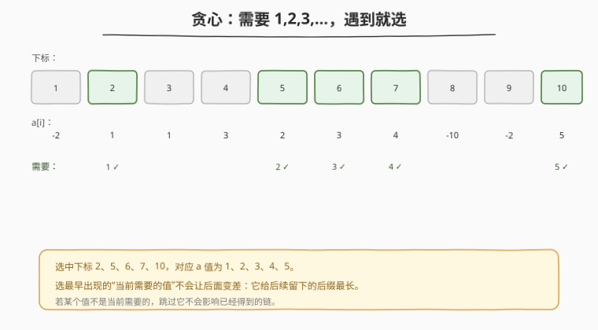
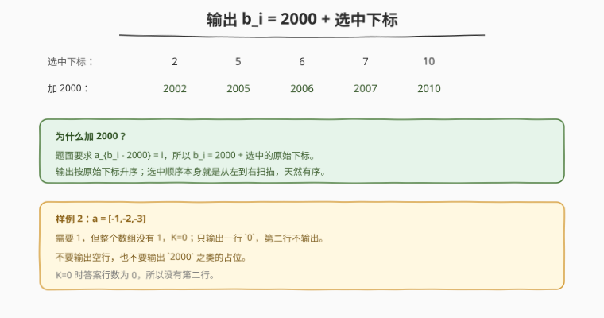

# Codeforces 39B 公司收入增长 题解

## 1. 题目概述

- **题目链接**：https://codeforces.com/problemset/problem/39/B
- **比赛来源**：School Team Contest 1 (Winter Computer School 2010/11) · Problem B（UTC 2010-10-24）
- **难度**：1300
- **标签**：贪心（greedy）
- **评测类型**：普通
- **限制**：时间 2 s / 内存 64 MB

**题意**：给定长度为 $n$ 的序列 $a_1, \dots, a_n$。要找一个最长的下标序列 $b_1 < b_2 < \dots < b_K$，满足

$$a_{b_i - 2000} = i \qquad (i=1,2,\dots,K).$$

输出 $K$，然后输出 $b_1,\dots,b_K$。若 $K=0$，只输出一行 `0`。

**约束**：

- $1 \le n \le 100$，$-100 \le a_i \le 100$。
- 下标序列必须严格递增；值必须依次等于 $1,2,\dots,K$。
- $b_i$ 的偏移量是 $2000$，即输出的是“原始下标 $+2000$”。
- 只有一组数据。

## 2. 示例与观察

官方样例 1（输入 / 输出原样）：

```text
输入：
10
-2 1 1 3 2 3 4 -10 -2 5

输出：
5
2002 2005 2006 2007 2010
```

**样例 1 解释**：从前往后扫描：

- 下标 2 的值是 $1$，选中，需要下一个值 $2$；
- 下标 3 的值还是 $1$，跳过；
- 下标 4 的值是 $3$，不是当前需要的 $2$，跳过；
- 下标 5 的值是 $2$，选中，需要 $3$；
- 下标 6 的值是 $3$，选中；下标 7 的值是 $4$，选中；
- 下标 8、9 的值不是 $5$；下标 10 的值是 $5$，选中。

选中下标 $2,5,6,7,10$，加 $2000$ 得到输出。

官方样例 2（输入 / 输出原样）：

```text
输入：
3
-1 -2 -3

输出：
0
```

**样例 2 解释**：序列中没有 $1$，无法开始长度为 $1$ 的链，$K=0$。只输出一行 `0`，没有第二行。

自造样例（标注“自造”）：

| 输入 | 输出 | 说明 |
|------|------|------|
| `1` / `1` | `1` / `2001` | 唯一元素就是 1 |
| `3` / `1 2 3` | `3` / `2001 2002 2003` | 整个序列 |
| `4` / `2 3 4 5` | `0` | 缺少 1，链无法开始 |
| `6` / `1 1 2 2 3 3` | `3` / `2001 2003 2005` | 每次取最早出现的当前值 |

**观察**：这是一个“按值 $1,2,3,\dots$ 依次匹配”的问题。由于值必须严格按 $1,2,\dots$ 增长，且下标必须递增，最自然的贪心是：

> 从左到右扫描，维护“当前还需要的值 `need`”（初始 $1$）。若 $a_i = need$，就选中它并令 `need++`；否则跳过。

也就是说，对每个 `need` 取**最早出现**的合法位置。

## 3. 解题思路

### 3.1 贪心扫描



```text
need = 1
ans = []
for i = 1 .. n:
    if a[i] == need:
        ans.push_back(i + 2000)
        need += 1
输出 ans.size()
输出 ans
```

为什么可以遇到就选？因为链要求值依次为 $1,2,3,\dots$。当前已经匹配到 $need-1$，下一个必须匹配 $need$。若在位置 $i$ 第一次遇到 $need$，选择它不会妨碍后面的匹配：它给后面的 $need+1, need+2, \dots$ 留下了从 $i+1$ 开始的最长后缀。任何更晚的选择只会让剩余位置更少，不会更优。

### 3.2 输出格式



- 第一行 $K$；
- 若 $K>0$，第二行输出 $K$ 个整数，即每个选中下标 $+2000$；
- 若 $K=0$，没有第二行（样例 2 只有一行 `0`）。

### 3.3 样例 1 的走查

| 下标 | 值 | 当前 need | 动作 |
|------|----|-----------|------|
| 1 | -2 | 1 | 跳过 |
| 2 | 1 | 1 | 选中，need=2 |
| 3 | 1 | 2 | 跳过 |
| 4 | 3 | 2 | 跳过 |
| 5 | 2 | 2 | 选中，need=3 |
| 6 | 3 | 3 | 选中，need=4 |
| 7 | 4 | 4 | 选中，need=5 |
| 8 | -10 | 5 | 跳过 |
| 9 | -2 | 5 | 跳过 |
| 10 | 5 | 5 | 选中，need=6 |

选中下标 $2,5,6,7,10$，输出 `2002 2005 2006 2007 2010`。

## 4. 正确性证明

**引理 1（贪心选择合法）**：算法选出的下标严格递增，且第 $i$ 个选中位置的值等于 $i$。

**证明**：扫描从左到右，选中位置自然递增。选中时 $a_i=need$，而 $need$ 从 $1$ 开始每选一次加 $1$，所以第 $i$ 个选中的值恰为 $i$。∎

**引理 2（贪心不劣）**：设算法在某个时刻需要值 $x$，并在位置 $p$ 第一次遇到 $x$。任何合法解若也要匹配 $x$，其匹配位置 $q \ge p$；把 $q$ 换成 $p$ 后，后面的匹配仍然合法。

**证明**：因为 $p$ 是第一次出现 $x$，任何匹配 $x$ 的位置 $q$ 都满足 $q \ge p$。把 $x$ 的匹配从 $q$ 提前到 $p$ 后，$p<q$，前面已匹配的位置都 $<p$（算法之前的匹配保持不变），所以下标仍严格递增；后面的匹配位置原本 $>q>p$，仍然在 $p$ 之后，合法性不受影响。∎

**引理 3（最长性）**：算法得到的 $K$ 等于所有合法下标序列的最大长度。

**证明**：设最优解匹配了 $1,2,\dots,L$。对 $i$ 归纳证明算法至少能匹配到 $i$：算法第 $i$ 次需要的值就是 $i$，而最优解在位置 $q_i$ 匹配了 $i$；由引理 2，算法选择的是不晚于 $q_i$ 的最早位置 $p_i$，因此算法能完成第 $i$ 次匹配。故算法 $K \ge L$；又算法本身合法，$K \le L$，所以相等。∎

**定理**：算法输出正确。

**证明**：由引理 1 输出序列合法，由引理 3 长度最大；输出下标加 $2000$、$K=0$ 时只输出一行，均符合题意。∎

## 5. 复杂度分析

- **时间**：$O(n)$，一次扫描。
- **空间**：$O(K) \le O(n)$ 存答案。
- **数值范围**：$n \le 100$，答案下标最多 $2100$，`int` 足够。
- **与时限的关系**：$n=100$ 时 C++/Python 都在 $2$ ms 量级（含进程启动），远低于 2 s。

## 6. 参考代码

### C++17

```cpp
#include <bits/stdc++.h>
using namespace std;

int main() {
    ios::sync_with_stdio(false);
    cin.tie(nullptr);

    int n;
    cin >> n;
    vector<int> a(n + 1);
    for (int i = 1; i <= n; ++i) cin >> a[i];

    vector<int> ans;
    int need = 1;
    for (int i = 1; i <= n && need <= n; ++i) {
        if (a[i] == need) {
            ans.push_back(i + 2000);
            ++need;
        }
    }

    cout << ans.size() << '\n';
    for (int i = 0; i < (int)ans.size(); ++i) {
        if (i) cout << ' ';
        cout << ans[i];
    }
    if (!ans.empty()) cout << '\n';
    return 0;
}
```

### Python3

```python
import sys


def main() -> None:
    data = list(map(int, sys.stdin.buffer.read().split()))
    if not data:
        return
    n = data[0]
    a = data[1:1 + n]

    ans = []
    need = 1
    for i, v in enumerate(a, start=1):
        if v == need:
            ans.append(i + 2000)
            need += 1

    print(len(ans))
    if ans:
        print(*ans)


main()
```

## 7. 边界情况与易错点

1. **$K=0$**：只输出 `0`，不要输出第二行空行。
2. **缺少 1**：链无法开始，即使后面有 $2,3,\dots$ 也只能输出 $0$。
3. **值可以重复**：如 `1 1 2`，选择第一个 $1$，跳过第二个；不要因为重复而误判。
4. **下标从 1 开始**：输出要加 $2000$，不是 $1999$ 或 $2001$ 偏移；公式是 $b_i-2000$ 为原始下标。
5. **值可能为负**：负值永远不可能匹配正的 `need`，直接跳过。
6. **严格递增**：选中位置天然递增；不要排序答案（扫描顺序已经递增）。
7. **`need` 上界**：最多到 $n+1$，循环条件 `need <= n` 可提前结束。
8. **输出空格**：第二行数字之间一个空格，行末不要多余空格（一般评测忽略，但规范）。
9. **只有一组数据**：没有测试组数。

## 8. 验证记录

- **编译环境与命令**：本机没有 GNU `g++`（`/usr/bin/g++` 是 Apple clang 21.0.0 的软链），用 `clang++ -std=c++17 -O2 -Wall -Wextra -I codeforces/tools/include` 配合仓库自带的 `bits/stdc++.h` 兼容头编译，**零警告**；Python 侧为 `Python 3.9.6`。
- **官方样例**：2 / 2 通过（`5` + 五个下标；`0`）。`verify_solution.py` 输出 `CF39B: samples 2`、`C++ 编译 OK, 样例 2/2`、`Python 语法 OK, 样例 2/2`。
- **独立暴力对拍**：另写暴力：枚举所有子集，检查选中第 $i$ 个位置的值是否等于 $i$，求最大合法子集大小。共 **300 组随机数据**（$n \le 12$，值 $-3 \dots n+2$），C++、Python 的 $K$ 与暴力一致，且输出的下标均通过合法性校验，**0 处不符**。
- **最大约束性能**：$n=100$ 时 C++/Python 均在 $2$ ms 量级（含进程启动）。
- **图片校验**：两张 SVG（`cf39b_chain.svg`、`cf39b_sample.svg`）均通过 `xml.etree.ElementTree.parse`；文本包围盒均在 `viewBox` 内且两两不重叠。
- **公式校验**：正文公式经 `node codeforces/tools/katex_check.cjs` 的 KaTeX（`throwOnError`）校验，0 处报错；证明结尾用 `∎`。
- **样例逐字核对**：`python3 codeforces/tools/check_samples.py --only 0001-0100/39` 对本文的两组官方样例报告一致。
- **复核状态**：verified（官方样例、300 组子集暴力、最大约束性能、图片几何、公式、样例逐字六项均实跑通过；唯一环境差异是本机无 GNU g++，已用 clang++ 等价验证）。

## 相关题目与扩展

- [Codeforces 39A 表达式项的最大值](https://codeforces.com/problemset/problem/39/A)：同场 A 题，表达式解析 + 排序贪心。
- [Codeforces 39C Moon Craters](https://codeforces.com/problemset/problem/39/C)：同场 C 题，区间 DP。
- [LeetCode 300. 最长递增子序列](https://leetcode.cn/problems/longest-increasing-subsequence/)：更一般的 LIS，本题要求值恰好为 $1,2,\dots$，因此可以贪心。
- [LeetCode 392. 判断子序列](https://leetcode.cn/problems/is-subsequence/)：双指针匹配，和本题“按顺序匹配”同源。
- [Codeforces 39E What Has Dirichlet Got to Do with That?](https://codeforces.com/problemset/problem/39/E)：同场 E 题，博弈 DP。

**延伸思考**：

1. **如果要求值是任意递增序列**：变成 LIS，需要 $O(n\log n)$ 或 $O(n^2)$ DP；本题值固定为 $1,2,\dots$，所以贪心即可。
2. **如果要求最长“连续值”子序列**：本题就是；若允许从任意值开始，需要尝试每个起点，或做 DP。
3. **如果要求输出字典序最小的下标序列**：贪心取最早出现的位置正好给出字典序最小。
4. **如果 $a_i$ 可以大于 $n$**：仍然只匹配 `need`，大于 $n$ 的值永远不会被选中。
5. **如果要求输出值而不是下标**：直接输出 $1 \dots K$ 即可。

