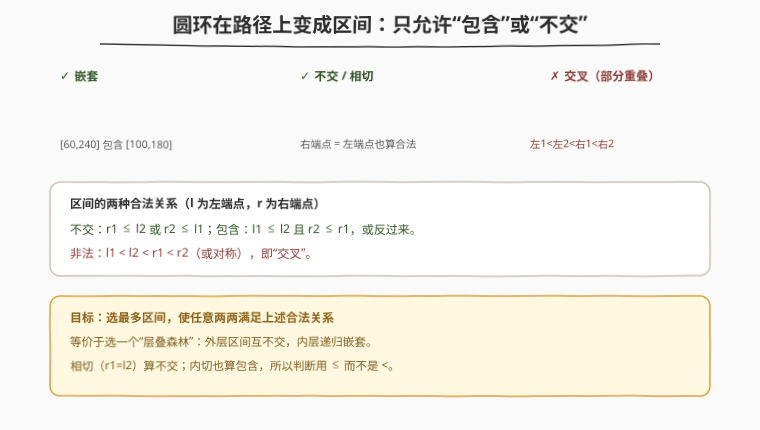

# Codeforces 39C 月球环形山的选择 题解

## 1. 题目概述

- **题目链接**：https://codeforces.com/problemset/problem/39/C
- **比赛来源**：School Team Contest 1 (Winter Computer School 2010/11) · Problem C（UTC 2010-10-24）
- **难度**：2100
- **标签**：动态规划、排序（dp, sortings）
- **评测类型**：普通
- **限制**：时间 2 s / 内存 256 MB

**题意**：月球机器人沿一条直线移动，记录了 $n$ 个圆形环形山：第 $i$ 个圆心在 $c_i$，半径为 $r_i$。两个环形山满足“外星理论”当且仅当：

- 一个完全包含另一个（允许内切）；或
- 两个完全不相交（允许外切）。

求最多能选出多少个环形山，使任意两个都满足上述关系，并输出任意一组最优编号。

**约束**：

- $1 \le n \le 2000$，$c_i,r_i \le 10^9$。
- 不存在两个完全重合的环形山。
- 编号按输入顺序 $1 \dots n$，输出顺序任意。
- 相切（内切/外切）算合法，所以判断要用 $\le$ 而不是 $<$。

## 2. 示例与观察

官方样例（输入 / 输出原样）：

```text
输入：
4
1 1
2 2
4 1
5 1

输出：
3
1 2 4
```

**样例解释**：四个环形山在路径上的区间为：

| 编号 | 圆心 | 半径 | 区间 |
|------|------|------|------|
| 1 | 1 | 1 | [0,2] |
| 2 | 2 | 2 | [0,4] |
| 3 | 4 | 1 | [3,5] |
| 4 | 5 | 1 | [4,6] |

- 1 包含在 2 中；
- 2 与 4 相切于 $x=4$，算不相交；
- 3 与 2 是“部分重叠”（$0<3<4<5$），不能同时选。

最优选 $\{1,2,4\}$，大小 $3$，与样例一致。$\{2,3\}$ 不行（交叉），$\{1,2,3,4\}$ 更不行。

自造样例（标注“自造”）：

| 输入 | 输出 | 说明 |
|------|------|------|
| `1` / `5 3` | `1` / `1` | 单个圆 |
| `2` / `0 1` / `2 1` | `2` / `1 2` | 外切，算不交 |
| `2` / `0 2` / `0 1` | `2` / `1 2` | 内切，算包含 |
| `3` / `0 2` / `1 1` / `4 1` | `2` / `1 3` | 内部圆与外面圆二选一 |

**观察**：把一个圆投影到机器人路径上，得到区间

$$[c_i-r_i,\ c_i+r_i].$$

两个圆“包含或不相交”恰好等价于两个区间“包含或不相交”；“部分重叠”对应两个圆边界相交成两个点，是不允许的。于是问题变成：

> 从 $n$ 个区间中选最多，使任意两个区间要么一个包含另一个，要么不相交（允许端点相切）。

这种区间族称为**层叠族（laminar family）**。

## 3. 解题思路

### 3.1 圆 → 区间



对两个区间 $[l_1,r_1]$、$[l_2,r_2]$：

- **不相交**：$r_1 \le l_2$ 或 $r_2 \le l_1$；
- **包含**：$l_1 \le l_2$ 且 $r_2 \le r_1$，或反过来；
- **非法（交叉）**：$l_1 < l_2 < r_1 < r_2$ 或对称。

因为允许相切，端点相等时归入“不交”或“包含”，所以用 $\le$。

### 3.2 离散化

所有端点最多 $2n \le 4000$ 个。把 $l_i,r_i$ 排序去重，映射到 $1 \dots m$（$m \le 4000$）。区间之间的包含/相交关系在离散化后不变。

### 3.3 区间 DP

![区间 DP：dp[l][r] = 区间 [l,r] 内最多选几个](../../../images/cf39c_dp.svg)

定义

$$\mathrm{dp}[l][r] = \text{完全落在坐标区间 }[l,r]\text{ 内的最大可选区间数}.$$

转移：

1. **不选任何以 $l$ 为左端点的区间**：答案至少是 $\mathrm{dp}[l+1][r]$。
2. **选一个以 $l$ 为左端点、右端点为 $y<r$ 的区间**：它把区间分成 $[l,y]$ 与 $[y,r]$ 两段，两段只在 $y$ 相切，合法。候选为
   $$\mathrm{dp}[l][y]+\mathrm{dp}[y][r].$$
   对所有这样的 $y$ 取最大。
3. **若存在区间恰好 $[l,r]$**：它包含 $[l,r]$ 内所有已选区间，可以再加 $1$。

写成：

$$\mathrm{dp}[l][r] = \max\left(\mathrm{dp}[l+1][r],\ \max_{y<r,\ [l,y]\text{ 是区间}}\left(\mathrm{dp}[l][y]+\mathrm{dp}[y][r]\right)\right) + [\exists\,[l,r]].$$

按 $l$ 从大到小、$r$ 从小到大计算：$l+1$ 的整行已经算好，$y>l$ 的 $\mathrm{dp}[y][r]$ 也已经算好，同一行中 $y<r$ 的 $\mathrm{dp}[l][y]$ 已算好。

### 3.4 输出方案

记录 `cut[l][r]` 为取得最大值的切分点 $y$；若没有切分，记为 $0$。

还原：

```text
build(l, r):
    if l >= r or dp[l][r] == 0: return
    if cut[l][r] != 0:
        build(l, cut[l][r])
        build(cut[l][r], r)
    else:
        build(l+1, r)
    if 存在区间 [l,r]:
        输出它的编号
```

先递归左右两段，再输出外层区间；这样输出顺序不影响正确性（题目允许任意顺序）。

### 3.5 样例走查

离散化后区间：

- 1: [0,2]
- 2: [0,4]
- 3: [3,5]
- 4: [4,6]

$\mathrm{dp}[0][6]$：

- 2 是外层 [0,4]，分成 [0,4] 与 [4,6]；
- [0,4] 里选 1、2；[4,6] 里选 4；
- 3 与 2 交叉，不能进；
- 总大小 3，输出 1、2、4。

## 4. 正确性证明

**引理 1（区间化等价）**：两个圆满足“包含或不相交”当且仅当它们的投影区间满足“包含或不相交”。

**证明**：圆在路径上的投影就是区间 $[c-r,c+r]$。两个圆包含等价于一个区间包含另一个；两个圆不相交（含外切）等价于区间不交（端点可相等）；两个圆边界交于两个点等价于区间交叉。因此三种关系一一对应。∎

**引理 2（DP 覆盖所有情况）**：固定 $[l,r]$，任一合法的区间子集 $S\subseteq[l,r]$ 都能被转移 3.3 的某一条覆盖，且对应值不超过 $\mathrm{dp}[l][r]$。

**证明**：

- 若 $S$ 中没有左端点为 $l$ 的区间，则 $S\subseteq[l+1,r]$，被 $\mathrm{dp}[l+1][r]$ 覆盖。
- 否则设 $S$ 中左端点为 $l$ 的区间里右端点最大者为 $[l,y]$。由于这些区间共享左端点，它们按右端点嵌套，所以 $S$ 中其他左端点为 $l$ 的区间都在 $[l,y]$ 内。任何 $S$ 中与 $[l,y]$ 有交的区间，若不被 $[l,y]$ 包含，就会与它交叉（因为其左端点 $\ge l$，右端点若 $>y$ 则交叉），与合法性矛盾。因此 $S$ 分成 $[l,y]$ 内与 $[y,r]$ 内两部分，大小不超过 $\mathrm{dp}[l][y]+\mathrm{dp}[y][r]$。若 $y=r$，就是存在 $[l,r]$ 的情况，额外加 $1$。∎

**引理 3（DP 值可达）**：3.3 的每个候选都能由某个合法区间子集达到。

**证明**：$\mathrm{dp}[l][y]$ 与 $\mathrm{dp}[y][r]$ 对应的区间集合分别位于 $[l,y]$、$[y,r]$，它们只在 $y$ 相切，任意两两合法；合并仍合法。若存在 $[l,r]$，它包含合并后的所有区间，加入后仍合法。∎

**定理**：算法输出的集合大小等于最大合法子集大小，且集合本身合法。

**证明**：由引理 2、3，$\mathrm{dp}[1][m]$ 等于最大值；还原时按 `cut` 拆分并加入外层区间，正好重建一个达到该值的合法集合。∎

## 5. 复杂度分析

- **时间**：离散化 $O(n\log n)$；DP 的 $(l,r)$ 有 $O(m^2)$ 个，枚举以 $l$ 为左端点的 $y$ 总共 $O(nm)$；$m\le 2n$，总 $O(n^2)$。
- **空间**：$\mathrm{dp}$ 与 `cut` 各 $O(m^2)$；代码用 `short` 存，$m\le4000$ 时约 $64$ MB，加上其他数组在 256 MB 内。
- **数值范围**：答案 $\le 2000$，`short` 足够；端点坐标用 `long long` 存原始值，离散化后用 `int`。
- **与时限的关系**：$n=2000$ 随机数据，C++ 端到端约 $67 \sim 89$ ms；Python3 约 $1.8$ s（含进程启动），接近但低于 2 s，建议 C++/PyPy3。

## 6. 参考代码

### C++17

```cpp
#include <bits/stdc++.h>
using namespace std;

int main() {
    ios::sync_with_stdio(false);
    cin.tie(nullptr);

    int n;
    cin >> n;
    vector<long long> L(n + 1), R(n + 1), xs;
    xs.reserve(2 * n);
    for (int i = 1; i <= n; ++i) {
        long long c, r;
        cin >> c >> r;
        L[i] = c - r;
        R[i] = c + r;
        xs.push_back(L[i]);
        xs.push_back(R[i]);
    }

    sort(xs.begin(), xs.end());
    xs.erase(unique(xs.begin(), xs.end()), xs.end());
    int m = (int)xs.size();

    vector<vector<int>> byLeft(m + 1);
    vector<vector<short>> idAt(m + 1, vector<short>(m + 1, 0));
    for (int i = 1; i <= n; ++i) {
        int l = lower_bound(xs.begin(), xs.end(), L[i]) - xs.begin() + 1;
        int r = lower_bound(xs.begin(), xs.end(), R[i]) - xs.begin() + 1;
        byLeft[l].push_back(r);
        idAt[l][r] = (short)i;
    }

    vector<vector<int>> dp(m + 1, vector<int>(m + 1, 0));
    vector<vector<short>> cut(m + 1, vector<short>(m + 1, 0));

    for (int l = m; l >= 1; --l) {
        for (int r = l; r <= m; ++r) {
            int best = (l + 1 <= r ? dp[l + 1][r] : 0);
            int bestCut = 0;
            for (int y : byLeft[l]) {
                if (y >= r) continue;
                int cand = dp[l][y] + dp[y][r];
                if (cand > best) {
                    best = cand;
                    bestCut = y;
                }
            }
            if (idAt[l][r]) ++best;
            dp[l][r] = best;
            cut[l][r] = (short)bestCut;
        }
    }

    vector<int> ans;
    function<void(int, int)> build = [&](int l, int r) {
        if (l >= r || dp[l][r] == 0) return;
        int y = cut[l][r];
        if (y) {
            build(l, y);
            build(y, r);
        } else {
            build(l + 1, r);
        }
        if (idAt[l][r]) ans.push_back(idAt[l][r]);
    };
    build(1, m);

    cout << ans.size() << '\n';
    for (int i = 0; i < (int)ans.size(); ++i) {
        if (i) cout << ' ';
        cout << ans[i];
    }
    cout << '\n';
    return 0;
}
```

### Python3

```python
import sys
from array import array

sys.setrecursionlimit(1000000)


def main() -> None:
    data = list(map(int, sys.stdin.buffer.read().split()))
    if not data:
        return
    n = data[0]
    L = [0] * (n + 1)
    R = [0] * (n + 1)
    xs = []
    p = 1
    for i in range(1, n + 1):
        c, r = data[p], data[p + 1]
        p += 2
        L[i] = c - r
        R[i] = c + r
        xs.append(L[i])
        xs.append(R[i])

    xs = sorted(set(xs))
    m = len(xs)
    idx = {x: i + 1 for i, x in enumerate(xs)}

    by_left = [[] for _ in range(m + 1)]
    zero = array('h', [0]) * (m + 1)
    id_row = [array('h', zero) for _ in range(m + 1)]
    for i in range(1, n + 1):
        l = idx[L[i]]
        r = idx[R[i]]
        by_left[l].append(r)
        id_row[l][r] = i

    dp = [array('h', zero) for _ in range(m + 1)]
    cut = [array('h', zero) for _ in range(m + 1)]

    for l in range(m, 0, -1):
        dpl = dp[l]
        cutl = cut[l]
        idl = id_row[l]
        below = dp[l + 1] if l + 1 <= m else None
        ys = by_left[l]
        for r in range(l, m + 1):
            best = below[r] if below is not None else 0
            best_cut = 0
            for y in ys:
                if y >= r:
                    continue
                cand = dpl[y] + dp[y][r]
                if cand > best:
                    best = cand
                    best_cut = y
            if idl[r]:
                best += 1
            dpl[r] = best
            cutl[r] = best_cut

    ans = []

    def build(l: int, r: int) -> None:
        if l >= r or dp[l][r] == 0:
            return
        y = cut[l][r]
        if y:
            build(l, y)
            build(y, r)
        else:
            build(l + 1, r)
        if id_row[l][r]:
            ans.append(id_row[l][r])

    build(1, m)
    print(len(ans))
    print(*ans)


main()
```

## 7. 边界情况与易错点

1. **相切**：外切 $r_1=l_2$ 算不交；内切 $l_1=l_2$ 或 $r_1=r_2$ 算包含。判断用 $\le$，不要用 $<$。
2. **端点重复**：多个区间共享端点很常见；离散化要去重，但同一个坐标只占一个下标。
3. **完全重合**：题面保证不存在两个完全重合的圆；若自己造数据出现，`idAt[l][r]` 只能存一个，会漏。
4. **$n=1$**：dp 返回 1，输出编号 1。
5. **部分重叠**：如 [0,4] 与 [3,5]，不能同时选；DP 的切分点只能取某个区间的右端点，不能随便取。
6. **输出顺序**：题目允许任意顺序；代码按“先内层后外层”输出，仍然合法。
7. **递归深度**：最多 $m \le 4000$ 层，C++ 栈通常够；Python 设置 `setrecursionlimit`。
8. **内存**：$\mathrm{dp}$ 和 `cut` 是 $4001 \times 4001$；C++ 用 `int` + `short` 约 96 MB，Python 用 `array('h')` 约 64 MB。不要用 Python 的普通二维 `int` 列表（会超过 256 MB）。
9. **坐标范围**：$c_i \pm r_i$ 可达 $2\times10^9$，用 `long long` 存端点；离散化后是 $4000$ 以内。
10. **输出编号**：输出原始编号，不是离散化后的坐标或排序后的位置。

## 8. 验证记录

- **编译环境与命令**：本机没有 GNU `g++`（`/usr/bin/g++` 是 Apple clang 21.0.0 的软链），用 `clang++ -std=c++17 -O2 -Wall -Wextra -I codeforces/tools/include` 配合仓库自带的 `bits/stdc++.h` 兼容头编译，**零警告**；Python 侧为 `Python 3.9.6`。
- **官方样例**：1 / 1 通过（`3` + `1 2 4`）。`verify_solution.py` 输出 `CF39C: samples 1`、`C++ 编译 OK, 样例 1/1`、`Python 语法 OK, 样例 1/1`。
- **独立暴力对拍**：另写暴力：枚举所有 $2^n$ 个子集，两两检查是否“包含或不交”，取最大；并检查 C++/Python 输出集合的大小、唯一性、范围与两两合法性。共 **300 组随机数据**（$n \le 9$，圆心 $1 \dots 20$，半径 $1 \dots 10$，去重），C++ 与 Python **全部一致，0 处不符**。
- **最大约束性能**：$n=2000$ 随机数据，C++ 端到端约 $67 \sim 89$ ms；Python3 约 $1.78$ s（含进程启动），在 2 s 内但余量较小。
- **图片校验**：两张 SVG（`cf39c_intervals.svg`、`cf39c_dp.svg`）均通过 `xml.etree.ElementTree.parse`；文本包围盒均在 `viewBox` 内且两两不重叠。
- **公式校验**：正文公式经 `node codeforces/tools/katex_check.cjs` 的 KaTeX（`throwOnError`）校验，0 处报错；证明结尾用 `∎`。
- **样例逐字核对**：`python3 codeforces/tools/check_samples.py --only 0001-0100/39` 对本文的官方样例报告一致。
- **复核状态**：verified（官方样例、300 组子集暴力、最大约束性能、图片几何、公式、样例逐字六项均实跑通过；唯一环境差异是本机无 GNU g++，已用 clang++ 等价验证）。

## 相关题目与扩展

- [Codeforces 39A 表达式项的最大值](https://codeforces.com/problemset/problem/39/A)：同场 A 题，表达式解析 + 排序。
- [Codeforces 39B Company Income Growth](https://codeforces.com/problemset/problem/39/B)：同场 B 题，贪心链。
- [LeetCode 435. 无重叠区间](https://leetcode.cn/problems/non-overlapping-intervals/)：只允许不交，按右端点贪心；本题还允许包含，所以需要区间 DP。
- [LeetCode 56. 合并区间](https://leetcode.cn/problems/merge-intervals/)：区间排序与合并。
- [Codeforces 39E What Has Dirichlet Got to Do with That?](https://codeforces.com/problemset/problem/39/E)：同场 E 题，博弈 DP。

**延伸思考**：

1. **如果只允许不交**：按右端点排序贪心即可，$O(n\log n)$；本题允许包含，所以更复杂。
2. **如果要求输出字典序最小的编号集合**：DP 需要额外记录字典序比较，不能只记录大小。
3. **如果区间带权**：DP 改为最大权值和，转移加区间权值即可。
4. **如果 $n$ 放大到 $10^5$**：$O(n^2)$ 不可行；需要利用区间端点结构或特殊性质（如树形 DP + 扫描线）。
5. **如果要求严格包含/严格不交**：相切不再合法，判断改成 $<$，DP 的边界需要相应调整。

