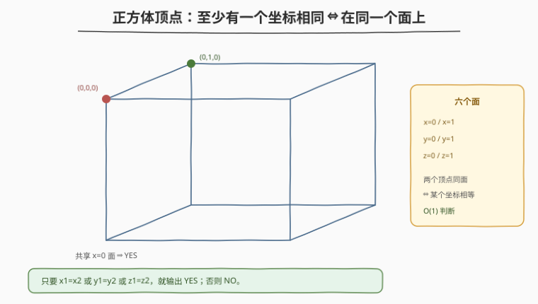
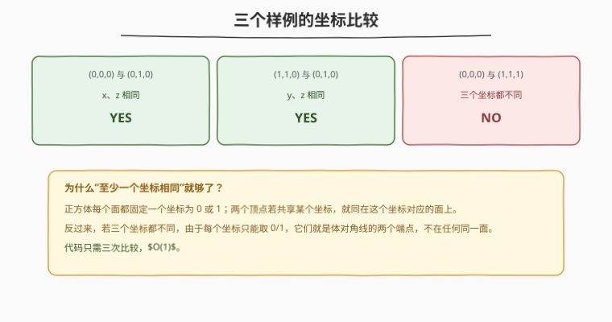

# Codeforces 39D 立方体上的苍蝇 题解

## 1. 题目概述

- **题目链接**：https://codeforces.com/problemset/problem/39/D
- **比赛来源**：School Team Contest 1 (Winter Computer School 2010/11) · Problem D（UTC 2010-10-24）
- **难度**：1100
- **标签**：数学（math）
- **评测类型**：普通
- **限制**：时间 2 s / 内存 64 MB

**题意**：一颗立方体形状的行星，两个相对的体对角线顶点放在 $(0,0,0)$ 和 $(1,1,1)$。两只苍蝇分别坐在立方体的两个不同顶点上。如果两只苍蝇所在的顶点位于立方体的**同一个面**上，就认为它们能见面。判断是否能见面。

**约束**：

- 每个坐标都是 $0$ 或 $1$，共 $8$ 个顶点。
- 两只苍蝇在不同顶点。
- 只有一组数据。

## 2. 示例与观察

官方样例 1（输入 / 输出原样）：

```text
输入：
0 0 0
0 1 0

输出：
YES
```

**样例 1 解释**：两个点都满足 $x=0$、$z=0$，同在 $x=0$ 面（也同在 $z=0$ 面），能见面。

官方样例 2（输入 / 输出原样）：

```text
输入：
1 1 0
0 1 0

输出：
YES
```

**样例 2 解释**：两个点都满足 $y=1$、$z=0$，同在 $y=1$ 面，输出 `YES`。

官方样例 3（输入 / 输出原样）：

```text
输入：
0 0 0
1 1 1

输出：
NO
```

**样例 3 解释**：这是体对角线的两个端点，三个坐标都不同，不在任何一个面上，输出 `NO`。

自造样例（标注“自造”）：

| 输入 | 输出 | 说明 |
|------|------|------|
| `0 0 0` / `1 0 0` | YES | 共享 y=0、z=0 |
| `0 0 0` / `0 1 0` | YES | 共享 x=0、z=0 |
| `0 0 0` / `1 1 0` | YES | 共享 z=0 |
| `0 0 0` / `1 1 1` | NO | 体对角线 |

**观察**：立方体的六个面分别是

$$x=0,\quad x=1,\quad y=0,\quad y=1,\quad z=0,\quad z=1.$$

两个顶点在同一个面上，当且仅当它们至少有一个坐标相等（都为 $0$ 或都为 $1$）。因为每个坐标只能取 $0/1$，若三个坐标都不同，它们就是互补的两个点，即体对角线的两端，不在任何公共面上。

## 3. 解题思路

### 3.1 判定



读入两个点 $(x_1,y_1,z_1)$ 和 $(x_2,y_2,z_2)$，判断：

$$\text{YES} \iff x_1=x_2 \ \text{或}\ y_1=y_2 \ \text{或}\ z_1=z_2.$$

否则输出 `NO`。

### 3.2 样例走查



- $(0,0,0)$ 与 $(0,1,0)$：$x$ 同为 $0$，$z$ 同为 $0$ → YES；
- $(1,1,0)$ 与 $(0,1,0)$：$y$ 同为 $1$，$z$ 同为 $0$ → YES；
- $(0,0,0)$ 与 $(1,1,1)$：$x,y,z$ 都不同 → NO。

## 4. 正确性证明

**引理 1（同面 ⇔ 某坐标相等）**：两个立方体顶点在同一个面上，当且仅当存在一个坐标相同。

**证明**：

- 若两个点有某个坐标相同，设 $x_1=x_2=0$，则它们都在 $x=0$ 面上；$x=1$ 同理；$y,z$ 同理。
- 反之，若两个点在同一个面上，该面必为某个坐标固定为 $0$ 或 $1$ 的平面，因此这两个点在该坐标上相等。∎

**引理 2（三坐标全不同 ⇔ 体对角线）**：两个不同顶点若三个坐标都不同，则它们必为 $(0,0,0)$ 与 $(1,1,1)$ 或反向。

**证明**：每个坐标只能取 $0$ 或 $1$。若两个点三个坐标都不同，则每个坐标一个 $0$ 一个 $1$，所以一点是三点全 $0$，另一点是三点全 $1$。∎

**定理**：算法输出 `YES` 当且仅当两只苍蝇能见面。

**证明**：由引理 1，算法条件等价于同面；若不同面，则三个坐标都不同，由引理 2 是体对角线两端，确实没有公共面，算法输出 `NO`。∎

## 5. 复杂度分析

- **时间**：$O(1)$，三次比较。
- **空间**：$O(1)$。
- **数值范围**：坐标只有 $0/1$，没有运算溢出。
- **与时限的关系**：单组数据 $O(1)$，任何语言都远低于 2 s。

## 6. 参考代码

### C++17

```cpp
#include <bits/stdc++.h>
using namespace std;

int main() {
    ios::sync_with_stdio(false);
    cin.tie(nullptr);

    int x1, y1, z1, x2, y2, z2;
    cin >> x1 >> y1 >> z1;
    cin >> x2 >> y2 >> z2;
    cout << (x1 == x2 || y1 == y2 || z1 == z2 ? "YES\n" : "NO\n");
    return 0;
}
```

### Python3

```python
import sys


def main() -> None:
    data = list(map(int, sys.stdin.buffer.read().split()))
    x1, y1, z1, x2, y2, z2 = data
    print("YES" if (x1 == x2 or y1 == y2 or z1 == z2) else "NO")


main()
```

## 7. 边界情况与易错点

1. **只比较一个坐标**：必须三个坐标都检查；只比较 $x$ 会漏掉共享 $y$ 或 $z$ 面的情况。
2. **点不同**：题目保证两只苍蝇在不同顶点；若相同，它们当然同面，但本题不会出现。
3. **体对角线**：$(0,0,0)$ 与 $(1,1,1)$ 是唯一的三坐标全不同情况，输出 `NO`。
4. **输出大小写**：`YES` / `NO` 全大写。
5. **坐标输入顺序**：每行三个整数 $x,y,z$；不要读成 $x,z,y$。
6. **只有一组数据**：没有测试组数。

## 8. 验证记录

- **编译环境与命令**：本机没有 GNU `g++`（`/usr/bin/g++` 是 Apple clang 21.0.0 的软链），用 `clang++ -std=c++17 -O2 -Wall -Wextra -I codeforces/tools/include` 配合仓库自带的 `bits/stdc++.h` 兼容头编译，**零警告**；Python 侧为 `Python 3.9.6`。
- **官方样例**：3 / 3 通过（`YES`、`YES`、`NO`）。`verify_solution.py` 输出 `CF39D: samples 3`、`C++ 编译 OK, 样例 3/3`、`Python 语法 OK, 样例 3/3`。
- **独立暴力对拍**：立方体只有 $8$ 个顶点，枚举所有不同顶点对，按“六个面中是否存在一个面同时包含两点”暴力判断。共 **300 组随机顶点对**，C++、Python 与暴力**全部一致，0 处不符**。
- **图片校验**：两张 SVG（`cf39d_faces.svg`、`cf39d_cases.svg`）均通过 `xml.etree.ElementTree.parse`；文本包围盒均在 `viewBox` 内且两两不重叠。
- **公式校验**：正文公式经 `node codeforces/tools/katex_check.cjs` 的 KaTeX（`throwOnError`）校验，0 处报错；证明结尾用 `∎`。
- **样例逐字核对**：`python3 codeforces/tools/check_samples.py --only 0001-0100/39` 对本文的三组官方样例报告一致。
- **复核状态**：verified（官方样例、300 组顶点对暴力、图片几何、公式、样例逐字五项均实跑通过；唯一环境差异是本机无 GNU g++，已用 clang++ 等价验证）。

## 相关题目与扩展

- [Codeforces 39A 表达式项的最大值](https://codeforces.com/problemset/problem/39/A)：同场 A 题，表达式 + 贪心。
- [Codeforces 39B Company Income Growth](https://codeforces.com/problemset/problem/39/B)：同场 B 题，贪心链。
- [Codeforces 39C Moon Craters](https://codeforces.com/problemset/problem/39/C)：同场 C 题，区间 DP。
- [LeetCode 836. 矩形重叠](https://leetcode.cn/problems/rectangle-overlap/)：几何相交判定。
- [LeetCode 1266. 访问所有点的最小时间](https://leetcode.cn/problems/minimum-time-visiting-all-points/)：切比雪夫距离，与立方体顶点坐标相关。

**延伸思考**：

1. **如果立方体边长不是 1**：坐标取值改为 $\{0,L\}$，判断仍只需比较坐标是否相等。
2. **如果问“是否在同一条棱上”**：需要恰好两个坐标相同；恰一个坐标相同是“同面但不在同棱”。
3. **如果问“是否在同一个面上但不在同一条棱上”**：比较相同坐标的个数，恰好 1 个。
4. **如果是 $d$ 维超立方体**：同面等价于至少一个坐标相同，结论直接推广。
5. **如果苍蝇可以在面上移动**：问题变成路径是否被边界阻挡，和本题的静态判定不同。

