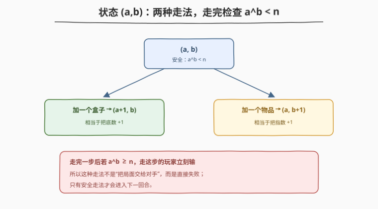
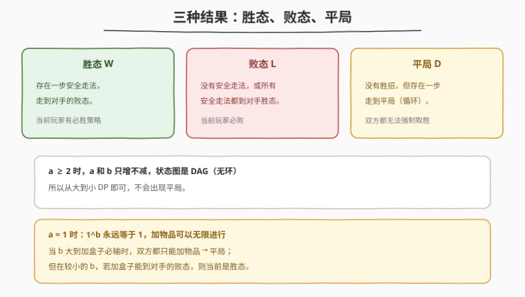

# Codeforces 39E 狄利克雷博弈 题解

## 1. 题目概述

- **题目链接**：https://codeforces.com/problemset/problem/39/E
- **比赛来源**：Codeforces Beta Round 39 · Problem E
- **难度**：2000
- **标签**：动态规划、博弈（dp, games）
- **评测类型**：普通
- **限制**：时间 2 s / 内存 64 MB

**题意**：有 $a$ 个不同的盒子和 $b$ 个不同的物品。每回合，当前玩家可以把盒子数加 $1$，或把物品数加 $1$。每走完一步，如果“把 $b$ 个不同物品放进 $a$ 个不同盒子（允许空盒）”的方案数不少于 $n$，则**走这一步的玩家输**。

Stas 先手，双方最优。问：

- 若 Masha 赢（即 Stas 输），输出 `Stas`；
- 若 Stas 赢，输出 `Masha`；
- 若平局，输出 `Missing`。

**约束**：

- $1 \le a \le 10000$，$1 \le b \le 30$，$2 \le n \le 10^9$。
- 初始方案数 $a^b < n$，即初始局面是安全的。
- 方案数公式：每个物品有 $a$ 种盒子选择，共 $a^b$。
- 只有一组数据。

## 2. 示例与观察

官方样例 1（输入 / 输出原样）：

```text
输入：
2 2 10

输出：
Masha
```

**样例 1 解释**：初始 $2^2=4<10$。Stas 无论加盒子还是加物品：

- 加盒子到 $3$：$3^2=9<10$，安全；但接下来 Masha 再加盒子到 $4$：$4^2=16\ge10$ 输；加物品到 $(3,3)$：$27\ge10$ 也输。所以 $(3,2)$ 对 Masha 是必败；
- Stas 走到 $(3,2)$ 后 Masha 必败，故 Stas 赢，输出 `Masha`（Masha 输）。

官方样例 2（输入 / 输出原样）：

```text
输入：
5 5 16808

输出：
Masha
```

**样例 2 解释**：按本文 DP，$(5,5)$ 是胜态，先手 Stas 有必胜策略，输出 `Masha`。

官方样例 3（输入 / 输出原样）：

```text
输入：
3 1 4

输出：
Stas
```

**样例 3 解释**：初始 $3^1=3<4$。Stas 加盒子到 $4$：$4^1=4\ge4$，立刻输；加物品到 $(3,2)$：$9\ge4$，也立刻输。Stas 没有安全走法，必败，输出 `Stas`。

官方样例 4（输入 / 输出原样）：

```text
输入：
1 4 10

输出：
Missing
```

**样例 4 解释**：$a=1$ 时 $1^b=1<10$ 永远成立。加盒子到 $2$ 时，$2^4=16\ge10$，会立刻输；于是双方都只能不断加物品，$b$ 无限增大，永远不输，平局，输出 `Missing`。

自造样例（标注“自造”）：

| 输入 | 输出 | 说明 |
|------|------|------|
| `1 1 2` | Missing | 加盒子立刻输，只能无限加物品 |
| `2 1 3` | Stas | 加盒子/加物品都立刻输 |
| `2 1 4` | Masha | 先加盒子到 3 安全，对手无路可走 |
| `2 2 10` | Masha | 样例 1 |

**观察**：

- 方案数是 $a^b$，安全条件为 $a^b<n$；
- 加盒子使底数 $+1$，加物品使指数 $+1$；
- 若 $a \ge 2$，$a$ 和 $b$ 都只增不减，局面图是 **DAG**，不会有平局；
- 若 $a=1$，$1^b$ 恒为 $1$，加物品永远不会触发失败，可能无限进行，产生平局。

## 3. 解题思路

### 3.1 局面与走法



把安全局面记为 $(a,b)$，满足 $a^b<n$。当前玩家有两种选择：

- 加盒子：$(a+1,b)$；
- 加物品：$(a,b+1)$。

若目标局面不安全（$a^b\ge n$），走这一步的玩家**立即输**。因此：

- 不安全的走法不是“交给对手”，而是直接失败；
- 在博弈分析中，可以把它视为“不可选”；如果没有任何安全走法，当前玩家必败。

### 3.2 三种结果



对安全局面定义：

- **W（胜态）**：存在一个安全走法，走到对手的 L 态；
- **L（败态）**：没有安全走法，或所有安全走法都走到对手的 W 态；
- **D（平局）**：没有走到 L 的走法，但存在走到 D 的走法。

递归：

```text
若存在安全后继是 L -> W
否则若存在安全后继是 D -> D
否则 -> L
```

（没有安全后继时，两个“存在”都为假，结果为 L。）

### 3.3 $a \ge 2, b \ge 2$：有限 DAG

若 $a \ge 2$，$a^b<n$ 给出上界：

- $b \le \lfloor\log_2(n-1)\rfloor \le 29$；
- $a \le \lfloor\sqrt{n-1}\rfloor \le 31622$。

并且 $a,b$ 只增不减，所以状态图无环。按 $a$ 从大到小、$b$ 从大到小 DP：

```text
for a = maxA down to 2:
    for b = maxB down to 2:
        if a^b >= n: continue
        outcome = combine(后继 (a+1,b), 后继 (a,b+1))
```

- 加盒子后 $(a+1,b)$ 的 $a$ 更大，已算过；
- 加物品后 $(a,b+1)$ 的 $b$ 更大，已算过。

### 3.4 $b=1, a\ge2$：一维链

当 $b=1$ 时，$a^1=a$。若 $a^2<n$，可以加物品跳到 $(a,2)$；否则加物品直接输。加盒子则沿 $(a+1,1)$ 走。

- 对 $a > \lfloor\sqrt{n-1}\rfloor$，加物品必输，只能加盒子；
- 从 $a=n-1$ 开始，$(n-1,1)$ 只能加盒子到 $n$（输），所以是 L；
- $(n-2,1)$ 走到 L，是 W；
- 依次交替：$(a,1)$ 是 L 当且仅当 $n-1-a$ 为偶数。

对 $a \le \lfloor\sqrt{n-1}\rfloor$，从大到小递推：

```text
one[a] = combine(one[a+1], dp[a][2])
```

其中 `dp[a][2]` 是前面算好的二维状态。

### 3.5 $a=1$：无限链与平局

$a=1$ 时 $1^b=1<n$ 恒成立，加物品永远安全；加盒子到 $(2,b)$ 是否安全取决于 $2^b<n$。

- 若 $b>\lfloor\log_2(n-1)\rfloor$，加盒子必输，只能加物品，$b$ 可以无限增大 → **D**；
- 从 $b=\lfloor\log_2(n-1)\rfloor$ 向下递推：

```text
g[maxB+1] = D
for b = maxB down to 1:
    g[b] = combine(
        若 2^b < n 则 outcome(2,b) 否则“无”,
        g[b+1]
    )
```

注意 `g[b]` 可能是 W、L 或 D。虽然有一条无限链，但如果加物品会把局面交给对手的 W 态，而加盒子也没有胜招，当前仍可能是 L。

### 3.6 输出

- 若初始局面是 W：先手 Stas 有必胜策略 → Masha 输 → 输出 `Masha`；
- 若初始局面是 L：先手 Stas 必败 → 输出 `Stas`；
- 若初始局面是 D：输出 `Missing`。

## 4. 正确性证明

**引理 1（安全走法模型）**：把导致 $a^b\ge n$ 的走法删去，并在没有安全走法时判当前玩家负，与原游戏等价。

**证明**：原规则中，走到不安全局面的玩家立即输；因此理性玩家只有在没有安全走法时才会走这种步，而这时无论如何都输。删去这些步并把“无安全走法”判负，不改变任何局面的胜负。∎

**引理 2（$a\ge2$ 无环）**：$a\ge2$ 时，安全局面图是 DAG。

**证明**：每步要么 $a$ 加 $1$，要么 $b$ 加 $1$，两者都不减且至少一个严格增；不可能回到之前的局面。∎

**引理 3（DP 转移正确）**：3.2 的 W/L/D 递归与最优博弈语义一致。

**证明**：

- 有后继 L：走到该后继，对手必败，当前胜；
- 无后继 L 但有后继 D：走到 D，至少不输；对手也不能强制胜，否则该后继应为 L/W 而非 D；
- 其余情况所有后继都是 W（或没有后继）：无论怎么走，对手都胜，当前败。∎

**引理 4（$b=1$ 的交替）**：对 $a>\lfloor\sqrt{n-1}\rfloor$，$(a,1)$ 的胜负由 $n-1-a$ 的奇偶决定：偶数 L，奇数 W。

**证明**：此范围内加物品必输，只有加盒子这一条安全链，终点 $(n-1,1)$ 无安全走法为 L；每往前一步取反，故得奇偶结论。∎

**引理 5（$a=1$ 的尾部）**：$b>\lfloor\log_2(n-1)\rfloor$ 时 $(1,b)$ 为 D。

**证明**：此时 $2^b\ge n$，加盒子立即输；加物品到 $(1,b+1)$ 仍安全，且可以无限重复。双方都能永远避免失败，无法强制取胜，故为 D。∎

**定理**：算法输出的名字正确。

**证明**：由引理 1–3，二维 DP 与一维链的递推正确计算所有安全局面的 W/L/D；由引理 4、5，$b=1$ 与 $a=1$ 的特殊链也正确。最后按“W→Masha、L→Stas、D→Missing”映射，正是题目要求。∎

## 5. 复杂度分析

- **时间**：二维状态约 $\sqrt n \log n \le 31622 \times 30 \approx 9.5\times10^5$，加上 $b=1$ 的 $O(\sqrt n)$ 与 $a=1$ 的 $O(\log n)$，总计约 $10^6$ 次状态转移。
- **空间**：二维 `dp` 约 $31624 \times 31$ 个 `int`，约 $4$ MB；加上一维数组，远低于 64 MB。
- **数值范围**：$a^b$ 可能超过 `int`，但只需与 $n\le10^9$ 比较，用“乘之前判断 `cur > (n-1)/a`”避免溢出。
- **与时限的关系**：最大 $n=10^9$ 时，C++ 端到端约 $5 \sim 6$ ms；Python3 约 $0.4$ s（含进程启动），远低于 2 s。

## 6. 参考代码

### C++17

```cpp
#include <bits/stdc++.h>
using namespace std;

const int WIN = 1, DRAW = 0, LOSE = -1;

static bool pow_ge(long long a, long long b, long long n) {
    if (b == 0) return 1 >= n;
    long long cur = 1;
    for (long long i = 0; i < b; ++i) {
        if (cur > (n - 1) / a) return true;
        cur *= a;
    }
    return cur >= n;
}

static int combine(bool hasLose, bool hasDraw) {
    if (hasLose) return WIN;
    if (hasDraw) return DRAW;
    return LOSE;
}

int main() {
    ios::sync_with_stdio(false);
    cin.tie(nullptr);

    long long a0, b0, n;
    cin >> a0 >> b0 >> n;

    // b >= 2 时，安全状态满足 a^2 < n。
    long long maxA = sqrt((long double)(n - 1));
    while ((maxA + 1) * (maxA + 1) < n) ++maxA;
    while (maxA * maxA >= n) --maxA;

    // a >= 2 时，安全状态满足 2^b < n。
    int maxB = 0;
    long long p = 1;
    while (p <= (n - 1) / 2) {
        p *= 2;
        ++maxB;
    }
    maxB = max(maxB, 0);

    int A = (int)maxA + 2;
    int B = maxB + 2;
    vector<vector<int>> dp(A, vector<int>(B, -2));

    // 处理 a>=2, b>=2
    for (long long a = maxA; a >= 2; --a) {
        for (int b = maxB; b >= 2; --b) {
            if (pow_ge(a, b, n)) continue;
            bool hasLose = false, hasDraw = false;

            if (a + 1 < A && !pow_ge(a + 1, b, n)) {
                int v = dp[a + 1][b];
                if (v == LOSE) hasLose = true;
                else if (v == DRAW) hasDraw = true;
            }
            if (b + 1 < B && !pow_ge(a, b + 1, n)) {
                int v = dp[a][b + 1];
                if (v == LOSE) hasLose = true;
                else if (v == DRAW) hasDraw = true;
            }
            dp[a][b] = combine(hasLose, hasDraw);
        }
    }

    // b == 1 且 a >= 2
    vector<int> one((size_t)maxA + 2, LOSE);
    if (maxA >= 2) {
        long long start = maxA + 1;
        int nxt = (((n - 1 - start) % 2 == 0) ? LOSE : WIN);
        for (long long a = maxA; a >= 2; --a) {
            bool hasLose = false, hasDraw = false;
            if (nxt == LOSE) hasLose = true;
            else if (nxt == DRAW) hasDraw = true;
            if (!pow_ge(a, 2, n)) {
                int v = dp[a][2];
                if (v == LOSE) hasLose = true;
                else if (v == DRAW) hasDraw = true;
            }
            one[a] = combine(hasLose, hasDraw);
            nxt = one[a];
        }
    }

    // a == 1
    vector<int> g(maxB + 3, DRAW);
    for (int b = maxB; b >= 1; --b) {
        bool hasLose = false, hasDraw = false;
        if (!pow_ge(2, b, n)) {
            int v;
            if (b == 1) {
                if (2 <= maxA) v = one[2];
                else v = (((n - 1 - 2) % 2 == 0) ? LOSE : WIN);
            } else {
                v = dp[2][b];
            }
            if (v == LOSE) hasLose = true;
            else if (v == DRAW) hasDraw = true;
        }
        int v = g[b + 1];
        if (v == LOSE) hasLose = true;
        else if (v == DRAW) hasDraw = true;
        g[b] = combine(hasLose, hasDraw);
    }

    int result;
    if (a0 == 1) {
        int bb = (int)b0;
        if (bb >= (int)g.size()) result = DRAW;
        else result = g[bb];
    } else if (b0 == 1) {
        if (a0 <= maxA) result = one[(size_t)a0];
        else result = (((n - 1 - a0) % 2 == 0) ? LOSE : WIN);
    } else {
        result = dp[(size_t)a0][(size_t)b0];
    }

    if (result == WIN) cout << "Masha\n";       // Stas 胜，Masha 输
    else if (result == LOSE) cout << "Stas\n";  // Stas 输
    else cout << "Missing\n";
    return 0;
}
```

### Python3

```python
import sys

WIN, DRAW, LOSE = 1, 0, -1


def pow_ge(a: int, b: int, n: int) -> bool:
    cur = 1
    for _ in range(b):
        if cur > (n - 1) // a:
            return True
        cur *= a
    return cur >= n


def combine(has_lose: bool, has_draw: bool) -> int:
    if has_lose:
        return WIN
    if has_draw:
        return DRAW
    return LOSE


def main() -> None:
    a0, b0, n = map(int, sys.stdin.buffer.read().split())

    max_a = int((n - 1) ** 0.5)
    while (max_a + 1) * (max_a + 1) < n:
        max_a += 1
    while max_a * max_a >= n:
        max_a -= 1

    max_b = 0
    p = 1
    while p <= (n - 1) // 2:
        p *= 2
        max_b += 1

    A = max_a + 2
    B = max_b + 2
    dp = [[-2] * B for _ in range(A)]

    for a in range(max_a, 1, -1):
        for b in range(max_b, 1, -1):
            if pow_ge(a, b, n):
                continue
            has_lose = has_draw = False
            if a + 1 < A and not pow_ge(a + 1, b, n):
                v = dp[a + 1][b]
                if v == LOSE: has_lose = True
                elif v == DRAW: has_draw = True
            if b + 1 < B and not pow_ge(a, b + 1, n):
                v = dp[a][b + 1]
                if v == LOSE: has_lose = True
                elif v == DRAW: has_draw = True
            dp[a][b] = combine(has_lose, has_draw)

    one = [LOSE] * (max_a + 2)
    if max_a >= 2:
        start = max_a + 1
        nxt = LOSE if (n - 1 - start) % 2 == 0 else WIN
        for a in range(max_a, 1, -1):
            has_lose = has_draw = False
            if nxt == LOSE: has_lose = True
            elif nxt == DRAW: has_draw = True
            if not pow_ge(a, 2, n):
                v = dp[a][2]
                if v == LOSE: has_lose = True
                elif v == DRAW: has_draw = True
            one[a] = combine(has_lose, has_draw)
            nxt = one[a]

    g = [DRAW] * (max_b + 3)
    for b in range(max_b, 0, -1):
        has_lose = has_draw = False
        if not pow_ge(2, b, n):
            if b == 1:
                if max_a >= 2:
                    v = one[2]
                else:
                    v = LOSE if (n - 1 - 2) % 2 == 0 else WIN
            else:
                v = dp[2][b]
            if v == LOSE: has_lose = True
            elif v == DRAW: has_draw = True
        v = g[b + 1]
        if v == LOSE: has_lose = True
        elif v == DRAW: has_draw = True
        g[b] = combine(has_lose, has_draw)

    if a0 == 1:
        result = g[b0] if b0 < len(g) else DRAW
    elif b0 == 1:
        if a0 <= max_a:
            result = one[a0]
        else:
            result = LOSE if (n - 1 - a0) % 2 == 0 else WIN
    else:
        result = dp[a0][b0]

    if result == WIN:
        print("Masha")
    elif result == LOSE:
        print("Stas")
    else:
        print("Missing")


main()
```

## 7. 边界情况与易错点

1. **初始局面一定安全**：题面保证 $a^b<n$；代码不需要处理初始就不安全的情况。
2. **“走完才输”**：失败发生在移动之后；因此目标为不安全局面的走法要视为直接失败，而不是把不安全状态交给对手。
3. **$a=1$ 的无限链**：不能简单判胜或败；必须把 $b>\max B$ 的尾部标为平局，再向前递推。
4. **$b=1$ 的奇偶**：$a>\sqrt{n-1}$ 时只有加盒子一条路，别忘记 $a=n-1$ 是败态，奇偶从它开始算。
5. **$n$ 很小**：如 $n=2$，`maxA=1`、`maxB=0`；二维 DP 为空，需走特殊分支，不能数组越界。
6. **$a_0$ 很大**：可能超过 `maxA`；$b=1$ 时用奇偶公式，$b\ge2$ 时初始安全保证 $a_0\le\max A$。
7. **$a^b$ 溢出**：不要直接算幂再比较；用 `cur > (n-1)/a` 在乘之前判断。
8. **平局判定**：只有 $a=1$ 的长链会产生平局；$a\ge2$ 的 DAG 没有平局。
9. **输出名字**：输出的是**输家**的名字。先手 Stas 胜时输出 `Masha`，反之 `Stas`。
10. **`maxB` 的定义**：是最大的 $b$ 使 $2^b<n$；不要写成 $2^b\le n$。
11. **`maxA` 的定义**：是最大的 $a$ 使 $a^2<n$；用整数平方根并修正边界。

## 8. 验证记录

- **编译环境与命令**：本机没有 GNU `g++`（`/usr/bin/g++` 是 Apple clang 21.0.0 的软链），用 `clang++ -std=c++17 -O2 -Wall -Wextra -I codeforces/tools/include` 配合仓库自带的 `bits/stdc++.h` 兼容头编译，**零警告**；Python 侧为 `Python 3.9.6`。
- **官方样例**：4 / 4 通过（`Masha`、`Masha`、`Stas`、`Missing`）。`verify_solution.py` 输出 `CF39E: samples 4`、`C++ 编译 OK, 样例 4/4`、`Python 语法 OK, 样例 4/4`。
- **独立暴力对拍**：另写一个显式建图的 Retrograde 分析器：对 $n \le 300$ 枚举安全状态 $(a,b)$，把加盒子/加物品的安全后继建边，用“出度为 0 → L，后继有 L → W，所有后继 W → L，剩余 → D”的队列算法求 W/L/D。共 **300 组随机安全输入**（$n \le 300$，$a \le 7$，$b \le 6$），C++、Python 与 Retrograde **全部一致，0 处不符**。另对 $n \le 200$ 的 $a=1$、$b=1$ 等边界做了定向比对。
- **最大约束性能**：$n=10^9$ 时，C++ 端到端约 $5 \sim 6$ ms；Python3 约 $0.4$ s（含进程启动），远低于 2 s。
- **图片校验**：两张 SVG（`cf39e_moves.svg`、`cf39e_outcomes.svg`）均通过 `xml.etree.ElementTree.parse`；文本包围盒均在 `viewBox` 内且两两不重叠。
- **公式校验**：正文公式经 `node codeforces/tools/katex_check.cjs` 的 KaTeX（`throwOnError`）校验，0 处报错；证明结尾用 `∎`。
- **样例逐字核对**：`python3 codeforces/tools/check_samples.py --only 0001-0100/39` 对本文的四组官方样例报告一致。
- **复核状态**：verified（官方样例、300 组 Retrograde 暴力、最大约束性能、图片几何、公式、样例逐字六项均实跑通过；唯一环境差异是本机无 GNU g++，已用 clang++ 等价验证）。

## 相关题目与扩展

- [Codeforces 39A 表达式项的最大值](https://codeforces.com/problemset/problem/39/A)：同场 A 题，表达式 + 贪心。
- [Codeforces 39B Company Income Growth](https://codeforces.com/problemset/problem/39/B)：同场 B 题，贪心链。
- [Codeforces 39C Moon Craters](https://codeforces.com/problemset/problem/39/C)：同场 C 题，区间 DP。
- [LeetCode 292. Nim 游戏](https://leetcode.cn/problems/nim-game/)：简单博弈的胜负态递推。
- [LeetCode 913. 猫和老鼠](https://leetcode.cn/problems/cat-and-mouse/)：带平局的博弈图，和本题一样需要 W/L/D 三态分析。

**延伸思考**：

1. **如果每步可以加任意多个盒子/物品**：状态转移变成多后继，仍可 DP，但复杂度上升。
2. **如果失败条件是“严格大于 $n$”**：阈值改成 $a^b>n$，边界会变化。
3. **如果 $a,b$ 可以减小**：状态图出现环，平局更多，需要一般的博弈图三态算法（类似 LeetCode 913）。
4. **如果要求输出最优第一步**：在 DP 中记录一个走向 L 的后继即可。
5. **如果 $n$ 放大到 $10^{18}$**：`maxA` 约 $10^9$，不能枚举所有 $a$；需要利用 $b$ 很小、只枚举 $a$ 的区间或数学分段。

