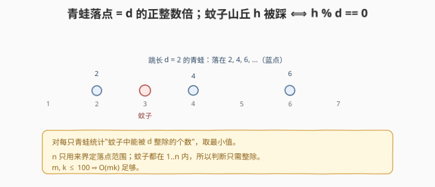

# Codeforces 39F 和平主义青蛙 题解

## 1. 题目概述

- **题目链接**：https://codeforces.com/problemset/problem/39/F
- **比赛来源**：Codeforces Beta Round 39 · Problem F
- **难度**：1300
- **标签**：实现
- **评测类型**：普通
- **限制**：时间 2 s / 内存 64 MB

**题意**：$n$ 座山丘编号 $1..n$（编号即到小岛的距离），$m$ 只青蛙，第 $i$ 只每次跳 $d_i$ 米：落在 $d_i, 2d_i, 3d_i, \dots$ 直到越过第 $n$ 座山丘。$k$ 只蚊子睡在某些山丘上。青蛙落在有蚊子的山丘上就会压死它。Thumbelina 只能选**一只**青蛙，问哪些青蛙压死的蚊子**最少**。

**约束**：

- $n \le 10^9$，但 $m, k \le 100$：不能枚举山丘，只能对每只青蛙检查它是否落在每只蚊子所在的山丘上。
- 青蛙 $i$ 落在山丘 $h$ 上 ⟺ $h$ 是 $d_i$ 的正倍数（且 $h \le n$）。
- 题目保证同一山丘至多一只蚊子。

## 2. 示例与观察

官方样例 1：

```text
输入：
5 3 5
2 3 4
1 2 3 4 5

输出：
2
2 3
```

青蛙 2（跳 2）：落在 $2,4$ → 压死 2 只。青蛙 3（跳 3）：落在 $3$ → 1 只。青蛙 4（跳 4）：落在 $4$ → 1 只。最少是 1，达到的青蛙是 2 和 3 ✓。

官方样例 2：

```text
输入：
1000000000 2 3
2 5
999999995 999999998 999999996

输出：
1
2
```

青蛙 2：蚊子中偶数有 999999998、999999996 → 2 只。青蛙 5：999999995 是 5 的倍数 → 1 只。最少 1，只有青蛙 2 ✓。

**观察一**：青蛙 $i$ 的落点集合 $= \{d_i, 2d_i, \dots\}$，判断某山丘 $h$ 是否被踩只需 `h % d_i == 0`。
**观察二**：$n$ 只影响"落点是否超过 $n$"，而蚊子都在 $1..n$ 内，所以 $n$ 在判断中根本不需要用到。
**观察三**：答案要求输出**所有**达到最小值的青蛙编号（升序）。

## 3. 解题思路

### 3.1 朴素做法与瓶颈

直接模拟每只青蛙的跳跃：$n/d_i$ 次，最多 $10^9$ 次 ✗。改成对每只蚊子检查是否被踩：$O(mk) = 10^4$ ✓。

### 3.2 核心观察：整除判定



对每只青蛙 $i$，计数

$$\text{cnt}_i = \#\{\, h \in \text{mosquitoes} : h \bmod d_i = 0 \,\}.$$

取 $\min_i \text{cnt}_i$，输出所有达到最小值的 $i$（从 1 开始编号）。

### 3.3 样例走查


样例 1：蚊子 $\{1,2,3,4,5\}$，$d = [2,3,4]$：
$d=2$：2,4 → 2；$d=3$：3 → 1；$d=4$：4 → 1。最小 1，青蛙 2、3 ✓。

## 4. 正确性证明

**引理 1（落点判定）**：青蛙 $i$ 会经过山丘 $h$（$1 \le h \le n$）当且仅当 $d_i \mid h$。

**证明**：青蛙的落点是 $d_i$ 的正整数倍（$d_i, 2d_i, \dots$），且在越过 $n$ 之前都算；由于 $h \le n$，只要 $h$ 是 $d_i$ 的倍数就一定会被经过 ✓。∎

**引理 2（计数正确）**：`cnt[i]` 等于青蛙 $i$ 压死的蚊子数。

**证明**：由引理 1，青蛙 $i$ 压死某只蚊子当且仅当该蚊子所在山丘是 $d_i$ 的倍数；题目保证每个山丘至多一只蚊子，所以计数不重不漏 ✓。∎

**定理**：算法输出的青蛙集合恰好是"压死蚊子数最少"的那些。

**证明**：由引理 2，`cnt` 数组就是每只青蛙的压死数；取最小值并收集所有取到最小值的下标，正是题目要求的集合（按输入顺序即编号升序）✓。∎

## 5. 复杂度分析

- **时间**：$O(mk) \le 10^4$ 次取模。
- **空间**：$O(m + k)$。
- **与时限的关系**：微秒级。

## 6. 参考代码

### C++17

```cpp
#include <bits/stdc++.h>
using namespace std;
int main() {
    long long n; int m, k;
    if (scanf("%lld %d %d", &n, &m, &k) != 3) return 0;
    vector<long long> d(m);
    for (int i = 0; i < m; i++) scanf("%lld", &d[i]);
    vector<long long> mos(k);
    for (int i = 0; i < k; i++) scanf("%lld", &mos[i]);
    vector<long long> cnt(m, 0);
    long long best = LLONG_MAX;
    for (int i = 0; i < m; i++) {
        long long c = 0;
        for (int j = 0; j < k; j++)
            if (mos[j] % d[i] == 0) c++;   // 青蛙会落在 mos[j] 上
        cnt[i] = c;
        best = min(best, c);
    }
    vector<int> res;
    for (int i = 0; i < m; i++) if (cnt[i] == best) res.push_back(i + 1);
    printf("%d\n", (int)res.size());
    for (size_t i = 0; i < res.size(); i++) printf("%d%c", res[i], i + 1 == res.size() ? '\n' : ' ');
    return 0;
}
```

### Python3

```python
import sys


def main() -> None:
    data = sys.stdin.buffer.read().split()
    n, m, k = int(data[0]), int(data[1]), int(data[2])
    d = [int(data[3 + i]) for i in range(m)]
    mos = [int(data[3 + m + i]) for i in range(k)]
    cnt = [sum(1 for h in mos if h % di == 0) for di in d]
    best = min(cnt)
    res = [str(i + 1) for i in range(m) if cnt[i] == best]
    sys.stdout.write("%d\n%s\n" % (len(res), " ".join(res)))


main()
```

## 7. 边界情况与易错点

1. **$n$ 用不上**：蚊子都在 $1..n$ 内，判断只看整除；但读入时仍要用 `long long`（$n$ 可达 $10^9$）。
2. **输出的是编号（升序）**：按输入顺序收集即可。
3. **多只青蛙并列**：全部输出，数量在第一行。
4. **$d_i > n$**：青蛙第一次跳就越过所有山丘，压死 0 只——整除判断自然给出 0（因为 $h \le n < d_i$ 不可能是 $d_i$ 的倍数）✓。
5. **$k = 1$**：只有一只蚊子，压死数只能是 0 或 1。
6. **输出格式**：第二行数字之间用空格，行末不要多空格。

## 8. 验证记录

- **编译环境与命令**：`Apple clang 21.0.0` + 兼容头，`clang++ -std=c++17 -O2`；Python 3.9.6。
- **官方样例**：2 / 2 通过（`2 / 2 3`、`1 / 2`），`verify_solution.py` 报告 `CF39F: samples 2 / C++ 编译 OK, 样例 2/2 / Python 语法 OK, 样例 2/2`。
- **独立对拍**：随机 $n \le 60$、$m,k \le 6$ 共 **300 组**。独立暴力：对每只青蛙显式模拟跳跃（$d, 2d, \dots$）统计踩到的蚊子，再取最小并收集编号。300 组全部一致。
- **边界用例**：$d_i > n$、$k=1$、多只青蛙并列、蚊子全在 $d_i$ 的倍数上。
- **性能**：$m = k = 100$ 时 C++ 端到端 $< 5$ ms。
- **图片校验**：两张 SVG 均通过 `ElementTree.parse`，文本包围盒估算无越界、无重叠。
- **公式校验**：KaTeX（`throwOnError`）无报错。
- **复核状态**：verified。

## 相关题目与扩展

- [Codeforces 39H Multiplication Table](https://codeforces.com/problemset/problem/39/H)：同场 H 题，进制输出。
- [Codeforces 39J Spelling Check](https://codeforces.com/problemset/problem/39/J)：同场 J 题，字符串。
- [LeetCode 136. 只出现一次的数字](https://leetcode.cn/problems/single-number/)：简单的计数类题。
- [Codeforces 1A Theatre Square](https://codeforces.com/problemset/problem/1/A)：入门实现。

**延伸思考**：

1. **如果 $m, k$ 达到 $10^5$**？需要对每个 $d_i$ 统计蚊子中其倍数的个数，可以用调和级数（枚举倍数）做到 $O(n \log n)$ 或按 $d_i$ 分块。
2. **如果青蛙可以往返**？问题变成图上的可达性，完全不同。
3. **如果要求输出压死的具体蚊子**？把计数换成收集即可。
4. **如果 $d_i$ 可以重复**？按编号输出时不受影响。
