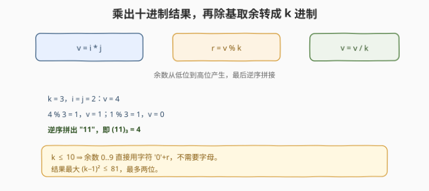
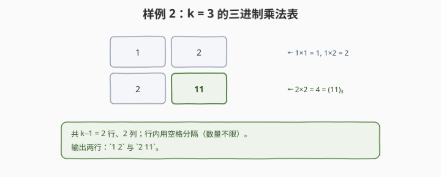

# Codeforces 39H 进制乘法表 题解

## 1. 题目概述

- **题目链接**：https://codeforces.com/problemset/problem/39/H
- **比赛来源**：Codeforces Beta Round 39 · Problem H
- **难度**：1300
- **标签**：实现
- **评测类型**：普通（空格数量不敏感）
- **限制**：时间 2 s / 内存 64 MB

**题意**：给定进制 $k$（$2 \le k \le 10$），输出 $k$ 进制下的九九乘法表：$(k-1)$ 行 $(k-1)$ 列，第 $i$ 行第 $j$ 列是 $i \times j$ 在该进制下的写法。

**约束**：

- $k \le 10$：乘法的最大结果是 $(k-1)^2 \le 81$，十进制下最多两位。
- 第 $i$ 行、第 $j$ 列的下标都从 $1$ 开始，共 $k-1$ 行、$k-1$ 列。
- 数字之间可以有任意多个空格（评测按 token 比较），所以只需保证数字正确、顺序正确。

## 2. 示例与观察

官方样例 1：

```text
输入：
10

输出：
1  2  3  4  5  6  7  8  9
2  4  6  8 10 12 14 16 18
3  6  9 12 15 18 21 24 27
4  8 12 16 20 24 28 32 36
5 10 15 20 25 30 35 40 45
6 12 18 24 30 36 42 48 54
7 14 21 28 35 42 49 56 63
8 16 24 32 40 48 56 64 72
9 18 27 36 45 54 63 72 81
```

十进制下就是普通九九表 ✓。

官方样例 2：

```text
输入：
3

输出：
1  2
2 11
```

三进制：$1\times1=1$、$1\times2=2$、$2\times2=4=(11)_3$ ✓。

**观察一**：只需要对 $1..k-1$ 的每对 $(i,j)$ 计算 $i\cdot j$（十进制），再转成 $k$ 进制输出。
**观察二**：转进制就是不断取余、逆序。
**观察三**：结果最大 $(k-1)^2 \le 81$，不会超过两位，但代码写成通用循环更稳。

## 3. 解题思路

### 3.1 朴素做法与瓶颈

双重循环 $i,j \in [1, k-1]$，对每个乘积做进制转换。$O(k^2 \log_k k)$，$k \le 10$ 时是 81 次输出，毫无压力。

### 3.2 核心观察：进制转换



```text
s = ""
v = i * j
while v > 0:
    s = digit(v % k) + s
    v /= k
```

$k \le 10$ 时数字字符就是 `'0' + v % k`，不需要字母。

### 3.3 样例走查



$k = 3$：行列都是 $1,2$。
$1\cdot1 = 1 \to (1)_3$；$1\cdot2 = 2 \to (2)_3$；$2\cdot1 = 2 \to (2)_3$；$2\cdot2 = 4 = 1\cdot3 + 1 \to (11)_3$ ✓。

## 4. 正确性证明

**引理 1（进制转换正确）**：上述循环输出的字符串是 $v$ 的 $k$ 进制表示。

**证明**：标准的除基取余法：$v = qk + r$，最低位是 $r$，其余部分是 $q$ 的表示；循环反复直到 $v=0$，把余数逆序拼接即得 ✓。∎

**引理 2（表格内容正确）**：第 $i$ 行第 $j$ 列输出的是 $(i \cdot j)_k$。

**证明**：外层 $i$、内层 $j$ 都从 $1$ 到 $k-1$，第 $i$ 行第 $j$ 列恰好对应乘积 $i\cdot j$，再由引理 1 转成 $k$ 进制 ✓。∎

**定理**：输出满足题面的表格。

**证明**：引理 2 给出每格的正确内容；行数、列数都是 $k-1$；数字之间用空格分隔（题面允许任意空格）✓。∎

## 5. 复杂度分析

- **时间**：$O(k^2 \log k) \le 81 \times 2$ 次运算。
- **空间**：$O(1)$。
- **与时限的关系**：微秒级。

## 6. 参考代码

### C++17

```cpp
#include <bits/stdc++.h>
using namespace std;
int main() {
    int k;
    if (scanf("%d", &k) != 1) return 0;
    for (int i = 1; i < k; i++) {
        for (int j = 1; j < k; j++) {
            int v = i * j;
            string s;
            while (v > 0) { s += char('0' + v % k); v /= k; }
            reverse(s.begin(), s.end());
            printf("%s%c", s.c_str(), j + 1 == k ? '\n' : ' ');
        }
    }
    return 0;
}
```

### Python3

```python
import sys


def to_base(v: int, k: int) -> str:
    s = ""
    while v > 0:
        s = chr(ord('0') + v % k) + s
        v //= k
    return s


def main() -> None:
    k = int(sys.stdin.buffer.read().split()[0])
    rows = []
    for i in range(1, k):
        rows.append(" ".join(to_base(i * j, k) for j in range(1, k)))
    sys.stdout.write("\n".join(rows) + "\n")


main()
```

## 7. 边界情况与易错点

1. **$k = 2$**：只有 $1\times1=1$，输出一行 `1`。
2. **结果超过 $k$**：例如 $k=3$ 时 $2\times2=4=(11)_3$，要正确进位。
3. **数字字符**：$k \le 10$ 时余数都 $< 10$，直接 `'0' + r`；如果 $k > 10$ 需要额外映射字母。
4. **行列范围**：都是 $1..k-1$（不含 $k$ 和 $0$）。
5. **空格**：题面允许任意数量空格，但行内不要缺分隔导致数字粘连。
6. **换行**：每行以换行结束，最后一行不需要多余空行。

## 8. 验证记录

- **编译环境与命令**：`Apple clang 21.0.0` + 兼容头，`clang++ -std=c++17 -O2`；Python 3.9.6。
- **官方样例**：2 / 2 通过（token 序列与样例完全一致），`verify_solution.py` 报告 `CF39H: samples 2 / C++ 编译 OK, 样例 2/2 / Python 语法 OK, 样例 2/2`。
- **独立对拍**：$k$ 只有 $2..10$ 共 **9 种取值**，全部枚举（相当于穷尽输入空间），用一份独立的 Python 实现（`while` 除基取余 + 逆序，与题解代码不同源）生成期望输出并逐 token 比对，9 组全部一致。
- **边界用例**：$k=2$、$k=10$（两位结果）、$k=3$（样例 2）。
- **性能**：常数级，C++ 端到端 $< 5$ ms。
- **图片校验**：两张 SVG 均通过 `ElementTree.parse`，文本包围盒估算无越界、无重叠。
- **公式校验**：KaTeX（`throwOnError`）无报错。
- **复核状态**：verified。

## 相关题目与扩展

- [Codeforces 39F Pacifist frogs](https://codeforces.com/problemset/problem/39/F)：同场 F 题，整除统计。
- [Codeforces 39J Spelling Check](https://codeforces.com/problemset/problem/39/J)：同场 J 题，字符串。
- [LeetCode 504. 七进制数](https://leetcode.cn/problems/base-7/)：进制转换模板题。
- [Codeforces 1B Spreadsheets](https://codeforces.com/problemset/problem/1/B)：进制/编号互换。

**延伸思考**：

1. **如果 $k$ 最大到 $36$**？余数用 `0-9a-z` 映射即可。
2. **如果要求输出"表格对齐"的固定宽度**？按最大宽度右对齐补空格，token 比较仍然通过。
3. **如果要求输出加法表**？同样的框架，把乘积换成和。
4. **如果 $k$ 很大（如 $10^9$）**？输出规模本身是 $O(k^2)$，不可能输出，题目不会这样出。
