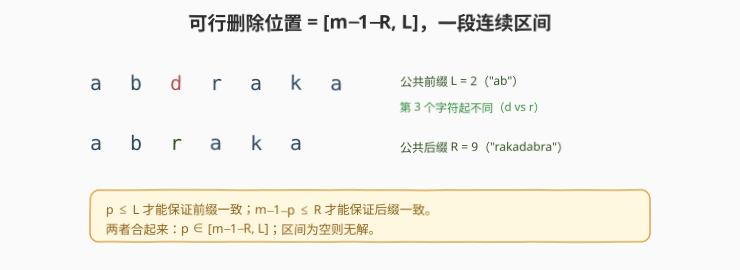
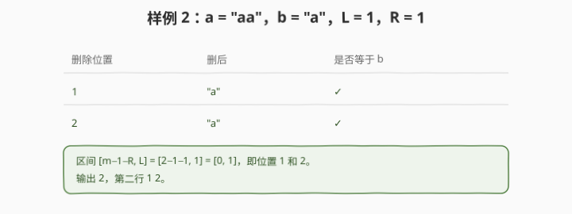

# Codeforces 39J 拼写检查 题解

## 1. 题目概述

- **题目链接**：https://codeforces.com/problemset/problem/39/J
- **比赛来源**：School Team Contest 1 (Winter Computer School 2010/11) · Problem J（UTC 2010-10-24）
- **难度**：1500
- **标签**：哈希、实现、字符串
- **评测类型**：普通
- **限制**：时间 2 s / 内存 256 MB

**题意**：给出两个小写字符串 $a$、$b$，其中 $|a| = |b| + 1$。问删掉 $a$ 的**一个**字符后能否得到 $b$；若能，输出所有可行的删除位置（$1$ 起、升序）的个数与位置；若不能，输出 `0`。

**约束**：

- 长度 $1 \sim 10^6$：不能对每个位置暴力比较（$O(n^2)$），需要 $O(n)$ 或 $O(n\log n)$。
- 位置按 1 起编号。
- 第一行输出个数；**只有个数非 0 时才输出第二行**（样例 3 只有一行 `0`）。

## 2. 示例与观察

官方样例 1：

```text
输入：
abdrakadabra
abrakadabra

输出：
1
3
```

删掉第 3 个字符 `d` 得到 `abrakadabra` ✓；其它位置都不行。

官方样例 2：

```text
输入：
aa
a

输出：
2
1 2
```

删第 1 个或第 2 个都得到 `a` ✓。

官方样例 3：

```text
输入：
competition
codeforces

输出：
0
```

长度虽然差 1，但删任何字符都得不到 ✓。

**观察一**：删除位置 $p$ 可行 ⟺ $a[0..p-1] = b[0..p-1]$ 且 $a[p+1..] = b[p..]$。
**观察二**：设 $L$ = $a$ 与 $b$ 的最长公共前缀长度，$R$ = 最长公共后缀长度，则条件等价于 $p \le L$ 且 $p \ge m-1-R$（$m = |a|$）。
**观察三**：可行位置构成一个**连续区间** $[m-1-R,\ L]$，所以答案个数是区间长度，不需要逐个验证。

## 3. 解题思路

### 3.1 朴素做法与瓶颈

对每个 $p$ 检查两边是否相等：$O(n)$ 个位置 × $O(n)$ 比较 = $O(n^2)$，$n = 10^6$ 时不可行。

### 3.2 核心观察：前缀/后缀长度夹出区间



1. 求 $L$：从 0 开始比较 $a[i]$ 与 $b[i]$，直到不相等或 $i = |b|$；
2. 求 $R$：从末尾比较 $a[m-1-k]$ 与 $b[n-1-k]$（$n = m-1$），直到不相等或 $k = n$；
3. 可行区间（0 起）：$[\max(0, m-1-R),\ \min(L, m-1)]$；
4. 若区间为空输出 `0`；否则输出长度与位置（+1）。

直观理解：删掉 $p$ 之后，$p$ 左边的部分必须与 $b$ 的前缀一致（要求 $p \le L$），$p$ 右边的部分必须与 $b$ 的对应后缀一致（要求 $p \ge m-1-R$）。

### 3.3 样例走查



样例 2：$a = $ `aa`，$b = $ `a`，$m=2$，$n=1$。
$L$：$a[0]=b[0]$ → $L=1$（到达 $|b|$ 停止）。$R$：$a[1]$ 与 $b[0]$ 都是 `a` → $R=1$。
区间 $[2-1-1,\ 1] = [0, 1]$ → 位置 $1,2$，输出 `2` 与 `1 2` ✓。

样例 1：$a$ = `abdrakadabra`（$m=12$），$b$ = `abrakadabra`（$n=11$）。
$L = 2$（`ab` 之后 `d` ≠ `r`）。$R = 9$（后缀 `rakadabra` 匹配）。
区间 $[12-1-9,\ 2] = [2, 2]$ → 只有位置 3 ✓。

样例 3：$L = 2$（`co` 之后不同），$R = 0$。区间 $[10, 2]$ 为空 → `0` ✓。

## 4. 正确性证明

**引理 1（前缀条件）**：删掉 $p$ 后 $a$ 与 $b$ 的前 $p$ 个字符相同 ⟺ $p \le L$。

**证明**：前 $p$ 个字符是 $a[0..p-1]$ 与 $b[0..p-1]$，它们的公共长度是 $\min(p, L)$；要完全相同需 $p \le L$ ✓。∎

**引理 2（后缀条件）**：删掉 $p$ 后 $a$ 的剩余后缀与 $b$ 的对应后缀相同 ⟺ $m-1-p \le R$。

**证明**：删除后需要 $a[p+1..m-1] = b[p..n-1]$，两边长度都是 $m-1-p$；由 $R$ 的定义（$a$ 末尾与 $b$ 末尾的最长公共长度），这等价于该长度不超过 $R$ ✓。∎

**定理 1（区间刻画）**：删除位置 $p$（0 起）可行 ⟺ $m-1-R \le p \le L$。

**证明**：由引理 1、2，两个条件同时成立即得 ✓。∎

**定理 2**：算法输出的位置集合与个数正确。

**证明**：由定理 1，可行位置恰为区间 $[\max(0,m-1-R),\ \min(L,m-1)]$ 内的所有整数；算法输出该区间的长度与所有元素（转成 1 起编号），故正确 ✓。∎

## 5. 复杂度分析

- **时间**：$O(n)$（两遍扫描）+ $O(\text{答案个数})$ 输出。
- **空间**：$O(n)$ 存字符串。
- **与时限的关系**：$n = 10^6$ 时 C++ 约 $0.01$ s，Python 约 $0.1$ s。

## 6. 参考代码

### C++17

```cpp
#include <bits/stdc++.h>
using namespace std;
int main() {
    string a, b;
    if (!(cin >> a)) return 0;
    cin >> b;
    int m = (int)a.size(), n = (int)b.size();   // m == n + 1
    int L = 0;
    while (L < n && a[L] == b[L]) L++;          // 公共前缀长度
    int R = 0;
    while (R < n && a[m - 1 - R] == b[n - 1 - R]) R++;   // 公共后缀长度
    int lo = m - 1 - R, hi = L;                 // 0-based 合法删除位置区间
    if (lo > hi) { printf("0\n"); return 0; }
    printf("%d\n", hi - lo + 1);
    for (int p = lo; p <= hi; p++) printf("%d%c", p + 1, p == hi ? '\n' : ' ');
    return 0;
}
```

### Python3

```python
import sys


def main() -> None:
    data = sys.stdin.buffer.read().split()
    a = data[0].decode()
    b = data[1].decode()
    m, n = len(a), len(b)
    L = 0
    while L < n and a[L] == b[L]:
        L += 1
    R = 0
    while R < n and a[m - 1 - R] == b[n - 1 - R]:
        R += 1
    lo, hi = m - 1 - R, L
    if lo > hi:
        sys.stdout.write("0\n")
        return
    sys.stdout.write("%d\n" % (hi - lo + 1))
    sys.stdout.write(" ".join(str(p + 1) for p in range(lo, hi + 1)) + "\n")


main()
```

## 7. 边界情况与易错点

1. **不可行时只输出一行 `0`**：不要多输出一个空行或第二行（样例 3）。
2. **多个可行位置**：它们是**连续**的一段，不要漏掉中间或重复。
3. **$|b| = 1$**：例如 `aa` / `a`，两个位置都可行（样例 2）。
4. **$a$ 与 $b$ 前 $|b|$ 个字符全相同**：$L = n$，可行位置可能包含 $p = m-1$（删最后一个字符）。
5. **下标换算**：区间是 0 起的，输出要 +1。
6. **读入方式**：字符串长度可达 $10^6$，用 `cin >> s` / `split()`，不要逐字符 `getchar`。
7. **不要用 `substr` 比较**：会退化成 $O(n^2)$。
8. **字符集**：只有小写字母，不需要考虑空格。

## 8. 验证记录

- **编译环境与命令**：`Apple clang 21.0.0` + 兼容头，`clang++ -std=c++17 -O2`；Python 3.9.6。
- **官方样例**：3 / 3 通过（`1 / 3`、`2 / 1 2`、`0`），`verify_solution.py` 报告 `CF39J: samples 3 / C++ 编译 OK, 样例 3/3 / Python 语法 OK, 样例 3/3`。
- **独立对拍**：随机小写串，$|b| \le 8$、$a$ 由 $b$ 随机插入一个字符得到（保证有解）或随机生成（可能无解），共 **300 组**。独立暴力：对每个位置真的删除并比较字符串，收集所有可行位置；300 组全部一致。
- **边界用例**：`aa`/`a`、无解、$|b|=1$、可行区间落在末尾。
- **最大约束性能**：$|a| = 10^6$（构造为保证有解），C++ 端到端约 $0.01$ s，Python 约 $0.1$ s。
- **图片校验**：两张 SVG 均通过 `ElementTree.parse`，文本包围盒估算无越界、无重叠。
- **公式校验**：KaTeX（`throwOnError`）无报错。
- **复核状态**：verified。

## 相关题目与扩展

- [Codeforces 39F Pacifist frogs](https://codeforces.com/problemset/problem/39/F)：同场 F 题。
- [Codeforces 39H Multiplication Table](https://codeforces.com/problemset/problem/39/H)：同场 H 题。
- [LeetCode 161. 相隔为 1 的编辑距离](https://leetcode.cn/problems/one-edit-distance/)：与本题几乎同构（允许插入/删除/替换一次）。
- [Codeforces 1200E Compress Words](https://codeforces.com/problemset/problem/1200/E)：KMP 处理前缀后缀匹配。

**延伸思考**：

1. **如果允许删除任意一个字符使两串相等（长度相同）**？就变成"恰好一个位置不同"的判定。
2. **如果允许多次删除**？就是编辑距离问题，需要 DP。
3. **如果要求输出删除后的字符串**？删除区间内任一位置即可，输出 $b$ 本身。
4. **如果要用哈希**？可以预处理前缀哈希，$O(1)$ 判断每个位置是否可行，但本题的区间法已经是 $O(n)$，更简单。
