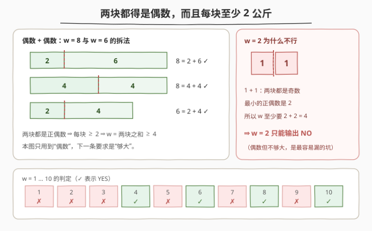
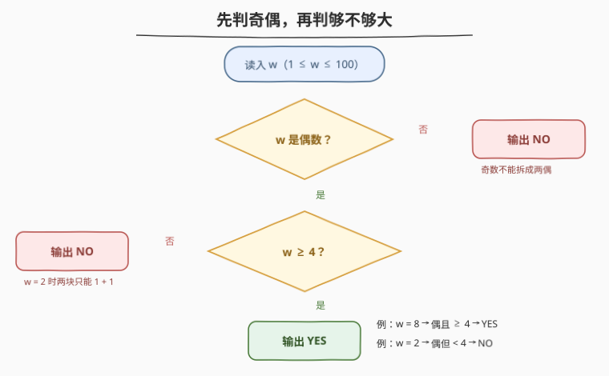
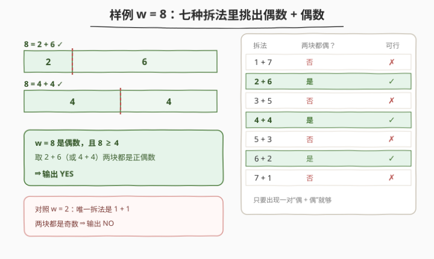

# Codeforces 4A 西瓜分成偶数两半 题解

## 1. 题目概述

- **题目链接**：https://codeforces.com/problemset/problem/4/A
- **比赛来源**：Codeforces Beta Round 4 (Div. 2 Only) · Problem A
- **难度**：800
- **标签**：暴力枚举、数学（brute force, math）
- **评测类型**：普通
- **限制**：时间 1 s / 内存 64 MB

**题意**：Pete 和 Billy 买了一个重 $w$ 公斤的西瓜，要把它切成**两块**分着吃。两人都喜欢偶数，所以要求每块西瓜的重量都是**正偶数**公斤；两块不要求一样重，但每块都必须有正的重量。给定 $w$，判断能否这样切，能则输出 `YES`，否则输出 `NO`。

输入只有一行一个整数 $w$；输出一行一个大写单词。

**约束**：

- $1 \le w \le 100$：值域极小，$O(w)$ 的枚举甚至 $O(w^2)$ 的暴力都远快于 1 s，因此本题的难点不在复杂度，而在**把两个条件都想全**。
- 两块都是正偶数，所以合法配置的最小和是 $2 + 2 = 4$；这直接排除了 $w = 1, 2, 3$。
- 输入只有**一组**数据：题面写的是“一行一个整数 $w\,(1\le w\le100)$”，没有测试组数 $t$，也不是读到 EOF 的多组格式。
- 输出必须是大写的 `YES` / `NO`，普通评测逐 token 比对。

## 2. 示例与观察

官方样例（输入 / 输出原样）：

```text
输入：
8

输出：
YES
```

**样例解释**：$8$ 可以拆成 $2 + 6$，也可以拆成 $4 + 4$；两种拆法的两块都是正偶数，所以输出 `YES`。

自造样例（标注“自造”，覆盖小值、奇偶分界与上界）：

| 输入 | 输出 | 说明 |
|------|------|------|
| `1` | `NO` | 无法拆成两个正整数 |
| `2` | `NO` | 唯一拆法是 $1 + 1$，两块都是奇数 |
| `3` | `NO` | 拆法 $1 + 2$，必有一块是奇数 |
| `4` | `YES` | $2 + 2$，合法配置的最小值 |
| `5` | `NO` | 奇数，偶数 + 偶数不可能等于奇数 |
| `6` | `YES` | $2 + 4$ |
| `7` | `NO` | 奇数 |
| `8` | `YES` | 官方样例：$2 + 6$ 或 $4 + 4$ |
| `100` | `YES` | $2 + 98$，上界 |

**观察**：在表里覆盖到的取值中，`YES` 恰好是 $4, 6, 8, 100$，它们都满足“**偶数且不小于 4**”。反过来，`NO` 分成两类：一类是奇数（和为奇数不可能由两个偶数拼成），另一类是 $w = 2$（偶数，但两块最小也得各 2 公斤，总和至少 4）。于是猜测判定条件是

$$w \bmod 2 = 0 \quad \text{且} \quad w \ge 4 .$$

注意 $w = 2$ 是唯一的“偶数陷阱”：只写 `w % 2 == 0` 会在它上面输出 `YES`，而正确答案是 `NO`。

## 3. 解题思路

### 3.1 朴素做法与瓶颈

最直白的做法是枚举第一块的重量 $a$，令第二块为 $b = w - a$，逐一检查 $a, b$ 是否都是正偶数：

```text
for a = 1 .. w-1:
    b = w - a
    if a % 2 == 0 and b % 2 == 0:
        return YES
return NO
```

它的复杂度是 $O(w)$，在 $w \le 100$ 时最多循环 99 次，1 s 内绰绰有余，**完全可以直接提交**。所以本题不存在“性能瓶颈”，真正的风险是判定条件写漏：任何试图把 $O(w)$ 压成 $O(1)$ 的化简，只要漏掉“每块至少 2”这一条，就会在 $w = 2$ 上翻车。

另一个常见错解是“按面积/平均分”：先判 $w$ 是偶数，再令两块各为 $w/2$。当 $w = 6$ 时 $w/2 = 3$ 是奇数，这个写法会输出 `NO`，但 $6 = 2 + 4$ 明明可行。**两块不要求相等**，这是题面明确写的，不能用平分代替一般拆分。

### 3.2 核心观察：两个必要条件合起来也充分



设两块重量为 $a, b$，题面要求 $a, b$ 都是正偶数。于是有两条独立的必要条件：

1. **奇偶性**：偶数加偶数仍是偶数，所以 $w = a + b$ 必须是偶数。$w$ 为奇数时无论怎么拆都不行。
2. **下界**：正偶数的最小值是 $2$，所以 $a \ge 2$、$b \ge 2$，从而 $w = a + b \ge 4$。

这两条不只是必要条件，**合起来还是充分的**：当 $w$ 是偶数且 $w \ge 4$ 时，令

$$a = 2, \qquad b = w - 2 .$$

因为 $w$ 是偶数，$b = w - 2$ 也是偶数；因为 $w \ge 4$，$b \ge 2$ 是正数；而 $a = 2$ 本身就是正偶数，且 $a + b = w$。所以 $(2, w-2)$ 就是一组合法拆法。

图里左侧用 $w = 8$ 演示了 $2 + 6$ 与 $4 + 4$，右侧用 $w = 2$ 演示了为什么“偶数”这一条单独不够：它只能拆成 $1 + 1$，两块都是奇数。

### 3.3 算法流程



1. 读入整数 $w$；
2. 若 $w$ 是奇数，输出 `NO` 并结束（偶数之和不可能为奇数）；
3. 若 $w < 4$（在偶数里只剩 $w = 2$），输出 `NO` 并结束（两块至少各 2 公斤）；
4. 否则输出 `YES` 并结束。

流程只有一次读入、两次比较，没有循环。第 2、3 步的先后顺序无所谓：两个条件必须**同时**满足，任何一个不满足都输出 `NO`。写成一行就是 `w % 2 == 0 && w >= 4`。

也可以把下界写成 `w > 2`：在 $w$ 为偶数的前提下，$w > 2$ 与 $w \ge 4$ 等价。但**不要**写成 `w / 2 >= 1`（$w = 2$ 时 $1 \ge 1$ 成立，会误判为 `YES`），也不要写成 `w / 2 >= 2` 之后忘记先判奇偶——$w = 5$ 时 $5/2 = 2 \ge 2$ 成立，同样会误判。

### 3.4 样例走查：$w = 8$



$w = 8$ 时，把 $8$ 拆成两个正整数一共有 $7$ 种有序拆法：

| 拆法 | 两块是否都为偶数 | 可行 |
|------|------------------|------|
| $1 + 7$ | 否（奇 + 奇） | ✗ |
| $2 + 6$ | 是（偶 + 偶） | ✓ |
| $3 + 5$ | 否（奇 + 奇） | ✗ |
| $4 + 4$ | 是（偶 + 偶） | ✓ |
| $5 + 3$ | 否（奇 + 奇） | ✗ |
| $6 + 2$ | 是（偶 + 偶） | ✓ |
| $7 + 1$ | 否（奇 + 奇） | ✗ |

只要出现任意一对“偶 + 偶”，答案就是 `YES`；这里有三对，输出 `YES`。图中同时还画了 $w = 2$ 的对照：它只有 $1 + 1$ 一种拆法，两块都是奇数，所以是 `NO`。

这个走查也解释了为什么不能“只看一半”：$w = 8$ 的 $w/2 = 4$ 是偶数，平分恰好可行；但换成 $w = 6$，平分得到 $3 + 3$ 不可行，而 $2 + 4$ 可行。判定必须针对“存在一对偶数”，而不是“平分是否为偶数”。

## 4. 正确性证明

**引理 1（必要性）**：若 $w$ 能拆成两个正偶数 $a, b$（$a + b = w$，$a, b \ge 2$），则 $w$ 是偶数且 $w \ge 4$。

**证明**：两个偶数之和为偶数，故 $w = a + b$ 是偶数。又 $a \ge 2$、$b \ge 2$，相加得 $w = a + b \ge 4$。∎

**引理 2（充分性）**：若 $w$ 是偶数且 $w \ge 4$，则存在两个正偶数 $a, b$ 使 $a + b = w$。

**证明**：取 $a = 2$、$b = w - 2$。由 $w$ 是偶数知 $b$ 是偶数；由 $w \ge 4$ 知 $b \ge 2$，即为正；$a = 2$ 是正偶数；且 $a + b = w$。故 $(2, w-2)$ 是一组合法拆法。∎

**定理**：算法输出 `YES` 当且仅当 $w$ 能被拆成两个正偶数。

**证明**：

- 若算法输出 `YES`，则 $w$ 是偶数且 $w \ge 4$，由引理 2 存在合法拆法，故可行。
- 若 $w$ 可行，由引理 1 得 $w$ 是偶数且 $w \ge 4$，算法两个条件都满足，输出 `YES`。
- 若 $w$ 不可行：$w$ 为奇数时算法在第 2 步输出 `NO`；$w$ 为偶数时，若 $w \ge 4$ 则由引理 2 可行，与不可行矛盾，故只能 $w < 4$，即 $w = 2$，算法在第 3 步输出 `NO`。两种情形都不会误判为 `YES`。

综上，输出与可行性完全一致。∎

## 5. 复杂度分析

- **时间**：$O(1)$。一次读入、一次取模、一次比较，与 $w$ 的大小无关；即使把约束放大到 $w \le 10^{18}$，也只是一次常数时间运算。
- **空间**：$O(1)$。只用一个整型变量，没有数组、没有递归，不存在栈深度问题。
- **数值范围**：$w \le 100$，`int` 绰绰有余；本题没有任何乘法或累加，不存在溢出风险（这也是为什么它被评为 800 分）。
- **与时限的关系**：1 s 的时限极其宽松。实测（含进程启动）C++ 端到端约 $2.0 \sim 2.6$ ms、平均 $2.2$ ms，Python3 约 $17.5 \sim 22.9$ ms、平均 $18.8$ ms，其中几乎全部是解释器/进程启动开销，算法本体不足 $1\ \mu\text{s}$，时间余量在 40 倍以上。

## 6. 参考代码

### C++17

```cpp
#include <bits/stdc++.h>
using namespace std;

int main() {
    ios::sync_with_stdio(false);
    cin.tie(nullptr);

    int w;
    if (!(cin >> w)) return 0;                 // 题面只有一行一个整数
    cout << ((w % 2 == 0 && w >= 4) ? "YES" : "NO") << '\n';
    return 0;
}
```

### Python3

```python
import sys


def main() -> None:
    data = sys.stdin.buffer.read().split()
    if not data:
        return
    w = int(data[0])
    sys.stdout.write("YES\n" if w % 2 == 0 and w >= 4 else "NO\n")


main()
```

两份代码都只用标准库，可原样提交；本题是普通评测，输出一个大写单词即可。

## 7. 边界情况与易错点

1. **$w = 2$ 是最容易漏的坑**：它是偶数，但两块都必须是正偶数，最小和是 $2 + 2 = 4$，所以 $2$ 只能拆成 $1 + 1$，答案是 `NO`。任何只判 `w % 2 == 0` 的写法都会在这里错。
2. **奇数一律 `NO`**：包括 $w = 1, 3, 5, 7, \dots$。偶数加偶数不可能得到奇数，这条与下界无关，先判后判都对，但必须判。
3. **“平分”不是通解**：$w = 6$ 平分成 $3 + 3$ 不可行，而 $2 + 4$ 可行；$w = 10$ 平分成 $5 + 5$ 不可行，而 $2 + 8$ 可行。题面明确说两块**不必相等**，不要用 $w/2$ 是否为偶数作为判定。
4. **下界要显式写成 `w >= 4`（或等价的 `w > 2`），别用除法绕**：`w / 2 >= 1` 在 $w = 2$ 时成立，`w / 2 >= 2` 在 $w = 5$ 时成立，两者都会误判。
5. **只有一组输入**：题面没有 $t$，也不是“读到 EOF 的多组”。用 `while (cin >> w)` 循环处理会在某些数据上产生多余输出，按题面读一次即可。
6. **输出大小写**：必须是 `YES` / `NO`，写成 `Yes`、`yes`、`No` 都会被判错（普通评测按 token 精确比较）。也不要在单词后加句号等多余字符（行尾空格无妨）。
7. **空输入保护**：本仓库的验证脚本会严格按样例喂入，但养成 `if (!(cin >> w)) return 0;` / `if not data: return` 的习惯，能避免本地手测时的未定义行为。
8. **整数范围不成问题**：$w \le 100$，不需要 `long long`，也没有浮点运算；如果题目把上界改成 $10^{18}$，判定式本身仍然成立，只需换类型读入。

## 8. 验证记录

- **编译环境与命令**：本机没有 GNU `g++`（`/usr/bin/g++` 是 Apple clang 21.0.0 的软链），因此用 `clang++ -std=c++17 -O2 -Wall -Wextra -I codeforces/tools/include` 配合仓库自带的 `bits/stdc++.h` 兼容头编译，**零警告**；代码只依赖标准库，可原样提交 GNU C++17。Python 侧为 `Python 3.9.6`。
- **官方样例**：1 / 1 通过（`8` → `YES`）；`verify_solution.py` 的输出为 `CF4A: samples 1`、`C++ 编译 OK, 样例 1/1`、`Python 语法 OK, 样例 1/1` 三行（其中“最慢”一行随机器负载波动，从 14 ms 到 16 ms 不等）。
- **独立暴力对拍**：另写一份不使用任何公式的暴力：枚举 $a = 1 \dots w-1$，令 $b = w - a$，逐一检查 $a, b$ 是否都是正偶数，找到一对就输出 `YES`。对 $w = 1 \dots 600$ 做**全枚举 600 组**（其中 $1 \dots 100$ 是题面值域，$101 \dots 600$ 是值域外的外推），再加 **300 组随机 $w \in [1, 100]$**，共 **900 组**，C++、Python 与暴力三方逐一比对，**0 处不一致**。
- **最大约束性能**：$w = 100$ 时 C++ 端到端 200 次测量为 min $1.97$ ms / avg $2.20$ ms / max $2.60$ ms，Python3 50 次为 avg $18.8$ ms（均含进程启动），相对 1 s 时限余量在 40 倍以上。
- **图片校验**：三张 SVG（`cf4a_parity_floor.svg`、`cf4a_decision_flow.svg`、`cf4a_walkthrough_w8.svg`）均通过 `xml.etree.ElementTree.parse`；另用 headless Chrome 的 `getBBox()` 逐元素测量渲染后的包围盒：三图共 94 个文本块，全部落在 `viewBox` 内，文本之间 0 处重叠，落在方框内的文本全部收在框内（`cf4a_walkthrough_w8.svg` 的表格行、`cf4a_parity_floor.svg` 的判定表均已逐格核对）。
- **公式校验**：正文公式均为 `$...$` 行内与 `$$...$$` 块级形式，星号直接写 `*`，`\text{}` 内无裸 `#`，经 `node codeforces/tools/katex_check.cjs` 的 KaTeX（`throwOnError`）校验无报错。
- **复核状态**：verified（样例、900 组对拍、最大约束性能、图片几何、公式五项均实跑通过；唯一环境差异是本机无 GNU g++，已用 clang++ 等价验证）。

## 相关题目与扩展

- [Codeforces 4B Before an Exam](https://codeforces.com/problemset/problem/4/B)：同场 B 题，构造一组满足上下界与总和的时间表，是“先算可行区间再构造”的经典套路。
- [Codeforces 1335A Candies and Two Sisters](https://codeforces.com/problemset/problem/1335/A)：把 $n$ 拆成两个正整数且 $a > b$，答案为 $\lfloor (n-1)/2 \rfloor$，同样是“拆分 + 边界”的计数题。
- [Codeforces 50A Domino piling](https://codeforces.com/problemset/problem/50/A)：用 $2 \times 1$ 骨牌铺 $n \times m$ 棋盘，答案 $\lfloor nm/2 \rfloor$，是另一类“奇偶性决定答案”的入门题。
- [Codeforces 617A Elephant](https://codeforces.com/problemset/problem/617/A)：每次走 $1 \sim 5$ 步，求最少步数，答案 $\lceil x/5 \rceil$，可作为整数除法的热身。
- [Codeforces 1551A Polycarp and Coins](https://codeforces.com/problemset/problem/1551/A)：用面值 1 和 2 凑出 $n$ 且两种硬币数尽量接近，属于同类“小值域数学构造”。
- [LeetCode 231. 2 的幂](https://leetcode.cn/problems/power-of-two/)：判断整数是否为 2 的幂，同样只需一次位运算/取模，适合对比“常数时间判定”的写法。

**延伸思考**：

1. **如果要求两块重量相等**：则必须 $w = 2a$ 且 $a$ 为偶数，即 $4 \mid w$。$w = 6$ 时虽然能拆成 $2 + 4$，但拆不出相等的两块；$w = 8$ 才行（$4 + 4$）。可见“可行”与“可平分”是两个不同的条件。
2. **如果要求分成 $k$ 块正偶数**：条件是 $w$ 为偶数且 $w \ge 2k$。构造取 $k-1$ 块各 $2$ 公斤、最后一块 $w - 2(k-1)$；由 $w \ge 2k$ 知最后一块 $\ge 2$ 且为偶数。本题是 $k = 2$ 的特例，下界从 $4$ 变成 $2k$。
3. **如果要求两块都是奇数**：两块奇数之和是偶数，所以 $w$ 仍必须是偶数；但此时每块最小是 $1$，$w = 2$ 反而可行（$1 + 1$），$w = 4$ 也可行（$1 + 3$）。与本题对照：对偶数 $w$，“奇数块”在 $w \ge 2$ 时总能做到，而“偶数块”要 $w \ge 4$；$w = 2$ 是两者答案不同的唯一取值。
4. **如果要求每块都是 $d$ 的倍数**：设两块为 $dx, dy$（$x, y \ge 1$），则 $w = d(x+y)$，所以必须 $d \mid w$ 且 $w \ge 2d$；反之取 $d$ 与 $w-d$ 即可。本题是 $d = 2$ 的特例，把“偶数”换成“$d$ 的倍数”，判定式只是把 $2$ 换成 $d$。
5. **如果允许切三块以上并问方案数**：问题立刻从判定变成计数，等价于求 $w$ 拆成若干个正偶数的有序/无序方案数，可以用生成函数或 DP 处理；本题的 $O(1)$ 判定只适用于“块数固定为 2”的情形。
