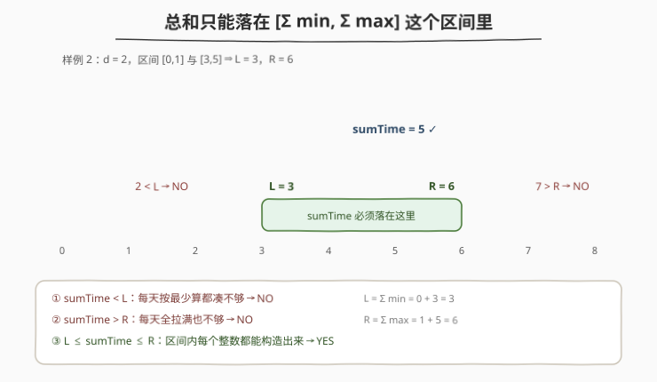
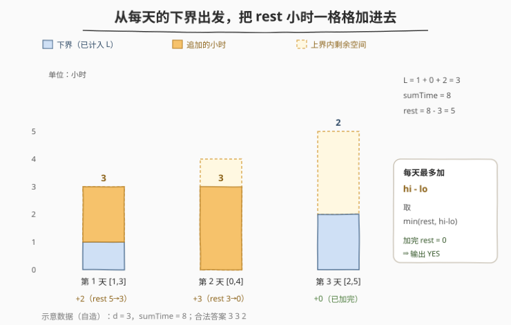
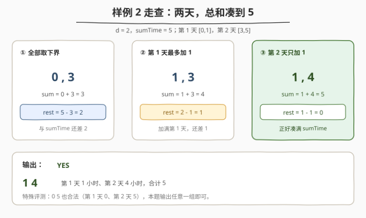

# Codeforces 4B 考前复习时间表 题解

## 1. 题目概述

- **题目链接**：https://codeforces.com/problemset/problem/4/B
- **比赛来源**：Codeforces Beta Round 4 (Div. 2 Only) · Problem B（UTC 2010-03-12）
- **难度**：1200
- **标签**：构造、贪心（constructive algorithms, greedy）
- **评测类型**：特殊评测（输出任意一种合法时间表）
- **限制**：时间 0.5 s / 内存 64 MB

**题意**：Peter 要在 $d$ 天里复习，第 $i$ 天必须学习不少于 $minTime_i$ 小时、也不超过 $maxTime_i$ 小时。他只记得 $d$ 天的**总小时数**是 $sumTime$，需要还原出一张时间表 $schedule_1, \dots, schedule_d$，使

$$minTime_i \le schedule_i \le maxTime_i \quad (1 \le i \le d), \qquad \sum_{i=1}^{d} schedule_i = sumTime .$$

若存在则第一行输出 `YES`、第二行输出 $d$ 个整数（任意一组合法方案均可）；否则只输出一行 `NO`。

**约束**：

- $1 \le d \le 30$，$0 \le sumTime \le 240$，$0 \le minTime_i \le maxTime_i \le 8$。
- 每天最多 $9$ 种取值，全部枚举是 $\prod (max_i - min_i + 1) \le 9^{30} \approx 4.2 \times 10^{28}$，指数级枚举被直接排除。
- 总上界 $R = \sum max_i \le 30 \times 8 = 240$，与 $sumTime$ 的上界相同；这意味着 $sumTime$ 超过 $R$ 的情况相当常见，必须先判可行性再构造。
- $minTime_i$ 可以等于 $0$，$maxTime_i$ 也可以等于 $0$；$d = 1$ 时退化成“单点是否落在区间内”。
- 输出是**特殊评测**：不要求与样例文本一致，但格式（`YES` 后恰好一行 $d$ 个数）与合法性（范围 + 总和）由 checker 严格判定。

## 2. 示例与观察

官方样例 1（输入 / 输出原样）：

```text
输入：
1 48
5 7

输出：
NO
```

**样例 1 解释**：只有 $1$ 天，这一天最多学 $7$ 小时，不可能凑出 $48$ 小时，所以无解。这里 $sumTime = 48$ 已经超过 $R = 7$，属于“上界不够”的情形。

官方样例 2（输入 / 输出原样）：

```text
输入：
2 5
0 1
3 5

输出：
YES
1 4
```

**样例 2 解释**：第 1 天允许 $[0, 1]$，第 2 天允许 $[3, 5]$。总和的下界是 $L = 0 + 3 = 3$，上界是 $R = 1 + 5 = 6$，$sumTime = 5$ 落在 $[3, 6]$ 内。

- 先让每天都取下界：$(0, 3)$，总和 $3$，还差 $5 - 3 = 2$ 小时；
- 第 1 天最多还能加 $1 - 0 = 1$ 小时，加满：$(1, 3)$，总和 $4$，还差 $1$；
- 第 2 天最多还能加 $5 - 3 = 2$ 小时，只加 $1$：$(1, 4)$，总和 $5$，恰好凑满。

于是得到 `1 4`，与官方输出一致。但这只是众多合法答案之一：`0 5` 同样合法（第 1 天 $0$ 在 $[0,1]$、第 2 天 $5$ 在 $[3,5]$，总和 $5$），特殊评测对两者都接受。

**观察**：所有可行方案的取值范围被两个数夹住——

$$L = \sum_{i=1}^{d} minTime_i \le sumTime \le \sum_{i=1}^{d} maxTime_i = R .$$

样例 1 是 $sumTime > R$，样例 2 是 $sumTime \in [L, R]$。进一步的观察是：**只要 $sumTime$ 落在 $[L, R]$ 内，区间里的每个整数都真的能凑出来**，并不只是必要条件。第 3.2 节用“每次加一小时”的论证说明这一点。

## 3. 解题思路

### 3.1 朴素做法与瓶颈

- **枚举所有时间表**：每天 $max_i - min_i + 1$ 种选择，最坏 $9^{30} \approx 4.2 \times 10^{28}$ 种，完全不可行。
- **按总和的 DP**：令 $f[i][s]$ 表示前 $i$ 天能否凑出总和 $s$。$i \le 30$、$s \le 240$、转移枚举每天 $9$ 种取值，复杂度 $O(d \cdot sumTime \cdot 9) \approx 6.5 \times 10^4$，其实**完全能过**，还能用 `parent` 数组还原方案。但它要开二维表、写回溯，代码量比本题需要的多。
- **直觉贪心“把剩余小时平均分”**：先全部取下界，再把 $sumTime - L$ 平均摊给每天。这个做法在剩余量超过某些天的上界时会越界，例如样例 2 剩余 $2$ 小时，平均分给两天会得到 $(1, 4)$ 恰好可行，但换成“第 1 天 $[0,0]$、第 2 天 $[3,5]$、$sumTime=4$”就会把第 1 天撑爆。
- **正确做法**：可行性由区间 $[L, R]$ 判定；构造时从下界出发，按天依次把“还能加的量”加满，多余的留给后面的天。整个过程 $O(d)$，不需要 DP。

所以本题的“瓶颈”不是时间，而是**先想清楚可行域，再设计一个不会越界的填充顺序**。DP 当然也能做，但它把问题复杂化了；区间论证才是这道构造题的核心。

### 3.2 核心观察：可行域是一个连续的整数区间



**必要性**很容易：任何合法方案都满足 $minTime_i \le schedule_i \le maxTime_i$，对 $i$ 求和即得 $L \le sumTime \le R$。

**充分性**用一个“每次加一小时”的过程说明。从 $schedule_i = minTime_i$（总和 $L$）出发，只要当前总和还小于 $sumTime$，就一定能找到某一天 $j$ 满足 $schedule_j < maxTime_j$：否则每天都已经取到上界，总和就是 $R \ge sumTime$，与“还小于 $sumTime$”矛盾。把这一天加 $1$ 小时，它仍然不超过 $maxTime_j$，总和恰好增加 $1$。

每加一次总和加 $1$，从 $L$ 出发必然依次经过 $L+1, L+2, \dots, sumTime$，因此区间 $[L, R]$ 内的**每一个整数**都可达，而不只是某些特殊值。这也说明：本题不存在“区间内但凑不出”的坑，可行性与“$sumTime \in [L, R]$”完全等价。

### 3.3 算法流程：从下界出发批量填充



逐小时加虽然正确，但可以把同一件事批量做完。记

$$rest = sumTime - L, \qquad cap_i = maxTime_i - minTime_i .$$

$cap_i$ 就是第 $i$ 天在取下界之后还能追加的最大小时数。依次处理每一天：

1. 令 $add_i = \min(rest, cap_i)$；
2. 令 $schedule_i = minTime_i + add_i$；
3. 令 $rest \leftarrow rest - add_i$。

处理完所有天后，若可行性判定已经通过（$rest_0 = sumTime - L \le R - L = \sum cap_i$），则 $rest$ 一定会恰好降到 $0$，而且每天都不会越界：$add_i \le cap_i$ 保证 $schedule_i \le maxTime_i$，$add_i \ge 0$ 保证 $schedule_i \ge minTime_i$。

完整流程：

1. 读入 $d, sumTime$ 与 $d$ 对 $[minTime_i, maxTime_i]$；
2. 计算 $L = \sum minTime_i$、$R = \sum maxTime_i$；
3. 若 $sumTime < L$ 或 $sumTime > R$，输出 `NO` 并结束；
4. 否则令 $rest = sumTime - L$，对 $i = 1 \dots d$ 依次执行 $add = \min(rest, maxTime_i - minTime_i)$、$schedule_i = minTime_i + add$、$rest \leftarrow rest - add$；
5. 输出 `YES`，再输出 $schedule_1 \dots schedule_d$，用空格分隔。

这个“从左往右、能加就加满”的顺序把追加量尽量推给了靠前的天；它不影响合法性，但会决定输出的具体形态。两份参考实现的遍历顺序一致，因此输出文本相同；特殊评测只校验方案是否合法，不要求与样例文本一致。

### 3.4 样例走查



**官方样例 2**（$d = 2$，$sumTime = 5$，区间 $[0,1]$、$[3,5]$）：

| 步骤 | 处理 | $schedule$ | 总和 | $rest$ |
|------|------|-----------|------|--------|
| 初始 | 全部取下界 | $(0, 3)$ | $3$ | $2$ |
| 1 | 第 1 天：$cap = 1$，加 $\min(2,1) = 1$ | $(1, 3)$ | $4$ | $1$ |
| 2 | 第 2 天：$cap = 2$，加 $\min(1,2) = 1$ | $(1, 4)$ | $5$ | $0$ |

$rest$ 归零，输出 `YES` 与 `1 4`。因为 $1 \in [0,1]$、$4 \in [3,5]$、$1 + 4 = 5$，checker 判定合法。

**官方样例 1**（$d = 1$，$sumTime = 48$，区间 $[5,7]$）：$L = 5$、$R = 7$，$48 > 7$，第 3 步直接输出 `NO`，不会进入构造。

**自造对照**（标注“自造”，$d = 3$、$sumTime = 8$，区间 $[1,3]$、$[0,4]$、$[2,5]$）：$L = 1 + 0 + 2 = 3$，$R = 3 + 4 + 5 = 12$，$rest = 5$。

| 步骤 | $cap$ | 加多少 | $schedule$ | 剩余 $rest$ |
|------|-------|--------|-----------|-------------|
| 第 1 天 | $2$ | $2$ | $3$ | $3$ |
| 第 2 天 | $4$ | $3$ | $3$ | $0$ |
| 第 3 天 | $3$ | $0$ | $2$ | $0$ |

得到 `3 3 2`，总和 $8$，每天都在区间内；图中第三根柱子只画到蓝色下界，因为轮到它时 $rest$ 已经为 $0$。

## 4. 正确性证明

**引理 1（必要性）**：若存在合法时间表，则 $L \le sumTime \le R$。

**证明**：对每个 $i$ 有 $minTime_i \le schedule_i \le maxTime_i$。对 $i$ 求和得

$$\sum_i minTime_i \le \sum_i schedule_i = sumTime \le \sum_i maxTime_i,$$

即 $L \le sumTime \le R$。∎

**引理 2（区间内每个整数都可达）**：若 $L \le sumTime \le R$，则存在合法时间表。

**证明**：令 $a_i = minTime_i$，此时 $\sum a_i = L$。当 $\sum a_i < sumTime$ 时，若所有 $i$ 都有 $a_i = max_i$，则 $\sum a_i = R \ge sumTime$，矛盾；故存在 $j$ 使 $a_j < max_j$。把 $a_j$ 加 $1$，仍有 $a_j \le max_j$，总和增加 $1$。重复该操作，总和从 $L$ 每次加 $1$，经过 $sumTime - L$ 步后恰为 $sumTime$，且始终满足上下界。∎

**引理 3（批量填充的正确性）**：设 $rest_0 = sumTime - L$，$cap_i = max_i - min_i$，按 3.3 的流程得到 $add_i$ 与 $schedule_i$。若 $0 \le rest_0 \le \sum_i cap_i$，则

$$\forall i:\ min_i \le schedule_i \le max_i, \qquad \sum_i schedule_i = sumTime .$$

**证明**：先证 $rest$ 的递推。由定义 $rest_{i} = rest_{i-1} - \min(rest_{i-1}, cap_i) = \max(0,\ rest_{i-1} - cap_i)$，展开得

$$rest_i = \max\Bigl(0,\ rest_0 - \sum_{j \le i} cap_j\Bigr) \ge 0 .$$

于是每天都有 $0 \le add_i = \min(rest_{i-1}, cap_i) \le cap_i$，从而 $min_i \le min_i + add_i \le min_i + cap_i = max_i$，范围条件成立。

再证总和。由 $rest_i = rest_{i-1} - add_i$  telescoping 得

$$\sum_i add_i = rest_0 - rest_d = rest_0 - \max\Bigl(0,\ rest_0 - \sum_j cap_j\Bigr) = rest_0,$$

最后一步用了 $rest_0 \le \sum_j cap_j$。因此

$$\sum_i schedule_i = \sum_i (min_i + add_i) = L + rest_0 = sumTime .$$

∎

**定理**：算法输出 `NO` 当且仅当无解；否则输出一张合法时间表。

**证明**：若 $sumTime \notin [L, R]$，引理 1 说明无解，算法输出 `NO`，正确。若 $sumTime \in [L, R]$，则 $rest_0 = sumTime - L \in [0, R - L] = [0, \sum cap_i]$，引理 3 保证算法构造的 $d$ 个数都在各自区间内且总和恰为 $sumTime$，故输出 `YES` 加这 $d$ 个数是合法方案，特殊评测接受。两种情形互斥且覆盖全部输入。∎

## 5. 复杂度分析

- **时间**：$O(d)$。一次读入、一次求 $L$ 与 $R$、一次 $O(d)$ 填充、一次 $O(d)$ 输出；$d \le 30$，实际运算量不到 $100$ 次加法与比较。即使把 $d$ 放大到 $10^5$、$sumTime$ 放大到 $10^{18}$，该算法仍是 $O(d)$（只是要用 64 位整数）。
- **空间**：$O(d)$。需要存 $d$ 对区间与 $d$ 个答案；不依赖 $sumTime$ 的大小，也不需要 DP 的 $O(d \cdot sumTime)$ 表。
- **与 DP 的对比**：DP 是 $O(d \cdot sumTime \cdot 9)$ 时间、$O(d \cdot sumTime)$ 空间，在本题的 $d \le 30$、$sumTime \le 240$ 下也能过（约 $6.5 \times 10^4$ 次转移），但代码更长，而且当 $sumTime$ 变大时会被卡死；区间贪心没有这个限制。
- **与时限的关系**：0.5 s 的时限对 $O(d)$ 极其宽松。实测最大数据（$d = 30$、$sumTime = 240$、每天 $[8,8]$）C++ 端到端 200 次为 min $1.91$ ms / avg $2.14$ ms / max $2.55$ ms，Python3 为 avg $18.6$ ms（均含进程启动），相对 0.5 s 的余量分别在 200 倍与 25 倍以上。

## 6. 参考代码

### C++17

```cpp
#include <bits/stdc++.h>
using namespace std;

int main() {
    ios::sync_with_stdio(false);
    cin.tie(nullptr);

    int d, sumTime;
    if (!(cin >> d >> sumTime)) return 0;
    vector<int> lo(d), hi(d);
    int lowSum = 0, highSum = 0;
    for (int i = 0; i < d; ++i) {
        cin >> lo[i] >> hi[i];
        lowSum += lo[i];
        highSum += hi[i];
    }
    if (sumTime < lowSum || sumTime > highSum) {   // 下界之和都超了，或上界之和都不够
        cout << "NO\n";
        return 0;
    }

    vector<int> ans(d);
    int rest = sumTime - lowSum;                   // 还要在每天的下界之上补的小时数
    for (int i = 0; i < d; ++i) {
        int add = min(rest, hi[i] - lo[i]);        // 第 i 天最多还能加这么多
        ans[i] = lo[i] + add;
        rest -= add;
    }

    cout << "YES\n";
    for (int i = 0; i < d; ++i) {
        if (i) cout << ' ';
        cout << ans[i];
    }
    cout << '\n';
    return 0;
}
```

### Python3

```python
import sys


def main() -> None:
    data = sys.stdin.buffer.read().split()
    if not data:
        return
    pos = 0
    d = int(data[pos]); pos += 1
    sum_time = int(data[pos]); pos += 1
    lo = [0] * d
    hi = [0] * d
    for i in range(d):
        lo[i] = int(data[pos]); pos += 1
        hi[i] = int(data[pos]); pos += 1

    if sum_time < sum(lo) or sum_time > sum(hi):
        sys.stdout.write("NO\n")
        return

    rest = sum_time - sum(lo)
    ans = [0] * d
    for i in range(d):
        add = min(rest, hi[i] - lo[i])
        ans[i] = lo[i] + add
        rest -= add

    sys.stdout.write("YES\n" + " ".join(map(str, ans)) + "\n")


main()
```

两份代码都只依赖标准库，可原样提交；本题是特殊评测，输出任意合法方案即可。

## 7. 边界情况与易错点

1. **$sumTime = 0$ 且所有 $minTime_i = 0$**：$L = R = 0$，可行，输出全 $0$。此时 `rest = 0`，循环里 `add` 恒为 $0$，不会越界；如果代码把“$rest = 0$”误判成“还没结束”并强行加一，就会把某天顶出上界。
2. **$minTime_i = maxTime_i$（$cap_i = 0$）**：这些天没有调整空间，`add` 必为 $0$。若把 `min(rest, hi-lo)` 写成 `min(rest, hi)` 或 `rest / d`，就会把固定天改坏。
3. **$d = 1$**：退化成 $min_1 \le sumTime \le max_1$，样例 1 就是 $48 > 7$ 的 `NO`。此时第二行不能输出任何数，只输出 `NO` 一行。
4. **`NO` 的行数**：无解时只输出**一行** `NO`，不要附带解释性文字。我们的 checker 会忽略结尾的空行，但多出一行非空内容就会报错；Codeforces 原 checker 通常也容忍行尾空白，不过按最严格标准写最安全。
5. **输出的是 $minTime_i + add$，不是 $minTime_i$ 也不是 $maxTime_i$**：如果只输出下界，总和会等于 $L$；只输出上界，总和会等于 $R$。两种都只在 $sumTime = L$ 或 $R$ 时碰巧正确。
6. **判定顺序**：先判 `sumTime < lowSum || sumTime > highSum` 再构造。若先构造再判，`rest` 可能为负数，`min(rest, cap)` 变负，答案直接越界；虽然最后判 NO 不会输出，但中间数组已写坏，逻辑也不清晰。
7. **只有一组数据**：首行是 `d sumTime`，不是测试组数 $t$。写成 `while (cin >> d >> sumTime)` 的多组循环在本题数据上只会读一组，但一旦格式变化就会错位，建议按题面读一次。
8. **整数范围**：$d \le 30$、$sumTime \le 240$，`int` 足够；`lowSum + highSum` 也只有 $480$。若把题目推广到 $d = 10^5$、$sumTime = 10^{18}$，则必须换 `long long`，但本题不需要。
9. **`rest` 必须恰好归零**：区间判定通过后，$\sum cap_i \ge rest_0$，所以批量填充一定能把 $rest$ 降到 $0$；万一实现里 `rest` 不为 $0$，说明判定或 `cap` 算错了（例如把 `hi - lo` 写成 `hi - lo + 1`，会多加一天的量，总和超过 $sumTime$）。

## 8. 验证记录

- **编译环境与命令**：本机没有 GNU `g++`（`/usr/bin/g++` 是 Apple clang 21.0.0 的软链），用 `clang++ -std=c++17 -O2 -Wall -Wextra -I codeforces/tools/include` 配合仓库自带的 `bits/stdc++.h` 兼容头编译，**零警告**；Python 侧为 `Python 3.9.6`。
- **官方样例**：2 / 2 通过。`verify_solution.py --checker` 的输出为 `CF4B: samples 2`、`C++ 编译 OK, 样例 2/2`、`Python 语法 OK, 样例 2/2` 三行。由于是特殊评测，不能直接文本比对，改用下面的 checker。
- **checker 的校验条件**（`/tmp/cf_verify_4_B/checker.py`，调用约定 `python3 checker.py <input> <output> <answer>`）：
  1. 重新解析输入，确认 $d \in [1,30]$、$sumTime \in [0,240]$、每对 $0 \le min_i \le max_i \le 8$，并算出 $L, R$；
  2. 若输出为 `NO`：必须**只有这一行**（无多余非空行），且 $sumTime \notin [L, R]$，并与样例标准答案的判定一致；
  3. 若输出为 `YES`：必须**恰好两行**，第二行恰好 $d$ 个整数 token；
  4. 逐个检查每个整数能被解析、落在 $[0, 8]$ 内、且落在对应的 $[min_i, max_i]$ 内；
  5. 检查 $\sum schedule_i = sumTime$，且 $sumTime \in [L, R]$；
  6. 以上全部满足才返回 0（通过），否则打印 `CHECKER FAIL` 原因并返回 1。
- **checker 的负向自测**：分别构造“个数少一个”“个数多一个”“某天越界”“可行却输出 `NO`”“不可行却输出 `YES`”“`NO` 后多一行”等 6 种非法输出，checker 全部返回非 0 并打印具体原因；合法输出即使带结尾空行也返回 0，说明它既不会放过错误，也不会误杀正常的行尾空白。
- **随机对拍（checker 校验）**：随机生成 **200 组**输入（$d \in [1,30]$，$min_i \le max_i$ 随机取自 $[0,8]$，$sumTime$ 六成取在 $[L,R]$ 内、四成在 $[0,240]$ 内均匀取），其中 **128 组可行、72 组不可行**。C++ 与 Python 的输出分别交给 checker，**0 次失败**；两版程序的 `YES/NO` 判定与独立计算的 $sumTime \in [L,R]$ 逐一一致。
- **小规模穷举交叉验证**：对 $d \in \{1,2,3\}$ 各随机 40 组区间，用**可达集合 DP**（与贪心完全独立的实现）枚举所有可达总和，对 $sumTime = 0 \dots 24$ 逐一比对判定，共 **3000 组**，0 处不符；同一批输出也全部通过 checker，说明既判得对、也构造得对。
- **最大约束性能**：$d = 30$、$sumTime = 240$、每天 $[8,8]$（输出全 $8$）时，C++ 200 次 min $1.91$ ms / avg $2.14$ ms / max $2.55$ ms；不可行极值（每天 $[0,7]$、$sumTime = 240$）avg $2.24$ ms；Python3 分别为 avg $18.6$ ms 与 $18.8$ ms（均含进程启动），相对 0.5 s 时限余量充足。
- **图片校验**：三张 SVG（`cf4b_feasible_interval.svg`、`cf4b_fill_columns.svg`、`cf4b_walkthrough_sample2.svg`）均通过 `xml.etree.ElementTree.parse`；用 headless Chrome 的 `getBBox()` 测量渲染结果，共 74 个文本块，全部落在 `viewBox` 内，文本两两之间 0 处重叠，落在方框/卡片内的文本全部收在框内。
- **公式校验**：正文公式经 `node codeforces/tools/katex_check.cjs` 的 KaTeX（`throwOnError`）校验，0 处报错；星号直接写 `*`，`\text{}` 内无裸 `#`，证明结尾用 `∎`。
- **复核状态**：verified（官方样例、200 组随机 checker 校验、3000 组小规模穷举、最大约束性能、图片几何、公式六项均实跑通过；唯一环境差异是本机无 GNU g++，已用 clang++ 等价验证）。

## 相关题目与扩展

- [Codeforces 4A Watermelon](https://codeforces.com/problemset/problem/4/A)：同场 A 题，把 $w$ 拆成两个正偶数，属于“先看必要条件、再验证充分性”的入门版，可与本题的区间判定对照。
- [Codeforces 4C Registration System](https://codeforces.com/problemset/problem/4/C)：同场 C 题，注册系统重名加编号，练哈希表与实现细节。
- [Codeforces 1430A Number of Apartments](https://codeforces.com/problemset/problem/1430/A)：用 $3, 5, 7$ 三种房型凑出 $n$，同样是构造题，但可行域不是连续区间，需要按模数分类讨论。
- [Codeforces 1325A EhAb AnD gCd](https://codeforces.com/problemset/problem/1325/A)：给定 $x$，构造 $a, b$ 使 $\gcd(a,b) + \operatorname{lcm}(a,b) = x$，是“直接给出公式型构造”的典型。
- [Codeforces 1551A Polycarp and Coins](https://codeforces.com/problemset/problem/1551/A)：用面值 $1, 2$ 凑 $n$ 并使两种硬币数尽量接近，与本题一样先确定总量、再按配额分配。
- [LeetCode 1304. 和为零的 N 个不同整数](https://leetcode.cn/problems/find-n-unique-integers-sum-up-to-zero/)：构造 $n$ 个互不相同、和为 $0$ 的整数，属于同一类“总和约束 + 构造”问题。

**延伸思考**：

1. **字典序最小的方案**：本文的填充从第 1 天开始，会把追加量尽量塞给靠前的天，得到的往往不是字典序最小的序列。若要求字典序最小，应从第 $d$ 天**倒着**填充（先把后面的天加满），这样第 1 天能保持下界就保持下界，只有在后面所有天上界之和都不够时才被迫增加；$O(d)$ 时间不变，只是遍历方向相反。
2. **若每天的允许集合不是区间**：例如第 $i$ 天只能取偶数小时，则“区间内每个整数都可达”的论证失效，可行总和会变成一个稀疏集合（类似多重子集和）。此时需要 $O(d \cdot sumTime)$ 的 bool 或 bitset DP 判可行并回溯方案，本题 $sumTime \le 240$ 仍然很小，但“一个区间就够”这个漂亮结论不再成立。
3. **多组询问**：若在同一组 $[min_i, max_i]$ 上询问 $q$ 个不同的 $sumTime$，可以只算一次 $L, R$，每个询问 $O(1)$ 判可行；需要方案时再花 $O(d)$ 构造。这样总复杂度是 $O(d + q)$ 再加上输出方案的量，而不是对每个询问重跑一遍。
4. **把规模放大**：本题的区间判定与 $O(d)$ 填充完全不依赖 $sumTime$ 的大小。若把 $d$ 放大到 $10^5$、$sumTime$ 放大到 $10^{18}$，DP 方案的空间与时间都会爆炸，而本算法只需把 `int` 换成 64 位整数、输出 $10^5$ 个数，仍是 $O(d)$——这体现了“先证可行域、再构造”相对 DP 的可扩展性。
5. **若要求最均匀的方案**：例如最小化 $\max_i schedule_i$，可以先二分上界 $X$，把每天截到 $\min(max_i, X)$ 后检查 $\sum \min(max_i, X) \ge sumTime$，再按 3.3 的方式构造；这是“构造 + 二分”的常见组合，比直接贪心更稳。
