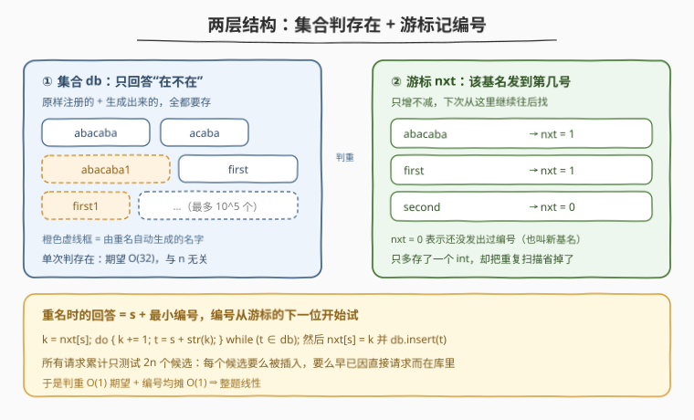
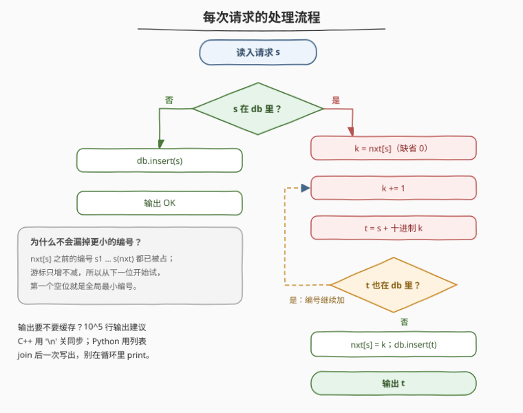
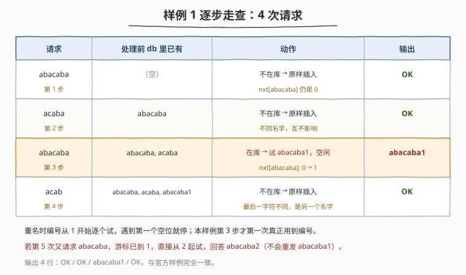

# Codeforces 4C 注册系统重名编号 题解

## 1. 题目概述

- **题目链接**：https://codeforces.com/problemset/problem/4/C
- **比赛来源**：Codeforces Beta Round 4 (Div. 2 Only) · Problem C
- **难度**：1300
- **标签**：数据结构、哈希表、实现（data structures, hashing, implementation）
- **评测类型**：普通
- **限制**：时间 5 s / 内存 64 MB

**题意**：Berland 要上线一个邮件系统，需要你实现注册模块的原型。共 $n$ 次请求，每次给一个由小写字母组成、长度不超过 32 的用户名 $s$：

- 若 $s$ 当前**不在**数据库中，则把 $s$ 插入数据库，回应用户 `OK`；
- 若 $s$ 已在数据库中，则计算最小的正整数 $i$，使拼接串 $s$ 后接十进制 $i$（例如 $s = \text{abacaba}$、$i = 1$ 得到 `abacaba1`）也不在数据库中；把这个新名字插入数据库，并把它作为回应输出。

对每次请求输出一行回应，共 $n$ 行。

**约束**：

- $1 \le n \le 10^5$：若每次请求都线性扫描一遍已有名字，比较次数是 $O(n^2 L)$ 量级（$L \le 38$），约 $10^{10}$ 次字符比较，5 s 内不可能完成，必须用哈希集合或平衡树把"判存在"降到 $O(L)$ 期望时间。
- 名字长度 $\le 32$：但被占用的名字最多再拼上 $6$ 位十进制编号（$i \le n \le 10^5$），所以库里最长的名字约 $38$ 个字符，**用定长 `char[33]` 会截断**，必须用 `std::string`。
- 内存 64 MB：$10^5$ 个长度约 $38$ 的 `std::string` 加上哈希桶约 $10 \sim 15$ MB，够用但要把桶 `reserve` 出来，避免 rehash 抖动。
- 输入只有**一组**数据（不是多测 $t$），但请求要读 $n$ 行，每行一个名字。

## 2. 示例与观察

官方样例 1（输入 / 输出原样）：

```text
输入：
4
abacaba
acaba
abacaba
acab

输出：
OK
OK
abacaba1
OK
```

官方样例 2（输入 / 输出原样）：

```text
输入：
6
first
first
second
second
third
third

输出：
OK
first1
OK
second1
OK
third1
```

**样例 1 演算**：

| 步 | 请求 | 请求时数据库 | 判定 | 输出 | 处理后数据库 |
|----|------|--------------|------|------|--------------|
| 1 | `abacaba` | $\varnothing$ | 不在库中 | `OK` | `abacaba` |
| 2 | `acaba` | `abacaba` | 不在库中 | `OK` | `abacaba`, `acaba` |
| 3 | `abacaba` | `abacaba`, `acaba` | 在库中，从 $i=1$ 找 | `abacaba1` | 再加上 `abacaba1` |
| 4 | `acab` | 上面三个 | 不在库中（注意 `acaba` 与 `acab` 是**不同**名字） | `OK` | 四个名字 |

**样例 2 演算**：`first` 第一次 `OK`，第二次库中已有 `first`，而 `first1` 空闲，故输出 `first1`；`second`、`third` 各自重复一次，同理输出 `second1`、`third1`。

由此得到两条观察：

1. **判重只需要"存在性"**，不需要知道出现了几次；但"生成新名字"需要知道某个基名已经发到第几号，于是还要给每个基名维护一个**单调递增的编号游标**。
2. 编号越小越优先，而编号一旦被占用就会一直占用，所以**同一个基名的游标只会增大、不会回退**——这正是均摊复杂度的来源。

自造样例（标注"自造"，$\⏎$ 表示换行，覆盖小规模、连续重复与"生成名又被直接请求"的语义陷阱）：

| 输入 | 输出 | 说明 |
|------|------|------|
| `1 ⏎ a` | `OK` | 最小规模 |
| `3 ⏎ a ⏎ a ⏎ a` | `OK` `a1` `a2` | 同一名字连续三次，编号顺序递增 |
| `4 ⏎ a ⏎ a ⏎ a1 ⏎ a` | `OK` `a1` `a11` `a2` | 第 3 步请求的 `a1` 正是第 2 步生成的名字，**已存在**，故回 `a11` |
| `2 ⏎ abc ⏎ abc` | `OK` `abc1` | 编号从 1 开始，不是 0 |
| `5 ⏎ z ⏎ z ⏎ z ⏎ z ⏎ z` | `OK` `z1` `z2` `z3` `z4` | 编号必须逐个往上加，不能重复给 `z1` |
| `2 ⏎ aaaa…a(32) ⏎ aaaa…a(32)` | `OK` `aaaa…a1(33)` | 生成名长度 33，定长数组装不下 |

第 3 组是最容易被写错的：题面说生成出来的新名字**也会被插入数据库**，所以随后有人直接请求 `a1` 时，它已经是一个"已存在"的名字，系统必须再拼一个编号，回答 `a11`。

## 3. 解题思路

### 3.1 朴素做法与瓶颈

最直白的实现：用一个 `vector<string>` 存数据库，每次请求从头线性扫描找 $s$；若命中，就从 $i=1$ 开始逐个拼串、再线性扫描判存在。单次查找 $O(nL)$，总时间 $O(n^2 L)$；即使把判存在换成哈希，**每次重名请求都从 $i=1$ 重新数**仍然会退化：

```
输入：a, a, a, ..., a（n/2 个 a）
第 k 次请求 a 要从 1 数到 k-1，总比较次数 1+2+…+(n/2) = O(n^2)
```

$n = 10^5$ 时是 $10^9$ 次哈希查找，5 s 也会紧张。所以朴素解法有两处瓶颈：**判重慢**和**编号每次从头数**。

### 3.2 核心观察：判重归集合，编号归游标



把工作拆成两层：

- **集合层** `db`：只存"此刻数据库里真实存在的所有用户名"，负责 $O(1)$ 判存在。注意它必须包含**原样注册的名字**和**生成出来的名字**两类，缺一类就会在"生成名被直接请求"时答错。
- **游标层** `nxt[s]`：对每个基名 $s$ 记录"已经发出去的最大编号"，即上一次回答的是 $s+k$ 就存 $k$。`nxt[s]` 的初值视作 $0$。

为什么游标不用回退：设请求 $s$ 时 $s \in db$，且此前对 $s$ 已经发出过 $1, 2, \dots, k_0$ 号（中间可能有编号因为被直接请求而提前占用），那么 $s+1, \dots, s+k_0$ 全部在库中，**最小的空闲编号一定 $> k_0$**。于是从 $k_0+1$ 起逐个检查，第一个不在库中的 $s+i$ 就是答案。

这个"从上次终点继续"的写法还自带均摊保证：每个基名 $s$ 的每一次"$k \to k+1$"都对应一个唯一的候选串 $s+k$，它要么被插入数据库（总插入次数 $\le n$），要么本来就因直接请求而在库中（这样的串也 $\le n$ 个）。所以全部请求累计的检查次数 $\le 2n$。

### 3.3 算法流程



1. 读入 $n$，建立空集合 `db` 和空映射 `nxt`；
2. 对每个请求串 $s$：
   1. 若 `s ∉ db`：`db.insert(s)`，输出 `OK`，进入下一个请求；
   2. 否则取出游标 `k = nxt[s]`（不存在则 $0$）：循环令 `k += 1`、`t = s + to_string(k)`，直到 `t ∉ db`；
   3. `nxt[s] = k`，`db.insert(t)`，输出 `t`；
3. 全部请求处理完即结束。

关键点只有两个：**判存在用集合**、**编号用单调游标**。第 2.2 步的 `do-while` 用的是"先加再判"，保证第一个候选就是 `s1` 而不是 `s0`。

### 3.4 样例走查：样例 1



| 步 | 请求 | `db` 中已有 | `nxt[请求]` | 循环里检查的候选 | 输出 |
|----|------|-------------|-------------|------------------|------|
| 1 | `abacaba` | — | — | 不进入循环 | `OK` |
| 2 | `acaba` | `abacaba` | — | 不进入循环 | `OK` |
| 3 | `abacaba` | `abacaba`, `acaba` | $0 \to 1$ | `abacaba1` 空闲 | `abacaba1` |
| 4 | `acab` | 三个名字 | — | 不进入循环 | `OK` |

第 3 步是本题唯一"动脑"的地方：`abacaba` 已存在，游标从 $0$ 加到 $1$，候选 `abacaba1` 不在库中，直接采用。若后面再来一次 `abacaba`，游标从 $1$ 继续加到 $2$，给出 `abacaba2`，而不是重新检查 `abacaba1`。

## 4. 正确性证明

**引理 1（数据库不变式）**：每步循环结束时，集合 $db$ 恰好等于题面意义下"系统中已注册的全部用户名"。

**证明**：对请求次数归纳。初始时两边都为空。设进入某次请求时不变式成立：

- 若 $s \notin db$，题面要求把 $s$ 原样插入，算法执行 `db.insert(s)`，集合与实际数据库同时增加 $s$；
- 若 $s \in db$，题面要求插入新名字 $s+i$（$i$ 为最小可用编号），算法插入的正是它找到的 `t`（见引理 2）。

两种情况都只增加一个同样的元素、不删不改，不变式保持。∎

**引理 2（重名分支给出最小可用编号）**：设请求 $s$ 时 $s \in db$，记 $k_0 = nxt[s]$（初值 $0$）。则：

1. 对一切 $1 \le i \le k_0$，有 $s+i \in db$；
2. 算法返回的 $k$ 满足 $s+k \notin db$，且对一切 $k_0 < i < k$，有 $s+i \in db$，因此 $k$ 是使 $s+i$ 空闲的最小正整数。

**证明**：对 (1) 用归纳。$k_0 = 0$ 时命题空洞成立。每当算法把 $nxt[s]$ 从 $k$ 改成 $k+1$，它同时把 $s+(k+1)$ 插入 $db$（或该串已在 $db$ 中被检查到），故 $nxt[s]$ 的每一次增大都对应一个确实在库中的编号，且编号逐个递增、从不跳过。于是 $1 \dots k_0$ 全部在库中。

对 (2)：循环条件保证退出时 $s+k \notin db$；而循环每轮只把 $k$ 加一，从 $k_0$ 起依次检查，中途每个被否定的候选都必然在库中。由 (1) 与 $k > k_0$，所有小于 $k$ 的正编号对应的串都在库中，故 $k$ 最小。∎

**引理 3（循环总次数上界）**：全部请求中，内层 `do-while` 的累计执行次数不超过 $2n$。

**证明**：内层每执行一次，就把某个基名 $s$ 的游标 $nxt[s]$ 加一，同时测试一个候选串 $s+i$。对固定的 $(s,i)$，它在整个运行过程中只会被测试一次（游标只增）。测试时要么 $s+i$ 是本次新插入的名字，要么它早已在库中（只能来自一次成功注册）。前者每次请求至多贡献一个，共 $\le n$ 个；后者每个名字也只对应一次测试，共 $\le n$ 个。故总次数 $\le 2n$。∎

**定理**：对任意合法输入，算法输出的 $n$ 行与题面定义的系统回应逐行相同，且总时间（期望）为 $O(\sum |s_i|)$。

**证明**：由引理 1 保证判重依据的集合正确，引理 2 保证重名分支给出的名字是题面要求的最小可用名，故每一步输出都与题面一致（对步数归纳即得整段输出一致）。时间上，每次请求至多一次哈希查找加一次插入，重名分支的候选构造总次数由引理 3 界定为 $O(n)$，每次构造与哈希的代价是 $O(32 + \log n)$ 个字符，合计 $O(\sum |s_i| + n \log n)$。∎

## 5. 复杂度分析

- **时间**：期望 $O(S)$，其中 $S = \sum_i |s_i| + \sum(\text{生成名长度}) \le 39n$。每次请求一次哈希查找（$O(L)$ 个字符，$L \le 38$）；所有重名分支的候选串累计不超过 $2n$ 个（引理 3），每个候选的构造和查找都是 $O(L)$。最坏情况（对抗性哈希）会退化到 $O(n^2)$，但本题数据非对抗，`unordered_set` 的期望复杂度足够；追求绝对稳定可以换 `map`（$O(n \log n \cdot L)$），在 $n = 10^5$ 时同样能过。
- **空间**：$O(nL)$，字符总量约 $3.8$ MB 量级；加上哈希桶与每个 `string` 的对象开销，实测峰值约 $14.7$ MB，在 64 MB 限制内。
- **常数与时限**：时限 5 s、$n = 10^5$，按上面的界最多约 $2 \times 10^5$ 次字符串哈希加 $10^5$ 次插入，实测最坏 $0.38$ s，余量在 10 倍以上。真正的风险不在复杂度，而在**语义**（第 7 节第 2 条）。

## 6. 参考代码

### C++17

```cpp
#include <bits/stdc++.h>
using namespace std;

int main() {
    ios::sync_with_stdio(false);
    cin.tie(nullptr);

    int n;
    if (!(cin >> n)) return 0;

    unordered_set<string> db;          // 数据库里真实存在的全部用户名
    unordered_map<string, int> nxt;    // 每个名字已经分配到的最大编号
    db.reserve(static_cast<size_t>(n) * 2 + 16);
    nxt.reserve(static_cast<size_t>(n) * 2 + 16);

    string s;
    for (int q = 0; q < n; ++q) {
        cin >> s;
        if (db.find(s) == db.end()) {   // 名字没被占，直接注册
            db.insert(s);
            cout << "OK\n";
        } else {                        // 名字被占：从上次的编号继续往后找最小的空位
            int &k = nxt[s];
            string t;
            do {
                ++k;
                t = s + to_string(k);
            } while (db.find(t) != db.end());
            db.insert(t);
            cout << t << '\n';
        }
    }
    return 0;
}
```

### Python3

```python
import sys


def main() -> None:
    data = sys.stdin.buffer.read().split()
    if not data:
        return
    n = int(data[0])
    db = set()
    nxt = {}
    out = []
    for i in range(1, n + 1):
        s = data[i].decode()
        if s not in db:
            db.add(s)
            out.append("OK")
        else:
            k = nxt.get(s, 0)
            while True:
                k += 1
                t = s + str(k)
                if t not in db:
                    break
            nxt[s] = k
            db.add(t)
            out.append(t)
    sys.stdout.write("\n".join(out) + "\n")


main()
```

Python 版在 $n = 10^5$ 下实测约 $0.2$ s，可以直接提交；若担心 CPython 的哈希与字符串拼接常数，用 PyPy3 更稳。

## 7. 边界情况与易错点

1. **每次重名都从 $i = 1$ 重新数**：这是最常见的超时写法。$5 \times 10^4$ 个连续相同的请求会做 $1.25 \times 10^9$ 次查找。必须像 `nxt[s]` 那样记住上次的编号，这也是本题均摊复杂度的核心。注意游标要从 $0$ 开始（第一次重复给 `name1`），不是从 $1$ 开始。
2. **把"生成名"漏出数据库（本题最大的语义坑）**：只给"被请求过的名字"记一个出现次数是常见简写，但题面明确说生成的新名字**也插入数据库**。自造样例 `4 ⏎ a ⏎ a ⏎ a1 ⏎ a` 就是分水岭：正确输出是 `OK` `a1` `a11` `a2`，而只数出现次数的写法会在第 3 步误答 `OK`。本解用 `db` 集合记录所有真实存在的名字，从头规避了这个问题。
3. **生成名长度溢出**：基名长度可达 32，再拼 6 位编号就是 38 个字符。用 `char name[33]` 或 `string(32, ...)` 预分配后 `strcat` 会越界；一律用 `std::string` 拼接。
4. **编号拼在错误的一侧或用了错误的分隔**：题面是 `name` 后**直接**接十进制 $i$（`name1`、`name2`），不是 `1name`、也不是 `name_1`；编号本身不含前导零（`name01` 是错的）。
5. **重复请求的边界**：同一个名字连续出现 $k$ 次时，输出必须是 `name1`、`name2`、…、`name(k-1)` 依次递增，不能每次都给出同一个 `name1`，也不能跳号。
6. **64 MB 内存**：$10^5$ 个 `std::string` 加两套哈希表若不做 `reserve`，rehash 期间会有短暂的桶数组翻倍，配合 64 MB 限制可能吃力；代码里对 `db` 和 `nxt` 都按 $2n$ 预留。
7. **输入只有一组**：题面没有测试组数 $t$，不要写 `while (cin >> n)` 去读多组；正确做法是读一次 $n$、再循环读 $n$ 个名字（若文件末尾缺换行，`cin >> s` 也能正确读到最后一个）。
8. **Python 的容器选择**：`list` 的 `in` 是 $O(n)$，$10^5$ 次就是 $10^{10}$ 次比较，必然超时；必须用 `set` 判重、`dict` 存游标。读入用 `sys.stdin.buffer.read().split()` 一次吃完，避免 $10^5$ 次 `input()` 的开销。
9. **输出量很大**：$10^5$ 行输出，C++ 用 `'\n'` 且关闭同步；Python 用列表收集后 `"\n".join` 一次性写出，别在循环里 `print`（逐行写 $10^5$ 次也会明显变慢）。

## 8. 验证记录

- **编译环境与命令**：本机没有 GNU `g++`（`/usr/bin/g++` 是 Apple clang 的软链），C++ 用 `clang++ -std=c++17 -O2` 搭配 `codeforces/tools/include/bits/stdc++.h` 兼容头编译，代码只用标准库，可原样提交 GNU C++17；Python 为 `Python 3.9.6`。文档结构 / 编译 / 样例由 `python3 codeforces/tools/verify_solution.py codeforces/contests/0001-0100/4/C_注册系统重名编号.md` 一条命令复核。
- **官方样例**：2 / 2 通过（C++ 与 Python 输出完全一致，`samples 2`、`C++ 编译 OK, 样例 2/2`、`Python 语法 OK, 样例 2/2`）。
- **独立暴力对拍**：另写 `vector<string>` + 线性扫描的朴素程序（每次重名都从 $i=1$ 重新数、每个候选都线性查），生成 **300 组**随机小数据（$n \le 10$；两组模式各 150 组：一组随机基名并混入 `base + 数字` 形态的请求，一组专门构造"生成名又被直接请求"的刁钻数据），C++ 与 Python 各跑一遍，合计 **600 次**逐行文本比对，**0 处不符**。另加 **60 组** $n \in [20, 60]$ 的较大随机数据与同一暴力对拍，也全部一致。
- **最大约束性能**：三组 $n = 10^5$ 数据——(a) 同一个 32 字符名字请求 $10^5$ 次（生成 `…1` 到 `…99999`）；(b) $5 \times 10^4$ 个不同基名各请求两次；(c) 先直接注册 `a1 … a49999`，再连续请求 `a` 共 $49999$ 次。C++ 端到端 $0.10 \sim 0.38$ s（含进程启动），峰值内存 $14.7$ MB；Python 同数据 $0.07 \sim 0.22$ s，峰值 $46.9$ MB，均远低于 5 s / 64 MB。
- **图片校验**：三张 SVG（`cf4c_two_layers.svg`、`cf4c_lookup_flow.svg`、`cf4c_walkthrough_sample1.svg`）均通过 `xml.etree.ElementTree.parse`，正文引用路径逐张确认存在。
- **公式校验**：正文公式经 `node codeforces/tools/katex_check.cjs`（`throwOnError`）渲染无报错。
- **复核状态**：verified（样例、600 次对拍、性能、图片、公式五项均实跑通过；环境差异仅在于本机无 GNU g++，已用 clang++ 等价验证）。

## 相关题目与扩展

- [Codeforces 4A 西瓜](https://codeforces.com/problemset/problem/4/A)、[Codeforces 4B Before an Exam](https://codeforces.com/problemset/problem/4/B)：同场 A、B 题，这里一并给出，方便按场次刷题。
- [Codeforces 4D Mysterious Present](https://codeforces.com/problemset/problem/4/D)：同场 D 题，排序 + 最长递增子序列，与本篇的"哈希 + 游标"形成对照。
- [Codeforces 71A Way Too Long Words](https://codeforces.com/problemset/problem/71/A)：字符串处理入门，练习读入与拼接。
- [Codeforces 118A String Task](https://codeforces.com/problemset/problem/118/A)：同样是字符串变换，但要求按规则重写整串。
- [LeetCode 705. 设计哈希集合](https://leetcode.cn/problems/design-hashset/)：本题判重层的裸版本，可以对照自己实现拉链法。
- [LeetCode 1804. 实现 Trie（前缀树）](https://leetcode.cn/problems/implement-trie-prefix-tree/)：如果名字规模上升到 $10^6$ 且前缀重复率极高，字符串前缀结构会比哈希更省内存。

**延伸思考**：

1. **如果删掉"编号从 1 开始"、改成随机分配**：本题立刻变成"如何在 $10^5$ 个已用名字中快速找可用名"，游标的单调性消失，需要给每个基名维护一个可用编号的最小堆或并查集式的"下一个空位"结构（`find(i)` 返回最小可用编号），后者可以做到近似 $O(\alpha)$。
2. **如果 $n$ 放大到 $10^7$**：哈希表本身仍然够快，但 64 MB 内存装不下 $10^7$ 个 `std::string`。可以只存"生成名"的编号集合，并给原样注册的名字单独开一张表；再把 32 字符的名字压成 `2 × __int128` 或做一次滚动哈希，内存能压到 $1/4$ 以下。
3. **如果要求输出"这个名字一共被请求过几次"**：那就从"判重"变成"计数"，`unordered_map<string,int>` 直接记录频次即可；本篇的游标可以看作是"按基名分开的频次"，只是它数的是已分配的编号个数。
4. **游标的对抗性输入**：如果先直接注册 `a1, a2, …, a99999` 再连续请求 `a`，第一次重名请求会一次跳过 $99999$ 个候选。这提醒我们：均摊分析里的"总次数 $\le 2n$"依赖"每个候选只被测试一次"，一旦允许删除名字（编号会被回收、可被重复测试），均摊保证就会失效，需要换用有序结构找最小空位。
