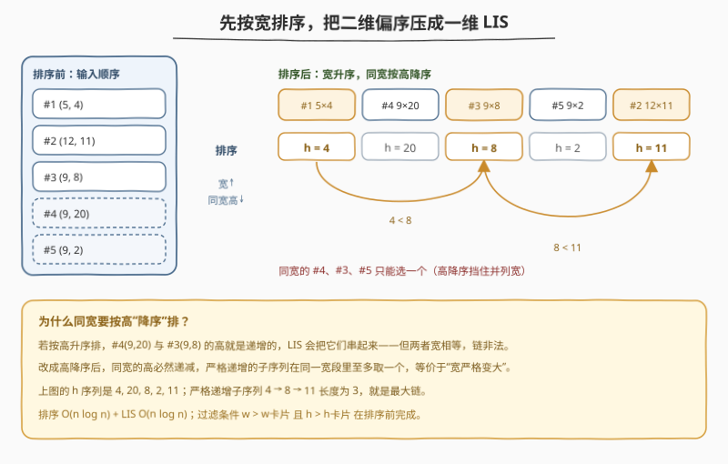
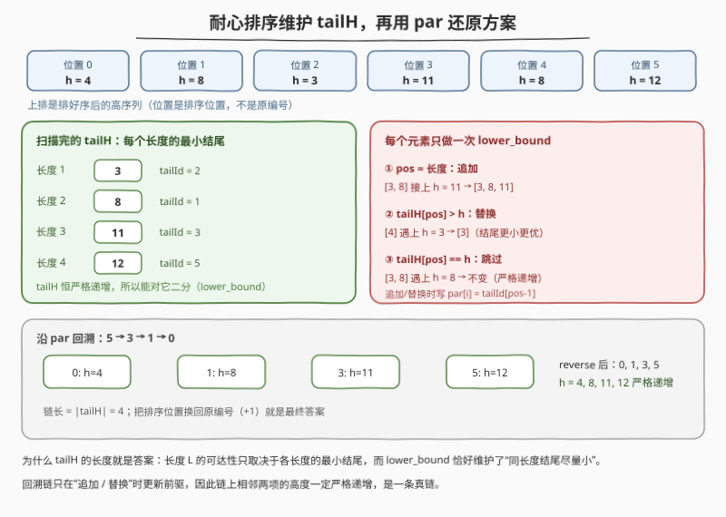
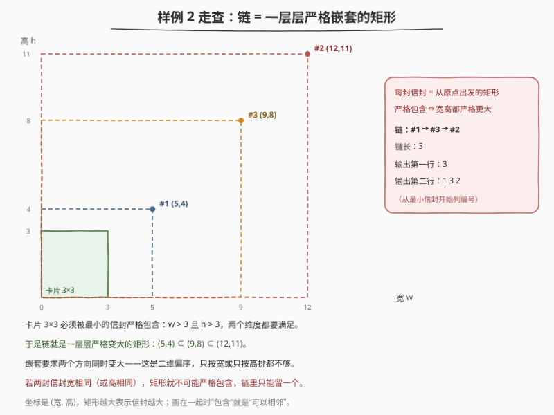

# Codeforces 4D 神秘礼物的信封链 题解

## 1. 题目概述

- **题目链接**：https://codeforces.com/problemset/problem/4/D
- **比赛来源**：Codeforces Beta Round 4 (Div. 2 Only) · Problem D
- **难度**：1700
- **标签**：动态规划、排序（dp, sortings）
- **评测类型**：普通（多解：输出任意一个最长链）
- **限制**：时间 1 s / 内存 64 MB

**题意**：Peter 有 $n$ 个信封，第 $i$ 个宽 $w_i$、高 $h_i$，还有一张宽 $w$、高 $h$ 的卡片。他想用信封串成一条"链"：链中信封依次排列，后一个信封的宽和高都要**严格大于**前一个。卡片要能放进链中**最小的**那个信封，即卡片宽高都要严格小于首封的宽高；卡片和信封都不许旋转。

求最长链的大小，并输出这条链上信封的原编号（从最小的信封开始，用空格分隔）。如果卡片装不进任何一个信封，输出单独的一行 `0`。多解输出任意一组。

**约束**：

- $n \le 5000$：$O(n^2)$ 的 DP 是 $2.5 \times 10^7$ 次比较，C++ 在 1 s 内绰绰有余，但 Python 的纯循环要几十秒；更稳的做法是排序 + $O(n \log n)$ 的 LIS，两种语言都能过。
- $1 \le w, h, w_i, h_i \le 10^6$：值域很小，用 `int` 就够，不会溢出；但**不要**做"按坐标值域开数组"的桶，$10^6 \times 10^6$ 的二维状态开不下，也没必要。
- 时间是严格的 1 s（不是 5 s），$O(n^2)$ 必须写得很紧；而最坏情况下答案要输出 $5000$ 个编号，方案还原的辅助空间也必须控制在 $O(n)$。
- 输入只有一组数据，不是多测 $t$。

## 2. 示例与观察

官方样例 1（输入 / 输出原样）：

```text
输入：
2 1 1
2 2
2 2

输出：
1
1
```

官方样例 2（输入 / 输出原样）：

```text
输入：
3 3 3
5 4
12 11
9 8

输出：
3
1 3 2
```

> 说明：两个官方样例的第二行末尾在题面里各有一个空格，评测按 token 比较，末尾空格不影响判题；本文按整齐排版省略。

**样例 1 演算**：卡片 $1 \times 1$，两个信封都是 $2 \times 2$，都可装下卡片；但两封信封**完全相同**，不满足"严格大于"，不能叠在一起。所以最长链长 1，输出任意一个信封的编号，样例给的是 `1`。

**样例 2 演算**：卡片 $3 \times 3$，三个信封 $(5,4), (12,11), (9,8)$ 都满足 $w_i > 3$ 且 $h_i > 3$。按宽排序是

$$(5,4) \to (9,8) \to (12,11),$$

宽 $5 < 9 < 12$、高 $4 < 8 < 11$ 都严格递增，因此三封信封能全部串起来，链长为 3；对应原编号依次是 $1, 3, 2$。

由此得到两条观察：

1. **"严格大于"卡片的信封才可用**；可用的信封之间又要"两个维度都严格大于"才能相邻。前者是一次过滤，后者是一个二维偏序上的最长链。
2. 只要把二维偏序**按宽排好序**，问题就塌缩成一维的"高严格递增的最长上升子序列"，方案用前驱指针还原即可。

自造样例（标注"自造"，`⏎` 表示换行）：

| 输入 | 输出 | 说明 |
|------|------|------|
| `1 1 1 ⏎ 1 1` | `0` | 宽高都没严格大于卡片，一个都用不了 |
| `1 5 5 ⏎ 6 6` | `1 ⏎ 1` | 恰好严格大于，可用 |
| `4 1 1 ⏎ 2 2 ⏎ 3 3 ⏎ 2 3 ⏎ 3 2` | `2 ⏎ 1 2` | $(2,2) \to (3,3)$；$(2,3)$ 与 $(3,2)$ 互不可比 |
| `2 5 5 ⏎ 5 6 ⏎ 6 5` | `0` | 一个宽等于卡片、一个高等卡片，都不可用 |
| `3 1 1 ⏎ 2 2 ⏎ 2 2 ⏎ 2 2` | `1 ⏎ 1` | 完全相同的信封不能叠，只能选一个 |
| `2 1 1 ⏎ 2 2 ⏎ 50 50` | `2 ⏎ 1 2` | 两封严格递增，链长 2 |
| `3 10 10 ⏎ 11 20 ⏎ 20 11 ⏎ 12 12` | `1 ⏎ 2`（任意一个均可） | 三个信封两两不可比，链长 1 |

第 3 组里 $(2,3)$ 与 $(3,2)$ 互不可比、第 4 组两封信封各差一个维度、第 5 组是同尺寸信封——分别对应"只比一个维度""过滤条件写成或""允许相等"三类典型错误。

## 3. 解题思路

### 3.1 朴素做法与瓶颈

最自然的想法是 DP：把所有可用信封两两比较，令 $dp_i$ 表示以信封 $i$ 结尾的最长链长，

$$dp_i = 1 + \max\{\, dp_j : w_j < w_i \text{ 且 } h_j < h_i \,\},$$

再记一个 $par_i$ 记录取到最大值的那个 $j$，最后从最大的 $dp_i$ 回溯。这是 $O(n^2)$ 时间、$O(n)$ 空间：$n = 5000$ 时 $2.5 \times 10^7$ 次比较，C++ 约 $0.02$ s，能过；但 Python 的纯双层循环要大几十秒，会 TLE。

更糟的是"直接搜索所有链"：最坏情况下可比关系稠密，链的数量是 $2^{\Theta(n)}$，不可行。所以需要一个 $O(n \log n)$ 的做法，让两种语言都稳。

### 3.2 核心观察：排序把二维偏序压成一维 LIS



两个关键处理：

1. **先过滤**：只保留 $w_i > w$ 且 $h_i > h$ 的信封。卡片必须能放进链的首封，而链中宽高严格递增，所以只要首封能装下卡片，后面每一封自然也能装下；反之，不满足条件的信封连单独成链都不行。过滤不丢最优解。
2. **按宽升序、宽相同按高降序排**：宽升序让"宽严格递增"变成"在排序序列里按下标递增"；宽相同时把高**降序**放，是为了让同宽的两个信封在序列里呈"高递减"，从而**不可能**被一个高严格递增的子序列同时选中——这就自动实现了"宽必须严格增大"。

排完之后，合法的链就与"排序序列上高的严格递增子序列"一一对应了。于是问题变成经典的一维 LIS，用"耐心排序"维护 `tailH[len]`（长度 `len+1` 的递增子序列的最小结尾高度）即可，配合 $par$ 指针还原方案。

为什么"高降序"这一步不能省：若同宽按高升序排，$(2,2), (2,3)$ 在序列里就是高递增的，LIS 会把它们串成链，但它们宽相等，实际不合法。这个坑在样例 1 的 $(2,2), (2,2)$ 上同样存在（高相等也不允许），只是那里被"严格递增"挡住了。

### 3.3 算法流程



1. 读入 $n, w, h$，收集所有满足 $w_i > w$ 且 $h_i > h$ 的信封，记为 `(w_i, h_i, i)`（$i$ 为 0 起的原始下标）；若一个都没有，直接输出 `0` 并结束。
2. 按 `(w 升, h 降, 下标升)` 排序。
3. 扫描排序后的序列，维护两个等长数组 `tailH`、`tailId` 和一个前驱数组 `par`：
   - 令 `pos` 为 `tailH` 中第一个 $\ge h_i$ 的位置（`lower_bound` / `bisect_left`）；
   - 若 `pos == len(tailH)`：说明存在长度为 `len` 的链能接上它，于是 `par[i] = tailId.back()`，把 $h_i$ 追加到 `tailH` 末尾，`tailId` 同步追加；
   - 若 `tailH[pos] > h_i`：长度 `pos+1` 的链有了更小的结尾，替换 `tailH[pos] = h_i`、`tailId[pos] = i`，其前驱是 `tailId[pos-1]`；
   - 若 `tailH[pos] == h_i`：跳过（保留更早出现的下标，链长不变）。
4. 从 `tailId.back()` 出发沿 `par` 回溯，得到排序序列上的位置链，`reverse` 之后把每个位置换成原始下标 $+1$，先输出链长、再输出编号。

`tailH` 始终严格递增，这是 `lower_bound` 能用的前提；`tailId[len]` 与 `par` 共同保证任意时刻都能从"当前最优结尾"一路回退出一条真链。

### 3.4 样例走查：样例 2



卡片 $3 \times 3$，三个信封全部可用。排序后（宽升序）：

| 排序位置 | 信封（原编号） | $w$ | $h$ | `lower_bound` 结果 | `tailH` | `par` |
|----------|----------------|-----|-----|--------------------|---------|-------|
| 0 | #1 | 5 | 4 | `pos = 0 = len`，追加 | `[4]` | $-1$ |
| 1 | #3 | 9 | 8 | `pos = 1 = len`，追加 | `[4, 8]` | $0$ |
| 2 | #2 | 12 | 11 | `pos = 2 = len`，追加 | `[4, 8, 11]` | $1$ |

最终 `tailId.back() = 2`，回溯 $2 \to 1 \to 0$，反转得排序位置 $0, 1, 2$，对应原编号 $1, 3, 2$，链长 3 —— 与样例输出一致。

再自查样例 1：排序后两张 $(2,2)$ 顺序为 #1、#2。处理 #1 时 `tailH = [2]`；处理 #2 时 $h = 2$，`lower_bound` 在 `tailH` 中找到 $2 \ge 2$ 的位置 $0$，且 `tailH[0] == h`，于是跳过。最终链长 1，回溯得到 #1，输出 `1`。若这里换成 `upper_bound` 或"相等也替换"，链长仍是 1，但可能输出 #2；两种都对（多解），只是我们选择了与样例一致的那种。

## 4. 正确性证明

**引理 1（过滤不改变答案）**：记可用集合 $S = \{ i : w_i > w,\ h_i > h \}$。则任意合法链的信封都在 $S$ 中；且 $S$ 中任一信封单独构成一条合法链。

**证明**：设链为 $a_1, \dots, a_k$。卡片要能放进"链中最小的信封"，即 $w < w_{a_1}$ 且 $h < h_{a_1}$，故 $a_1 \in S$。链中宽高严格递增，故 $w_{a_1} < w_{a_2} < \dots$、$h_{a_1} < h_{a_2} < \dots$，于是每个 $a_j$ 都满足 $w_{a_j} > w$、$h_{a_j} > h$，即所有信封都在 $S$ 中。反之，任一 $i \in S$ 满足 $w_i > w$、$h_i > h$，单元素序列就是合法链。∎

**引理 2（排序后链与一维 LIS 等价）**：把 $S$ 中的信封按"$w$ 升序，$w$ 相同按 $h$ 降序，再按原始下标升序"排成序列 $e_0, e_1, \dots, e_{m-1}$，记 $H_t = h_{e_t}$。则：序列 $e$ 的一个子序列是合法链，当且仅当它在 $H$ 上严格递增。

**证明**：

（$\Rightarrow$）设子序列对应 $e_{t_1}, \dots, e_{t_k}$（$t_1 < \dots < t_k$）是合法链。链要求相邻两项宽高都严格递增，故 $w$ 严格递增，从而各元素宽互不相同；又排序以宽为主键，所以子序列在 $e$ 中的出现顺序与宽递增顺序一致，即 $w_{e_{t_1}} < \dots < w_{e_{t_k}}$，且 $H_{t_1} = h_{e_{t_1}} < \dots < H_{t_k}$ 严格递增。

（$\Leftarrow$）设 $t_1 < \dots < t_k$ 且 $H_{t_1} < \dots < H_{t_k}$ 严格递增。任取相邻两项 $t_j < t_{j+1}$。若 $w_{e_{t_j}} = w_{e_{t_{j+1}}}$，由排序规则，同宽的元素按高**降序**排列，下标更小的 $t_j$ 其高不小于 $t_{j+1}$，即 $H_{t_j} \ge H_{t_{j+1}}$，与严格递增矛盾。因此 $w_{e_{t_j}} < w_{e_{t_{j+1}}}$。宽和高都严格递增，即为合法链。∎

**引理 3（`tailH` 不变式）**：扫描到第 $i$ 个元素后，对每个 $0 \le \ell < |tailH|$，`tailH[ℓ]` 等于"用前 $i+1$ 个元素能凑出的长度 $\ell+1$ 的严格递增子序列"的最小结尾值，且 `tailH` 严格递增；`tailId[ℓ]` 是取到该最小结尾的位置，沿 `par` 回溯得到一条长度 $\ell+1$ 的严格递增子序列。

**证明**：对 $i$ 归纳。初始 `tailH` 为空，不变式空洞成立。处理 $e_i$（高度 $h$）时，令 $p$ 为第一个满足 `tailH[p] ≥ h` 的位置：

- 若 $p = |tailH|$，则所有现有结尾都 $< h$，用长度 $|tailH|$ 的最优子序列接上 $h$ 得到长度 $|tailH|+1$ 的子序列；更长的子序列不可能凭空产生，故追加后不变式成立（新结尾 $h$ 也是该长度的最小值，因为它是唯一一个）。
- 若 `tailH[p] > h`，则长度 $p+1$ 的子序列结尾可以改小为 $h$（由 $p$ 的最小性，长度 $p$ 的结尾 $< h$，可接上）；其余长度的最小值不变，且替换后 `tailH[p-1] < h < tailH[p+1]` 保持严格递增。
- 若 `tailH[p] == h`，长度 $p+1$ 的最小结尾已经是 $h$，无需改动，链长与最小结尾都不变。

三种情况都保持不变式。`par` 在追加和替换时被赋为长度 $p$ 的最优结尾位置，正是"接在前面"的合法前驱；由归纳假设，沿 `par` 回溯得到的是严格递增子序列。∎

**定理**：算法输出的链长等于最长合法链的长度，输出的编号序列是一条合法链。

**证明**：由引理 1，只需在 $S$ 上讨论；由引理 2，最长合法链长等于 $H$ 的最长严格递增子序列长度；由引理 3，扫描结束时 $|tailH|$ 恰为该 LIS 长度，且从 `tailId.back()` 沿 `par` 回溯得到一条等长的严格递增子序列，对应回原信封即为合法链（引理 2 的 $\Leftarrow$ 方向）。故输出的长度最优、编号序列合法。∎

## 5. 复杂度分析

- **时间**：过滤 $O(n)$，排序 $O(n \log n)$，LIS 每个元素一次 `lower_bound`，共 $O(n \log n)$，回溯 $O(\text{ans}) \le O(n)$。总计 $O(n \log n)$，$n = 5000$ 时约 $5000 \times 13 \approx 6.5 \times 10^4$ 次比较，比 $O(n^2)$ 的 $2.5 \times 10^7$ 小两个数量级。
- **空间**：`(w, h, idx)` 三元组、`tailH`、`tailId`、`par` 各 $O(n)$，$n = 5000$ 时合计不到 $1$ MB 的裸数据，实测峰值 $2.2$ MB，远低于 64 MB。
- **与时限的关系**：$n = 5000$ 的两组极端数据（随机坐标、以及链长为 $5000$ 的严格递增序列）实测 C++ 端到端 $0.014 \sim 0.022$ s、Python $0.022 \sim 0.037$ s，相对 1 s 有 25 倍以上余量；即使换成 $O(n^2)$ 的 DP，C++ 也只需 $0.02$ s，但 Python 会超时，故统一采用 $O(n \log n)$。
- **数值范围**：$w_i, h_i \le 10^6$，比较与排序都在 `int` 范围内，用 `int` 即可；参考代码用 `long long` 存宽高只是顺手兜底，不影响结论；输出编号 $\le 5000$。

## 6. 参考代码

### C++17

```cpp
#include <bits/stdc++.h>
using namespace std;

int main() {
    ios::sync_with_stdio(false);
    cin.tie(nullptr);

    int n;
    long long W, H;
    if (!(cin >> n >> W >> H)) return 0;

    vector<tuple<long long, long long, int>> env;   // (宽, 高, 原始编号)
    for (int i = 0; i < n; ++i) {
        long long w, h;
        cin >> w >> h;
        if (w > W && h > H) env.emplace_back(w, h, i);
    }
    if (env.empty()) {
        cout << 0 << '\n';
        return 0;
    }

    // 宽升序；宽相同时高降序，保证同宽的两张信封不可能被先后选进链
    sort(env.begin(), env.end(), [](const auto &a, const auto &b) {
        if (get<0>(a) != get<0>(b)) return get<0>(a) < get<0>(b);
        if (get<1>(a) != get<1>(b)) return get<1>(a) > get<1>(b);
        return get<2>(a) < get<2>(b);
    });

    int m = static_cast<int>(env.size());
    vector<long long> tailH;   // tailH[len-1]：长度 len 的递增子序列的最小结尾高度
    vector<int> tailId;        // 对应的 env 下标
    vector<int> par(m, -1);    // 链上的前驱

    for (int i = 0; i < m; ++i) {
        long long hi = get<1>(env[i]);
        int pos = static_cast<int>(lower_bound(tailH.begin(), tailH.end(), hi) - tailH.begin());
        if (pos == static_cast<int>(tailH.size())) {
            par[i] = tailId.empty() ? -1 : tailId.back();
            tailH.push_back(hi);
            tailId.push_back(i);
        } else if (tailH[pos] != hi) {   // 严格递增：相等时保留更早的下标，答案更稳
            par[i] = (pos == 0 ? -1 : tailId[pos - 1]);
            tailH[pos] = hi;
            tailId[pos] = i;
        }
    }

    int best = tailId.back();
    vector<int> chain;
    for (int v = best; v != -1; v = par[v]) chain.push_back(get<2>(env[v]));
    reverse(chain.begin(), chain.end());

    cout << chain.size() << '\n';
    for (size_t i = 0; i < chain.size(); ++i) cout << chain[i] + 1 << (i + 1 == chain.size() ? '\n' : ' ');
    return 0;
}
```

### Python3

```python
import sys
from bisect import bisect_left


def main() -> None:
    data = sys.stdin.buffer.read().split()
    if not data:
        return
    n, W, H = int(data[0]), int(data[1]), int(data[2])
    env = []
    p = 3
    for i in range(n):
        w, h = int(data[p]), int(data[p + 1])
        p += 2
        if w > W and h > H:          # 卡片放不进去的信封直接丢掉
            env.append((w, h, i))
    if not env:
        sys.stdout.write("0\n")
        return

    env.sort(key=lambda e: (e[0], -e[1], e[2]))   # 宽升序、高降序
    m = len(env)
    tail_h = []      # 长度 len 的链的最小结尾高度
    tail_id = []     # 对应 env 下标
    par = [-1] * m   # 前驱，用于还原方案

    for i, (w, h, idx) in enumerate(env):
        pos = bisect_left(tail_h, h)
        if pos == len(tail_h):
            par[i] = tail_id[-1] if tail_id else -1
            tail_h.append(h)
            tail_id.append(i)
        elif tail_h[pos] != h:       # 严格递增：相等时不替换，保留更早的下标
            par[i] = tail_id[pos - 1] if pos > 0 else -1
            tail_h[pos] = h
            tail_id[pos] = i

    chain = []
    v = tail_id[-1]
    while v != -1:
        chain.append(env[v][2])
        v = par[v]
    chain.reverse()

    out = [str(len(chain)), " ".join(str(x + 1) for x in chain)]
    sys.stdout.write("\n".join(out) + "\n")


main()
```

两份代码都是 $O(n \log n)$，Python 版在 $n = 5000$ 下实测 $0.03$ s 量级，可直接提交（不必依赖 PyPy3）。

## 7. 边界情况与易错点

1. **两个维度都要严格大于卡片**：条件是 $w_i > w$ **且** $h_i > h$，不是"或"。自造样例 `2 5 5 ⏎ 5 6 ⏎ 6 5` 中两封信封各满足一边、另一边不满足，正确答案是 `0`；写成"或"会输出 2。
2. **链中的"严格"**：相邻信封必须宽高**都**严格增大。完全相同的两封（如样例 1 的 $(2,2), (2,2)$）不能相邻；实现上"高严格递增"必须用 `lower_bound`（$\ge$ 的第一个位置）而不是 `upper_bound`，否则会把相等的高也接上。
3. **同宽必须按高降序排**：这是本题最隐蔽的坑。若按 `(w 升, h 升)` 排，$(2,2)$、$(2,3)$ 在序列里高是递增的，LIS 会把它们串起来，但两者宽相等、链非法。降序排列让同宽内部高递减，LIS 就只能从中挑一个。
4. **下标是输入顺序，不是排序顺序**：三元组里必须带上原始下标 $i$，回溯后输出 $i+1$；输出的是"从最小信封开始"的顺序，所以回溯结果要 `reverse`，不能直接从 `tailId.back()` 往前打印。
5. **无解只输出一行 `0`**：卡片装不进任何信封时输出单个 0，**不要**再输出一个空行或第二行的空串（多余行在严格比较下可能被判错）。代码里 `env.empty()` 分支直接 `return`。
6. **忘记过滤会导致下标错位**：如果先对全部 $n$ 封信封排序、再在输出时跳过不可用的，很容易把原编号搞混；正确做法是过滤后立刻把原始下标写进三元组。
7. **`n = 1`**：只有一个信封且可用时输出 `1` 和 `1`；不可用时输出 `0`。两条分支都要覆盖。
8. **多解要能接受"任意一个"**：样例 1 输出 `1` 或 `2` 都合法。本地用文本比对时容易误判，必须用 checker 校验"长度最优 + 链合法"，否则会把正确程序判成错的。
9. **排序键不要用浮点或字符串**：$w, h$ 直接按整数比较；`(w, -h, idx)` 在 Python 里天然可用，C++ 里写三段比较器。
10. **`lower_bound` 的区间**：`tailH` 必须始终严格递增，才能对它二分；替换分支里 `tailH[pos - 1] < h < tailH[pos + 1]` 保证了这个性质（端点处只看相邻的一侧，见引理 3），不要把 `pos` 写错。

## 8. 验证记录

- **编译环境与命令**：本机没有 GNU `g++`，C++ 用 `clang++ -std=c++17 -O2` 搭配 `codeforces/tools/include/bits/stdc++.h` 兼容头编译，代码只用标准库，可原样提交 GNU C++17；Python 为 `Python 3.9.6`。
- **官方样例**：2 / 2 通过（C++ 与 Python 输出均与样例逐 token 相同）。因为本题**多解**，除文本比对外还用 checker 复核：`python3 codeforces/tools/verify_solution.py codeforces/contests/0001-0100/4/D_神秘礼物的信封链.md --checker /tmp/cf_verify_4_D/checker.py`。checker 的校验条件是：
  1. 若卡片装不进任何信封，输出必须恰好是单个 `0`；
  2. 否则第一行给出链长 $k$，第二行给出 $k$ 个下标，且 $k$ 必须等于 checker 用独立 $O(n^2)$ DP 算出的最优长度；
  3. 下标互不重复、都在 $[1, n]$ 内；按输出顺序，每个信封都要装得下卡片（$w_i > w$ 且 $h_i > h$），且相邻两封宽高都严格递增。
- **独立暴力对拍**：另写 Python 的 $O(n^2)$ DP（只算长度，不含 LIS 结构），生成 **300 组**随机小数据（三种模式各 100 组：$n \le 8$ 的随机坐标；坐标值域被压到 $\{1,2\}$ 制造大量相等并不可用；沿对角线生成以便出现长度 5 的链），C++ 与 Python 各跑一遍，共 **600 次**比对；每次都比对"参考输出声明的链长 = 暴力最优长度"，并用上面的 checker 验证方案合法。**全部一致，0 处不符**，覆盖到的答案范围是链长 $0 \sim 5$。
- **最大约束性能**：三组 $n = 5000$ 数据——(a) 坐标在 $[2, 10^6]$ 随机（链长 138）；(b) $(2,2), (3,3), \dots$ 严格递增（链长 5000，必须完整输出 5000 个编号）；(c) 全部坐标在 $\{500000, 500001, 500002\}$ 中（大量并列，链长 2）。C++ 端到端 $0.014 \sim 0.022$ s、峰值内存 $2.2$ MB；Python $0.022 \sim 0.037$ s、峰值 $12.9$ MB，均远低于 1 s / 64 MB。
- **图片校验**：三张 SVG（`cf4d_sort_to_lis.svg`、`cf4d_lis_patience.svg`、`cf4d_walkthrough_sample2.svg`）均通过 `xml.etree.ElementTree.parse`，并用无头浏览器取每个 `text` 的 `getBBox` 复核：无越出 `viewBox`、无文字互相重叠、无文字溢出所在方框。
- **公式校验**：正文公式经 `node codeforces/tools/katex_check.cjs`（`throwOnError`）渲染无报错。
- **复核状态**：verified（样例、600 次对拍 + checker、性能、图片、公式五项均实跑通过；环境差异仅在于本机无 GNU g++，已用 clang++ 等价验证）。

## 相关题目与扩展

- [Codeforces 4C Registration System](https://codeforces.com/problemset/problem/4/C)：同场 C 题，哈希 + 游标，与本篇的排序 + LIS 正好是两种典型套路。
- [Codeforces 4A 西瓜](https://codeforces.com/problemset/problem/4/A)、[Codeforces 4B Before an Exam](https://codeforces.com/problemset/problem/4/B)：同场 A、B 题，可按场次顺序刷。
- [Codeforces 269B Greenhouse Effect](https://codeforces.com/problemset/problem/269/B)：把"最少移动次数"转化成"最长不下降子序列"，同属"排序 + LIS"建模。
- [Codeforces 363D Renting Bikes](https://codeforces.com/problemset/problem/363/D)：排序 + 贪心/二分，对照"先排序让偏序变线性"的思路。
- [Codeforces 474D Flowers](https://codeforces.com/problemset/problem/474/D)：线性 DP 的前缀和优化，可作为 LIS 之外的另一类"按结尾转移"的练习。
- [LeetCode 354. 俄罗斯套娃信封问题](https://leetcode.cn/problems/russian-doll-envelopes/)：几乎是本题的原型（二维严格递增的最长链），连"同宽按高降序"的技巧都一模一样，可以拿来对拍。

**延伸思考**：

1. **如果要求输出字典序最小的最优链**：本文的任意解就不够了。需要先算出以每个信封为结尾的最长链长 $f_i$（正向 LIS）和以它为开头的最大链长 $g_i$（反向 LIS），再从左往右贪心选取"能接上且 $f_i$ 足够大"的最小下标信封，总复杂度仍是 $O(n \log n)$。
2. **如果 $n$ 放大到 $10^6$**：$O(n \log n)$ 依然可行，但排序的比较次数与内存会成为瓶颈；若坐标值域也很大，可以改用 CDQ 分治或树状数组维护"高 $\to$ 最大链长"来做离线二维偏序，避免排序的常数开销。
3. **如果链允许旋转信封**：$90^\circ$ 旋转意味着每个信封有两种朝向 $(w_i, h_i)$ 与 $(h_i, w_i)$，问题从"选子序列"变成"选朝向 + 选子序列"，需要把每个信封拆成两个节点并加"同一信封最多选一次"的约束，简单的 LIS 就不够用了。
4. **如果改成"链中宽高之积递增"**：排序不再能把二维压成一维（乘积序与分量序不一致），最长链会变成一般 DAG 上的最长路，$O(n^2)$ 是常规做法，需要更高级的数据结构才能做到亚二次。
5. **为什么"严格"可以用 `lower_bound`、"不严格"要用 `upper_bound`**：这是 LIS 类问题最常见的笔误来源，本质是"能否把等于当前结尾的元素接在后面"。本题要求严格，所以相等时必须停在原地；把这个判据记牢，俄罗斯套娃、导弹拦截一类题都不会再错。
