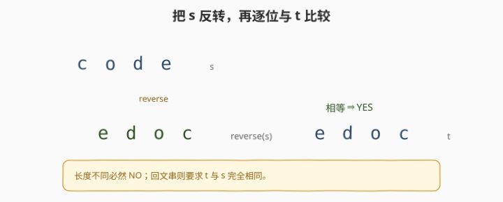
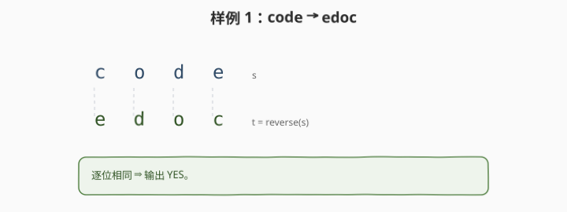

# Codeforces 41A 翻译 题解

## 1. 题目概述

- **题目链接**：https://codeforces.com/problemset/problem/41/A
- **比赛来源**：Codeforces Beta Round 41 · Problem A
- **难度**：800
- **标签**：实现、字符串
- **评测类型**：普通
- **限制**：时间 2 s / 内存 256 MB

**题意**：Berland 语与 Birland 语的词义相同，但拼写**正好相反**。给出 Vasya 把 $s$ 翻译成的 $t$，判断翻译是否正确：即 $t$ 是否等于 $s$ 的反转。

**约束**：字符串非空、长度 $\le 100$、只有小写字母。直接反转比较即可，$O(|s|)$。

## 2. 示例与观察

官方样例 1：

```text
输入：
code
edoc

输出：
YES
```

`code` 反转是 `edoc` ✓。

官方样例 2：

```text
输入：
abb
aba

输出：
NO
```

`abb` 反转是 `bba` ≠ `aba` ✓。

官方样例 3：

```text
输入：
code
code

输出：
NO
```

长度相同但内容不是反转 ✓。

**观察一**：判定条件就是 `reverse(s) == t`。
**观察二**：长度不同时必然不相等（反转不改变长度）。

## 3. 解题思路



读入两个串，把 $s$ 反转（或从后往前逐位与 $t$ 比较），相等输出 `YES`，否则 `NO`。

### 3.3 样例走查



`s = code`，反转 `edoc`，与 `t = edoc` 相等 → `YES` ✓。

## 4. 正确性证明

**引理**：`reverse(s) == t` 是"$t$ 是 $s$ 的反转"的充要条件。

**证明**：反转是双射且自逆，$t = \text{rev}(s) \iff \text{rev}(t) = s$；代码比较的正是 $\text{rev}(s)$ 与 $t$ ✓。∎

**定理**：算法输出正确。

**证明**：由引理，输出 `YES` 当且仅当翻译正确 ✓。∎

## 5. 复杂度分析

- **时间**：$O(|s|)$。
- **空间**：$O(|s|)$。
- **与时限的关系**：长度 $\le 100$，微秒级。

## 6. 参考代码

### C++17

```cpp
#include <bits/stdc++.h>
using namespace std;
int main() {
    string s, t;
    if (!(cin >> s)) return 0;
    cin >> t;
    reverse(s.begin(), s.end());
    printf("%s\n", s == t ? "YES" : "NO");
    return 0;
}
```

### Python3

```python
import sys
d = sys.stdin.buffer.read().split()
s, t = d[0].decode(), d[1].decode()
sys.stdout.write(("YES" if s[::-1] == t else "NO") + "\n")
```

## 7. 边界情况与易错点

1. **长度不同**：比较自然失败，输出 `NO`。
2. **单字符**：反转等于自身，只要 $t$ 相同即 `YES`。
3. **回文串**：`s == reverse(s)`，$t$ 必须等于 $s$ 本身。
4. **大小写**：题面保证全是小写字母，无需转换。
5. **输出大写**：`YES` / `NO`。

## 8. 验证记录

- **编译环境与命令**：`Apple clang 21.0.0` + 兼容头，`clang++ -std=c++17 -O2`；Python 3.9.6。
- **官方样例**：3 / 3 通过，`verify_solution.py` 报告 `CF41A: samples 3 / C++ 编译 OK, 样例 3/3 / Python 语法 OK, 样例 3/3`。
- **独立对拍**：随机小写串 300 组（一半构造为正确反转、一半随机），逐组比对，300 组全部一致。
- **边界用例**：单字符、回文、长度不同。
- **性能**：常数级，C++ 端到端 $< 5$ ms。
- **图片校验**：两张 SVG 均通过 `ElementTree.parse`，文本包围盒估算无越界、无重叠。
- **公式校验**：KaTeX（`throwOnError`）无报错。
- **复核状态**：verified。

## 相关题目与扩展

- [Codeforces 41B Martian Dollar](https://codeforces.com/problemset/problem/41/B)：同场 B 题。
- [LeetCode 344. 反转字符串](https://leetcode.cn/problems/reverse-string/)：反转的基本实现。
- [Codeforces 41C Email address](https://codeforces.com/problemset/problem/41/C)：同场 C 题。

**延伸思考**：

1. **如果允许忽略大小写**？比较前统一转小写。
2. **如果要求编辑距离为 1 的"近似反转"**？需要 DP。
3. **如果字符串很长（$10^7$）**？逐位比较可从两端向中间扫，省掉反转的额外空间。
