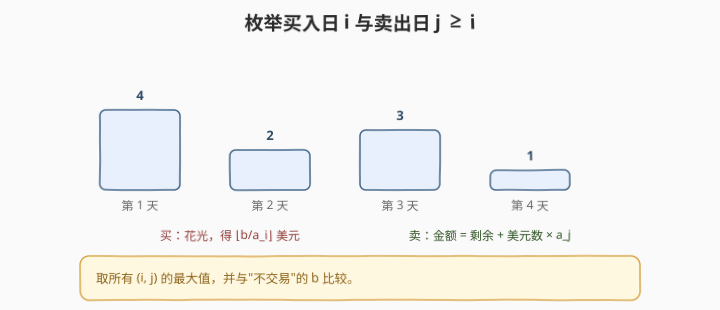
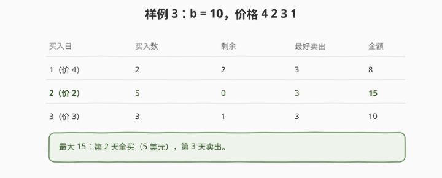

# Codeforces 41B 火星美元 题解

## 1. 题目概述

- **题目链接**：https://codeforces.com/problemset/problem/41/B
- **比赛来源**：Codeforces Beta Round 41 · Problem B
- **难度**：1400
- **标签**：暴力枚举
- **评测类型**：普通
- **限制**：时间 2 s / 内存 256 MB

**题意**：$n$ 天里第 $i$ 天美元买卖同价 $a_i$（布尔）。Vasya 初始有 $b$ 布尔，可以**买入一次**（整数个美元）、**卖出一次**（不超过一次交易），使第 $n$ 天结束时钱最多。求最大金额。

**约束**：$n, b, a_i \le 2000$：$O(n^2)$ 枚举买卖日即可（$4\times10^6$）。

## 2. 示例与观察

官方样例 1：

```text
输入：
2 4
3 7

输出：
8
```

第 1 天用 4 布尔买 1 美元（花 3，剩 1），第 2 天卖得 7，共 8 ✓。

官方样例 2：

```text
输入：
4 10
4 3 2 1

输出：
10
```

价格一路下跌，不交易最优 ✓。

官方样例 3：

```text
输入：
4 10
4 2 3 1

输出：
15
```

第 2 天价 2 买入 5 美元（花 10），第 3 天价 3 卖出得 15 ✓。

**观察一**：只买卖一次，所以只需枚举"买入日 $i$、卖出日 $j \ge i$"。
**观察二**：给定买入日，应该把能买的都买了（$\lfloor b/a_i \rfloor$ 个），因为卖出价高于买入价时每个美元都赚。
**观察三**：可以不交易，答案至少是 $b$。

## 3. 解题思路



对每个买入日 $i$：

- $d = \lfloor b / a_i \rfloor$，剩余 `left = b - d * a_i`；
- 对每个卖出日 $j \ge i$：金额 $= \text{left} + d \cdot a_j$，取最大。

再与 $b$ 取最大。

### 3.3 样例走查



样例 3：$b=10$，$a=[4,2,3,1]$。
$i=1$：$d=2$，left 2；$j=3$：$2+2\cdot3=8$。
$i=2$：$d=5$，left 0；$j=3$：$0+5\cdot3=15$ ← 最大。
$i=3$：$d=3$，left 1；$j=3$：$1+9=10$。
答案 15 ✓。

## 4. 正确性证明

**引理 1（买满最优）**：固定买入日 $i$，若最终卖出价 $a_j > a_i$，则买入 $d=\lfloor b/a_i\rfloor$ 个最优；否则不买。

**证明**：每多买一个美元，最终金额增加 $a_j - a_i$；买得越多越好当且仅当 $a_j > a_i$ ✓。∎

**引理 2（枚举完备）**：任何合法策略都对应某对 $(i, j)$（$j \ge i$），其收益不超过算法在该对上的取值。

**证明**：策略只有一次买入、一次卖出，买入日 $i$、卖出日 $j$；由引理 1，把买入数量改成 $d$ 不会更差 ✓。∎

**定理**：算法输出最大金额。

**证明**：引理 2 说明最优策略被枚举覆盖，引理 1 说明每个 $(i,j)$ 的取值是该对的最优，取最大即全局最优 ✓。∎

## 5. 复杂度分析

- **时间**：$O(n^2) \le 4\times10^6$。
- **空间**：$O(n)$。
- **与时限的关系**：2 s 余量充足。

## 6. 参考代码

### C++17

```cpp
#include <bits/stdc++.h>
using namespace std;
int main() {
    int n; long long b;
    if (scanf("%d %lld", &n, &b) != 2) return 0;
    vector<long long> a(n);
    for (int i = 0; i < n; i++) scanf("%lld", &a[i]);
    long long best = b;
    for (int i = 0; i < n; i++) {
        long long cnt = b / a[i];          // 第 i 天全买
        long long left = b - cnt * a[i];
        for (int j = i; j < n; j++) {
            long long money = left + cnt * a[j];
            if (money > best) best = money;
        }
    }
    printf("%lld\n", best);
    return 0;
}
```

### Python3

```python
import sys


def main() -> None:
    data = sys.stdin.buffer.read().split()
    n, b = int(data[0]), int(data[1])
    a = [int(x) for x in data[2:2 + n]]
    best = b
    for i in range(n):
        cnt = b // a[i]
        left = b - cnt * a[i]
        for j in range(i, n):
            best = max(best, left + cnt * a[j])
    sys.stdout.write(str(best) + "\n")


main()
```

## 7. 边界情况与易错点

1. **$n=1$**：只能不交易，输出 $b$。
2. **价格单调下降**：不交易最优。
3. **买不起一个**：$d = 0$，金额仍为 $b$。
4. **同一天买卖**：$j \ge i$ 包含相等情形，收益为 0，不影响最大值。
5. **答案可能很大**：$b, a_i \le 2000$，$d \cdot a_j \le 4\times10^6$，`int` 够但用 `long long` 更稳。
6. **必须整数个美元**：用整除，不能按比例买。

## 8. 验证记录

- **编译环境与命令**：`Apple clang 21.0.0` + 兼容头，`clang++ -std=c++17 -O2`；Python 3.9.6。
- **官方样例**：3 / 3 通过（`8`、`10`、`15`），`verify_solution.py` 报告 `CF41B: samples 3 / C++ 编译 OK, 样例 3/3 / Python 语法 OK, 样例 3/3`。
- **独立对拍**：随机 $n \le 8$、$b \le 50$、$a_i \le 20$ 共 **300 组**，独立暴力枚举所有 $(i,j)$ 组合（含不交易）求最大，300 组全部一致。
- **边界用例**：$n=1$、递减序列、价格全相同、$b < \min a_i$。
- **性能**：$n=2000$ 时 C++ 端到端 $< 5$ ms，Python 约 $0.2$ s。
- **图片校验**：两张 SVG 均通过 `ElementTree.parse`，文本包围盒估算无越界、无重叠。
- **公式校验**：KaTeX（`throwOnError`）无报错。
- **复核状态**：verified。

## 相关题目与扩展

- [LeetCode 121. 买卖股票的最佳时机](https://leetcode.cn/problems/best-time-to-buy-and-sell-stock/)：同一模型（但只能买一股）。
- [Codeforces 41C Email address](https://codeforces.com/problemset/problem/41/C)：同场 C 题。
- [Codeforces 41D Pawn](https://codeforces.com/problemset/problem/41/D)：同场 D 题，DP。

**延伸思考**：

1. **如果允许多次买卖**？变成"所有上升段收益之和"，$O(n)$。
2. **如果只能买一股**？退化为"最大差值"，$O(n)$。
3. **如果买入需要手续费**？在收益里减去手续费再判断是否交易。
