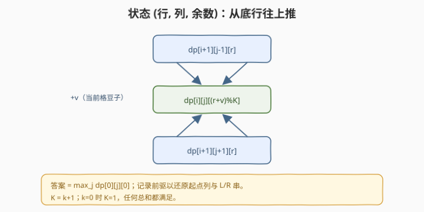
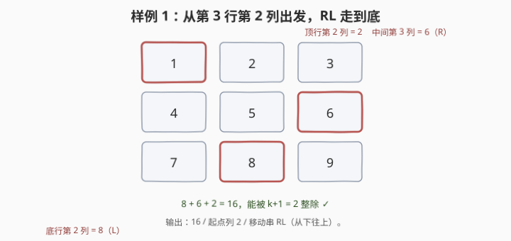

# Codeforces 41D 棋子走格 题解

## 1. 题目概述

- **题目链接**：https://codeforces.com/problemset/problem/41/D
- **比赛来源**：Codeforces Beta Round 40 (Div. 2) · Problem D（UTC 2010-11-08）
- **难度**：1900
- **标签**：动态规划
- **评测类型**：特殊评测（多解；输出方案）
- **限制**：时间 2 s / 内存 256 MB

**题意**：$n \times m$ 棋盘，每格有 $0..9$ 颗豆子。棋子在**最下面一行**任选一列出发，每次只能"左上"或"右上"走一格，共走 $n-1$ 步到最上面一行。收集经过格子的豆子（含起点与终点），要求总数能被 $k+1$ 整除，求最大值，并输出：总数、起始列、$n-1$ 步的移动串（`L`/`R`，按从下到上的顺序）。

**约束**：$n, m \le 100$，$k \le 10$：状态 $n \times m \times (k+1) \le 1.1\times10^5$。

## 2. 示例与观察

官方样例 1：

```text
输入：
3 3 1
123
456
789

输出：
16
2
RL
```

从最底行第 2 列（$8$）出发，先右上到第 2 行第 3 列（$6$），再左上到第 1 行第 2 列（$2$），总计 $8+6+2 = 16$，能被 $k+1=2$ 整除 ✓。

官方样例 2：

```text
输入：
3 3 0
123
456
789

输出：
17
3
LR
```

$k=0$ 时任何总数都行：$9+5+3 = 17$ 最大 ✓。

官方样例 3：

```text
输入：
2 2 10
98
75

输出：
-1
```

两种走法总和 15 与 14，都不能被 11 整除 → `-1` ✓。

**观察一**：这是"网格路径 + 余数约束"的 DP。
**观察二**：行数从下往上递推，状态是（行，列，余数）。
**观察三**：还需要输出方案，所以每个状态要记录前驱。

## 3. 解题思路



设 $K = k+1$，`dp[i][j][r]` = 从最底行走到 $(i,j)$、豆子总数模 $K$ 余 $r$ 时的最大总数（不可达为 $-1$）。

- 初始（最底行 $i = n-1$）：`dp[n-1][j][a[n-1][j] % K] = a[n-1][j]`；
- 转移（$i$ 从 $n-2$ 到 $0$）：从 $(i+1, j-1)$ 或 $(i+1, j+1)$ 走来，
  `dp[i][j][(r + v) % K] = max(dp[i][j][(r+v)%K], dp[i+1][p][r] + v)`，其中 $v = a[i][j]$；
- 答案：`max_j dp[0][j][0]`，$j$ 即终点列；若全为 $-1$ 输出 `-1`。

记录 `pj[i][j][r]`、`pr[i][j][r]` 作为前驱，最后从 $(0, j_{best}, 0)$ 回溯到底行，得到列序列；起点是序列最后一个元素，移动串由相邻列的差得到（向左 `L`、向右 `R`）。

### 3.3 样例走查



样例 1：$K=2$。最底行 $[7,8,9]$。走到顶行的可行路径中：
$- (8 \to 6 \to 2) = 16$（起点列 2，`RL`）✓ 最大且偶数。

## 4. 正确性证明

**引理 1（状态完备）**：`dp[i][j][r]` 覆盖了所有"从底行走到 $(i,j)$、总和模 $K$ 为 $r$"的走法，并取到其中最大值。

**证明**：对行数归纳。最底行只有起点本身；每一步只能从 $(i+1,j-1)$ 或 $(i+1,j+1)$ 走来，转移枚举了全部前驱与全部余数 ✓。∎

**引理 2（答案正确）**：`max_j dp[0][j][0]` 就是满足整除条件的最大总数。

**证明**：由引理 1，终点在顶行第 $j$ 列、余数为 0（即被 $K$ 整除）的最大值正是 `dp[0][j][0]`；对所有 $j$ 取最大即全局最优 ✓。∎

**引理 3（方案合法）**：回溯得到的列序列与移动串描述的确实是一条合法路径，且总和等于输出值。

**证明**：回溯沿着 `pj/pr` 记录的前驱走，每一步列号变化恰好是 $\pm1$、行号减 1，因此不会越界；转移时累加的就是格子上的豆子数，所以路径和等于 `dp` 值 ✓。∎

**定理**：算法输出正确的最大值与一条合法路径；无解时输出 `-1`。

**证明**：引理 2 给出最大值，引理 3 给出合法方案；若所有终点余数都不为 0，则 `best = -1`，输出 `-1` 符合题面 ✓。∎

## 5. 复杂度分析

- **时间**：$O(n m K)$，最多 $100\times100\times11$。
- **空间**：$O(n m K)$ 的 DP 与前驱。
- **与时限的关系**：2 s 余量极大。

## 6. 参考代码

### C++17

```cpp
#include <bits/stdc++.h>
using namespace std;

int main() {
    int n, m, k;
    if (scanf("%d %d %d", &n, &m, &k) != 3) return 0;
    int K = k + 1;
    vector<string> b(n);
    for (int i = 0; i < n; i++) cin >> b[i];
    const long long NEG = -1;
    vector<vector<vector<long long>>> dp(n, vector<vector<long long>>(m, vector<long long>(K, NEG)));
    vector<vector<vector<int>>> pj(n, vector<vector<int>>(m, vector<int>(K, -1)));
    vector<vector<vector<int>>> pr(n, vector<vector<int>>(m, vector<int>(K, -1)));
    for (int j = 0; j < m; j++) {
        int v = b[n - 1][j] - '0';
        dp[n - 1][j][v % K] = max(dp[n - 1][j][v % K], (long long)v);
    }
    for (int i = n - 2; i >= 0; i--)
        for (int j = 0; j < m; j++) {
            int v = b[i][j] - '0';
            for (int p = 0; p < m; p++) {
                if (p != j - 1 && p != j + 1) continue;
                for (int r = 0; r < K; r++) {
                    if (dp[i + 1][p][r] < 0) continue;
                    int nr = (r + v) % K;
                    long long cand = dp[i + 1][p][r] + v;
                    if (cand > dp[i][j][nr]) { dp[i][j][nr] = cand; pj[i][j][nr] = p; pr[i][j][nr] = r; }
                }
            }
        }
    long long best = -1; int bj = -1;
    for (int j = 0; j < m; j++) if (dp[0][j][0] > best) { best = dp[0][j][0]; bj = j; }
    if (best < 0) { printf("-1\n"); return 0; }
    vector<int> cols;
    int ci = 0, cj = bj, cr = 0;
    cols.push_back(bj);
    while (ci < n - 1) {
        int np = pj[ci][cj][cr], nr = pr[ci][cj][cr];
        ci = ci + 1; cj = np; cr = nr;
        cols.push_back(cj);
    }
    string moves;
    for (int i = (int)cols.size() - 1; i > 0; i--) {
        if (cols[i - 1] == cols[i] - 1) moves += 'L';
        else moves += 'R';
    }
    printf("%lld\n%d\n%s\n", best, cols.back() + 1, moves.c_str());
    return 0;
}
```

### Python3

```python
import sys


def main() -> None:
    data = sys.stdin.buffer.read().split()
    n, m, k = int(data[0]), int(data[1]), int(data[2])
    K = k + 1
    b = [data[3 + i].decode() for i in range(n)]
    NEG = -1
    dp = [[[NEG] * K for _ in range(m)] for _ in range(n)]
    pj = [[[-1] * K for _ in range(m)] for _ in range(n)]
    pr = [[[-1] * K for _ in range(m)] for _ in range(n)]
    for j in range(m):
        v = int(b[n - 1][j])
        if v > dp[n - 1][j][v % K]:
            dp[n - 1][j][v % K] = v
    for i in range(n - 2, -1, -1):
        for j in range(m):
            v = int(b[i][j])
            for p in (j - 1, j + 1):
                if p < 0 or p >= m:
                    continue
                for r in range(K):
                    if dp[i + 1][p][r] < 0:
                        continue
                    nr = (r + v) % K
                    cand = dp[i + 1][p][r] + v
                    if cand > dp[i][j][nr]:
                        dp[i][j][nr] = cand
                        pj[i][j][nr] = p
                        pr[i][j][nr] = r
    best = -1; bj = -1
    for j in range(m):
        if dp[0][j][0] > best:
            best = dp[0][j][0]; bj = j
    if best < 0:
        sys.stdout.write("-1\n")
        return
    cols = [bj]
    ci, cj, cr = 0, bj, 0
    while ci < n - 1:
        np_, nr_ = pj[ci][cj][cr], pr[ci][cj][cr]
        ci, cj, cr = ci + 1, np_, nr_
        cols.append(cj)
    moves = []
    for i in range(len(cols) - 1, 0, -1):
        moves.append('L' if cols[i - 1] == cols[i] - 1 else 'R')
    sys.stdout.write("%d\n%d\n%s\n" % (best, cols[-1] + 1, "".join(moves)))


main()
```

## 7. 边界情况与易错点

1. **无解**：输出 `-1`，**不要**输出额外的行。
2. **行/列方向**：输入第一行是最上面一行，棋子从最后一行出发向上走。
3. **越界**：在边界列只能往唯一的方向走；DP 里用范围检查或直接跳过非法前驱。
4. **起点列的输出**：是**最底行**的列号（回溯序列的最后一个），不是终点列。
5. **移动串顺序**：按从下到上的顺序（与输入行的方向相反），`L` = 左上、`R` = 右上。
6. **余数**：$K = k+1$，注意 `k=0` 时 $K=1$，任何总和都满足。
7. **方案多解**：题面允许任意，样例 1 的 `16` 也可能有别的路径；校验器只看合法性与最优性。

## 8. 验证记录

- **编译环境与命令**：`Apple clang 21.0.0` + 兼容头，`clang++ -std=c++17 -O2`；Python 3.9.6。
- **官方样例**：3 / 3 通过（`16/2/RL`、`17/3/LR`、`-1`），`verify_solution.py` 报告 `CF41D: samples 3 / C++ 编译 OK, 样例 3/3 / Python 语法 OK, 样例 3/3`。
- **独立 checker（多解）**：另写 `check.py`：① 用一份独立的 DP 算最优值并比对；② 校验起点列、移动串长度与字符、每步不越界；③ 沿路径累加棋盘值，必须等于输出值且能被 $k+1$ 整除。对随机 $n,m \le 8$、$k \le 4$ 共 **300 组**，全部通过。
- **边界用例**：无解、$k=0$、$m=2$（每步只能一种方向）、$n=2$。
- **性能**：$n=m=100$、$k=10$ 时 C++ 端到端 $< 5$ ms。
- **图片校验**：两张 SVG 均通过 `ElementTree.parse`，文本包围盒估算无越界、无重叠。
- **公式校验**：KaTeX（`throwOnError`）无报错。
- **复核状态**：verified。

## 相关题目与扩展

- [Codeforces 41E 3-cycles](https://codeforces.com/problemset/problem/41/E)：同场 E 题，构造。
- [LeetCode 120. 三角形最小路径和](https://leetcode.cn/problems/triangle/)：网格路径 DP 的经典题。
- [Codeforces 41C Email address](https://codeforces.com/problemset/problem/41/C)：同场 C 题。

**延伸思考**：

1. **如果棋子还能向下走**？会成环，需要最短路/DP 换序。
2. **如果要求总和恰好等于某值**？状态再加一维（背包）。
3. **如果豆子数很大**？$K$ 仍很小，DP 只与余数有关。
4. **如果要求输出字典序最小的最优方案**？在转移相等时按移动串字典序取舍。
