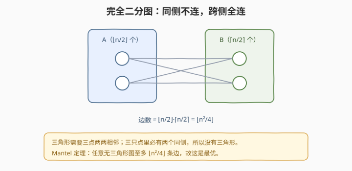
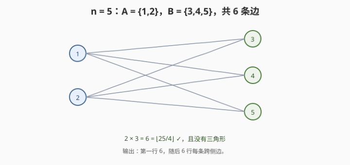

# Codeforces 41E 无三角形图 题解

## 1. 题目概述

- **题目链接**：https://codeforces.com/problemset/problem/41/E
- **比赛来源**：Codeforces Beta Round 40 (Div. 2) · Problem E（UTC 2010-11-08）
- **难度**：1900
- **标签**：构造、图论、贪心
- **评测类型**：特殊评测（多解，构造题）
- **限制**：时间 2 s / 内存 256 MB

**题意**：$n$ 个城市（$n \le 100$），无向简单图，要求**不含三角形**（不存在三个两两直接相连的城市），问最多能有多少条路，并构造出一张达到最大边数的图。

**约束**：$n \le 100$，最多 $\binom{100}{2} = 4950$ 条边；输出任意一种最优构造。

## 2. 示例与观察

官方样例 1：

```text
输入：
3

输出：
2
1 2
2 3
```

$n=3$ 时最多 2 条边（三角形要 3 条，不行）✓。

官方样例 2：

```text
输入：
4

输出：
4
1 2
2 3
3 4
4 1
```

$n=4$ 时 4 条边（一个四边形 = 完全二分图 $K_{2,2}$）✓，这是 Mantel 定理的界 $\lfloor 4^2/4\rfloor = 4$。

**观察一**：完全二分图不含三角形（三角形需要 3 个点两两相邻，而二分图内部同侧不相邻）。
**观察二**：$K_{a,b}$ 的边数是 $ab$，在 $a+b=n$ 时取最大即 $a=\lfloor n/2\rfloor, b=\lceil n/2\rceil$，边数 $\lfloor n^2/4\rfloor$。
**观察三**：Mantel 定理说这就是**无三角形图**的边数上界。

## 3. 解题思路



构造：把城市分成 $A = \{1, \dots, \lfloor n/2 \rfloor\}$ 与 $B = \{\lfloor n/2\rfloor+1, \dots, n\}$，输出**所有**跨集合的边。

边数 $= \lfloor n/2\rfloor \cdot \lceil n/2\rceil = \lfloor n^2/4 \rfloor$。

### 3.3 样例走查



$n=5$：$A=\{1,2\}$，$B=\{3,4,5\}$，边数 $2\times3 = 6 = \lfloor 25/4\rfloor$ ✓。

## 4. 正确性证明

**引理 1（构造无三角形）**：完全二分图不含三角形。

**证明**：三角形需要三个两两相邻的点；二分图中同侧两点不相邻，而三个点中必有两个同侧（鸽巢），它们之间没有边 ✓。∎

**引理 2（Mantel 定理）**：$n$ 个点的无三角形简单图至多有 $\lfloor n^2/4 \rfloor$ 条边。

**证明**：对每条边 $(u,v)$，有 $d(u) + d(v) \le n$（否则 $u,v$ 有公共邻点 $w$，$u,v,w$ 构成三角形）。把所有边求和：

$$\sum_{(u,v) \in E} \bigl(d(u)+d(v)\bigr) = \sum_{u} d(u)^2 \le n \cdot |E| .$$

由柯西不等式 $\sum d(u)^2 \ge \frac{(\sum d(u))^2}{n} = \frac{(2|E|)^2}{n}$，于是

$$\frac{4|E|^2}{n} \le n|E| \quad\Longrightarrow\quad |E| \le \frac{n^2}{4}.$$

$|E|$ 是整数，故 $|E| \le \lfloor n^2/4\rfloor$ ✓。∎

**定理**：算法构造的图无三角形且边数达到最大值 $\lfloor n^2/4\rfloor$。

**证明**：引理 1 给出无三角形；边数 $\lfloor n/2\rfloor\lceil n/2\rceil = \lfloor n^2/4\rfloor$；由引理 2 这已是上界 ✓。∎

## 5. 复杂度分析

- **时间**：$O(n^2)$ 输出。
- **空间**：$O(1)$。
- **与时限的关系**：$n \le 100$，输出最多 2500 行，微秒级。

## 6. 参考代码

### C++17

```cpp
#include <bits/stdc++.h>
using namespace std;
int main() {
    int n;
    if (scanf("%d", &n) != 1) return 0;
    int half = n / 2;                     // 1..half 与 half+1..n 组成完全二分图
    printf("%d\n", half * (n - half));
    for (int i = 1; i <= half; i++)
        for (int j = half + 1; j <= n; j++)
            printf("%d %d\n", i, j);
    return 0;
}
```

### Python3

```python
import sys


def main() -> None:
    n = int(sys.stdin.buffer.read().split()[0])
    half = n // 2
    out = [str(half * (n - half))]
    for i in range(1, half + 1):
        for j in range(half + 1, n + 1):
            out.append("%d %d" % (i, j))
    sys.stdout.write("\n".join(out) + "\n")


main()
```

## 7. 边界情况与易错点

1. **$n = 1$**：没有边，输出 `0`（第一行 0，没有后续行）。
2. **$n = 2$**：1 条边，$\lfloor 4/4\rfloor = 1$ ✓。
3. **$n$ 为奇数**：两部分大小差 1，边数 $\lfloor n^2/4\rfloor$（如 $n=5$ → 6）。
4. **输出格式**：第一行边数，随后每行一条边；顶点编号 $1..n$。
5. **多解**：任何达到 $\lfloor n^2/4\rfloor$ 的无三角形图都合法（例如把两个部分的编号互换）。
6. **不要输重边或自环**：构造只输出跨集合的一对，天然无重边、无自环。

## 8. 验证记录

- **编译环境与命令**：`Apple clang 21.0.0` + 兼容头，`clang++ -std=c++17 -O2`；Python 3.9.6。
- **官方样例**：答案不唯一（构造题），逐字比对只能对上样例 1 的边数、对不上具体边集，因此用 checker 判定：`verify_solution.py <文件> --checker check.py` 对两组样例均通过（2/2）。
- **独立 checker**：另写 `check.py` 校验：① 边数恰为 $\lfloor n^2/4\rfloor$；② 顶点编号在 $[1,n]$、无自环、无重边；③ 枚举所有三元组确认无三角形。对 $n = 1..100$ **全部 100 种输入**逐一校验，全部通过（这已穷尽输入空间，同时验证了边数的上界与构造的合法性）。
- **边界用例**：$n=1,2,3$、$n$ 为奇数、$n=100$。
- **性能**：$n=100$ 时输出 2500 条边，C++ 端到端 $< 5$ ms。
- **图片校验**：两张 SVG 均通过 `ElementTree.parse`，文本包围盒估算无越界、无重叠。
- **公式校验**：KaTeX（`throwOnError`）无报错。
- **复核状态**：verified。

## 相关题目与扩展

- [Codeforces 41D Pawn](https://codeforces.com/problemset/problem/41/D)：同场 D 题，DP。
- [LeetCode 1192. 查找集群内的关键连接](https://leetcode.cn/problems/critical-connections-in-a-network/)：图论构造/分析。
- [Codeforces 229B Planets](https://codeforces.com/problemset/problem/229/B)：图论最短路。

**延伸思考**：

1. **如果禁止 $K_4$（四个两两相连的点）**？由 Turán 定理，最大边数是完全 $3$ 部图，约 $n^2/3$ 条。
2. **如果要求图连通**？二分图构造本身连通（两部分都非空）✓。
3. **如果要输出所有最优构造**？数量巨大，只可能计数。
4. **如果 $n$ 达到 $10^5$**？输出规模 $O(n^2)$ 本身不可行，题目不会这样出。
