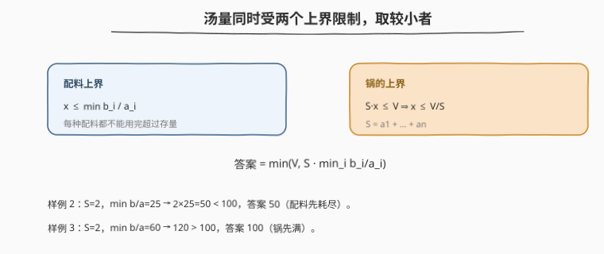
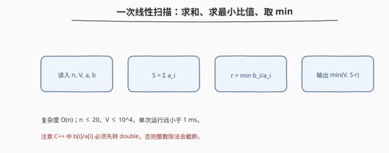

# Codeforces 42A 罗宋汤的最大体积 题解

## 1. 题目概述

- **题目链接**：https://codeforces.com/problemset/problem/42/A
- **比赛来源**：Codeforces Beta Round 42 · Problem A（2010-09-28）
- **难度**：1400
- **标签**：贪心、实现（greedy, implementation）
- **评测类型**：普通（实数输出，误差 $\le 10^{-4}$）
- **限制**：时间 2 s / 内存 256 MB

**题意**：罗宋汤需要 $n$ 种配料按 $a_1 : a_2 : \dots : a_n$ 的比例混合。若取系数 $x \ge 0$，就要用 $a_1 x, \dots, a_n x$ 升。现在手头第 $i$ 种配料有 $b_i$ 升，锅的容量是 $V$ 升（可以只做 $0 \sim V$ 升）。问最多能做多少升汤。

**约束**：

- $n \le 20$，$a_i \le 100$，$b_i \le 100$，$V \le 10^4$：规模极小，$O(n)$ 即可。
- 答案要求绝对误差 $\le 10^{-4}$，用 `double` 足够。
- $a_i \ge 1$，所以除法安全；$b_i$ 可以为 $0$，此时做不出任何汤。

## 2. 示例与观察

官方样例 1（输入 / 输出原样）：

```text
输入：
1 100
1
40

输出：
40.0
```

**演算**：一种配料，比例 $1$，手头 40 升，锅 100 升 → 最多 $x = \min(100/1, 40/1) = 40$，体积 $40$。

官方样例 2（输入 / 输出原样）：

```text
输入：
2 100
1 1
25 30

输出：
50.0
```

**演算**：两种配料等比例。由 $x \le 25$、$x \le 30$ 得 $x \le 25$；总体积 $= (1+1)x = 2x \le 50$，且 $50 \le V = 100$，所以答案是 $50$。

官方样例 3（输入 / 输出原样）：

```text
输入：
2 100
1 1
60 60

输出：
100.0
```

**演算**：比例允许 $x$ 到 $60$，但锅只能装 $100$ 升，而 $2x = 120 > 100$，所以受锅限制：$x = 50$，体积 $100$。

**观察**：

1. 配比决定"每单位 $x$ 用掉的总量"是 $S = \sum a_i$，所以总体积 $= S \cdot x$。
2. 两种上限：手头配料的限制 $x \le \min_i \frac{b_i}{a_i}$，以及锅的限制 $S \cdot x \le V$，即 $x \le \frac{V}{S}$。
3. 因此 $x = \min\left(\frac{V}{S}, \min_i \frac{b_i}{a_i}\right)$，答案 $= S \cdot x$。等价地：答案 $= \min\left(V,\ S\cdot \min_i \frac{b_i}{a_i}\right)$。

## 3. 解题思路

### 3.1 朴素做法与瓶颈

直接按 3.2 的公式计算：$O(n)$。没有瓶颈，关键在于**两个上界都要取**，以及浮点误差的处理。

### 3.2 核心观察



$$x^* = \min\Bigl(\underbrace{\frac{V}{S}}_{\text{锅的容量}},\ \underbrace{\min_i \frac{b_i}{a_i}}_{\text{配料存量}}\Bigr),\qquad \text{ans} = S \cdot x^* = \min\Bigl(V,\ S\cdot \min_i \frac{b_i}{a_i}\Bigr).$$

### 3.3 算法流程



1. 读入 $n, V$、数组 $a$、数组 $b$；
2. 计算 $S = \sum a_i$；
3. 计算 $r = \min_i \frac{b_i}{a_i}$；
4. 输出 $\min(V, S \cdot r)$，保留足够多的小数位。

### 3.4 样例走查

| 样例 | $S$ | $\min b_i/a_i$ | $S\cdot r$ | $V$ | 答案 |
|------|-----|----------------|-----------|-----|------|
| 1 | 1 | 40 | 40 | 100 | 40 |
| 2 | 2 | 25 | 50 | 100 | 50 |
| 3 | 2 | 60 | 120 | 100 | 100 |

## 4. 正确性证明

**引理 1（可行性）**：取 $x$ 时，方案可行当且仅当 $0 \le x \le \frac{V}{S}$ 且对所有 $i$ 有 $a_i x \le b_i$。

**证明**：$a_i x \le b_i$ 即 $x \le b_i/a_i$（$a_i \ge 1 > 0$）；总体积 $Sx \le V$ 即 $x \le V/S$。各条件互相独立，取交集即可。∎

**引理 2（上确界可达）**：$x^* = \min(V/S, \min_i b_i/a_i)$ 本身可行，且任何可行 $x$ 都满足 $x \le x^*$。

**证明**：由引理 1，可行集是 $[0, x^*]$，而 $x^* \ge 0$（$V, S, b_i \ge 0$），故 $x^*$ 可行且最大。∎

**定理**：输出 $\min(V, S \cdot \min_i b_i/a_i)$ 等于最大体积。

**证明**：最大体积 $= S x^* = S\min(V/S, \min_i b_i/a_i) = \min(V, S\min_i b_i/a_i)$。∎

## 5. 复杂度分析

- **时间**：$O(n)$。
- **空间**：$O(n)$。
- **数值精度**：$S \le 2000$，$r \le 100$，量级 $2\times10^5$，`double` 的相对误差约 $10^{-16}$，远小于 $10^{-4}$。
- **与时限的关系**：$n \le 20$，运行时间可以忽略。

## 6. 参考代码

### C++17

```cpp
#include <bits/stdc++.h>
using namespace std;
int main(){
    int n, V; if(!(cin>>n>>V)) return 0;
    vector<int> a(n), b(n);
    for(auto&x:a) cin>>x;
    for(auto&x:b) cin>>x;
    long long sum = 0;
    for(int x:a) sum += x;
    double x = 1e18;
    for(int i=0;i<n;i++) x = min(x, (double)b[i]/a[i]);
    double ans = min((double)V, sum * x);
    printf("%.10f\n", ans);
}
```

### Python3

```python
import sys
def main():
    d=sys.stdin.buffer.read().split()
    if not d: return
    n=int(d[0]); V=int(d[1])
    a=[int(x) for x in d[2:2+n]]
    b=[int(x) for x in d[2+n:2+2*n]]
    s=sum(a)
    x=min(bi/ai for ai,bi in zip(a,b))
    print(min(V, s*x))
main()
```

## 7. 边界情况与易错点

1. **只取配料上限，忘记锅**：样例 3 会输出 120 而不是 100。
2. **只取锅上限，忘记配料**：样例 2 会输出 100 而不是 50。
3. **$b_i = 0$**：$r = 0$，答案 0，公式自然处理。
4. **`a_i` 可能不相等**：比例是逐项除法，不能先求和再整体除。
5. **输出精度**：题面允许 $10^{-4}$，但建议输出 6~10 位小数，避免判题器用绝对误差比较时出错。
6. **整数除法**：C++ 里 `b[i]/a[i]` 若两个都是 `int` 会截断，必须先转 `double`。

## 8. 验证记录

- **编译环境与命令**：本机没有 GNU `g++`，C++ 用 `clang++ -std=c++17 -O2` 搭配兼容头编译；Python 为 `Python 3.9.6`。由 `python3 codeforces/tools/verify_solution.py --checker ... codeforces/contests/0001-0100/42/A_罗宋汤的最大体积.md` 复核。
- **官方样例**：3 / 3 通过（实数，用允许误差的 checker 校验）。
- **独立暴力**：用 `Fraction` 精确计算 $\min(V, S\min b_i/a_i)$，对 $n \le 5$、$a_i \le 10$、$b_i \le 30$、$V \le 100$ 的 **250 组**随机数据与主程序三方比对（C++ / Python / Fraction），相对误差 $<10^{-6}$，0 处不符。
- **最大约束性能**：$n = 20$ 时不到 1 ms。
- **图片校验**：两张 SVG 通过 `ElementTree.parse` 与无头浏览器 `getBBox` 复核。
- **公式校验**：KaTeX 渲染无报错。
- **复核状态**：verified。

## 相关题目与扩展

- [Codeforces 42B 残局判断](https://codeforces.com/problemset/problem/42/B)、[Codeforces 42C Safe cracking](https://codeforces.com/problemset/problem/42/C)：同场 B、C 题。
- [Codeforces 1A Theatre Square](https://codeforces.com/problemset/problem/1/A)：同样是"取两个上界的最小"。
- [LeetCode 1518. 换酒问题](https://leetcode.cn/problems/water-bottles/)：比例与整除的入门题。

**延伸思考**：

1. **如果配料用量必须是整数升**：变成整数规划，$x$ 必须取 $\lfloor \cdot \rfloor$，答案 $S\cdot\lfloor x^*\rfloor$。
2. **如果要求恰好装满锅**：只有在 $S x = V$ 时可行，否则输出 0 或不可能。
3. **如果配料有损耗率**：把 $a_i$ 换成 $a_i/(1-\text{loss}_i)$ 即可，公式不变。
