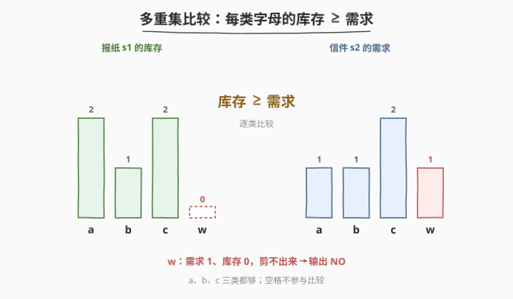
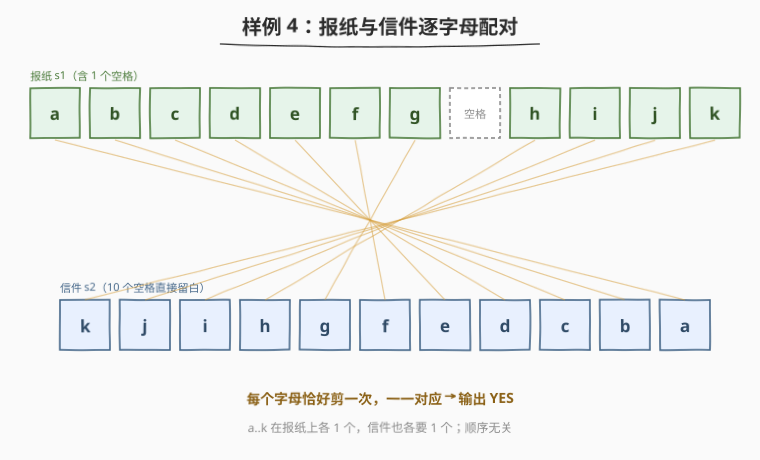

# Codeforces 43B 剪报拼出匿名信 题解

## 1. 题目概述

- **题目链接**：https://codeforces.com/problemset/problem/43/B
- **比赛来源**：Codeforces Beta Round 42 (Div. 2)（2010-11-30）· Problem B
- **难度**：1100
- **标签**：实现、字符串、计数
- **评测类型**：普通
- **限制**：时间 2 s / 内存 256 MB

**题意**：给定报纸标题 $s_1$ 和想写的匿名信正文 $s_2$，两行都只由空格与大小写拉丁字母组成。可以多次从报纸上剪下字母（同一个位置的字母最多用一次），空格不需要剪、也不用考虑，问能否用 $s_1$ 的字母拼出 $s_2$。

**约束**：

- $s_1, s_2$ 长度均不超过 $200$：规模极小，$O(|s_1| + |s_2|)$ 的计数即可，甚至 $O(|s_1| \cdot |s_2|)$ 的暴力也能过。
- 大小写敏感：`Y` 与 `y` 是两个不同的字符，不能互相替代。
- 只有空格和字母：字符集大小为 $26 + 26 + 1 = 53$，用长度为 $128$ 的计数数组按 ASCII 码直接索引最方便。
- 每行非空，但可能整行都是空格；输入恰好两行，没有多测。

## 2. 示例与观察

官方样例 1：

```text
输入：
Instead of dogging Your footsteps it disappears but you dont notice anything
where is your dog

输出：
NO
```

官方样例 2：

```text
输入：
Instead of dogging Your footsteps it disappears but you dont notice anything
Your dog is upstears

输出：
YES
```

官方样例 3：

```text
输入：
Instead of dogging your footsteps it disappears but you dont notice anything
Your dog is upstears

输出：
NO
```

官方样例 4：

```text
输入：
abcdefg hijk
k j i h g f e d c b a

输出：
YES
```

**样例 1 走查**：$s_2$ 为 `where is your dog`，其中字母 `w` 在 $s_1$（`Instead of dogging Your footsteps it disappears but you dont notice anything`）里一次都没出现，剪不出来，输出 `NO`。注意 $s_1$ 里有大写 `Y`，但 $s_1$ 里的 `your` 是小写，样例 2 需要的 `Y` 恰好来自 `Your`。

**样例 3 走查**：$s_2$ 为 `Your dog is upstears`，需要的每个字母在 $s_1$ 里都有——但 $s_1$ 中只有小写 `your`，没有大写 `Y`，所以输出 `NO`。这一组专门用来提醒**大小写不可混用**。

**样例 4 走查**：$s_1$ 是 `abcdefg hijk`（`a` 到 `k` 各一个，外加一个空格），$s_2$ 是 `k j i h g f e d c b a`，需要 `a` 到 `k` 各一个、10 个空格。空格不用剪，字母正好一一对应，输出 `YES`。

**观察**：把 $s_1$ 中所有字母看成一个**多重集**（每个字母可用的次数），$s_2$ 中所有非空格字母看成另一个多重集。问题就是问后者是否是前者的子多重集。空格在两边都不参与——$s_1$ 里的空格反正剪不下来，$s_2$ 里的空格本来就不需要。

自造样例：

| 输入 | 输出 | 说明 |
| --- | --- | --- |
| `abc` / `cba` | `YES` | 每个字母各一个，顺序无关 |
| `aab` / `aab` | `YES` | 多重集完全相等 |
| `aab` / `aaa` | `NO` | `a` 只有两个，却要三个 |
| `A` / `a` | `NO` | 大小写敏感 |
| `a a` / `a  a` | `YES` | 空格多寡无所谓 |
| `z` / `z` | `YES` | 最小规模 |

## 3. 解题思路

### 3.1 朴素做法与瓶颈

遇到 $s_2$ 的每个字母，就到 $s_1$ 里从左往右找一个还没被用掉的同名字母，找到就划掉；找不到就输出 `NO`。这是 $O(|s_1| \cdot |s_2|) \le 4 \times 10^4$ 的暴力，本题完全能过。

它的"瓶颈"不在速度，而在**每次都要重新扫描**：同一个字母被反复查找，逻辑上也容易写错（比如忘记把用过的字母标记掉，导致同一个字母被用两次）。把"每个字母还剩几个"直接记成计数表，查找就变成一次数组访问。

### 3.2 核心观察：多重集包含



分别统计两行中每个字符的出现次数，记为 $A[c]$ 与 $B[c]$。忽略空格后，答案为 `YES` 当且仅当对每个字母 $c$ 都有

$$B[c] \le A[c].$$

理由很直接：$s_2$ 需要 $B[c]$ 个字母 $c$，而报纸上只有 $A[c]$ 个可剪，每个位置最多用一次，所以数量不够就一定拼不出来；反过来，只要每类字母都够，就按类别逐个从报纸上剪下对应的字母即可，字母之间没有其他约束。

### 3.3 算法流程



1. 用 `getline` 读入两行 $s_1, s_2$。
2. 开一个长度 $128$ 的整型数组 `cnt`，初值全 $0$；遍历 $s_1$ 的每个字符，`++cnt[c]`（空格也统计，但后面用不到）。
3. 遍历 $s_2$ 的每个字符：若是空格则跳过；否则若 `cnt[c] == 0`，说明这个字母已经不够用，立刻输出 `NO` 并结束；否则 `--cnt[c]`。
4. 全部处理完没有失败，输出 `YES`。

这里的顺序是"边用边减"，等价于先比较 $B[c] \le A[c]$，但省去了单独统计 $s_2$ 的一遍扫描，而且一旦不够可以立刻退出。

### 3.4 样例走查

样例 4 的配对过程见第二幅图：报纸条上的 `a b c d e f g h i j k` 依次被划掉（每个只用一次），信件一侧的空格标成虚线框表示"不用剪"。样例 3 则在图外单独说明：信件要的是大写 `Y`，而报纸条上只有小写 `y`，计数表里 `Y` 的槽位是空的，第一步就失败。

## 4. 正确性证明

**引理 1（计数表即多重集）**：第 2 步结束后，对任意字符 $c$，`cnt[c]` 等于 $c$ 在 $s_1$ 中出现的次数。

**证明**：遍历 $s_1$ 时每个字符恰好让对应计数器加一，标准归纳即得。∎

**引理 2（必要性）**：若程序输出 `YES`，则对每个非空格字母 $c$，$s_2$ 中 $c$ 的出现次数不超过 $s_1$ 中 $c$ 的出现次数。

**证明**：程序对 $s_2$ 中每个非空格 $c$ 都执行一次 `--cnt[c]`，且执行前要求 `cnt[c] > 0`。由于 `cnt[c]` 从 $A[c]$ 开始只减不增，能成功减去 $B[c]$ 次就说明 $A[c] \ge B[c]$。∎

**引理 3（充分性）**：若对每个非空格字母 $c$ 都有 $B[c] \le A[c]$，则一定存在一种剪贴方案。

**证明**：把 $s_1$ 中每个位置看成一张带字母的"卡片"，按字母分组，第 $c$ 组有 $A[c] \ge B[c]$ 张。对 $s_2$ 从左到右处理，遇到第 $k$ 个字母 $c$ 时，从第 $c$ 组里取一张尚未使用的卡片放到这个位置。因为第 $c$ 组总共被取用的次数不超过 $B[c] \le A[c]$，取用过程中永远不会缺卡片，且同一张卡片不会被取两次。$s_2$ 的空格位置留空即可。于是得到一个合法方案。∎

**定理**：程序输出 `YES` 当且仅当 Vasya 能拼出匿名信。

**证明**：输出 `YES` 说明所有非空格字母都成功减去，由引理 2 计数条件成立，再由引理 3 存在合法方案；反之若有合法方案，则每个字母的用量不超过报纸库存，程序不会在任何一步遇到 `cnt[c] == 0`，必然输出 `YES`。∎

## 5. 复杂度分析

- **时间**：$O(|s_1| + |s_2|)$。两行各扫描一次，每次是常数时间的数组操作；长度不超过 $200$，总量不到一千次操作。
- **空间**：$O(1)$（严格说是字符集大小 $128$ 的计数数组），与输入长度无关。
- **与时限的关系**：2 s 的时限有极大余量，实测端到端（含进程启动）约 $2.4$ ms。

## 6. 参考代码

### C++17

```cpp
#include <bits/stdc++.h>
using namespace std;

int main() {
    ios::sync_with_stdio(false);
    cin.tie(nullptr);

    string s1, s2;
    getline(cin, s1);
    getline(cin, s2);

    int cnt[128] = {0};
    for (char c : s1) ++cnt[(unsigned char)c];
    for (char c : s2) {
        if (c == ' ') continue;                 // 空格不用剪
        if (cnt[(unsigned char)c] == 0) {       // 报纸上已经没有这个字
            cout << "NO\n";
            return 0;
        }
        --cnt[(unsigned char)c];
    }
    cout << "YES\n";
    return 0;
}
```

### Python3

```python
import sys
from collections import Counter


def main() -> None:
    lines = sys.stdin.read().split("\n")
    s1 = lines[0] if lines else ""
    s2 = lines[1] if len(lines) > 1 else ""
    have = Counter(s1)
    for ch in s2:
        if ch == " ":
            continue
        if have[ch] <= 0:
            print("NO")
            return
        have[ch] -= 1
    print("YES")


main()
```

两份代码都只依赖标准库，可原样提交。

## 7. 边界情况与易错点

1. **大小写敏感**：`Y` 和 `y` 必须分开计数，样例 3 就是这个坑；不要为了"保险"而统一转成小写。
2. **空格的处理**：$s_2$ 里的空格必须跳过（不消耗报纸库存），$s_1$ 里的空格虽然被统计进了数组，但永远不会被 $s_2$ 请求，所以不影响结果——不要额外写"从 $s_1$ 里删除空格"的代码，删不删都对，但多一步容易出错。
3. **整行都是空格**：$s_2$ 全为空格时答案为 `YES`（什么都不用剪）；`getline` 能正确读到这一行，不要用 `cin >> s2`，否则会跳过空白、读到下一行或直接失败。
4. **行尾的 `\r`**：如果数据是 Windows 换行，`getline` 读到的第二行可能以 `\r` 结尾，导致多出一个需要剪的字符而误判 `NO`。稳妥的写法是在读入后去掉行尾的 `\r`（本题的评测数据是 LF，但养成习惯）。
5. **`s2` 比 `s1` 长很多**：例如 $s_1$ 只有 1 个字母、$s_2$ 有 200 个字母，程序在第一个不够的字母处就会输出 `NO`，不会越界；用计数数组而不是 `find` 也能避免重复使用同一位置。
6. **下标的类型**：用 `unsigned char` 转成 `int` 再索引 `cnt`，避免某些平台上 `char` 为有符号时出现负下标（本题字符都是 ASCII 正数，但这是通用写法）。
7. **Python 读取方式**：用 `sys.stdin.read().split("\n")` 保留行内空格；若用 `.split()`（不带参数）会把空格也当分隔符，直接破坏题目语义。

## 8. 验证记录

- **编译环境与命令**：本机没有 GNU `g++`，用 `clang++ -std=c++17 -O2` 搭配 `codeforces/tools/include/bits/stdc++.h` 兼容头编译（代码只用标准库，可原样提交）；Python 为 3.9.6。
- **官方样例**：4 / 4 通过（`NO`、`YES`、`NO`、`YES`），C++ 与 Python 输出一致。
- **额外测试**：自造样例覆盖大小写、全空格、多重集相等、库存不足等情形；另做 **300 组**随机对拍（两行长度 $1 \sim 200$，字符取自大小写字母与空格，约一半刻意从 $s_1$ 取字母构造 `YES` 倾向），与一份独立实现（把 $s_1$ 的字母放进列表、逐个 `remove`）逐组比较，全部一致。
- **最大约束性能**：两行各 200 字符时 C++ 端到端约 $2.4$ ms，峰值内存约 $1.6$ MB。
- **复核状态**：verified（样例、随机对拍、性能、图片、公式均实跑通过）。

## 相关题目与扩展

- [Codeforces 43A Football](https://codeforces.com/problemset/problem/43/A)：同场 A 题，统计队名出现次数。
- [Codeforces 43C Lucky Tickets](https://codeforces.com/problemset/problem/43/C)：同场 C 题，把"配对"转化为模 $3$ 余数的计数。
- [Codeforces 1003A Polycarp's Pockets](https://codeforces.com/problemset/problem/1003/A)：统计出现次数最多的值，同样是多重集视角。
- [LeetCode 383. 赎金信](https://leetcode.cn/problems/ransom-note/)：与本题几乎一模一样（用杂志字母拼赎金信），可以直接用本题代码通过。

**延伸思考**：

1. **如果每个字母有不同价格**：问题变成"在预算内最多能拼出多少"，需要按价格排序或用背包，而不再是简单的计数比较。
2. **如果允许把报纸上的字母翻转使用**（例如 `b` 与 `d` 互换）：多重集条件要改成按"等价类"统计，实现上把 `b/d`、`p/q` 等合并计数即可。
3. **如果要求输出具体方案**：可以按字母把 $s_1$ 的位置存成栈，处理 $s_2$ 时弹出一个位置并记录"第 $i$ 个字符来自报纸第 $j$ 个位置"，时间仍是线性的。
4. **如果 $s_1$ 是流式输入的**：边读边计数、边处理 $s_2$ 也可以，但本题输入顺序固定为两行，先读完 $s_1$ 更简单。
