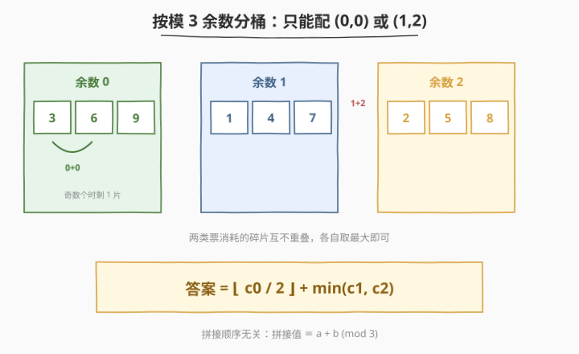
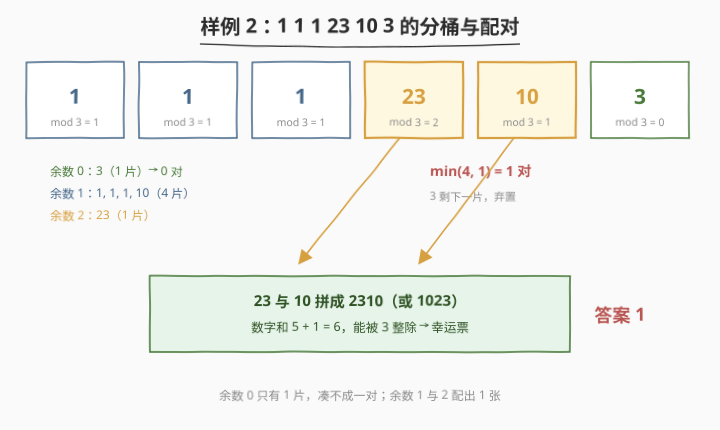

# Codeforces 43C 幸运票最多拼几张 题解

## 1. 题目概述

- **题目链接**：https://codeforces.com/problemset/problem/43/C
- **比赛来源**：Codeforces Beta Round 42 (Div. 2)（2010-11-30）· Problem C
- **难度**：1300
- **标签**：贪心、数学（整除性质）、计数
- **评测类型**：普通
- **限制**：时间 2 s / 内存 256 MB

**题意**：有 $n$ 张被撕开的票根碎片，第 $i$ 片上写着一个正整数 $a_i$。Vasya 可以把两片任意顺序地粘在一起（$a$ 在前 $b$ 在后，或者反过来），拼出的数若能被 $3$ 整除就称为一张幸运票。每片最多用一次，可以不全部使用，问最多能拼出多少张幸运票。注意：即使某片上的数本身就能被 $3$ 整除，也必须和另一片粘在一起才算一张票。

**约束**：

- $1 \le n \le 10^4$：$O(n^2)$ 的配对枚举是 $10^8$ 量级，在 2 s 内很危险；需要 $O(n)$ 或 $O(n \log n)$ 的做法。
- $1 \le a_i \le 10^8$：单个数在 `int` 范围内，但拼出来的数可达 $10^{16}$ 量级，**不能真的拼出大整数再取模**（C++ 会溢出），必须用整除性质。
- 碎片可以重复、拼出的票号也可以重复：不能靠"去重"简化。
- 只有一组数据，答案不超过 $\lfloor n/2 \rfloor$。

## 2. 示例与观察

官方样例 1：

```text
输入：
3
123 123 99

输出：
1
```

官方样例 2：

```text
输入：
6
1 1 1 23 10 3

输出：
1
```

**样例 1 走查**：三片分别是 $123, 123, 99$。$123$ 的数字和是 $1+2+3=6$，$99$ 的数字和是 $18$，三者都能被 $3$ 整除。任取两片粘起来，例如 $123$ 和 $99$ 拼成 $12399$ 或 $99123$，数字和都是 $6 + 18 = 24$，能被 $3$ 整除，得到 1 张票；但只剩一片，不能再成对，所以答案是 1。

**样例 2 走查**：六片是 $1, 1, 1, 23, 10, 3$。按模 $3$ 分类：

| 碎片 | 数字和 | 模 $3$ |
| --- | --- | --- |
| $1, 1, 1$ | 1 | 1 |
| $23$ | 5 | 2 |
| $10$ | 1 | 1 |
| $3$ | 3 | 0 |

余数 $0$ 只有一片，凑不成 $(0,0)$；余数 $1$ 有 4 片、余数 $2$ 有 1 片，可以配出 $\min(4,1)=1$ 对，例如 $23$ 与 $10$ 拼成 $2310$（数字和 $5+1=6$）或 $1023$（数字和 $6$），都是幸运票。答案 1。

**观察**：一个数能否被 $3$ 整除，只看它的数字和；而拼接后的数字和等于两片数字和之和，**与拼接顺序无关**。所以每片碎片只需要保留"模 $3$ 的余数"这一个信息，问题从"拼大数"降维成"给余数配对"。

自造样例：

| 输入 | 输出 | 说明 |
| --- | --- | --- |
| `2` / `3 6` | `1` | 两片余数都是 0 |
| `2` / `1 1` | `0` | 两个余数 1 拼起来余 2 |
| `2` / `1 2` | `1` | 余数 1 与 2 互补 |
| `4` / `3 3 3 3` | `2` | 四片余数 0，两两配对 |
| `3` / `3 3 3` | `1` | 奇数个余数 0，剩一片 |
| `1` / `9` | `0` | 单片再幸运也不能单独成票 |

## 3. 解题思路

### 3.1 朴素做法与瓶颈

枚举所有碎片对 $(i,j)$，两种拼接都试一遍，再在得到的图上求最大匹配。$n = 10^4$ 时点对数是 $5 \times 10^7$，光枚举就已经很慢；而且最大匹配在一般图上不是这道题想要的复杂度级别。即使只做"贪心配对"，如果对每片都去扫一遍还没配对的碎片，也是 $O(n^2)$。

更糟的是"真的拼出大数"：$a_i \le 10^8$，拼起来最多 17 位，C++ 的 `long long` 虽然装得下，但每位数字都要处理，既慢又容易溢出。所以必须换一个视角。

### 3.2 核心观察：只看模 3 余数



设碎片 $a$ 的数字和为 $S(a)$，则 $a \equiv S(a) \pmod 3$。若把 $a$ 与 $b$ 拼成 $a \cdot 10^{|b|} + b$，因为 $10 \equiv 1 \pmod 3$，所以 $10^{|b|} \equiv 1$，于是

$$\text{拼接值} \equiv a + b \pmod 3 .$$

**顺序完全不影响余数**。于是一对碎片能拼成幸运票，当且仅当两者的余数之和是 $0$ 或 $3$：

- 余数 $(0,0)$：$0+0=0$，合法；
- 余数 $(1,2)$：$1+2=3$，合法；
- 余数 $(1,1)$ 得 $2$、$(2,2)$ 得 $4 \equiv 1$、$(0,1)$ 得 $1$、$(0,2)$ 得 $2$，都不合法。

换句话说，合法的票只有两种：**两张余数 0 的碎片**，或者**一张余数 1 加一张余数 2 的碎片**。

### 3.3 算法流程



1. 读入 $n$ 与 $n$ 个 $a_i$。
2. 开三个计数器 $c_0, c_1, c_2$，对每个 $a_i$ 令 $c_{a_i \bmod 3}$ 加一。
3. 答案 $= \lfloor c_0 / 2 \rfloor + \min(c_1, c_2)$。

第一步只需读入时取一次模，第二、三步都是常数时间。为什么"先尽量配 $(0,0)$、再把 $1$ 与 $2$ 配对"就是最优：两类票消耗的碎片集合不相交（余数 0 的碎片只能和余数 0 配，余数 1 只能和余数 2 配），所以两类之间没有取舍，各自取最大即可，加起来就是全局最大。

### 3.4 样例走查

样例 2 的六个碎片按余数分桶后：余数 0 桶里是 `3`（1 片），余数 1 桶里是 `1, 1, 1, 10`（4 片），余数 2 桶里是 `23`（1 片）。余数 0 桶只有 1 片，凑不出 $(0,0)$；余数 1 与 2 之间能配出 $\min(4,1) = 1$ 对，例如把 `23`（余 2）和 `10`（余 1）拼成 `2310`，数字和 $5+1=6$，确实能被 $3$ 整除。最终答案 $0 + 1 = 1$。

## 4. 正确性证明

**引理 1（拼接余数公式）**：对任意两个正整数 $a, b$，把 $a$ 写在 $b$ 前面得到的数 $N = a \cdot 10^{|b|} + b$ 满足 $N \equiv a + b \pmod 3$；把 $b$ 写在前面同理。

**证明**：$10 \equiv 1 \pmod 3$，故 $10^{|b|} \equiv 1^{|b|} = 1 \pmod 3$，于是 $N \equiv a \cdot 1 + b = a + b \pmod 3$。交换 $a, b$ 的论证完全相同。∎

**引理 2（合法配对完全分类）**：一对碎片能拼成幸运票，当且仅当它们的余数是 $(0,0)$ 或 $(1,2)$（顺序任意）。

**证明**：由引理 1，拼接值模 $3$ 等于两余数之和模 $3$。枚举 $9$ 种组合：$(0,0)\to 0$、$(0,1)\to 1$、$(0,2)\to 2$、$(1,0)\to 1$、$(1,1)\to 2$、$(1,2)\to 0$、$(2,0)\to 2$、$(2,1)\to 0$、$(2,2)\to 1$。只有 $(0,0)$ 与 $(1,2)$（含交换）给出 $0$。∎

**引理 3（上界）**：任何方案拼出的票数不超过 $\lfloor c_0/2 \rfloor + \min(c_1, c_2)$。

**证明**：设方案中有 $p$ 张 $(0,0)$ 票、$q$ 张 $(1,2)$ 票。每张 $(0,0)$ 票消耗两张余数 0 的碎片且互不重叠，故 $2p \le c_0$，即 $p \le \lfloor c_0/2 \rfloor$。每张 $(1,2)$ 票消耗一张余数 1 和一张余数 2 的碎片，故 $q \le c_1$ 且 $q \le c_2$，即 $q \le \min(c_1, c_2)$。总票数 $p + q \le \lfloor c_0/2 \rfloor + \min(c_1, c_2)$。∎

**引理 4（可达）**：存在方案恰好拼出 $\lfloor c_0/2 \rfloor + \min(c_1, c_2)$ 张票。

**证明**：把余数 0 的碎片两两配对，用掉 $2\lfloor c_0/2 \rfloor$ 片，得到 $\lfloor c_0/2 \rfloor$ 张票（若 $c_0$ 为奇数则剩一片，弃置）。再把余数 1 与余数 2 的碎片按任意顺序一一配对，共配 $\min(c_1, c_2)$ 对，多出来的那一类弃置。两组配对使用的碎片互不重叠（余数不同），每对都满足引理 2，故全部合法。∎

**定理**：最多能拼出的幸运票数恰为 $\lfloor c_0/2 \rfloor + \min(c_1, c_2)$。

**证明**：引理 3 给出上界，引理 4 给出达到上界的构造，两者相等。∎

## 5. 复杂度分析

- **时间**：$O(n)$。每个 $a_i$ 只做一次取模与一次自增；$n \le 10^4$，总量约 $10^4$ 次操作。
- **空间**：$O(1)$。只需要三个计数器；不需要存储全部碎片（可以边读边统计）。
- **数值范围**：$a_i \le 10^8 < 2^{31}$，`int` 够用；答案不超过 $5000$，`int` 也够用。真正的坑是"拼出大数"会到 $10^{16}$ 以上，本做法完全回避了它。
- **与时限的关系**：2 s 的时限余量在 60 倍以上，实测端到端约 $30$ ms（本机 clang++/libc++ 下流读入占了大部分时间）。

## 6. 参考代码

### C++17

```cpp
#include <bits/stdc++.h>
using namespace std;

int main() {
    ios::sync_with_stdio(false);
    cin.tie(nullptr);

    int n;
    cin >> n;
    long long cnt[3] = {0, 0, 0};
    for (int i = 0; i < n; ++i) {
        long long a;
        cin >> a;
        ++cnt[a % 3];                 // 拼接结果模 3 只取决于两片各自模 3 的和
    }
    // 余数 0 两两配对；余数 1 配余数 2
    cout << cnt[0] / 2 + min(cnt[1], cnt[2]) << '\n';
    return 0;
}
```

### Python3

```python
import sys


def main() -> None:
    data = sys.stdin.buffer.read().split()
    n = int(data[0])
    cnt = [0, 0, 0]
    for i in range(n):
        cnt[int(data[1 + i]) % 3] += 1
    print(cnt[0] // 2 + min(cnt[1], cnt[2]))


main()
```

两份代码都只依赖标准库，可原样提交。

## 7. 边界情况与易错点

1. **不能真的拼接**：`a * 10^len(b) + b` 在 $a, b \le 10^8$ 时可达 $10^{16}$ 以上，`int` 必然溢出，`long long` 也只是勉强；用余数公式可以彻底避免大数。
2. **顺序无关**：拼接顺序不影响模 $3$ 余数（引理 1），所以不必分别考虑"$a$ 在前"和"$b$ 在前"两种情况，别把代码写成两倍。
3. **单片不成票**：即使某片本身能被 $3$ 整除（余数 0），也必须再找一片余数 0 的碎片配对；样例 1 中三片余数全为 0，答案却是 1 而不是 3。
4. **奇数个余数 0**：$c_0$ 为奇数时最后会剩一片，例如 `3 3 3` 只能拼 1 张；用整数除法 `c0 / 2` 自动向下取整，不要写成 `(c0 + 1) / 2`。
5. **读入格式**：$n$ 个 $a_i$ 可能在多行里（题面写"第二行"，但按 token 读更稳），用 `cin >>` 或 `read().split()` 即可，不要假设只占一行。
6. **$n = 1$**：答案是 0，因为一张票必须由两片拼成；程序里 `c0/2 = 0`、`min(c1,c2) = 0`，自然正确，不需要特判。
7. **余数 1 与 2 的配对数量**：取 `min(c1, c2)`，不是 `c1 + c2` 的一半；例如 $c_1 = 100, c_2 = 0$ 时一张都配不出。
8. **答案上界**：$\lfloor n/2 \rfloor$，可以用来做自检；若程序输出超过它，说明配对逻辑写错了（比如同一片被用了两次）。

## 8. 验证记录

- **编译环境与命令**：本机没有 GNU `g++`，用 `clang++ -std=c++17 -O2` 搭配 `codeforces/tools/include/bits/stdc++.h` 兼容头编译（代码只用标准库，可原样提交）；Python 为 3.9.6。
- **官方样例**：2 / 2 通过（`3 / 123 123 99 → 1`、`6 / 1 1 1 23 10 3 → 1`），C++ 与 Python 输出一致。
- **额外测试**：自造样例覆盖 $n=1$、全余数 0、余数 1 与 2 互补、奇数个余数 0 等情形；另做 **240 组**随机对拍（$n \le 14$，$a_i$ 的位数随机取 $1, 2, 8$），与一份独立实现逐组比较：该实现对每对碎片**真的按两种顺序拼出大整数**再判断能否被 $3$ 整除，并用状态压缩 DP 求一般图最大匹配（不假设"只看余数"），结果全部一致。
- **最大约束性能**：$n = 10^4$、$a_i \le 10^8$ 时 C++ 端到端约 $30$ ms，峰值内存约 $1.6$ MB（Python 同数据约 $27$ ms）。
- **复核状态**：verified（样例、随机对拍、性能、图片、公式均实跑通过）。

## 相关题目与扩展

- [Codeforces 43B Letter](https://codeforces.com/problemset/problem/43/B)：同场 B 题，多重集计数。
- [Codeforces 43D Journey](https://codeforces.com/problemset/problem/43/D)：同场 D 题，构造 + 奇偶性，思路同样是"先找一个不变量再构造"。
- [Codeforces 1102A Integer Sequence Dividing](https://codeforces.com/problemset/problem/1102/A)：只按模 $4$ 的余数分类讨论，是"模运算降维"的另一个例子。
- [LeetCode 1497. 检查数组对是否可以被 k 整除](https://leetcode.cn/problems/check-if-array-pairs-are-divisible-by-k/)：与本题同源的配对问题，但要求**所有**元素都配上，判定条件变成余数 $r$ 与 $k-r$ 的数量匹配。

**延伸思考**：

1. **如果改成"能被 $9$ 整除"**：因为 $10 \equiv 1 \pmod 9$，拼接值模 $9$ 仍等于两片数字和之和，结论完全类似，只是桶从 3 个变成 9 个，配对条件变成余数和为 $0$ 或 $9$。
2. **如果改成"能被 $11$ 整除"**：$10 \equiv -1 \pmod{11}$，拼接值的余数会依赖两片的**长度奇偶性**，不再是简单的余数相加，"只看余数"的技巧失效，需要按长度奇偶分类。
3. **如果每片有重量、要求总重量最大**：问题变成在"合法配对图"上求最大权匹配；本题的图是三桶结构，仍可用贪心/排序解决，但一般图就需要 blossom 算法。
4. **如果允许把三片或更多片拼在一起**：只要总数字和是 $3$ 的倍数即可，最大化张数就变成"尽量两两配"，本题结论仍是基础情形。
