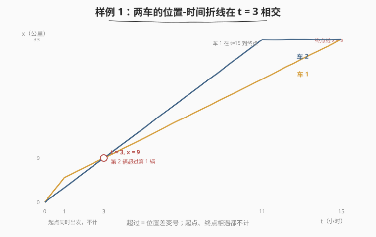
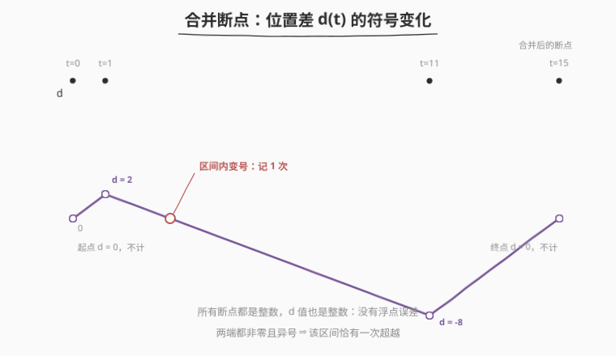

# Codeforces 43E 赛道超车计数 题解

## 1. 题目概述

- **题目链接**：https://codeforces.com/problemset/problem/43/E
- **比赛来源**：Codeforces Beta Round 42 (Div. 2)（2010-11-30）· Problem E
- **难度**：2300
- **标签**：暴力、实现、双指针
- **评测类型**：普通
- **限制**：时间 2 s / 内存 256 MB

**题意**：赛道长 $s$ 公里，$n$ 辆车同时从起点出发。第 $i$ 辆车被描述成 $k_i$ 段，第 $j$ 段是"以速度 $v_{i,j}$ 行驶 $t_{i,j}$ 小时"，各段按行驶顺序给出，每辆车所有段的总里程恰好是 $s$。求比赛过程中"某辆车超过另一辆车"的总次数。超车是瞬时的（不存在两车并排行驶一段正长度时间的情形），同一时刻同一地点的多次超车要分别计数，起点与终点的相遇不计。

**约束**：

- $2 \le n \le 100$：车对数是 $\binom{n}{2} \le 4950$，允许对每对车单独做与段数成正比的扫描。
- $1 \le s \le 10^6$，$k_i \le 100$，$v, t \le 1000$：每辆车的总时长不超过 $10^5$ 小时，累计里程不超过 $10^6$ 公里，位置用 32 位整数就够，但中间量建议用 `long long`。
- 所有超车瞬时发生：不会出现两车以相同速度、相同位置并行一段正长度时间的情况，因此"位置差函数"的零点都是孤立的。
- 只有一组数据；答案最大约为 $4950 \times 200 = 9.9 \times 10^5$，`int` 够用。

## 2. 示例与观察

官方样例 1：

```text
输入：
2 33
2 5 1 2 14
1 3 11

输出：
1
```

官方样例 2：

```text
输入：
2 33
2 1 3 10 3
1 11 3

输出：
0
```

官方样例 3：

```text
输入：
5 33
2 1 3 3 10
1 11 3
2 5 3 3 6
2 3 1 10 3
2 6 3 3 5

输出：
2
```

**样例 1 走查**：第 1 辆车先在 $[0,1]$ 小时以 $5$ km/h 走 $5$ km，再以 $2$ km/h 走 $14$ 小时共 $28$ km，总计 $33$ km、$15$ 小时；第 2 辆车一直以 $3$ km/h 走 $11$ 小时，共 $33$ km，在 $t=11$ 时到达终点。设两车位置差 $d(t) = x_1(t) - x_2(t)$：

| 时刻 $t$ | 0 | 1 | 11 | 15 |
| --- | --- | --- | --- | --- |
| $x_1$ | 0 | 5 | 25 | 33 |
| $x_2$ | 0 | 3 | 33 | 33 |
| $d$ | 0 | 2 | $-8$ | 0 |

$d$ 在 $t \in (1, 11)$ 内由正变负，说明第 2 辆车在 $t = 3$（位置 $9$）超过了第 1 辆车，记 1 次；两端的 $d=0$ 分别是起点同时出发和终点会合，都不计。答案 1。

**样例 2 走查**：第 1 辆车以 $1$ km/h 走 $3$ 小时后以 $10$ km/h 走 $3$ 小时，第 2 辆车一直以 $11$ km/h 走 $3$ 小时。在 $t=3$ 时第 1 辆车才走 $3$ km，第 2 辆车已经到达 $33$ km 的终点；此后第 1 辆车继续追赶但永远追不上（第 2 辆已停在终点）。位置差从 $0$ 单调变负再到 $0$，没有"由负变正"的时刻，答案 0。

**样例 3 走查**：五辆车一共只有 2 次超车，分别发生在第 3、4 辆车之间和第 4、5 辆车之间：

- 第 3 辆车：前 $3$ 小时以 $5$ km/h 走 $15$ km，之后以 $3$ km/h 走 $6$ 小时；第 4 辆车：前 $1$ 小时以 $3$ km/h 走 $3$ km，之后以 $10$ km/h 走 $3$ 小时。两者在 $t = 1.4$ 小时、位置 $7$ km 处交换领先（$5t = 10t - 7$）。
- 第 4 辆车与第 5 辆车（后者前 $3$ 小时以 $6$ km/h 走 $18$ km，再以 $3$ km/h 走 $5$ 小时）在 $t = 1.75$ 小时、位置 $10.5$ km 处交换领先（$10t - 7 = 6t$）。

**观察**：每辆车的位置 $x_i(t)$ 是**分段线性函数**，断点就是它各段结束的时刻。对每一对车 $(i,j)$，超车次数等于位置差 $d(t) = x_i(t) - x_j(t)$ 在"由正变负或由负变正"的零点个数，且要排除 $t=0$（起点）和位置 $=s$（终点）的零点。把所有断点合并后，$d$ 在每两个相邻断点之间都是一次函数，零点结构非常简单。

自造样例：

| 输入 | 输出 | 说明 |
| --- | --- | --- |
| `2 5` / `3 2 1 1 1 1 2` / `3 1 1 2 1 2 1` | `1` | 恰好在断点处交换领先 |
| `2 8` / `3 2 1 2 1 4 1` / `3 1 1 3 1 1 4` | `0` | 在 $t=2$、位置 $4$ 处"碰一下"又分开，不算超车 |
| `2 4` / `1 2 2` / `2 1 1 3 1` | `0` | 两车同时到达终点，终点相遇不计 |
| `3 6` / `2 1 2 2 2` / `1 3 2` / `2 2 1 1 4` | `1` | 第 1、3 辆车之间有一次超车 |

## 3. 解题思路

### 3.1 朴素做法与瓶颈

最直觉的做法是模拟：以很小的时间步长 $dt$ 推进，比较每对车的位置，符号变化就记一次超车。问题是超车时刻可以是任意有理数（样例 1 的 $t=3$、样例 3 的 $t=1.4$ 与 $1.75$），步长再小也可能跨过两次超车或恰好落在超车点上，**精度与步长都无法保证正确性**。总时长可达 $10^5$ 小时，用 $10^{-3}$ 的步长就是 $10^8$ 轮，还要乘上 $\binom{n}{2}$ 对车，时间也受不了。

另一个想法是对每对车求"位置相等"的方程。若直接在所有时刻上解方程，会得到无穷多个候选（每对段都可能相交），但每对车最多只有 $200$ 个断点，真正需要检查的区间只有 $O(k_i + k_j)$ 个——这正是分段线性结构带来的机会。

### 3.2 核心观察：位置差是分段线性函数



把第 $i$ 辆车的位置写成时间的函数：

$$x_i(t) = \min\Bigl(s,\ \text{第 } i \text{ 辆车在 } t \text{ 时刻按分段速度累计的里程}\Bigr),$$

即车到达 $s$ 之后停在终点（位置保持 $s$）。函数 $x_i$ 的断点集合是

$$T_i = \{0,\ t_{i,1},\ t_{i,1}+t_{i,2},\ \dots\};$$

在每个断点之间它是一条直线，斜率就是该段速度。两辆车的位置差 $d(t) = x_i(t) - x_j(t)$ 于是在"两车断点的并集"上分段线性，每段至多有一个零点（除非 $d$ 在一整段上恒为 $0$，题目保证不会）。

**一次超车 = $d$ 的一个变号零点**：$d$ 从正变负表示 $i$ 原本在前、被 $j$ 超过；从负变正表示 $i$ 反超 $j$。若 $d$ 只是"碰到 $0$ 又弹回同侧"（相切），两车并没有交换前后，不算超车。

### 3.3 算法流程



对每一对车 $(i, j)$：

1. 把 $T_i$ 与 $T_j$ 归并成有序、去重的断点序列 $t_0 < t_1 < \dots < t_K$（$K \le 200$）。
2. 对每个断点算出 $d_k = x_i(t_k) - x_j(t_k)$。因为所有 $t_k$ 都是整数、位置也都是整数，**$d_k$ 全是整数，不需要任何浮点运算**。
3. 统计变号零点：
   - 相邻两个断点 $d_{k-1}, d_k$ 都非零且符号相反：区间内部恰好有一个零点，记 1 次（零点位置必在 $(0, s)$ 内，见引理 4）。
   - $d_k = 0$：把连续的零看成一个"零段"。若零段前面最近的非零值 $d_a$ 与后面最近的非零值 $d_b$ 符号相反，说明函数穿过零，记 1 次；符号相同则是相切，不记。
   - 序列开头的零段（$t=0$ 时所有车都在起点）前面没有非零值，不记；序列结尾的零段（两车都已停在终点）后面没有非零值，不记。
4. 所有车对的计数相加就是答案（同一时刻多对车超车会被分别计入，符合题意）。

第 3 步里"零段"的处理是关键：直接数"$d_k = 0$ 的断点"会把起点、终点、相切全都算进去；只看相邻非零值的符号，才能准确区分"穿过"与"相切"。

### 3.4 样例走查

以样例 1 为例：两车断点并集是 $\{0, 1, 11, 15\}$，$d = (0, 2, -8, 0)$。

- $d_0 = 0$ 是开头零段，前面没有非零值，跳过；
- $d_1 = 2$ 与 $d_2 = -8$ 异号，区间 $(1, 11)$ 内记 1 次（实际交点 $t=3$）；
- $d_3 = 0$ 是结尾零段，后面没有非零值，跳过（这正是终点会合）。

合计 1 次，与样例输出一致。样例 3 中第 3、4 辆车的断点并集是 $\{0,1,3,4,9\}$，$d = (0, 2, -8, -15, 0)$：$d_1=2$ 与 $d_2=-8$ 异号，记 1 次；结尾的 $0$ 不计。第 4、5 辆车同理在 $(1,3)$ 内记 1 次，总计 2 次。

## 4. 正确性证明

**引理 1（分段线性）**：对每对车 $(i,j)$，在以两车断点并集划分的每个区间上，$x_i$ 与 $x_j$ 都是线性函数，因此 $d = x_i - x_j$ 也是线性函数。

**证明**：$x_i$ 的断点正是它每段结束的时刻，两个断点之间速度恒定，故 $x_i$ 线性；$x_j$ 同理。两个线性函数之差仍线性。∎

**引理 2（区间内至多一个零点）**：在任一区间上，若 $d$ 不恒为 $0$，则 $d$ 在该区间内至多有一个零点；且当区间两端 $d$ 的值异号时恰有一个，同号时没有（端点为零的情形单独处理）。

**证明**：线性函数 $d(t) = at + b$，$a \ne 0$ 时至多一个根；两端异号由介值性必有根，同号则根不在区间内部。∎

**引理 3（相切与穿过）**：设 $t^*$ 是 $d$ 的零点，$d$ 在 $t^*$ 两侧（足够小的邻域内）符号相同，则两车在 $t^*$ 前后没有交换前后次序，不构成超车；符号相反则构成一次超车。

**证明**："$i$ 在 $j$ 前面"等价于 $d > 0$。若 $t^*$ 两侧 $d$ 同号，则前后领先关系不变，只是一次相遇；异号则领先关系反转，即一次超车。∎

**引理 4（排除起点与终点）**：算法不会把起点或终点的相遇计为超车；反过来，任何位置严格在 $(0, s)$ 内、时刻 $>0$ 的变号零点都会被计入。

**证明**：起点处所有车位置都是 $0$，$d=0$ 且位于序列最左端，按"零段前面没有非零值"的规则不计。若两车在终点相遇，则两者位置同时为 $s$，由于位置被截断在 $s$，此后 $d$ 恒为 $0$，这个零段一直延伸到序列末尾，按"零段后面没有非零值"的规则不计；若只有一车到达终点，则另一车位置小于 $s$，$d \ne 0$，不产生零点。另一方面，区间内部的异号零点必在两端之间，其位置介于两端位置之间；两端位置都小于 $s$（否则会出现零段而不是异号端点），故位置严格小于 $s$；位置大于 $0$ 同理（$t>0$ 且车只前进）。∎

**定理**：算法输出的总数等于比赛中发生的超车次数。

**证明**：由引理 3，每次超车恰对应一个变号零点；由引理 2 与算法第 3 步，算法对每个变号零点恰好计一次（区间内部、断点零段分别覆盖，且不重不漏），相切零点与起点/终点零点不计。对所有车对求和，即得总超车次数；同一时刻多对车的超车被分别累加，符合题面"分别计数"的要求。∎

## 5. 复杂度分析

- **时间**：$O(n^2 K)$，其中 $K \le k_i + k_j \le 200$ 是每对车的断点数。最坏 $4950 \times 200 \approx 10^6$ 次求值与比较，每次是整数运算加一次二分查找，实测 C++ 端到端约 $65$ ms。
- **空间**：$O(n \cdot k_{\max})$ 存每辆车的断点与累计距离（不超过 $2 \times 10^4$ 个整数），另有每对车 $O(K)$ 的临时数组。
- **数值范围**：位置不超过 $s \le 10^6$，时刻不超过 $10^5$，$d$ 的绝对值不超过 $10^6$，全部可用 32 位整数；但读入与累计建议用 `long long`，避免乘法的中间结果溢出。
- **与时限的关系**：2 s 的时限对 C++ 有 30 倍以上余量。Python 版本常数较大，最大数据约 $2.1$ s，**建议用 PyPy3 提交，或直接使用 C++ 版本**。

## 6. 参考代码

### C++17

```cpp
#include <bits/stdc++.h>
using namespace std;

int main() {
    ios::sync_with_stdio(false);
    cin.tie(nullptr);

    int n;
    long long s;
    cin >> n >> s;

    vector<vector<long long>> times(n), dists(n);   // 每辆车的断点：时刻 / 累计距离
    for (int i = 0; i < n; ++i) {
        int k;
        cin >> k;
        times[i].push_back(0);
        dists[i].push_back(0);
        long long t = 0, d = 0;
        for (int j = 0; j < k; ++j) {
            long long v, tt;
            cin >> v >> tt;
            t += tt;
            d += v * tt;
            times[i].push_back(t);
            dists[i].push_back(d);
        }
    }

    // 车 i 在时刻 t 的位置（到终点后停在 s）
    auto pos = [&](int i, long long t) -> long long {
        int idx = int(upper_bound(times[i].begin(), times[i].end(), t) - times[i].begin()) - 1;
        long long d = dists[i][idx];
        if (idx + 1 < (int)times[i].size()) {
            long long v = (dists[i][idx + 1] - dists[i][idx]) / (times[i][idx + 1] - times[i][idx]);
            d += v * (t - times[i][idx]);
        }
        return min(d, s);
    };

    long long ans = 0;
    for (int i = 0; i < n; ++i) {
        for (int j = i + 1; j < n; ++j) {
            vector<long long> ts;
            merge(times[i].begin(), times[i].end(), times[j].begin(), times[j].end(),
                  back_inserter(ts));
            ts.erase(unique(ts.begin(), ts.end()), ts.end());

            vector<long long> d(ts.size());
            for (size_t k = 0; k < ts.size(); ++k) d[k] = pos(i, ts[k]) - pos(j, ts[k]);

            int prev = -1;       // 上一个非零差值样本的下标
            int zeroRun = -1;    // 当前零段起始下标
            for (int k = 0; k < (int)ts.size(); ++k) {
                if (d[k] == 0) {
                    if (zeroRun < 0) zeroRun = k;
                    continue;
                }
                if (zeroRun >= 0) {
                    // 零段 [zeroRun, k-1]：只有前后符号相反才算一次真正的超越
                    if (prev >= 0 && ((d[prev] > 0) != (d[k] > 0))) {
                        if (pos(i, ts[zeroRun]) < s) ++ans;   // 终点会合不计
                    }
                    zeroRun = -1;
                }
                if (k > 0 && d[k - 1] != 0 && ((d[k - 1] > 0) != (d[k] > 0)))
                    ++ans;                                    // 区间内部变号
                prev = k;
            }
        }
    }
    cout << ans << '\n';
    return 0;
}
```

### Python3

```python
import sys


def main() -> None:
    data = sys.stdin.buffer.read().split()
    it = iter(data)
    n = int(next(it))
    s = int(next(it))

    times, dists = [], []
    for _ in range(n):
        k = int(next(it))
        ts, ds = [0], [0]
        t = d = 0
        for _ in range(k):
            v = int(next(it))
            tt = int(next(it))
            t += tt
            d += v * tt
            ts.append(t)
            ds.append(d)
        times.append(ts)
        dists.append(ds)

    def pos(i, t):
        """车 i 在时刻 t 的位置（到终点后停在 s）。"""
        lo, hi = 0, len(times[i]) - 1
        while lo < hi:                     # 找最后一个 times[i][j] <= t
            mid = (lo + hi + 1) // 2
            if times[i][mid] <= t:
                lo = mid
            else:
                hi = mid - 1
        j = lo
        d = dists[i][j]
        if j + 1 < len(times[i]):
            v = (dists[i][j + 1] - dists[i][j]) // (times[i][j + 1] - times[i][j])
            d += v * (t - times[i][j])
        return s if d > s else d

    ans = 0
    for i in range(n):
        for j in range(i + 1, n):
            ts = sorted(set(times[i]) | set(times[j]))
            d = [pos(i, t) - pos(j, t) for t in ts]
            prev = -1
            zero = -1
            for k, val in enumerate(d):
                if val == 0:
                    if zero < 0:
                        zero = k
                    continue
                if zero >= 0:
                    if prev >= 0 and (d[prev] > 0) != (val > 0):
                        if pos(i, ts[zero]) < s:
                            ans += 1
                    zero = -1
                if k > 0 and d[k - 1] != 0 and (d[k - 1] > 0) != (val > 0):
                    ans += 1
                prev = k
    print(ans)


main()
```

Python 版本在最大约束下可能接近或略超 2 s，建议 PyPy3 或提交 C++；两者算法完全一致。

## 7. 边界情况与易错点

1. **用浮点求交点是最大的坑**：超车时刻可能是有理数（$1.4$、$1.75$），位置差在断点处又是整数。若用 `double` 算 $d$ 再判符号，遇到"恰好在断点处为零"或接近零的情形会因舍入误差误判。本做法只在整数断点上取值，彻底避开精度问题。
2. **相切不能算超车**：位置差碰到 $0$ 又回到同侧，两车并没有交换前后。必须用"零段前后最近的非零值是否异号"来判断，不能简单地数 $d_k = 0$ 的个数。
3. **终点会合不能算**：若两车同时到达 $s$，位置差从某个符号变成 $0$ 并永远保持 $0$。此时零段在序列末尾，后面没有非零值，不能被计入；若实现里写成"遇到零就查前一个值"，就会把这一下误记成超车。
4. **起点同时出发不能算**：$t=0$ 时所有车位置都是 $0$，$d_0 = 0$ 是零段，前面没有非零值；不要用"$d_0 = 0$ 且 $d_1 \ne 0$ 就算一次"的写法。
5. **先到终点的车要停住**：位置函数必须截断在 $s$。若让车"冲出终点继续按原速前进"，会让它和仍在比赛的车产生虚假交点；题面明确比赛在到达 $s$ 后结束。
6. **一对车里可能有多个零段**：例如两车先同时出发（开头零段）、中途相切（中间零段）、最后同时到达（结尾零段）。实现必须按"零段"整体处理，而不是逐点处理。
7. **多辆车同点相遇**：三辆车在同一时刻同一位置交换次序时，三对车各产生一次超车，答案应加 3；按车对独立计数天然满足，不要做全局去重。
8. **读入与总里程**：每辆车第一行是 $k$，随后 $k$ 对 $(v, t)$；题面保证每辆车总里程等于 $s$，但不要依赖这一点做剪枝。$v \cdot t$ 与累计距离建议用 `long long`。
9. **时间上界**：总时长最多 $100 \times 1000 = 10^5$ 小时，断点都是整数；不要用"以小时为单位的浮点数组"存整条时间轴（$10^5$ 个 double 乘 $n$ 辆车会爆内存且没必要）。

## 8. 验证记录

- **编译环境与命令**：本机没有 GNU `g++`，用 `clang++ -std=c++17 -O2` 搭配 `codeforces/tools/include/bits/stdc++.h` 兼容头编译（代码只用标准库，可原样提交）；Python 为 3.9.6。
- **官方样例**：3 / 3 通过（答案 `1`、`0`、`2`），C++ 与 Python 输出一致。
- **额外测试（随机对拍）**：另写一份**思路不同**的独立实现——枚举"第 $i$ 辆车的每一段与第 $j$ 辆车的每一段"在时间上的重叠，解析求出位置相等的候选时刻，去重后再在交点两侧各取一个有理数探针，用 `Fraction` 精确判断领先关系是否真的交换。共 **780 组**随机小规模数据（$n \in [2,4]$，每车 $1 \sim 3$ 段，$s \le 40$，并过滤掉"两车并排行驶正长度时间"的非法输入），与参考程序逐组比较，**全部一致**。
- **定向构造测试**：单独验证了三类边界——"在断点处恰好奇妙穿越"记 1 次、"相切后分开"记 0 次、"同时到达终点"记 0 次，三者与独立实现对拍一致；另有"三车同时同点相遇"按车对分别计数的用例。
- **最大约束性能**：$n = 100$、每车 $k = 100$ 段、$s = 10^6$、速度与时长取到接近上限时，C++ 端到端约 $65$ ms，峰值内存约 $2.2$ MB；Python 同数据约 $2.1$ s（故建议 PyPy3 / C++）。
- **复核状态**：verified（样例、随机对拍、定向边界、性能、图片、公式均实跑通过）。

## 相关题目与扩展

- [Codeforces 43D Journey](https://codeforces.com/problemset/problem/43/D)：同场 D 题，构造与奇偶性分析。
- [Codeforces 140A New Year Table](https://codeforces.com/problemset/problem/140/A)：几何 + 精度，反面教材式地说明"能用精确整数就别用浮点"。
- [Codeforces 702C Cellular Network](https://codeforces.com/problemset/problem/702/C)：双指针扫描有序事件，和本题"归并断点"的思路相通。
- [Codeforces 1131D Gourmet choice](https://codeforces.com/problemset/problem/1131/D)：把"大小关系"转成图上的连通性，与本题"用符号变化刻画领先"形成对照。
- [LeetCode 149. 直线上最多的点数](https://leetcode.cn/problems/max-points-on-a-line/)：同样是"枚举点对、用精确比值判共线"，可以对比它与本题避免浮点的写法。

**延伸思考**：

1. **如果允许两车并排行驶一段时间**：位置差会在一个区间上恒为 $0$，"交换领先"的定义变得模糊（可能多次交换），需要额外规定并改用"离开并排区间后的领先者是否改变"来计数。
2. **如果要求每辆车的超车明细**（谁超了谁、在什么时刻）：本题的算法可以顺便记录每个变号零点的时刻与位置，输出量最大仍是 $10^6$ 级别。
3. **如果速度与时长不是整数**：断点不再是整数，但"分段线性 + 逐段判号"的框架不变，只需改用有理数或高精度小数；本题的整数性质让实现简化了一个量级。
4. **如果赛道是环形的**：位置对 $s$ 取模，位置差不再单调，一辆车可能"套圈"超越同一辆车多次，需要把位置展开成时间轴上的折线并处理周期性，难度显著提高。
